# 01.网络基础概念

## 1. 什么是网络

给各个节点之间提供信息交换的系统

两个节点之间连接一根网线组成了最简单的网络

## 2. 数据通信的类型

### 2.1 单播

一对一

### 2.2 广播

一对广播域内所有所有设备

如果是ffff.ffff.ffff的mac地址，表示是广播

如果IP的主机位全为1，表示广播

如果IP地址是255.255.255.255，表示在任何局域网，这个数据包都是广播	

### 2.3 组播

一对所有感兴趣的组员

## 3. 集线器

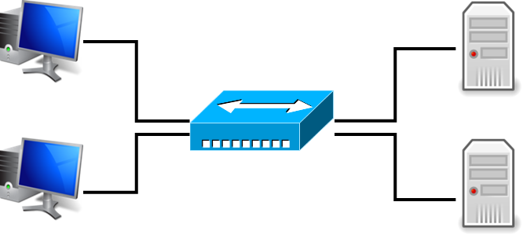

将网线的铜介质直接连在一起，这样就可以多个设备之间传递信号。

集线器在收到一个数据之后，会发送给所有的出口。

不管广播，单播，组播，都是发给所有节点

### 3.1 优点

- 稳定性
- 便宜

### 3.2 缺点

- 不安全
- 无法提供中继

## 4. 交换机

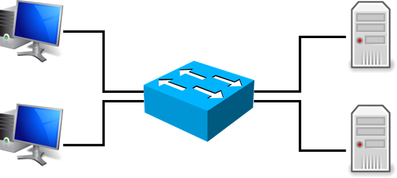

交换机有操作系统，在收到数据之后会根据数据中的目的地址进行准确的转发。

单播会被准确的转发

广播、组播会被泛洪

一个交换机组成的网络，一般是一个局域网，大家可以直接互相访问

## 5. 路由器

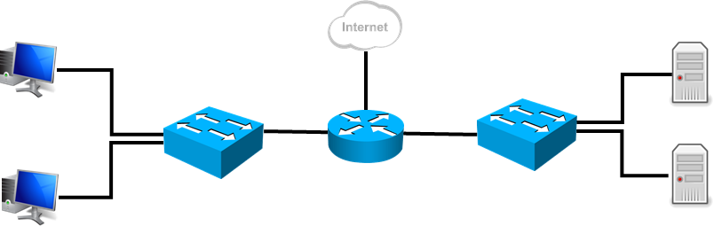

路由器主要用于连接不同的网段，并且负责隔离广播域。

单播会被准确的转发

广播会被拒绝

组播会根据感兴趣组的注册信息，准确转发

## 6. 网络拓扑

- 逻辑拓扑
  - 标注出主要节点的连线，忽略不重要设备
  - 主要节点有可能是虚拟化的

- 物理拓扑
  - 标注出物理设备的连线
  - 主要用于弱点实施

## 7. OSI七层模型

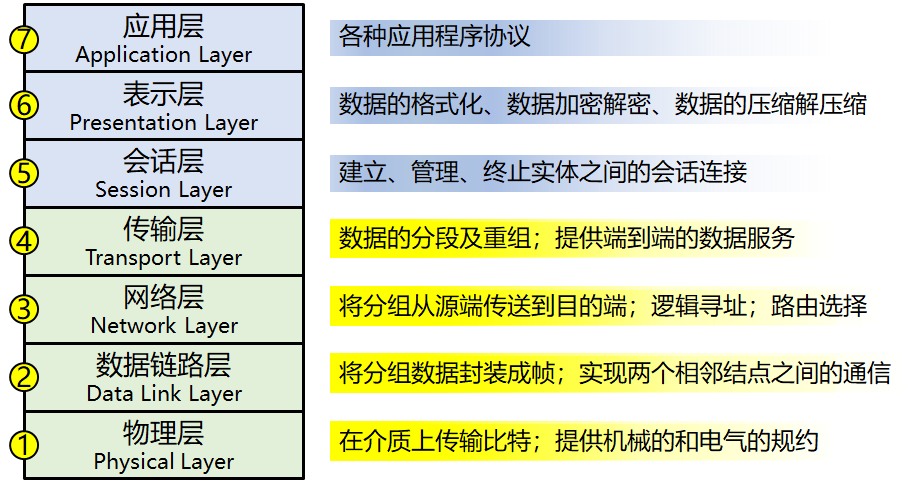

OSI七层模型必须要会背，面试必问。

### 7.1 应用层

提供用户UI接入以及各种应用程序协议

http

dns

ftp

### 7.2 表示层

对数据进行优化处理

格式化，压缩解压缩，加密与解密

### 7.3 会话层

管理不同应用的会话

### 7.4 传输层(段)

数据分段和重组，提供数据传输的方式

1. tcp
   1. 可靠传输
   2. 提供分段的可靠重组
2. udp
   1. 尽力而为的传输

提供应用协议的区分。使用端口号，来让操作系统将数据和进程之间关联。

端口号范围0~65535 

操作系统会预设一些端口号用于访问服务，比如我访问 http://www.ujs.edu.cn/ 

操作系统会根据http协议，去查找应该访问www.ujs.edu.cn地址的端口

查找文件为：`C:\Windows\System32\drivers\etc\services`

面试官有可能会问一些常见服务的端口号，请务必记住

http:80

dns:53

ftp:20、21

dhcp:67、68

telnet:23

ssh:22

### 7.5 网络层(包)

给数据提供远距离传输的机制

提供逻辑地址`IP地址`

ip地址可以让路由器识别数据所属的局域网，然后准确的转发。

ip地址相当于信件上的邮编，可以让邮局分类然后运到所属地区。

### 7.6 数据链路层(帧)

给提供数据在局域网中传输的机制

提供物理地址`mac地址`

mac地址是在网卡出厂的时候烧录到芯片中的，不能被轻易的修改。

mac地址在正规厂家的网卡中是全球独一无二的，mac地址是由48位二进制数组成。

mac地址前24位是组织唯一标识符，由IEEE分配给各个厂家，后24位是厂家自己定义。

为了方便人们记忆，我们将mac地址分成6段，每段8位二进制，然后再转换为16进制。

物理层的数据需要成帧

例：

`ipconfig /all` 可以查看windows的mac地址

`F0-1E-34-11-98-D5`

### 7.7 物理层（位）

定义传输介质的电气标准的

电：RJ45、RJ11、BNC

光：LC、SC、SFP

无线：wifi6

## 8. 数据的封装与解封装

### 8.1 传输层

由于需要分段和重组，以及端口号区分，所以数据必须携带上这些内容

由于这些信息用于控制数据的传递，并且总是加在报文的头部，所以被称为报头

传输层在分段之后，会在每个数据前面加上控制信息，比如源和目的端口号

### 8.2 网络层

数据想要通过路由器传递到远端的网络，就必须要提供目的IP地址，为了收到回复，还必须提供源IP地址。

### 8.3 数据链路层

当数据到达目的地所在的局域网的交换机上的时候，就需要通过mac地址来确认接收的设备网卡

为了收到回复，还必须提供源mac地址

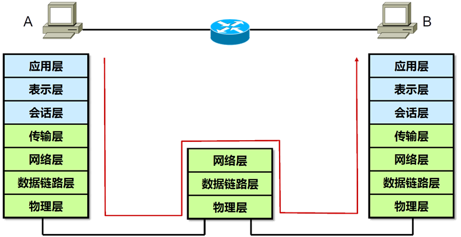

## 9. 分析数据通信

1. 当我们开始访问一个地址的时候，由于并不知道怎么去往网关的MAC地址，所以使用arp协议发起广播查询MAC地址。

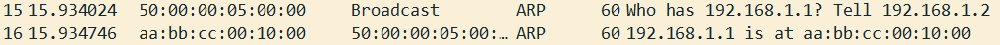

2. PC查到了网关的MAC地址之后，就记录到自己的ARP表中

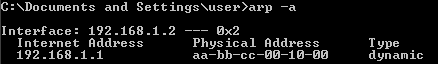

3. 然后将数据封装起来，封装的时候加上每一层的关键信息，比如源和目的端口，源和目的IP地址，源和目的MAC地址。这边要注意，由于我们要去往的目的地是`192.168.3.2`并不是同网段。所以需要借用网关的MAC地址。

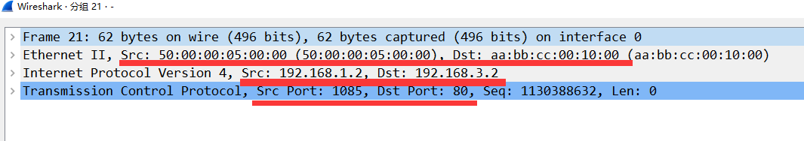

4. 数据从PC发出了之后被交换机收到了，交换机通过数据中Dst-MAC地址查找自己的`mac address table`知道应该从哪个接口离开。

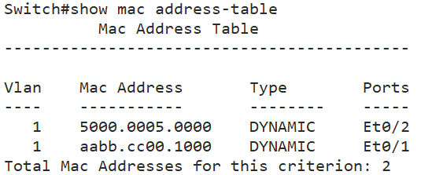

5. 路由器最终收到了这个数据，首先查看目的mac地址，发现是给自己，就解开数据链路层封装，查看网络层的Dst-IP地址，然后对比自己的路由表，查找目的地应该发出的接口

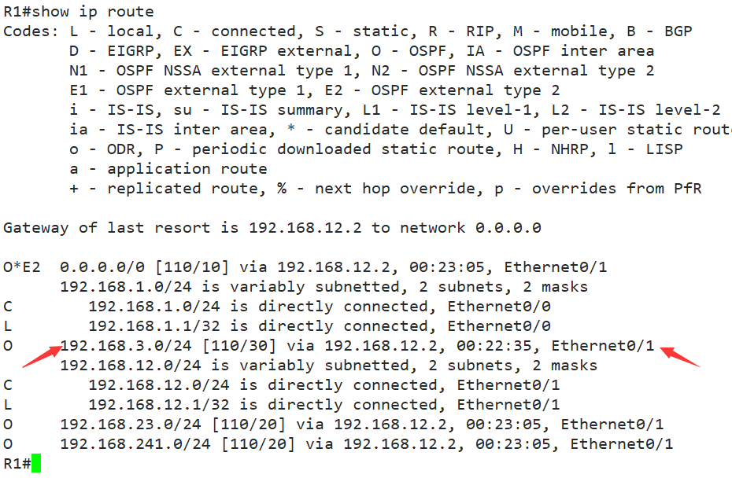

6. 路由器会在这个数据发出去之前，将自己出接口的MAC地址作为源MAC地址，将下一跳设备的MAC地址作为目的MAC地址，重新封装数据链路层，然后发出，后面的路由器收到了之后，重复5、6两步。

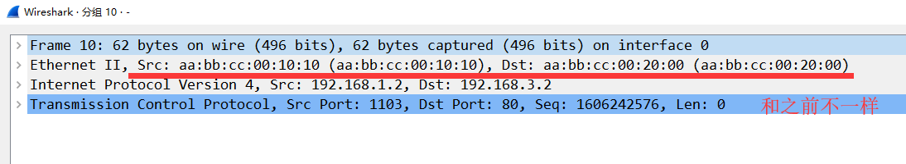

7. 数据在这种不断的封装解封装数据链路层的过程中到达了目的地，最终web服务器收到了这个数据后，发现目的MAC地址，目的IP地址都是自己，并且目的80端口也有进程在监听，最终完成请求的过程。

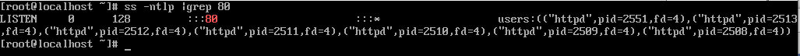

## 10. ARP(地址解析协议)

### 10.1 ARP地址解析协议

知道目的地的IP地址，请求MAC地址的协议

下面是请求的数据

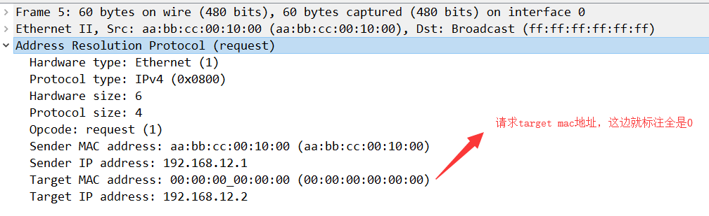

下面是回复的数据

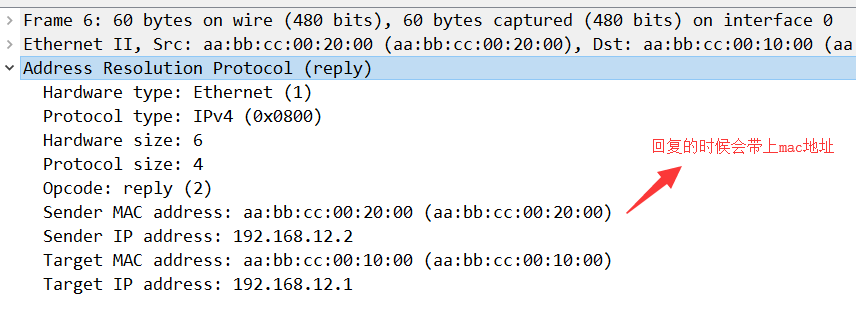

请求方拿到回答之后，会将结果记录在`arp表`中

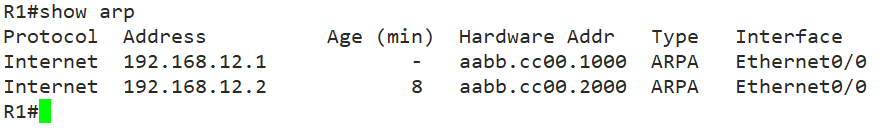

在Cisco的路由器上，arp表中条目会有300分钟的寿命，300分钟后，就会被删除，然后重新请求。

### 10.2 代理ARP

路由器**善意的谎言** 

1. 当路由器收到一个ARP请求，请求的目的地址不是自己的IP，但是自己可以去往这个地方
2. 路由器会给请求方一个回复，回复的内容中会标注你要去往的IP地址的MAC就是我的MAC地址
3. 然后请求方就把数据发送过来

注意！代理ARP并不是所有品牌的路由器都是默认开启的。并且需要路由器查询路由表，发现可以去往请求目的地址的时候，才会触发。

例：下图中R1去`ping 192.168.23.3`的时候，R2就会替`192.168.23.3`做出arp回应

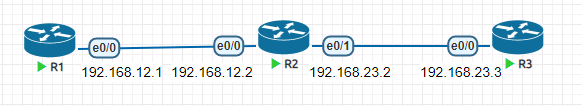

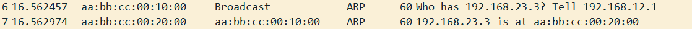

### 10.3 反向ARP

知道自己的MAC地址，但是不知道自己的IP，发起请求IP

类似的功能，还有一种协议:apipa

常用的场景：

- 无盘工作站
- PXE

------------------

## 11. DoD模型

也叫美国国防部模型，是各种面试喜欢问的模型，我们只要背住就行

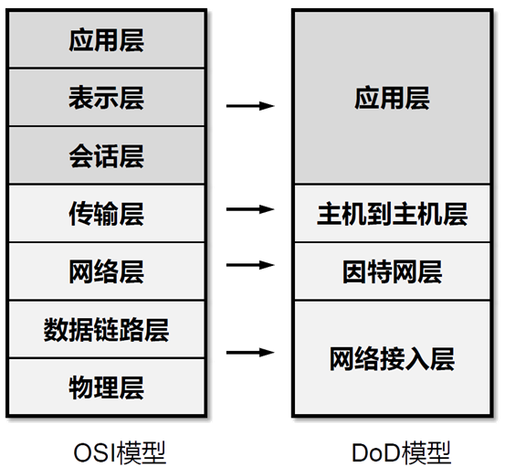

## 12. 传输层

### 12.1 端口号

一个IP地址可以拥有65536个端口号用于区分不同的服务

一般我们认为1023之前的端口号是保留的，并且运行众所周知的服务，可以查看系统的service文件

在发起通信的时候，正常情况下，源端口号是随机端口号，目的端口号由协议确定

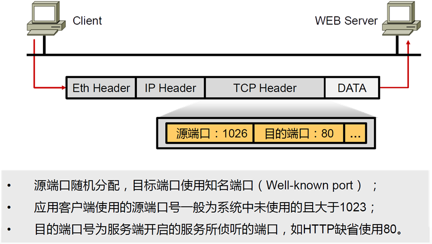

### 12.2 TCP

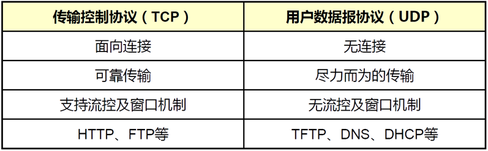

#### 12.2.1 TCP报文结构

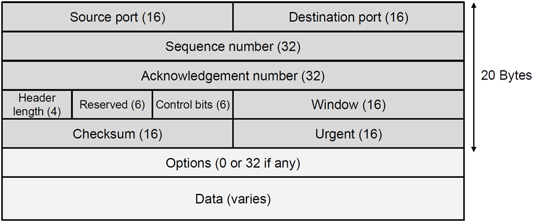

#### 12.2.2 三次握手

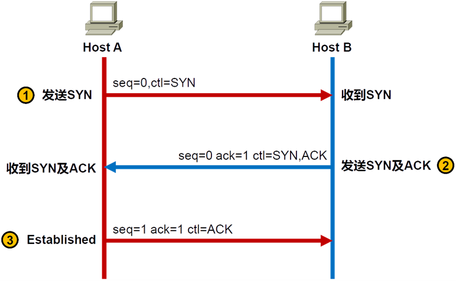

三次握手会导致半开TCP的攻击行为

#### 12.2.3 四次挥手

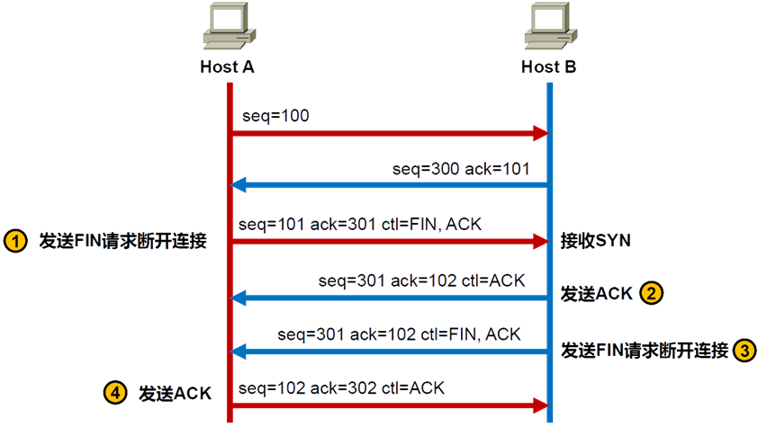

#### 12.2.4 TCP有限状态机

http://aaronxu.eagleslab.com/index.php/archives/229.html

#### 12.2.5 序列号与确认号

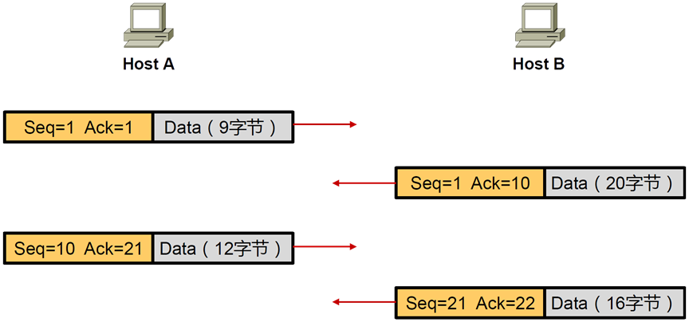

在传递数据的时候，TCP的序列号会加上传递数据的大小成为下一个收到数据的确认号

而确认号会成为下一个收到数据的序列号

通过这种方式保证每个数据都能有序完整的被对方接收

#### 12.2.6 滑动窗口

主要用于流量控制

 http://aaronxu.eagleslab.com/index.php/archives/225.html 

### 12.3 UDP

主要用于对数据的准确性没太高要求，以及对延迟低要求较高的场景

比如:QQ、网游、流媒体

## 13. IP编址

IP地址是32位二进制数组成，用于标识网络上唯一节点

为了方便人们记忆，采用点分十进制，比如IP地址是：

> ‭11000000‬‭10101000‬0000‭1100‬00000001
>
> 加上点之后
>
> 11000000‬‭.10101000‬.0000‭1100.‬00000001
>
> 变成十进制
>
> 192.168.12.1

IP地址32位中，主要是网络位和主机位构成，类似于手机号码前7位是归属地，后面4位是编号

早期的人们为了区分网络位和主机位，对IP地址进行分类

A: 1.0.0.0~126.255.255.255      		如果是这个段的，前8位是网络位

B: 128.0.0.0~191.255.255.255		如果是这个段的，前16位是网络位

C:  192.0.0.0~223.255.255.255		如果是这个段的，前24位是网络位

这样划分IP地址之后，网络位就可以被区分了，但是整个IP地址只有三档。

随着网络的发展，很多公司内部节点的数量，给个C类的地址，主机编号不够分，给个B类的地址，浪费。

后期人们保留ABC类的称呼，但是不再以此作为网络位数的判断，因为出现了子网掩码

### 13.1 子网掩码

子网掩码有32位二进制，和IP地址二进制位数一样的，并且可以和IP地址的二进制一一对应

我们规定子网掩码位是1，说明对应的IP位就是网络位

根据和之前旧的ABC类区分的方式对比，出现了VLSM(可变长子网掩码)、CIDR(地址聚合)

实例：

> VLSM：192.168.1.193   255.255.255.128  可以记作 192.168.1.193/25
>
> CIDR:   192.168.1.1    255.255.0.0    可以记作192.168.1.1/16

### 13.2 广播地址与网络编号

为了方便对局域网的管理，由于需要发广播，或者对整个局域网进行统一称呼，出现了广播地址和网络编号

一个IP地址的主机位全为1，那么这个地址就是广播地址。(这边说的是三层的广播地址，全是ffff的那个是二层广播)。

一个IP地址的主机位全为0，那么这个地址就是网络编号，被用来对整个局域网统一称呼。

广播地址和网络编号都是保留的，不能分配给主机使用。

> 请问下列哪个IP地址可以被主机使用：
>
> A:172.16.1.128/30   网络编号
>
> B:172.16.1.129/30
>
> C:172.16.1.130/30
>
> D:172.16.1.131/30   广播

### 13.3 私有IP地址

所有的IP地址都是由iana.org分配的，但是IPv4地址早就被分配光了

所以规定了私有Ip地址，可以再内网使用，但是不能与公网通信。

> A: 10.0.0.0~10.255.255.255    /8
>
> B:172.16.0.0~172.31.255.255    /12
>
> C:192.168.0.0~192.168.255.255    /16 

当前几乎所有的企业或者家庭内网，都是使用NAT(地址转换)来实现上公网的功能。

