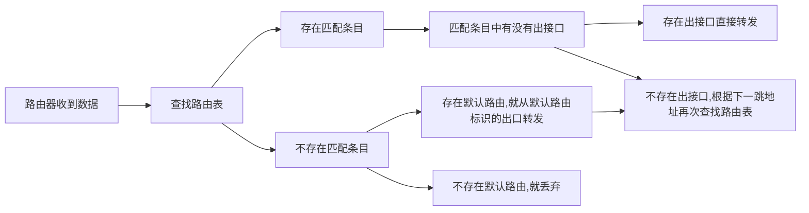

# 03.路由原理

## 1. 路由原理



```
R1#show ip route		# 查看路由表
Codes: L - local, C - connected, S - static, R - RIP, M - mobile, B - BGP
       D - EIGRP, EX - EIGRP external, O - OSPF, IA - OSPF inter area 
       N1 - OSPF NSSA external type 1, N2 - OSPF NSSA external type 2
       E1 - OSPF external type 1, E2 - OSPF external type 2
       i - IS-IS, su - IS-IS summary, L1 - IS-IS level-1, L2 - IS-IS level-2
       ia - IS-IS inter area, * - candidate default, U - per-user static route
       o - ODR, P - periodic downloaded static route, H - NHRP, l - LISP
       a - application route
       + - replicated route, % - next hop override, p - overrides from PfR
# 以上是路由表的提示信息，标识路由条目中出现的代码意思
Gateway of last resort is not set
# 上面这条是表示这个路由器没有默认的路由，当下面的条目与数据中目的地址一个也对不上的时候，就丢弃
# 如果有默认路由，当下面的条目与数据中目的地址一个也对不上的时候，就从默认的路由转发
      192.168.12.0/24 is variably subnetted, 2 subnets, 2 masks    # 为了方便查看，路由表会按照ABC类IP地址进行分类，这个是分类的标题
C        192.168.12.0/24 is directly connected, Ethernet0/0		# 前面的C，可以对照上面的codes,是直连的条目，后面的意思，可以直接从e0/0接口转发
L        192.168.12.1/32 is directly connected, Ethernet0/0
S     192.168.23.0/24 [1/0] via 192.168.12.2		# 前面的S，表示静态，后面并没有表示出接口，只标识了下一跳IP地址，这样就需要再次查找路由表，称为递归查找
```

### 1.1 路由匹配条件

路由表中出现了`192.168.12.0/24`说明：

1. 数据的目的IP地址的二进制，至少前24位要和`192.168.12.0`二进制前24位完全一致。
2. 这边的`/24`不一定和子网掩码是一样的，因为数据包中并不携带子网掩码信息。

### 1.2 路由匹配原则

### 1.3 最长匹配原则

```
R2#sh ip route
	  172.16.0.0/16 is variably subnetted, 2 subnets, 2 masks
S        172.16.0.0/16 [1/0] via 192.168.12.1
S        172.16.3.0/24 [1/0] via 192.168.23.3
      192.168.12.0/24 is variably subnetted, 2 subnets, 2 masks
C        192.168.12.0/24 is directly connected, Ethernet0/0
L        192.168.12.2/32 is directly connected, Ethernet0/0
      192.168.23.0/24 is variably subnetted, 2 subnets, 2 masks
C        192.168.23.0/24 is directly connected, Ethernet0/1
L        192.168.23.2/32 is directly connected, Ethernet0/1
R2#ping 172.16.1.1
Type escape sequence to abort.
Sending 5, 100-byte ICMP Echos to 172.16.1.1, timeout is 2 seconds:
!!!!!
Success rate is 100 percent (5/5), round-trip min/avg/max = 1/4/5 ms
R2#ping 172.16.3.3
Type escape sequence to abort.
Sending 5, 100-byte ICMP Echos to 172.16.3.3, timeout is 2 seconds:
!!!!!
Success rate is 100 percent (5/5), round-trip min/avg/max = 1/3/6 ms
```

`ping 172.16.1.1`的时候，由于只能与第3行的条目匹配，所以数据发给了R1,最终能用通信

`ping 172.16.3.3`的时候，由于第3，4行条目都匹配，路由器会优选匹配最长的条目，也就是第4行，最终能通信

### 1.4 默认路由

当路由条目的匹配长度为0的时候，那么所有的IP地址都是可以匹配的上的，这个路由条目被称为缺省路由，或者默认路由

```
R1(config)#ip route 0.0.0.0 0.0.0.0 192.168.12.2
R1#sh ip route
Gateway of last resort is 192.168.12.2 to network 0.0.0.0
S*    0.0.0.0/0 [1/0] via 192.168.12.2			# 默认路由在路由表中会带上*号
      172.16.0.0/16 is variably subnetted, 2 subnets, 2 masks
C        172.16.1.0/24 is directly connected, Loopback0
L        172.16.1.1/32 is directly connected, Loopback0
      192.168.12.0/24 is variably subnetted, 2 subnets, 2 masks
C        192.168.12.0/24 is directly connected, Ethernet0/0
L        192.168.12.1/32 is directly connected, Ethernet0/0
S     192.168.23.0/24 [1/0] via 192.168.12.2
R1#ping 172.16.3.3
Type escape sequence to abort.
Sending 5, 100-byte ICMP Echos to 172.16.3.3, timeout is 2 seconds:
!!!!!
Success rate is 100 percent (5/5), round-trip min/avg/max = 1/1/1 ms
```

在`ping 172.16.3.3`的时候，可以和路由表中的默认路由匹配的上。

在`ping 192.168.23.3`的时候，根据最长匹配原则，会和第11行匹配上

### 1.5 路由条目的来源

* 直连接口
  * 必须要是双`up`状态,才能生效
* 静态路由
  * 必须出接口或者下一跳IP地址有效
* 动态路由学习
  * 通过各种路由协议，让路由器互相分享路由信息

## 2. 环回接口

环回接口是软件模拟出来的接口，用于测试，或者管理

环回接口正常情况下是不会`down`，只要操作系统可以正常开机，那么环回接口就可以正常`up`

一台设备往往可以启动很多很多环回接口，用于模拟网络

```
R1(config)#interface loopback 0
R1(config-if)#ip add 172.16.1.1 255.255.255.0
R1#show ip interface brief 			# 查看接口的IP地址和状态
Interface                  IP-Address      OK? Method Status                Protocol
Ethernet0/0                192.168.12.1    YES manual up                    up      
Ethernet0/1                unassigned      YES unset  administratively down down    
Ethernet0/2                unassigned      YES unset  administratively down down    
Ethernet0/3                unassigned      YES unset  administratively down down    
Loopback0                  172.16.1.1      YES manual up                    up
```


