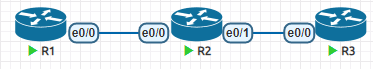
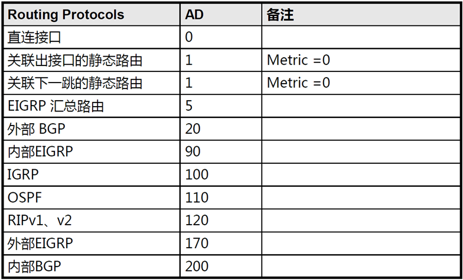
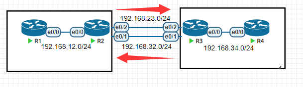
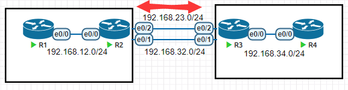

# 04.静态路由

## 1. 静态路由

- 在少量网段并且相对固定的时候可以使用静态路由
- 临时测试的时候

## 2. 实验



### 2.1 配置IP地址

```
R1
en
conf t
int e0/0
ip add 192.168.12.1 255.255.255.0
no sh
end
============================
R2
en
conf t
int e0/0
ip add 192.168.12.2 255.255.255.0
no sh
int e0/1
ip add 192.168.23.2 255.255.255.0
no sh
end
=============================
R3
en
conf t
int e0/0
ip add 192.168.23.3 255.255.255.0
no sh
end
```

在R2上可以检查到R1或者R3的连通性，确保IP地址配置正确

```
R2#ping 192.168.12.1
Type escape sequence to abort.
Sending 5, 100-byte ICMP Echos to 192.168.12.1, timeout is 2 seconds:
.!!!!
Success rate is 80 percent (4/5), round-trip min/avg/max = 1/3/5 ms
R2#ping 192.168.23.3
Type escape sequence to abort.
Sending 5, 100-byte ICMP Echos to 192.168.23.3, timeout is 2 seconds:
.!!!!
Success rate is 80 percent (4/5), round-trip min/avg/max = 1/1/2 ms
```

如果IP地址配置不正确，出现了问题，可以再每台设备上使用如下命令检查

```
R2#show ip int br
Interface                  IP-Address      OK? Method Status                Protocol
Ethernet0/0                192.168.12.2    YES manual up                    up      
Ethernet0/1                192.168.23.2    YES manual up                    up      
Ethernet0/2                unassigned      YES unset  administratively down down    
Ethernet0/3                unassigned      YES unset  administratively down down
```

### 2.2 检查R1和R3的联通性

```
R1#ping 192.168.23.3
Type escape sequence to abort.
Sending 5, 100-byte ICMP Echos to 192.168.23.3, timeout is 2 seconds:
.....
Success rate is 0 percent (0/5)
```

检查R1的路由表

```
R1#show ip route
      192.168.12.0/24 is variably subnetted, 2 subnets, 2 masks
C        192.168.12.0/24 is directly connected, Ethernet0/0
L        192.168.12.1/32 is directly connected, Ethernet0/0
```

发现`192.168.23.3`没有匹配条目

在R1上加上静态路由，告知R1如果想去往`192.168.23.0/24`需要从e0/0接口发出

```
R1(config)#ip route 192.168.23.0 255.255.255.0 e0/0
```

然而还是不通，因为R3并没有返回`192.168.12.0/24`的路由，导致R3只能收到R1的消息，但是不能回复

```
R3(config)#ip route 192.168.12.0 255.255.255.0 e0/0
```

现在三台路由器都知道了`192.168.12.0/24`和`192.168.23.0/24`两个网段的去法

```
R1#ping 192.168.23.3
Type escape sequence to abort.
Sending 5, 100-byte ICMP Echos to 192.168.23.3, timeout is 2 seconds:
..!!!
Success rate is 60 percent (3/5), round-trip min/avg/max = 1/1/1 ms
```

### 2.3 ARP在这个过程中

通过检查R1的arp表，我们可以发现`192.168.23.3`的arp结果和`192.168.12.2`的一样

```
R1#show arp
Protocol  Address          Age (min)  Hardware Addr   Type   Interface
Internet  192.168.12.1            -   aabb.cc00.1000  ARPA   Ethernet0/0
Internet  192.168.12.2            5   aabb.cc00.2000  ARPA   Ethernet0/0
Internet  192.168.23.3            0   aabb.cc00.2000  ARPA   Ethernet0/0
```

上面这种情况是代理ARP产生的，如果R1并不是去往R3，而是作为局域网连接外网网关，那么访问的目的地址可能无数个。这种情况下，会导致ARP结果越来越多，影响效率。

```
R1(config)#ip route 0.0.0.0 0.0.0.0 e0/0    # 在R1配置默认路由，模拟R1的e0/0接口是外网
R1#ping 192.168.23.4
Type escape sequence to abort.
Sending 5, 100-byte ICMP Echos to 192.168.23.4, timeout is 2 seconds:
..
Success rate is 0 percent (0/2)
R1#show arp
Protocol  Address          Age (min)  Hardware Addr   Type   Interface
Internet  123.123.123.123         0   aabb.cc00.2000  ARPA   Ethernet0/0
Internet  192.168.12.1            -   aabb.cc00.1000  ARPA   Ethernet0/0
Internet  192.168.12.2            9   aabb.cc00.2000  ARPA   Ethernet0/0
Internet  192.168.23.3            4   aabb.cc00.2000  ARPA   Ethernet0/0
Internet  192.168.23.4            0   aabb.cc00.2000  ARPA   Ethernet0/0
```

发现不管去往什么地址，都会导致ARP表多出一条。

检查路由表

```
R1#show ip route
S*    0.0.0.0/0 is directly connected, Ethernet0/0		# 发现默认路由条目一次查找，就知道出口了
      192.168.12.0/24 is variably subnetted, 2 subnets, 2 masks
C        192.168.12.0/24 is directly connected, Ethernet0/0
L        192.168.12.1/32 is directly connected, Ethernet0/0
S     192.168.23.0/24 is directly connected, Ethernet0/0
```

如果数据目的IP地址在路由表中直接能找到出接口，就回直接封装然后转发，如果没有MAC地址的记录，就会触发ARP。

如果静态路由尝试用下一跳IP地址作为出站线索，触发路由表递归查询

```
R1(config)#ip route 192.168.23.0 255.255.255.0 192.168.12.2
R1#sh ip route
      192.168.12.0/24 is variably subnetted, 2 subnets, 2 masks
C        192.168.12.0/24 is directly connected, Ethernet0/0
L        192.168.12.1/32 is directly connected, Ethernet0/0
S     192.168.23.0/24 [1/0] via 192.168.12.2
R1#ping 192.168.23.3
Type escape sequence to abort.
Sending 5, 100-byte ICMP Echos to 192.168.23.3, timeout is 2 seconds:
!!!!!
Success rate is 100 percent (5/5), round-trip min/avg/max = 1/1/1 ms
R1#sh arp
Protocol  Address          Age (min)  Hardware Addr   Type   Interface
Internet  192.168.12.1            -   aabb.cc00.1000  ARPA   Ethernet0/0
Internet  192.168.12.2            0   aabb.cc00.2000  ARPA   Ethernet0/0
```

如果静态路由配置下一跳的IP地址作为出站线索，那么就会触发路由表递归查找，而最终不仅仅是找到了出口信息，同时还找到了下一跳IP地址的MAC地址，直接会被拿来作为数据链路层的目的MAC地址。

### 2.4 结论

在配置静态路由的时候，尽量配置下一跳IP地址作为出口，这样可以避免ARP表的增大。

## 3. 路由汇总

为了测试，在R1上配置多个loopback接口，用于模拟多个网段

```
R1#sh ip int br
Interface                  IP-Address      OK? Method Status                Protocol
Ethernet0/0                192.168.12.1    YES manual up                    up      
Ethernet0/1                unassigned      YES unset  administratively down down    
Ethernet0/2                unassigned      YES unset  administratively down down    
Ethernet0/3                unassigned      YES unset  administratively down down    
Loopback1                  172.16.1.1      YES manual up                    up      
Loopback2                  172.16.2.1      YES manual up                    up      
Loopback3                  172.16.3.1      YES manual up                    up 
```

这些地址配置的都是/24,但是我们发现前16位都是一样的，那么R2上可以写如下的汇总静态路由

```
R2(config)#ip route 172.16.0.0 255.255.0.0 192.168.12.1
```

汇总路由可以精简路由条目，加快了查找效率

但是汇总路由也会导致明细的丢失，造成不必要的路由转发

## 4. 路由器的配置保存与查看

当上面的实验做完了，检查网络状态都可以，就可以保存配置了

```
R1#copy running-config startup-config	# 把内存中的配置文件，保存到开机启动配置文件中
R1#write
```

在配置的时候，可以查看当前的配置文件

```
R1#show running-config 		# 然后按空格翻页，按q退出
R1#show run int e0/0		# 查看接口e0/0下的配置
R1#show running-config | section ip route	# 查看有ip route的那一行配置
```

正常情况下，`ping`,`show`,`write`等命令只能在特权模式下(#)或者用户模式下(>)使用，如果想在各种配置模式中使用这些命令，可以在命令前面加个`do`来调用

```
R1(config)#show ip route
             ^
% Invalid input detected at '^' marker.

R1(config)#do show ip route		# 前面加do可以调用非配置模式下的命令
```

## 5. 管理距离

当路由器从不同的方式学到了同一条路由条目，由于路由器只能将最佳路由放在路由表中。所以会从多个可用条目中将最佳结果放入路由表。

路由器使用管理距离去评判路由获得方式优劣。



注意！上表是cisco设备的管理距离，每个品牌都会有些不一样，用的时候需要去查一下。

这个管理距离只是设备自己这么认为，无法影响其他设备，所以必要的时候，我们可以去修改，而不用担心全网的影响。越小越优。不优的不会出现在路由表中。

```
S     192.168.23.0/24 [1/0] via 192.168.12.2
# 这个条目中[1/0]里面1是管理距离，是用来判断同一个路由的不同来源的优先级
R1#show ip route 192.168.23.0
Routing entry for 192.168.23.0/24
  Known via "static", distance 1, metric 0		# 管理距离是1，度量值是0
  Routing Descriptor Blocks:
  * 192.168.12.2
      Route metric is 0, traffic share count is 1
```

## 6. 浮动静态路由

浮动静态路由是通过修改管理距离的方式，让静态路由可以做到控制路径，在发生故障的时候，也能切换。

两个路线都正常的情况下



当下面的路线断开之后



先配置IP地址

```
R1
int e0/0
ip add 192.168.12.1 255.255.255.0
no sh
==========================
R2
int e0/0
ip add 192.168.12.2 255.255.255.0
no sh
int e0/2
ip add 192.168.23.2 255.255.255.0
no sh
int e0/1
ip add 192.168.32.2 255.255.255.0
no sh
===========================
R3
int e0/0
ip add 192.168.34.3 255.255.255.0
no sh
int e0/2
ip add 192.168.23.3 255.255.255.0
no sh
int e0/1
ip add 192.168.32.3 255.255.255.0
no sh
==========================
R4
int e0/0
ip add 192.168.34.4 255.255.255.0
no sh
```

配置静态路由

```
R1(config)#ip route 0.0.0.0 0.0.0.0 192.168.12.2
==================================
R2(config)#ip route 192.168.34.0 255.255.255.0 192.168.23.3
R2(config)#ip route 192.168.34.0 255.255.255.0 192.168.32.3 2
===================================
R3(config)#ip route 192.168.12.0 255.255.255.0 192.168.23.2 2
R3(config)#ip route 192.168.12.0 255.255.255.0 192.168.32.2
==================================
R4(config)#ip route 0.0.0.0 0.0.0.0 192.168.34.3
```

检查在线路正常的时候访问的路径

```
R1#traceroute 192.168.34.4
Type escape sequence to abort.
Tracing the route to 192.168.34.4
VRF info: (vrf in name/id, vrf out name/id)
  1 192.168.12.2 1 msec 0 msec 1 msec
  2 192.168.23.3 1 msec 1 msec 0 msec
  3 192.168.34.4 1 msec *  1 msec
==========================
R4#traceroute 192.168.12.1
Type escape sequence to abort.
Tracing the route to 192.168.12.1
VRF info: (vrf in name/id, vrf out name/id)
  1 192.168.34.3 0 msec 1 msec 1 msec
  2 192.168.32.2 0 msec 1 msec 1 msec
  3 192.168.12.1 0 msec *  3 msec
```

下面关闭R2的e0/2口，来模拟线路有一个损坏，再次检查线路是否切换

```
R1#traceroute 192.168.34.4
Type escape sequence to abort.
Tracing the route to 192.168.34.4
VRF info: (vrf in name/id, vrf out name/id)
  1 192.168.12.2 5 msec 5 msec 5 msec
  2 192.168.32.3 1 msec 5 msec 5 msec
  3 192.168.34.4 1 msec *  1 msec
```

## 7. 负载均衡

当去往同一个路由条目有多个出口的时候，并且管理距离和度量值都是一样的，也就是说路由器分辨不出来哪个路径好坏。路由器会将这些路线全部加到路由表中，进行等价负载均衡。

```
R2(config)#ip route 100.0.0.0 255.0.0.0 192.168.12.1
R2(config)#ip route 100.0.0.0 255.0.0.0 192.168.23.3
R2(config)#do sh ip route
.........
S     100.0.0.0/8 [1/0] via 192.168.23.3
                  [1/0] via 192.168.12.1
........
```

比如：100.0.0.0/8就有两个下一跳IP地址，并且都是`[1/0]`，所以全部加入了路由表，在发数据的时候，会将数据包一个IP地址发一个。可以通过如下命令查看下次往哪里走。

```
R2(config)#do sh ip route 100.0.0.0
Routing entry for 100.0.0.0/8
  Known via "static", distance 1, metric 0
  Routing Descriptor Blocks:
    192.168.23.3
      Route metric is 0, traffic share count is 1
  * 192.168.12.1			# 前面的*表示下一个IP包将发到这个地址
      Route metric is 0, traffic share count is 1
R2#ping 100.1.1.1 repeat 1
Type escape sequence to abort.
Sending 1, 100-byte ICMP Echos to 100.1.1.1, timeout is 2 seconds:
!			# 100.1.1.1只有R1有，所以这次通了
Success rate is 100 percent (1/1), round-trip min/avg/max = 2/2/2 ms
R2#show ip route 100.0.0.0
Routing entry for 100.0.0.0/8
  Known via "static", distance 1, metric 0
  Routing Descriptor Blocks:
  * 192.168.23.3		#　由于192.168.12.1上次才发过数据包，所以下次走192.168.23.3
      Route metric is 0, traffic share count is 1	# 这个是线路共享比例，等价负载均衡是1:1
    192.168.12.1
      Route metric is 0, traffic share count is 1
R2#ping 100.1.1.1 repeat 1
Type escape sequence to abort.
Sending 1, 100-byte ICMP Echos to 100.1.1.1, timeout is 2 seconds:
U		# 100.1.1.1只有R1有，所以这次不通
Success rate is 0 percent (0/1)
```

负载均衡在企业的应用中非常的广泛，可以用于提升链路的可靠性，提升链路的速率。

