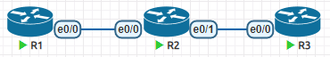
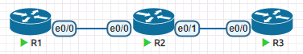
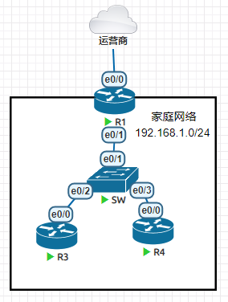

# 05.ACL

## 1. ACL(access control list)

### 1.1 作用

- 对流量进行过滤
- 对路由条目进行过滤

### 1.2 类型

- 标准访问控制列表
- 扩展访问控制列表

### 1.3 标准访问控制列表

1. 只能对流量的源IP地址进行抓取
2. 只能对经过本设备的流量进行过滤，如果是本设备始发的流量，就无法限制
3. 一个访问控制列表可以写多个规则，流量按照顺序一条条匹配，如果匹配上了，就执行动作，不会继续匹配下去
4. 访问控制列表最后会隐含一条拒绝所有，意思是，如果有流量在这个ACL中一个条件都没匹配的上，最终会被拒绝。



在上图中，如果我们想拒绝R1的`192.168.12.1`去访问R3的`192.168.23.3`，那么我们可以这样设置

```
R2(config)#access-list 1 deny host 192.168.12.1
R2(config)#access-list 1 permit any		# 我们针对性过滤源IP是192.168.12.1的，其他的放行
R2#show ip access-lists 			# 查看访问控制列表
Standard IP access list 1		# 访问控列表1里面的规则
    10 deny   192.168.12.1			# 前面的10是顺序，默认以10递增，方便后续维护的时候插入规则
    20 permit any
R2(config)#int e0/0
R2(config-if)#ip access-group 1 in		# 必须在接口上调用这个ACL，才能生效，需要注意方向in
```

标准访问控制列表由于只能针对IP地址做的过滤，所以越靠近源头，影响网络可达性越大，我们在真实使用的时候尽量靠近目的地。

注意，无法限制自己本身始发的流量。

### 1.4 扩展的访问控制列表

1. 只能对经过本设备的流量进行过滤，如果是本设备始发的流量，就无法限制
2. 可以针对源IP目的IP进行匹配和过滤，并且还能识别不同的数据流量，做针对性的过滤
3. 一个访问控制列表可以写多个规则，流量按照顺序一条条匹配，如果匹配上了，就执行动作，不会继续匹配下去
4. 访问控制列表最后会隐含一条拒绝所有，意思是，如果有流量在这个ACL中一个条件都没匹配的上，最终会被拒绝。



想让R1无法实现`ping 192.168.23.3`但是又可以`telnet 192.168.23.3`

```
R2(config)#access-list 100 deny icmp host 192.168.12.1 host 192.168.23.3 echo
# 其中icmp部分是选择协议
# 其中host 192.168.12.1是源IP地址
# 其中host 192.168.23.3是目的IP地址
# 其中echo是icmp中的一种数据报文类型
R2(config)#access-list 100 permit ip any any
R2(config)#interface Ethernet0/0
R2(config-if)#ip access-group 100 in
```

因为扩展的访问控制列表可以精确的匹配源和目的IP地址，所以我们在配置的时候尽量靠近源，避免不必要的转发。

修改访问控制列表条目

```
R2(config)#ip access-list extended 100
R2(config-ext-nacl)#no 10		# 删除第10条规则
R2(config-ext-nacl)#10 deny tcp 192.168.12.0 0.0.0.255 host 192.168.23.3 eq telnet
R2#sh ip access-lists 
Extended IP access list 100
    10 deny tcp 192.168.12.0 0.0.0.255 host 192.168.23.3 eq telnet
    20 permit ip any any (15 matches)
```

## 2. 配置设备远程访问

在目标主机上配置

```
line vty 0 4			# 开启虚拟控制台0~4
 password cisco			# 配置登录密码cisco
 login					# 开启密码校验
 transport input telnet		# 允许telnet协议
```

验证登录

```
R1#telnet 192.168.23.3
Trying 192.168.23.3 ... Open

User Access Verification

Password: 
R3>
R3>
R3>q

[Connection to 192.168.23.3 closed by foreign host]
```

telnet是一种远程终端协议，使用端口号23/tcp。

## 3. NAT( Network Address Translation )

## 4. 作用

- 可以让私有IP地址段的网络去访问公共网络
- 可以充当防火墙，保护内网的安全，因为公共网络无法直接访问内部的地址
- 解决地址冲突
- 发布内网的服务
- 负载均衡

## 5. PAT的配置



### 5.1 配置PC和路由器的IP地址

```
R1
int e0/0
ip add dhcp
no sh
int e0/1
ip add 192.168.1.1 255.255.255.0
no sh
==================================
R3
int e0/0
ip add 192.168.1.3 255.255.255.0
no sh
no ip routing			# 关闭路由功能，让路由器更好的冒充PC
===================================
R4
int e0/0
ip add 192.168.1.4 255.255.255.0
no sh
no ip routing
```

### 5.2 在网关路由器R1上配置pat

```
access-list 1 permit 192.168.1.0 0.0.0.255
ip nat inside source list 1 interface Ethernet0/0 overload
interface Ethernet0/0
 ip nat outside
interface Ethernet0/0
 ip nat inside
```

### 5.3 测试

```
PC1#ping 149.129.69.210
Type escape sequence to abort.
Sending 5, 100-byte ICMP Echos to 149.129.69.210, timeout is 2 seconds:
!!!!!
Success rate is 100 percent (5/5), round-trip min/avg/max = 54/256/1063 ms
PC2#ping 149.129.69.210
Type escape sequence to abort.
Sending 5, 100-byte ICMP Echos to 149.129.69.210, timeout is 2 seconds:
!!!!!
Success rate is 100 percent (5/5), round-trip min/avg/max = 63/65/67 ms
```

### 5.4 查看R1网关上的NAT表

```
R1#show ip nat translations 
Pro Inside global      Inside local       Outside local      Outside global
icmp 192.168.241.142:1 192.168.1.3:1      149.129.69.210:1   149.129.69.210:1
tcp 192.168.241.142:25695 192.168.1.3:25695 149.129.69.210:22 149.129.69.210:22
tcp 192.168.241.142:30610 192.168.1.3:30610 149.129.69.210:22 149.129.69.210:22
```

我们可以看到`192.168.1.3`最终被转换为`192.168.241.142`( 这个实验中的公网IP)

### 5.5 NAT带来的问题

如果内网搭建了服务，无法提供对外访问

- 端口映射
- 使用反向代理
- p2p隧道

