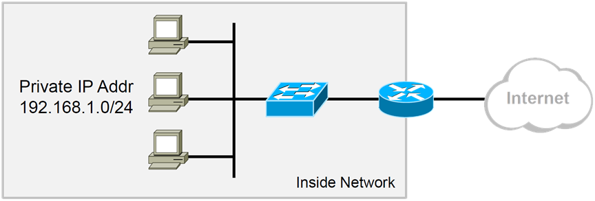
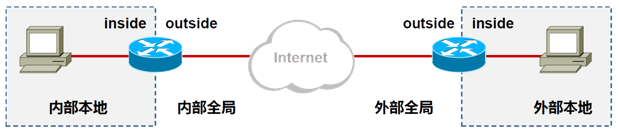
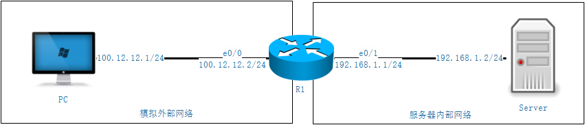
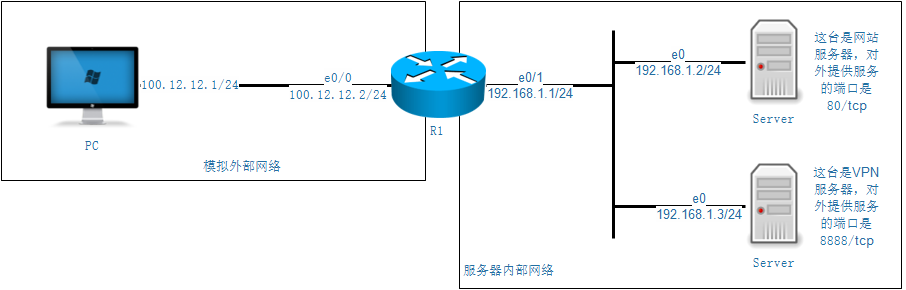
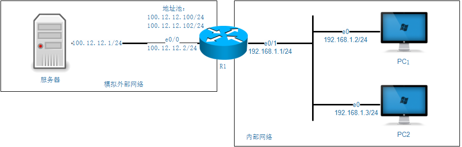
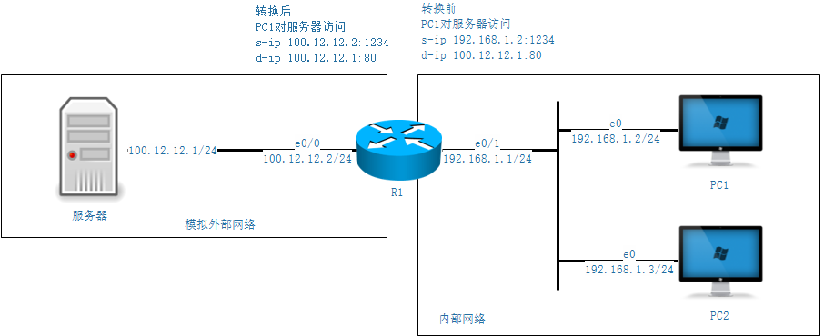
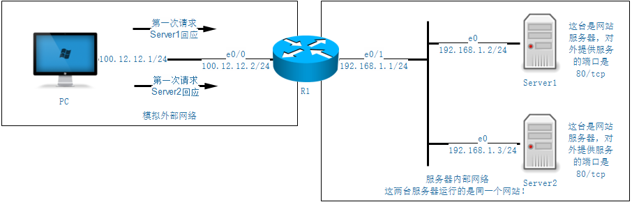

# 06.NAT

## 1. NAT技术背景



- 私有IP地址的定义极大程度的缓解了IPv4地址紧缺的问题。
- 私有IP地址可以在本地局域网、私有网络内部随意使用，但是这些地址在公网上是不可被路由的，因此私有IP地址无法直接访问公网。
- NAT网络地址转换技术能够将数据包中的IP地址进行转换。

## 2. 私有IPv4地址空间

10.0.0.0 -10.255.255.255

172.16.0.0 -172.31.255.255

192.168.0.0 -192.168.255.255

## 3. NAT优缺点

|                 优点                 |                 缺点                  |
| :----------------------------------: | :-----------------------------------: |
|            节省IP地址空间            |             增加转发延迟              |
|          解决IP地址重叠问题          |         丧失端到端的寻址能力          |
|     增加网络的连入Internet的弹性     |           某些应用不支持NAT           |
| 网络变更的时候减少IP重编址带来的麻烦 | 需要一定的内存空间支持动态存储NAT表项 |
|   对外隐藏内部地址，增加网络安全性   |  需要耗费一定CPU内存资源进行NAT操作   |

## 4. NAT术语

| 术语     | 英文           | 解释             |
| -------- | -------------- | ---------------- |
| 内部本地 | inside local   | 转换之前源地址   |
| 外部本地 | outside local  | 转换之前目的地址 |
| 内部全局 | inside global  | 转换之后源地址   |
| 内部全局 | outside global | 转换之后目的地址 |

`inside`表示源地址，`outside`表示目的地址

`local`表示转换之前,`global`表示转换之后



## 5. 静态NAT

一对一映射，为每个内部的地址指定一个公网IP地址。

这种方法主要用在内网中存在需要对公网提供服务的服务器的场景，类似的例子有WEB服务器、邮件服务器、FTP服务器等  

### 5.1 配置命令

```
Router(config)# ip nat inside source static local-ip global-ip
Router(config-if)# ip nat inside
Router(config-if)# ip nat outside
Router# show ip nat translations
```



上图所示R1作为服务器内部网络的路由器，拥有公网IP地址`100.12.12.2`，如果想要发布内部的服务到公网那么需要进行如下配置。

```
int e0/0
ip nat outside
int e0/1
ip nat inside
ip nat inside source static 192.168.1.2 100.12.12.10
```

这样配置之后，当pc访问`100.12.12.10`就相当于访问服务器，完全忽视掉路由器的存在。

不过这样做比较浪费IP地址，因为一台服务器占用一整个IP地址，如果服务器数量比较多，这样就需要租用多个IP地址。

最好的做法是端口的一对一映射，这样的做法比较常见。



上图中，两台服务器其实只需要一个端口号对外提供服务即可，并不需要完整的使用一整个IP地址，所以可以在R1上进行如下配置。

```
int e0/0
ip nat outside
int e0/1
ip nat inside
ip nat inside source static tcp 192.168.1.2 80 interface e0/0 80
ip nat inside source static tcp 192.168.1.3 8888 interface e0/0 8888
```

## 6. 基于地址池的源地址转换

定义一个IP地址池，里面放了多个公网IP地址，然后分配给内网需要上公网的主机用。

这样的做法个人认为比较土豪，而且并与下面提到的PAT比起来并没有任何优势，反而安全性有问题。容易暴露IP，造成短时间内的不安全。

### 6.1 配置

```
Router(config)# ip nat pool namestart-ip end-ip {netmasknetmask|prefix-lengthprefix-length}
Router(config-if)# access-list acl-numpermit source[source-wildcard]
Router(config-if)# ip nat inside source list acl-numpool name
Router(config-if)# ip nat inside
Router(config-if)# ip nat outside
```



上图中，内部网络的两台PC在访问服务器的时候会借用地址池里面的地址进行访问，不过当地址池的地址小于内部主机地址数量的时候，会出现后面发起访问的PC无法获取转换地址，导致无法上网。

R1上的核心配置如下

```
ip nat pool natpool 100.12.12.100 100.12.12.102 netmask 255.255.255.0
access-list 1 permit 192.168.1.0 0.0.0.255
ip nat inside source list 1 pool natpool
int e0/0
ip nat outside
int e0/1
ip nat inside
```

## 7. PAT

对数据包的源地址和端口均进行转换，通过这种转换，可以使多个内部本地地址同时共享同一个公网地址  。

这种NAT也是现在用的最多的，无论是企业还是家庭网络，因为成本的原因，都是一个公网IP地址需要承担内部网络众多主机的转换需求。



观察PC1去访问服务器的时候地址的转换情况，我们会发现源IP地址被路由器替换为出接口的IP地址，并且端口号也有可能会被替换，具体的看你需要的端口号是不是被占用。

当数据到达服务器之后，服务器就可以对数据包的源IP地址进行回复了，数据包回到路由器上之后，路由器再对照之前的NAT转换记录，将数据包发回`192.168.1.2:1234`，从而完成通信。

```
access-list 1 permit 192.168.1.0 0.0.0.255
ip nat inside source list 1 interface e0/0 overload
int e0/0
ip nat outside
int e0/1
ip nat inside
```

## 8. TCP负载均衡

通过静态NAT部分的介绍，我们知道路由器可以承担为路由器发布服务的功能，当我们访问路由器IP的时候，路由器可以帮助我们将请求转发到内部的服务器上。

我们可以将内部的服务相同用于冗余的服务器地址作为地址池，这样当我们从外部访问路由器IP地址的时候，路由器就可以将池中的服务器轮流作为回应的设备，从而实现负载均衡，减少单台服务器的压力。



如上图，PC第一次访问`100.12.12.2`地址的时候，是`server1`进行回应。当PC第二次访问`100.12.12.2`的时候，是`server2`回应。

R1的关键配置如下:

```
access-list 1 permit 100.12.12.2   # 用于匹配目的IP地址
ip nat pool natpool 192.168.1.2 192.168.1.3 netmask 255.255.255.0 type rotary
# 这边设置的池类型是rotary,意思是旋转的，为了更好的看到实验效果
# 默认的池类型是match-host，也就是同一个源IP地址，始终是同一台服务器响应
ip nat inside destination list 1 pool natpool
```

## 9. NAT维护命令

清除所有动态NAT表项

```
Router# clear ip nat translation *
```

清除特定的NAT表项

```
Router# clear ip nat translation ?
```

