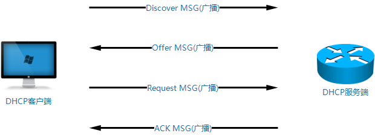
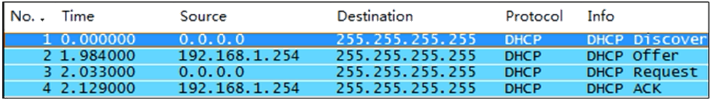
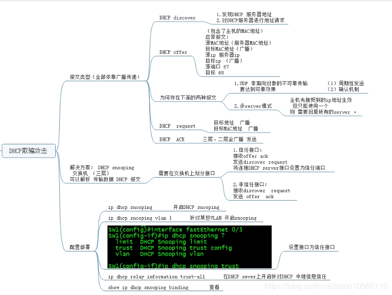
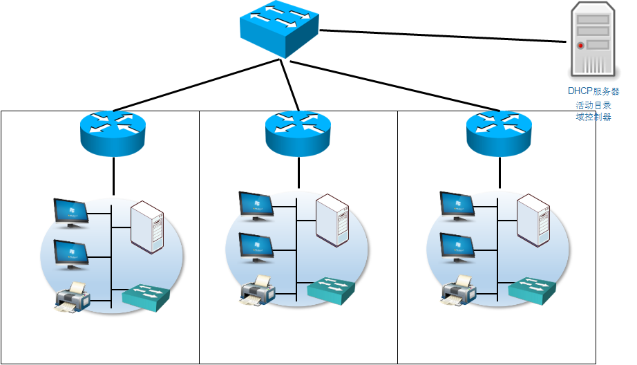
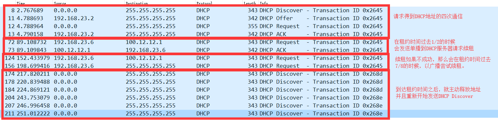

# 07.DHCP

## 1. DHCP理论

 DHCP (Dynamic Host configuration Protocol,动态主机配置协议 ) 

是一个局域网的网络协议，使用UDP协议工作；
主要有两个用途：

1. 用于内部网或网络服务供应商自动分配IP地址；
2. 给用户用于内部网管理员作为对所有计算机作中央管理的手段。 

功能简述：它主要是通过客户端发送广播数据包给整个物理网段内的所有主机，若局域网内有DHCP服务器时，才会响应客户端的IP参数要求。

### 1.1 DHCP服务器的需求

1. 拥有真实物理网卡，或者连接广播域的真实物理网卡
2. 该接口或者该物理网卡必须有一个合理的ip地址 此IP地址最好手动配置；

### 1.2 DHCP的服务端和客户端

服务端：负责在所创建的地址池中向申请地址的客户端分发地址；服务端口号67
客户端：接收地址 服务端口号68 





### 1.3 DHCP欺骗攻击

  

### 1.4 DHCP三种分配机制

| 分配方式                             | 说明                                                         |
| ------------------------------------ | ------------------------------------------------------------ |
| 自动分配方式（Automatic Allocation） | DHCP服务器为主机指定一个永久性的IP地址，一旦DHCP客户端第一次成功从DHCP服务器端租用到IP地址后，就可以永久性的使用该地址。 |
| 动态分配方式（Dynamic Allocation）   | DHCP服务器给主机指定一个具有时间限制的IP地址，时间到期或主机明确表示放弃该地址时，该地址可以被其他主机使用。 |
| 手工分配方式（Manual Allocation）    | 客户端的IP地址是由网络管理员指定的，DHCP服务器只是将指定的IP地址告诉客户端主机。 |

## 2. DHCP配置

```
Router(config)#server dhcp
# 开启DHCP服务
Router(config)#ip dhcp pool [pool name]
# 定义DHCP地址池，一个网段对应一个地址池
Router(config-dhcp)#network [network address][subnet mask]
# 定义地址池关联的网段
Router(config-dhcp)#default-router [host address]
# 定义分配给客户端的网关IP
Router(config-dhcp)#lease <天数> <小时> <分钟>
Router(config-dhcp)#dns-server <主DNS服务器> <备DNS服务器>
Router(config)#ip dhcp excluded-address 172.16.1.100 172.16.1.103
# 将一个或多个地址排除在地址池之外（如网关IP等），以避免分配给客户端
Router#show ip dhcp binding
# 查看dhcp已经分配出去的地址
```

## 3. DHCP固定地址绑定

服务器或者固定在一个局域网的设备，不需要用DHCP绑定，直接在设备上设置固定IP地址更加靠谱。

当移动的电子设备，或者只能DHCP获取地址的设备需要固定的IP的时候，可以使用DHCP固定地址绑定。

### 3.1 步骤1

首先让设备自动获取IP地址，从而获得设备的身份认证信息，身份认证信息可能是下面的一种：

- 客户端ID，不同的设备都会有自己的生成方式，但是都能保障局域网唯一。
- 硬件地址，一般是MAC地址
- 用户名，一般不用

```
R2#show ip dhcp binding 
Bindings from all pools not associated with VRF:
IP address          Client-ID/	 	        Lease expiration        Type
		            Hardware address/
		            User name
192.168.23.100      0063.6973.636f.2d61.    Mar 14 2020 05:32 AM    Automatic
                    6162.622e.6363.3030.
                    2e33.3030.302d.4574.
                    302f.30
# 这边我们就得到了当前192.168.23.100的客户端ID
```

### 3.2 步骤2

设置一个DHCP地址池，这个池里面就放一个IP地址，然后绑定这个客户端ID

需要注意，在绑定之前，记得清空DHCP现有地址池

```
show ip dhcp binding 		# 查看DHCP的绑定情况，得到设备的身份证明信息
clear ip dhcp binding *		# 不清空对应的绑定项，可能导致无法绑定
ip dhcp pool <池的名字>
host <IP地址>
client-identifier <输入ID>
hardware-address	<输入mac地址>		# ID和MAC二选一
dns-server <主DNS> <备用DNS>
default-route <网关IP>
```

### 3.3 步骤3

去客户端上释放DHCP地址，重新获得

```
shutdown 
no shutdown
```


## 4. DHCP中继问题

在企业中经常会出现IP地址集中管控的需求，而企业网段众多。比如，一台域控制服务器需要管理多个局域网，这个时候由于广播无法穿透路由器，就需要用到DHCP中继。



比如上图的情况，每个部门有不同的网段，但是最终需要被统一一台DHCP服务器分配，因为这台DHCP服务器同时也是域控制器等等管理服务的服务器。

我们可以在每个网段的网关接口上配置`help-adderss`来将广播变为单播发送，并且将收到的单播DHCP再变为广播发回局域网。从而完成DHCP中继。

```
ip helper-address 100.12.12.1		# 在每个内网的路由器接口上配置帮助地址
```

## 5. DHCP续租

DHCP分配的IP地址，只要动态分配就有一个租约时间，在Cisco路由器上这个时间默认是一天。可以手动修改。



如果续租成功了，那么从续租那一刻起重新计算租约时间。