# 08.RIP

## 1. 路由协议的分类

### 1.1 距离矢量

主要的特点：

是在更新消息的时候，发送的是自己的路由表条目，对方学习到之后，经过处理，放入自己的路由表。

等于每台路由器都把自己处理的结果让对方学习。

典型代表：

1. rip
2. eigrp

### 1.2 链路状态

主要的特点：

更新消息的时候，会发送自己链路的状态，比如带宽、网段等等信息，对方收到之后，需要经过计算，最终处理出路由表。

等于每台路由器都把自己接口的信息告诉对方，让对方自己判断路由是怎样的。

典型代表：

1. ospf
2. isis

## 2. RIP(routing information protocol)

### 2.1 实验拓扑

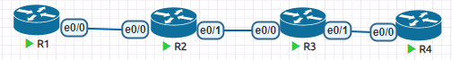

首先配置IP地址

```
略
```

配置RIP

```
R1
router rip
network 192.168.12.0
network 1.0.0.0
=============================
R2
router rip
network 192.168.12.0
network 2.0.0.0
network 192.168.23.0
============================
R3
router rip
network 192.168.23.0
network 3.0.0.0
network 192.168.34.0
===========================
R4
router rip
network 192.168.34.0
network 4.0.0.0
```

检查路由表中rip的条目，确保学习到

```
R1#show ip route rip
R     2.0.0.0/8 [120/1] via 192.168.12.2, 00:00:14, Ethernet0/0
R     3.0.0.0/8 [120/2] via 192.168.12.2, 00:00:14, Ethernet0/0
R     4.0.0.0/8 [120/3] via 192.168.12.2, 00:00:14, Ethernet0/0
R     192.168.23.0/24 [120/1] via 192.168.12.2, 00:00:14, Ethernet0/0
R     192.168.34.0/24 [120/2] via 192.168.12.2, 00:00:14, Ethernet0/0
```

检查连通性

```
R1#ping 4.4.4.4 source 1.1.1.1
Type escape sequence to abort.
Sending 5, 100-byte ICMP Echos to 4.4.4.4, timeout is 2 seconds:
Packet sent with a source address of 1.1.1.1 
!!!!!
Success rate is 100 percent (5/5), round-trip min/avg/max = 1/1/2 ms
```

### 2.2 RIPv1

#### 2.2.1 基本概念

- RIP的管理距离在cisco设备上是120
- RIP使用跳数(路由传递过程中经历的节点数量)来衡量路径好坏
- RIP使用UDP来携带更新消息，UDP的源和目的端口号都是520
- RIP的更新消息中直接携带了路由条目和度量值

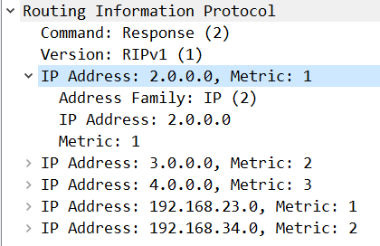

- RIPv1的更新数据内容中，没有子网掩码，所以RIPv1是不知道原始的子网掩码是多少，只能根据ABC类IP地址来判断，所以RIP是有类路由协议。
- RIP是周期性发送路由更新消息，并且使用广播地址来发送。
- RIP每30秒发送更新消息，接收方在收到消息之后会重置路由的计时器。

```
R1#show ip protocols 
Routing Protocol is "rip"
  Outgoing update filter list for all interfaces is not set
  Incoming update filter list for all interfaces is not set
  Sending updates every 30 seconds, next due in 13 seconds
  Invalid after 180 seconds, hold down 180, flushed after 240
  Redistributing: rip
  Default version control: send version 1, receive any version
    Interface                           Send  Recv  Triggered RIP  Key-chain
    Ethernet0/0                         1     1 2        No        none            
    Loopback0                           1     1 2        No        none            
  Automatic network summarization is in effect
  Maximum path: 4
  Routing for Networks:
    1.0.0.0
    192.168.12.0
  Routing Information Sources:
    Gateway         Distance      Last Update
    192.168.12.2         120      00:00:15
  Distance: (default is 120)
```

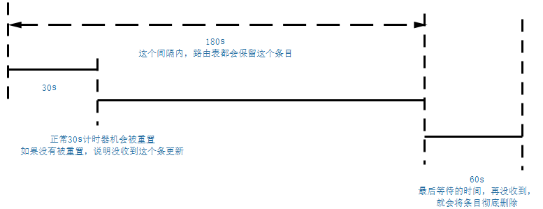

### 2.3 RIPv2

#### 2.3.1 和RIPv1的区别

- RIP是周期性发送路由更新消息，并且使用组播地址(224.0.0.9)来发送。
- RIPv2的更新消息中比RIPv1多出来：
  - Route Tag：给路由条目加上标记，方便后期对条目进行管理。
  - netmask：子网掩码，也就是RIPv2是无类路由协议，可以根据子网掩码来学习路由
  - next hop：默认都是0，也就是不携带，意思是哪里学来的条目，下一跳就指向谁

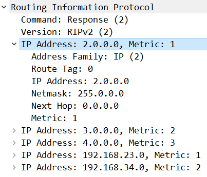

### 2.4 RIP路由汇总

#### 2.4.1 自动汇总

RIP默认开启自动汇总，RIPv1不支持关闭

自动汇总会将VLSM的路由条目根据ABC类IP地址，将路由匹配位数写成/8,/16,/24

我们在R1和R3上都创建一个loopback接口，并且配置一个IP地址。

```
R1
int lo100
ip add 100.1.1.1 255.255.255.0
router rip
network 100.0.0.0
====================
R4
int lo100
ip add 100.4.4.4 255.255.255.0
router rip
network 100.0.0.0
```

观察R2和R3路由表中`100.0.0.0/8`的条目

```
R2#sh ip route rip
R     100.0.0.0/8 [120/1] via 192.168.12.1, 00:00:25, Ethernet0/0
=============================
R3#sh ip route rip
R     100.0.0.0/8 [120/1] via 192.168.34.4, 00:00:27, Ethernet0/1
```

观察路由器到达R1和R4的情况

```
R2#ping 100.1.1.1
Type escape sequence to abort.
Sending 5, 100-byte ICMP Echos to 100.1.1.1, timeout is 2 seconds:
!!!!!
Success rate is 100 percent (5/5), round-trip min/avg/max = 1/1/1 ms
R2#ping 100.4.4.4
Type escape sequence to abort.
Sending 5, 100-byte ICMP Echos to 100.4.4.4, timeout is 2 seconds:
U.U.U
Success rate is 0 percent (0/5)
```

虽然R2能够从R3和R1都收到`100.0.0.0/8`的条目，但是路由表只会使用最佳条目，对比度量值(在RIP中是跳数)，发现R1传过来的是1，R3传过来的是2，所以路由表中关于`100.0.0.0/8`只有R1的方向。

关键的问题是在于RIP会自动将子网划分的条目去除子网，比如`100.1.1.0/24`变成`100.0.0.0/8`这么做被称为路由自动汇总。我们一般将其关闭，不然在子网众多的网络中会出现上述问题。

由于子网划分需要子网掩码，所以RIPv1不支持关闭自动汇总。

```
R1-4
router rip
no auto-summary		# 关闭自动汇总，只有v2支持
do clear ip route *		
# RIP更新机制的原因，导致路由发生变化，更新极慢，可以用这个命令快速刷新路由表
```

关闭了自动汇总以后，RIPv2会根据接口配置的子网掩码来更新路由条目。这种条目被称为明细路由。

#### 2.4.2 手动汇总

只有RIPv2支持手动汇总，在路由更新的出口方向配置，可以对下游路由器造成影响。

注意，配置路由汇总的那台路由器，路由表中的明细路由不会受到影响。

在R1上配置三个lo接口，然后我们在R2上进行汇总

```
R1
int lo1
ip add 172.16.1.1 255.255.255.0
int lo2
ip add 172.16.2.1 255.255.255.0
int lo3
ip add 172.16.3.1 255.255.255.0
router rip
network 172.16.0.0
======================================
R2
int e0/1
ip summary-address rip 172.16.0.0 255.255.0.0
```

然后观察路由更新下游的情况

```
R3
R3#sh ip route rip
R     172.16.0.0/16 [120/2] via 192.168.23.2, 00:00:03, Ethernet0/0
```

我们可以看到现在只有一条汇总路由

观察一下R2的路由表

```
R2#sh ip route rip
      172.16.0.0/24 is subnetted, 3 subnets
R        172.16.1.0 [120/1] via 192.168.12.1, 00:00:06, Ethernet0/0
R        172.16.2.0 [120/1] via 192.168.12.1, 00:00:06, Ethernet0/0
R        172.16.3.0 [120/1] via 192.168.12.1, 00:00:06, Ethernet0/0
```

R2的路由表没有影响到明细路由

路由汇总，是将明细路由抑制向下游更新，并且产生一条新的汇总条目，然后更新出去。

#### 2.4.3 RIP的默认路由

如果R1是公司网络的出口，R1还连接着运营商，那么R1就有义务向所有的RIP路由器通告一条*的路由。

```
router rip
 default-information originate
```

然后我们检查下游路由器的路由表

```
R2#sh ip route rip
Gateway of last resort is 192.168.12.1 to network 0.0.0.0
R*    0.0.0.0/0 [120/1] via 192.168.12.1, 00:00:01, Ethernet0/0
```

现在内网所有的路由器都知道了如果路由表中匹配不上的条目，可以从R1走。

### 2.5 RIP的认证

只有RIPv2支持认证，也就是在更新消息中加入认证信息。

在CISCO设备中，可以使用`key chain`来提供认证的需要的密码。

```
key chain <钥匙环名字>
 key <编号>
  key-string <密码>
  accept-lifetime <起始时间> <结束时间>	# 能够被匹配的时间
  send-lifetime <起始时间> <结束时间>	# 发送的时间
```

RIPv2支持明文认证和密文认证

明文认证就是把密码明文的发送，这样很蠢，因为抓包能直接看到密码

在R1上配置认证

```
R1
key chain huawei
 key 1
  key-string cisco1
int e0/0
ip rip authentication mode text		
ip rip authentication key-chain huawei
```

只配置R1的情况下，我们在R2上调试RIP协议，可以发现认证无效的警告

```
R2#debug ip rip events
*Mar 14 07:24:25.541: RIP: ignored v2 packet from 192.168.12.1 (invalid authentication)
```

在R2上配置好认证，就可以正常的学习路由

抓包，发现明文密码。

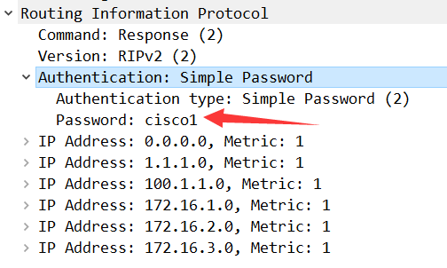

更改为密文加密

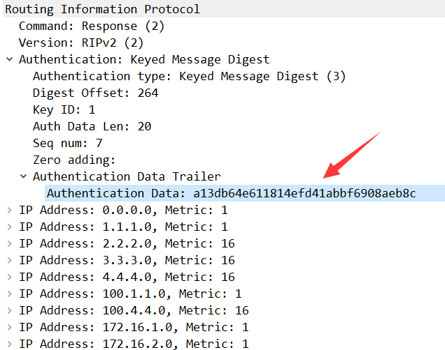

### 2.6 RIP防环机制

#### 2.6.1 环路的产生

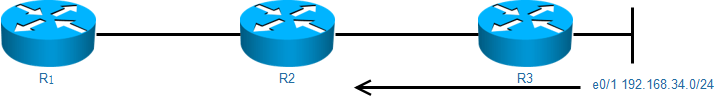

R3会将e0/1的网段更新给R2

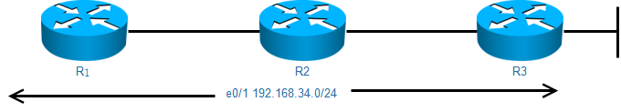

R2收到了之后，会更新给自己相邻的路由器，然而R3直连接口是192.168.34.0管理距离是0，所以R3不会接收R2的更新。

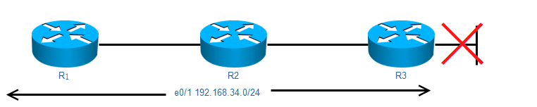

但是如果R3的e0/1接口损坏，就回导致R3开始学习R2更新的192.168.34.0的条目

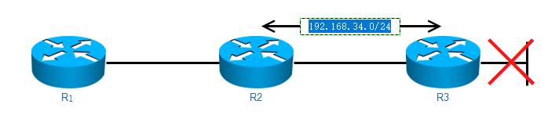

最终出现R3认为去往192.168.34.0/24需要走R2，而R2认为需要走R3，最终形成环路。

#### 2.6.2 防环机制1：最大跳数

RIP使用跳数去衡量一个路线的好坏，为了防止环路，规定最大跳数是15跳。

一个路由条目最多传递15个节点，这个也导致RIP无法用于大型网络。

##### 2.6.2.1 offset-list 偏移列表

可以用于修改距离矢量协议的度量值

我们在R2上修改1.1.1.0/24的跳数为13跳，然后观察R3

```
R2(config)#access-list 1 permit 1.1.1.0
R2(config-if)#router rip
R2(config-router)#offset-list 1 out 13
====================================
R3#sh ip route rip
R        1.1.1.0 [120/15] via 192.168.23.2, 00:00:04, Ethernet0/0
```

由于在R3上已经达到15跳，最大的跳数，所以在R4的路由表中，就学习不到`1.1.1.0`

```
R4#sh ip route rip
R*    0.0.0.0/0 [120/3] via 192.168.34.3, 00:00:01, Ethernet0/0
      2.0.0.0/24 is subnetted, 1 subnets
R        2.2.2.0 [120/2] via 192.168.34.3, 00:00:01, Ethernet0/0
      3.0.0.0/24 is subnetted, 1 subnets
R        3.3.3.0 [120/1] via 192.168.34.3, 00:00:01, Ethernet0/0
      100.0.0.0/8 is variably subnetted, 3 subnets, 2 masks
R        100.1.1.0/24 [120/3] via 192.168.34.3, 00:00:01, Ethernet0/0
R     172.16.0.0/16 [120/3] via 192.168.34.3, 00:00:01, Ethernet0/0
R     192.168.12.0/24 [120/2] via 192.168.34.3, 00:00:01, Ethernet0/0
R     192.168.23.0/24 [120/1] via 192.168.34.3, 00:00:01, Ethernet0/0
```

#### 2.6.3 防环机制2：水平分割

 路由器从某个接口学到的路由不会在发送回给邻居路由器，水平分割是默认开启的 

比如R2给R3的更新中，就不包含从R3那边收到的条目

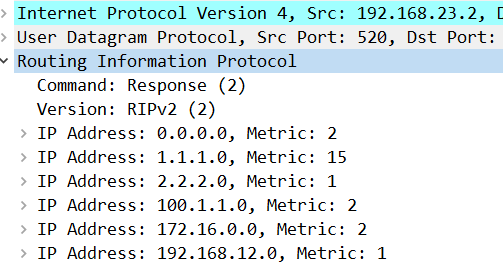

#### 2.6.4 防环机制3： 毒性反转

 路由器从某个接口学到路由后，将该路由的条数设置为16跳并从原接受接口发送回给邻居路由器 

#### 2.6.5 防环机制4：  路由毒化

当路由表中某个直连条目消失了，会立马发送一个该路由条目的更新，但是会将其跳数改成16跳，来让相邻路由器快速删除这个条目。

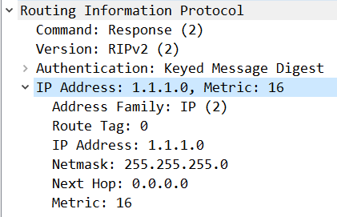

#### 2.6.6 防环机制5：  触发更新

当路由表发生变化的时候，会立马的更新条目，而不用等到30s周期的到来

#### 2.6.7 防环机制6：  更新计时器

见基本概念里面的计时器相关内容

### 2.7 RIP被动接口

由于RIP的更新是周期性的，这就导致RIP路由器之间的链路会不停收到广播或者组播。

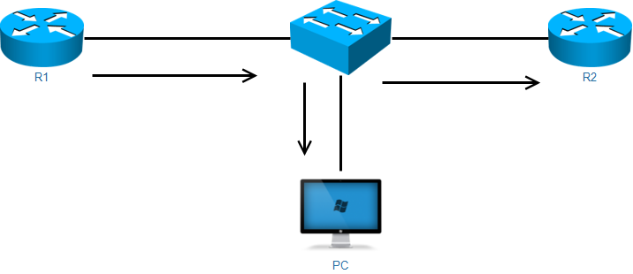

像上图这种情况，PC会不停的收到RIP发来的无用信息，所以RIP出现被动接口功能。

开启了被动接口之后，RIP不会主动发出任何的广播或者组播，比如要手动指定邻居，RIP才会以单播更新条目。

```
R1
router rip
 passive-interface Ethernet0/0
 neighbor 192.168.12.2
=================================
R1
router rip
 passive-interface Ethernet0/0
 neighbor 192.168.12.1
```

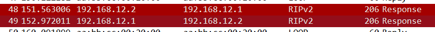

之后的RIP就会以单播开始更新

疑问：RIP可以不直连传递路由条目么？