# 09.OSPF

## 1. 实验拓扑

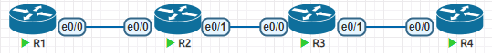

配置IP，必须在每个路由器上配置lo0

```
略
```

配置OSPF，把所有的接口都宣告进OSPF

```
R1
router ospf 1
 network 1.1.1.0 0.0.0.255 area 0
 network 192.168.12.0 0.0.0.255 area 0
===========================================
R2
R2(config)#int range e0/0 -1 , lo0
R2(config-if-range)#ip ospf 1 area 0
=========================================
R3
R3(config)#int lo0
R3(config-if)#ip ospf 1 area 0
R3(config-if)#int e0/0
R3(config-if)#ip ospf 1 area 0
R3(config-if)#int e0/1
R3(config-if)#ip ospf 1 area 0
========================================
R4
R4(config)#int range lo0 , e0/0
R4(config-if-range)#ip ospf 1 area 0
```

检查，在任意路由器上，检查路由学习的状况。

```
R2#show ip route ospf
      1.0.0.0/32 is subnetted, 1 subnets
O        1.1.1.1 [110/11] via 192.168.12.1, 00:02:22, Ethernet0/0
      3.0.0.0/32 is subnetted, 1 subnets
O        3.3.3.3 [110/11] via 192.168.23.3, 00:01:16, Ethernet0/1
      4.0.0.0/32 is subnetted, 1 subnets
O        4.4.4.4 [110/21] via 192.168.23.3, 00:00:07, Ethernet0/1
O     192.168.34.0/24 [110/20] via 192.168.23.3, 00:00:07, Ethernet0/1
```

## 2. OSPF简介

- OSPF在Cisco设备上的管理距离为110
- OSPF使用cost作为度量值，计算公式是
  - 参考单位(默认是10^5^Kbit/sec)/链路更新消息入口的带宽=开销(Cost)
  - OSPF计算度量值是累加每个LSA入口
  - 在计算的时候，cost没有小数，超出就进1，并且要加上IP所在的接口的开销(cost)
  - 查看接口带宽信息`show int e0/0`
  - 参考单位建议修改为本网络中最大的带宽，不然1Gbps和100Mbps将会都是1
  - 比如改为1Gbps，在OSPF的协议配置模式下`auto-cost reference-bandwidth 1000`
- 链路状态的工作原理
  - 首先每个路由对自己的链路状态进行描述，产生LSA（链路状态通告）
  - 邻居之间互相交换自己产生和学习到的LSA，最终都存在数据库中
  - 通过数据库中链路状态的信息，开始绘画拓扑图，就像下图
  - 根据拓扑，使用SPF(最短路径优先)算法计算出每个目的地的最佳路径下一跳，然后放入路由表，完成网络收敛。
    - 网络收敛完成，指的是路由表进入稳定状态。
- OSPF协议号为89，这个是携带在OSPF消息的IP报头中的，用于提示解封装的时候，采用89号(OSPF)结构去解析后续的二进制。

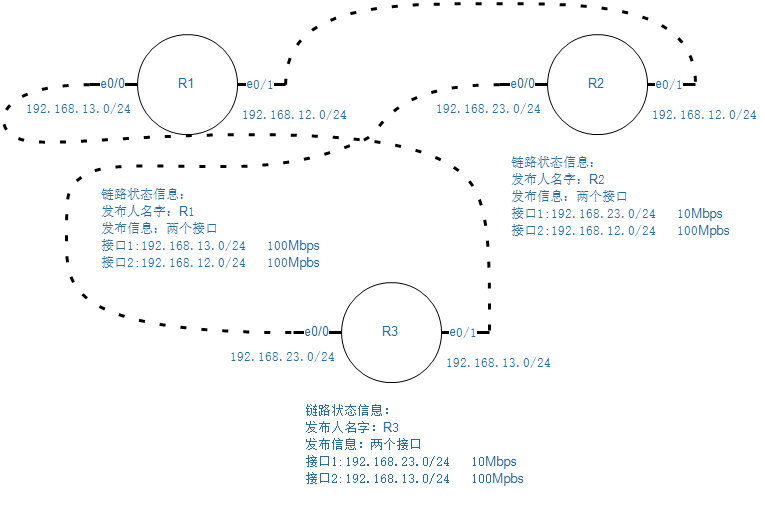

- 由于OSPF无法修改别人的LSA信息，每个路由器收到的都是原始信息，并且可以计算得到完整拓扑，所以不存在RIP协议中道听途说导致信息失误的可能。并且SPF算法可以保障无环路。

## 3. 三张表

### 3.1 邻居表

```
R2#sh ip ospf neighbor 

Neighbor ID     Pri   State           Dead Time   Address         Interface
3.3.3.3           1   FULL/DR         00:00:37    192.168.23.3    Ethernet0/1
1.1.1.1           1   FULL/BDR        00:00:35    192.168.12.1    Ethernet0/0
```

Neighbor ID：邻居的Router-ID

Pri：优先级

State：邻居状态/接口的角色

Dead Time：死亡时间，一个40s倒计时的计时器，每次收到ospf的hello消息(10s一次)就会重置

Interface：建立邻居的接口

### 3.2 链路状态数据库

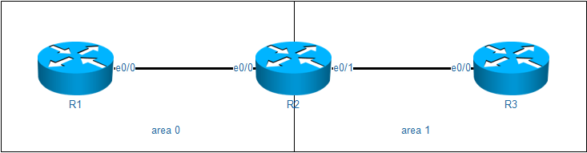

每个区域中的路由器都有该区域的链路状态数据库。如果是ABR，那么就有两个区域的数据库。

```
R2#sh ip ospf database 

            OSPF Router with ID (2.2.2.2) (Process ID 1)

		Router Link States (Area 0)

Link ID         ADV Router      Age         Seq#       Checksum Link count
1.1.1.1         1.1.1.1         26          0x80000004 0x00718B 3
2.2.2.2         2.2.2.2         25          0x80000003 0x0014DF 3

		Summary Net Link States (Area 0)

Link ID         ADV Router      Age         Seq#       Checksum
3.3.3.3         2.2.2.2         11          0x80000001 0x0031EC
192.168.23.0    2.2.2.2         44          0x80000001 0x0002A8

		Router Link States (Area 1)

Link ID         ADV Router      Age         Seq#       Checksum Link count
2.2.2.2         2.2.2.2         19          0x80000003 0x00C12D 2
3.3.3.3         3.3.3.3         20          0x80000002 0x00D5F8 3

		Summary Net Link States (Area 1)

Link ID         ADV Router      Age         Seq#       Checksum
1.1.1.1         2.2.2.2         21          0x80000001 0x008D98
2.2.2.2         2.2.2.2         52          0x80000001 0x00FA31
192.168.12.0    2.2.2.2         52          0x80000001 0x007B3A
```

- 不同的OSPF进程，数据库也是互相之间隔离
- 不同区域的OSPF数据库内容，也是会分开存放
- 同一个区域的OSPF数据库内容，不同类别也是分来存放
- 数据库中大致内容
  - Link ID
    - 链路的ID，可以理解为各种目的地
  - ADV Router
    - 这条数据库信息的来源路由器的Router-ID
  - Age
    - LSA的寿命，数据库每一条都是一个LSA信息。
    - 秒数，最大是3600秒，然后这条LSA就会被删除
    - 稳定情况下OSPF会每隔1800秒，将数据库中自己的条目更新给所有的邻居一遍，来刷新他们的数据库
    - 如果数据库发生了变化，会立即触发更新
  - Seq
    - 序列号，每次收到相同Link ID 的LSA更新，就回将Seq加1
    - 序列号的范围是0x80000001~0x7fffffff
    - 如果序列号变成0x7fffffff之后，再次更新条目，就变成了0x80000000，OSPF会认为这个编号是一种错误，然后就不会使用，直到下一个1800s到来，序列号变为0x80000001才会正常。
  - Checksum
    - LSA的校验值

## 4. OSPF名词

- router-id

  - 运行OSPF的路由器都会互相之间转发链路状态，为了让OSPF路由器收到这些链路状态的时候，可以对节点进行标注，所以都需要产生一个唯一的Route-id，类似于路由器的名字。不过是IP地址格式的。
  - Route-id的选举顺序
    - 手动指定
    - 自动选举
      - 优先选择环回接口IP地址大的作为route-id
      - 没有环回接口的情况下，优选物理接口IP地址大的作为route-id
  - 为了稳定性，route-id在ospf启动的时候就被选中，并且在重启ospf进程之前，都不会变化，哪怕手动指定都不会影响route-id。

- DR/BDR

  - 当OSPF路由器在一个多路访问网络(MA)情况下，相互建立邻居关系，会导致频繁的重复更新链路状态信息，如下拓扑

  - 当某台路由器链路状态信息发生变化的时候，会通告给自己所有的邻居，也就是R1会更新给R2和R3，然而R2的链路状态信息发生了变化，也会通告给自己所有的邻居，也就是更新给R3，R3也会做同样的事情。

  - 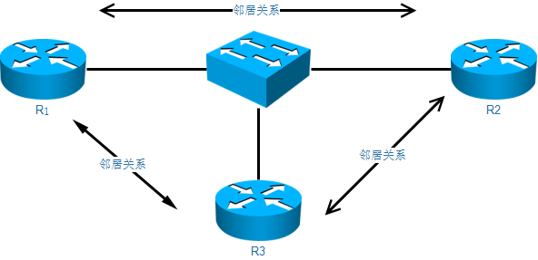

  - 在这种网络情况下，OSPF为了方式不必要的更新，选出来一个指定路由器(DR)，当非指定路由器(DR other)的链路信息发生变化的时候，首先更新给DR，再由DR更新给其他的路由器。

  - 为了防止DR故障导致更新不及时，还在这个内网选出一个作为备用指定路由器(BDR)。

  - <font color=red>虽然是说指定**路由器**，但是这个DR是接口的角色，一台路由器不同的接口可以属于不同的角色</font>

  - DR/BDR选举顺序

    - 比较优先级，默认优先级是1，可以手动修改
    - 优先级无法判断出来，就根据route-id的大小来判断，最大的成为DR
    - BDR是在DR选出来之后，在剩下的路由器里面按照上面两个的规则选出

  - DR一旦被选中，除非DR故障，不然不会再变化。也就是DR和BDR角色不会被抢占。

```
R3#sh ip ospf int e0/0
---------省略-------------
Transmit Delay is 1 sec, State DR, Priority 1
---------省略-------------
```

  - 上面的拓扑，我们修改R1的优先级，改完之后，需要重置R3的ospf来主动放弃DR身份

    

```
interface Ethernet0/0
 ip ospf priority 10
```

  - 如果OSPF接口优先级为0，那么将会直接放弃自己的DR或者BDR身份，并且不再参与选举，哪怕一个DR都没有，自己都不会做的DR或者BDR。

  - 这么做完以后，R2成为DR。因为DR故障了，**一定是BDR成为DR**，然后剩下的路由器重新选举一个BDR。

  - DR和BDR会监听`224.0.0.5`和`224.0.0.6`这两个组播地址，其他路由器只会监听`224.0.0.5`这个组播地址。

  - 当需要更新消息的时候，会发送给`224.0.0.6`这样DR和BDR就收到更新，DR在收到之后会发送给`224.0.0.5`这个地址，之后本广播域所有的路由器都可以学习到更新。

## 5. 邻居建立过程

1. Down
2. Init
   1. 当路由器收到了对方的Hello消息，但是却没有在Hello消息中看到自己的Router-ID
3. Two-way
   1. 在收到的Hello消息中，发现了自己和邻居的Route-ID，表示对方也发现自己，建立了双向通信。
   2. 开始选举DR和BDR，由于不能保证所有路由器启动OSPF时间一样的，所以这个状态会有一个Wait time，默认是40s。
   3. 我们可以修改OSPF接口的网络类型，避免在点对点链路上OSPF的2way等待时间，在接口上配置`ip ospf network point-to-point` 
4. Exstart
   1. 交换不携带数据的DBD消息，通过消息中router-id的大小来选择谁主导这个过程
   2. route-id数值大的，会来主导，成为master，其他slave路由器在接下的步骤需要配合master
5. Exchange
   1. slave路由器将自己链路状态数据库的描述信息发送给master
   2. master会比对自己的链路状态数据库，然后将对方需要的内容描述信息发回去。
6. Loading
   1. 根据上一步的摘要，开始交换完整的LSA(链路状态通告)数据库信息
7. Full
   1. 初步数据库同步完成，进入正常的邻居状态
   2. Hello消息维持关系
   3. 触发更新，当链路状态数据库发生变化的时候，会更新

### 5.1 建立邻居的条件

1. 相邻两台路由器运行OSPF协议(至少是逻辑上相连)
2. 两台路由器直接连接(至少是逻辑上直接连接)
3. 在同一个自制系统(在OSPF中表现不明显，因为OSPF后面加上的是进程号，不同进程号之间是可以建立邻居)
4. Hello/Dead时间一致(这个时间会在hello包中被携带)
5. 区域ID一致
6. 认证密码一致
7. MTP值一致

## 6. 消息类型

| 消息类型 | 描述                                                         |
| -------- | ------------------------------------------------------------ |
| Hello    | 发现OSPF的邻居，维护邻居关系，在Hello中会携带OSPF的基本信息，<br />比如自己和邻居的Route-ID,区域ID,认证信息等等其他的基本信息。 |
| DBD      | DataBase Description 这种消息有两种，<br />一个是不携带任何的数据，只有一个报头，主要用于在exstart状态的时候判断谁来主导信息交换过程<br />第二种是携带链路状态数据库的描述信息，可以理解为书的目录 |
| LSR      | Link State Request<br />用于请求完整的链路状态数据信息       |
| LSU      | Link State Upadte<br />用于发送完整的链路状态数据信息        |
| LSAck    | Link State Ack<br />用于确认收到消息，来保障可靠传输         |

## 7. OSPF多区域

由于SPF算法会消耗一定资源，如果OSPF网络过于庞大，会导致OSPF资源快速消耗，解决这个问题最好的方案就是划分区域，每个区域的路由器只需要负责计算自己这个区域的拓扑即可。

对于数据转发的过程来说，在本区域中可以得到全区拓扑，如果目的地不是本区域，只需要知道怎么跨越区域边界，到达目标所在区域即可，不需要知道那个区域的拓扑。

OSPF为了防止分区域过于零碎，导致部分区域的路由无法被其他区域学到，OSPF规定了两种区域

- 骨干区域：区域号必须是`0`或者`0.0.0.0`，骨干区域负责所有非骨干区域之间的数据传递。
- 非骨干区域：区域号可以是非0的其他数字，非骨干区域必须要和骨干区域相连。

OSPF还规定两种不同的路由器角色：

- 区域边界路由器： area border router(简称ABR)
  - 至少有一个接口属于骨干区域，一个接口属于非骨干区域
- 自制系统边界路由器：autonomous system boundary router（简称ASBR）
  - 需要引入OSPF外部的路由条目

将上面的拓扑进行更改

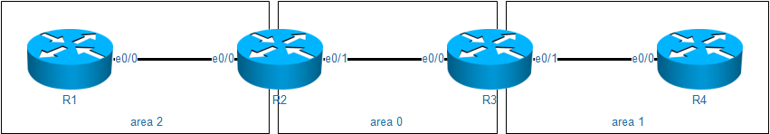

```
R2#sh ip route ospf
      1.0.0.0/32 is subnetted, 1 subnets
O        1.1.1.1 [110/11] via 192.168.12.1, 00:10:49, Ethernet0/0
      3.0.0.0/32 is subnetted, 1 subnets
O        3.3.3.3 [110/2] via 192.168.23.3, 00:10:54, Ethernet0/1
      4.0.0.0/32 is subnetted, 1 subnets
O IA     4.4.4.4 [110/12] via 192.168.23.3, 00:09:40, Ethernet0/1
O IA  192.168.34.0/24 [110/11] via 192.168.23.3, 00:10:28, Ethernet0/1
```

路由表中，标注了`O`的条目是本区域的，标注了`O IA`是其他区域学来的。

### 7.1 OSPF区域各种组合

如果把区域改成这样

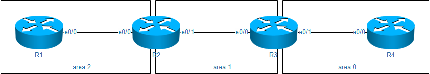

查看R2和R1的路由表

```
R2#sh ip route ospf
      1.0.0.0/32 is subnetted, 1 subnets
O        1.1.1.1 [110/11] via 192.168.12.1, 00:02:53, Ethernet0/0
      3.0.0.0/32 is subnetted, 1 subnets
O        3.3.3.3 [110/2] via 192.168.23.3, 00:00:27, Ethernet0/1
      4.0.0.0/32 is subnetted, 1 subnets
O IA     4.4.4.4 [110/12] via 192.168.23.3, 00:00:07, Ethernet0/1
O IA  192.168.34.0/24 [110/11] via 192.168.23.3, 00:00:27, Ethernet0/1
====================================================================
R1#sh ip route
      1.0.0.0/8 is variably subnetted, 2 subnets, 2 masks
C        1.1.1.0/24 is directly connected, Loopback0
L        1.1.1.1/32 is directly connected, Loopback0
      192.168.12.0/24 is variably subnetted, 2 subnets, 2 masks
C        192.168.12.0/24 is directly connected, Ethernet0/0
L        192.168.12.1/32 is directly connected, Ethernet0/0
R1#sh ip ospf nei

Neighbor ID     Pri   State           Dead Time   Address         Interface
2.2.2.2           0   FULL/  -        00:00:37    192.168.12.2    Ethernet0/0


```

观察到R1和R2的邻居关系是正常的，但是R1无法学习到其他区域的路由。

观察R2和R3的路由信息概述

```
R2#sh ip protocols 
Routing Protocol is "ospf 1"
  Outgoing update filter list for all interfaces is not set
  Incoming update filter list for all interfaces is not set
  Router ID 2.2.2.2
  Number of areas in this router is 2. 2 normal 0 stub 0 nssa
  Maximum path: 4
  Routing for Networks:
  Routing on Interfaces Configured Explicitly (Area 1):
    Loopback0
    Ethernet0/1
  Routing on Interfaces Configured Explicitly (Area 2):
    Ethernet0/0
  Routing Information Sources:
    Gateway         Distance      Last Update
    3.3.3.3              110      00:01:47
    4.4.4.4              110      00:03:21
    1.1.1.1              110      00:04:33
  Distance: (default is 110)
===================================================
R3#sh ip protocols 
---------省略----------
  It is an area border router
---------省略----------


```

发现R2并没有成为ABR，所以R2无法帮助R1去学习其他区域的路由。

### 7.2 解决区域断连

非骨干区域如果没有和骨干区域直接相连，称为区域断连。

#### 7.2.1 解决方案1：虚链路

我们在R2和R3之间建立一个虚拟的连接，然后这个虚拟的连接属于`area 0`

```
R2(config)#router ospf 1
R2(config-router)#area 1 virtual-link 3.3.3.3


```

检查虚链路邻居关系，还有R2是否成为ABR

```
R2#sh ip ospf nei
Neighbor ID     Pri   State           Dead Time   Address         Interface
3.3.3.3           0   FULL/  -        00:00:01    192.168.23.3    OSPF_VL0
3.3.3.3           0   FULL/  -        00:00:32    192.168.23.3    Ethernet0/1
1.1.1.1           0   FULL/  -        00:00:35    192.168.12.1    Ethernet0/0
R2#show ip ospf virtual-links 
Virtual Link OSPF_VL0 to router 3.3.3.3 is up
R2#show ip protocols 
------省略-----------
  Router ID 2.2.2.2
  It is an area border router
------省略-----------


```

再次查看R1的路由表

```
R1#show ip route ospf
      2.0.0.0/32 is subnetted, 1 subnets
O IA     2.2.2.2 [110/11] via 192.168.12.2, 00:03:45, Ethernet0/0
      3.0.0.0/32 is subnetted, 1 subnets
O IA     3.3.3.3 [110/12] via 192.168.12.2, 00:03:45, Ethernet0/0
      4.0.0.0/32 is subnetted, 1 subnets
O IA     4.4.4.4 [110/22] via 192.168.12.2, 00:02:32, Ethernet0/0
O IA  192.168.23.0/24 [110/11] via 192.168.12.2, 00:03:45, Ethernet0/0
O IA  192.168.34.0/24 [110/21] via 192.168.12.2, 00:02:32, Ethernet0/0


```

ospf通过虚链路学习到的LSA是没有老化时间的，邻居关系不需要hello来维持，所以及时一端加了认证或者发生了变动，也不能及时发现。

#### 7.2.2 解决方案2：VPN

可以在R2和R3之间打通一条虚拟专用网络，这个虚拟专用网络的隧道我们加入OSPF area 0，这样R2一样成为ABR

在R2和R3上打通一条IPIP隧道，并且加入area 0

```
interface Tunnel0
 ip address 172.16.23.3 255.255.255.0
 ip ospf 1 area 0
 tunnel source Ethernet0/0
 tunnel mode ipip
 tunnel destination 192.168.23.2


```

检查邻居关系

```
R2#sh ip ospf nei

Neighbor ID     Pri   State           Dead Time   Address         Interface
3.3.3.3           0   FULL/  -        00:00:38    172.16.23.3     Tunnel0
3.3.3.3           0   FULL/  -        00:00:39    192.168.23.3    Ethernet0/1
1.1.1.1           0   FULL/  -        00:00:36    192.168.12.1    Ethernet0/0
R2#show ip protocols 
Routing Protocol is "ospf 1"
  Outgoing update filter list for all interfaces is not set
  Incoming update filter list for all interfaces is not set
  Router ID 2.2.2.2
  It is an area border router		# R2满足了ABR的条件
  Number of areas in this router is 3. 3 normal 0 stub 0 nssa
  Maximum path: 4
  Routing for Networks:
  Routing on Interfaces Configured Explicitly (Area 0):		# 可以看到area 0的情况
    Tunnel0
  Routing on Interfaces Configured Explicitly (Area 1):
    Loopback0
    Ethernet0/1
  Routing on Interfaces Configured Explicitly (Area 2):
    Ethernet0/0
  Routing Information Sources:
    Gateway         Distance      Last Update
    3.3.3.3              110      00:00:18
    4.4.4.4              110      00:00:18
    1.1.1.1              110      00:00:22
  Distance: (default is 110)


```

查看R1的路由表

```
R1#sh ip route ospf
      2.0.0.0/32 is subnetted, 1 subnets
O IA     2.2.2.2 [110/11] via 192.168.12.2, 00:01:04, Ethernet0/0
      3.0.0.0/32 is subnetted, 1 subnets
O IA     3.3.3.3 [110/12] via 192.168.12.2, 00:01:04, Ethernet0/0
      4.0.0.0/32 is subnetted, 1 subnets
O IA     4.4.4.4 [110/1021] via 192.168.12.2, 00:01:04, Ethernet0/0
      172.16.0.0/24 is subnetted, 1 subnets
O IA     172.16.23.0 [110/1010] via 192.168.12.2, 00:01:03, Ethernet0/0
O IA  192.168.23.0/24 [110/11] via 192.168.12.2, 00:01:04, Ethernet0/0
O IA  192.168.34.0/24 [110/1020] via 192.168.12.2, 00:01:04, Ethernet0/0


```

## 8. LSA类别

| LSA类别 | 说明                       |
| ------- | -------------------------- |
| 1       | 路由器LSA                  |
| 2       | 网络LSA                    |
| 3       | 网络汇总LSA                |
| 4       | ASBR汇总LSA                |
| 5       | AS外部LSA                  |
| 6       | 组成员LSA                  |
| 7       | NSSA区域外部LSA            |
| 8       | 外部属性LSA                |
| 9       | Opaque LSA（链路本地范围） |
| 10      | Opaque LSA（本地区域范围） |
| 11      | Opaque LSA（AS范围）       |


### 8.1 Router Link States(type 1)

- **每个路由器针对它所在的区域产生LSA1**，描述区域内部与路由器直连的链路的信息（包括链路类型，Cost等） 

- LSA1只允许在本区域内洪泛，不允许跨越ABR

- LSA中会标识路由器是否是ABR(B比特置位),ASBR（E比特置位）或者是Virtual-link（V比特置位）的端点的身份信息

```
R1#sh ip ospf database router 2.2.2.2

            OSPF Router with ID (1.1.1.1) (Process ID 1)

		Router Link States (Area 0)

  LS age: 55
  Options: (No TOS-capability, DC)
  LS Type: Router Links
  Link State ID: 2.2.2.2
  Advertising Router: 2.2.2.2
  LS Seq Number: 80000006
  Checksum: 0x7739
  Length: 84
  Number of Links: 5

    Link connected to: a Stub Network
     (Link ID) Network/subnet number: 2.2.2.2
     (Link Data) Network Mask: 255.255.255.255
      Number of MTID metrics: 0
       TOS 0 Metrics: 1

    Link connected to: another Router (point-to-point)
     (Link ID) Neighboring Router ID: 3.3.3.3
     (Link Data) Router Interface address: 192.168.23.2
      Number of MTID metrics: 0
       TOS 0 Metrics: 10

    Link connected to: a Stub Network
     (Link ID) Network/subnet number: 192.168.23.0
     (Link Data) Network Mask: 255.255.255.0
      Number of MTID metrics: 0
       TOS 0 Metrics: 10

    Link connected to: another Router (point-to-point)
     (Link ID) Neighboring Router ID: 1.1.1.1
     (Link Data) Router Interface address: 192.168.12.2
      Number of MTID metrics: 0
       TOS 0 Metrics: 10

    Link connected to: a Stub Network
     (Link ID) Network/subnet number: 192.168.12.0
     (Link Data) Network Mask: 255.255.255.0
      Number of MTID metrics: 0
       TOS 0 Metrics: 10


```

### 8.2 Net Link States(type 2)

- 描述TransNet（包括Broadcast和NBMA网络）网络信息；
- **由DR生成**，描述其在该网络上连接的所有路由器以及网段掩码信息，以及这个MA所属的路由器；
- LSA类型2只在本区域Area内洪泛，不允许跨越ABR；
- Network LSA ID是DR进行宣告的那个接口的IP地址
- Network LSA 中没有COST字段

```
R1#show ip ospf database network 192.168.1.3

            OSPF Router with ID (1.1.1.1) (Process ID 1)

		Net Link States (Area 0)

  LS age: 310
  Options: (No TOS-capability, DC)
  LS Type: Network Links
  Link State ID: 192.168.1.3 (address of Designated Router)
  Advertising Router: 3.3.3.3
  LS Seq Number: 80000002
  Checksum: 0x8D16
  Length: 36
  Network Mask: /24
	Attached Router: 3.3.3.3
	Attached Router: 1.1.1.1
	Attached Router: 2.2.2.2


```

### 8.3 Summary Net Link States(type 3)

由ABR生成，实际上就是将区域内部的Type1 Type2的信息收集起来以路由子网的形式扩散出去, 这就是Summay LSA中Summay的含义（注意这里的summary与路由汇总没有关系）；

```
R2#sh ip ospf database summary 192.168.12.0

            OSPF Router with ID (2.2.2.2) (Process ID 1)

		Summary Net Link States (Area 1)

  LS age: 229
  Options: (No TOS-capability, DC, Upward)
  LS Type: Summary Links(Network)
  Link State ID: 192.168.12.0 (summary Network Number)
  Advertising Router: 2.2.2.2
  LS Seq Number: 80000001
  Checksum: 0x7B3A
  Length: 28
  Network Mask: /24
	MTID: 0 	Metric: 10 


```

### 8.4 Summary ASB Link States(type 4)

ASBR Summary LSA**由ABR生成**，用于描述ABR能够到达的ASBR它的链路状态ID为目的ASBR的RID。

```
R3#sh ip ospf database asbr-summary 1.1.1.1

            OSPF Router with ID (3.3.3.3) (Process ID 1)

		Summary ASB Link States (Area 1)

  LS age: 341
  Options: (No TOS-capability, DC, Upward)
  LS Type: Summary Links(AS Boundary Router)
  Link State ID: 1.1.1.1 (AS Boundary Router address)
  Advertising Router: 2.2.2.2
  LS Seq Number: 80000001
  Checksum: 0x75B0
  Length: 28
  Network Mask: /0
	MTID: 0 	Metric: 10 


```

### 8.5 Type-5 AS External Link States(type 5)

Autonomous System External LSA**由ASBR生成**用于描述OSPF自治域系统外的目标网段信息链路状态ID是目的地址的IP网络号。

```
R3#sh ip ospf database external 0.0.0.0

            OSPF Router with ID (3.3.3.3) (Process ID 1)

		Type-5 AS External Link States

  LS age: 203
  Options: (No TOS-capability, DC, Upward)
  LS Type: AS External Link
  Link State ID: 0.0.0.0 (External Network Number )
  Advertising Router: 1.1.1.1
  LS Seq Number: 80000004
  Checksum: 0x7553
  Length: 36
  Network Mask: /0
	Metric Type: 1 (Comparable directly to link state metric)
	MTID: 0 
	Metric: 100 
	Forward Address: 0.0.0.0
	External Route Tag: 1


```

### 8.6 Type-7 AS External Link States(type 7)

7类LSA的内容和5类LSA的内容是一样的，都是ASBR产生，用于记录外部路由条目的。

7类LSA的ASBR一定属于NSSA区域。

```
R3#sh ip ospf database nssa-external 10.1.0.0

            OSPF Router with ID (3.3.3.3) (Process ID 1)

		Type-7 AS External Link States (Area 1)

  LS age: 557
  Options: (No TOS-capability, Type 7/5 translation, DC, Upward)
  LS Type: AS External Link
  Link State ID: 10.1.0.0 (External Network Number )
  Advertising Router: 3.3.3.3
  LS Seq Number: 80000001
  Checksum: 0x172
  Length: 36
  Network Mask: /24
	Metric Type: 2 (Larger than any link state path)
	MTID: 0 
	Metric: 20 
	Forward Address: 3.3.3.3
	External Route Tag: 0


```

## 9. 注入默认路由

- 在局域网中，指引流量离开的那个地址，我们称之为网关
- 在一个自制系统(可以想象成一个公司的内网，由很多网段组成)中，指引每个网段如何去往互联网的条目，我们称之为默认路由，或者缺省路由

OSPF产生默认路由的方式

```
R1(config)#router ospf 1
R1(config-router)#default-information originate [always]
# 如果不带always，那么这台路由器上必须有*的路由才能生效，加了always那么总是生效。


```

OSPF注入的默认路由默认是O*E2，也就是2类的外部路由。

- 1类外部路由会累加内部开销
- 2类外部路由不会累加内部开销

我们将默认路由改为1类，查看开销

```
R3#sh ip route
O*E2  0.0.0.0/0 [110/1] via 192.168.23.2, 00:04:03, Ethernet0/0
# 改为1之前，度量值始终是1，不会增加
R1(config-router)#default-information originate always metric-type 1 metric 100
# 下面修改为1，同时我们还能顺带改度量值
R3#sh ip route ospf
O*E1  0.0.0.0/0 [110/120] via 192.168.23.2, 7w0d, Ethernet0/0
# 发现由原本的100，累积到了120，说明累加内部开销


```

## 10. 特殊区域

由于非骨干区域只能学到本区域的拓扑，以及骨干区域传来的其他区域和AS外部的条目，所以非骨干区域可以对路由条目进行精简

- 比如可以不学习AS外部的条目，只要是OSPF内部没学到的路由器统统交给骨干区域。
- 比如可以不学习本区域以外的路由条目，反正要从骨干区域走，不如产生默认路由指向骨干。

对于需要进一步精简路由表，优化OSPF区域的情况，我们可以配置特殊区域。

**骨干区域不可以配置成特殊区域**

### 10.1 演示拓扑

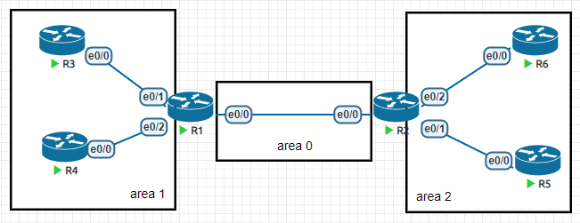

在R1上创建三个loopback接口，172.16.1~3.1/24，用于模拟外部注入的路由条目。

```
R1
interface Loopback1
 ip address 172.16.1.1 255.255.255.0
interface Loopback2
 ip address 172.16.2.1 255.255.255.0
interface Loopback3
 ip address 172.16.3.1 255.255.255.0
router ospf 1
 redistribute connected subnets


```

在非骨干区域查看，确认学到了外部的条目

```
R3#sh ip route ospf
O E2     172.16.1.0 [110/20] via 192.168.13.1, 00:00:54, Ethernet0/0
O E2     172.16.2.0 [110/20] via 192.168.13.1, 00:00:54, Ethernet0/0
O E2     172.16.3.0 [110/20] via 192.168.13.1, 00:00:54, Ethernet0/0


```


### 10.2 stub

stub区域用于让非骨干区域不去学习外部的路由条目，通过指向ABR的默认路由来访问外部，做到精简路由条目的目的。

stub区域中，没有4、5类LSA。

我们将area 1配置为stub，需要在所有参与area 1的路由器上配置如下命令,否则无法建立邻居

```
router ospf 1
 area 1 stub


```

查看R3的链路状态数据库

```
R3#sh ip ospf database 

            OSPF Router with ID (3.3.3.3) (Process ID 1)

		Router Link States (Area 1)

Link ID         ADV Router      Age         Seq#       Checksum Link count
1.1.1.1         1.1.1.1         21          0x8000000E 0x0066B1 2
3.3.3.3         3.3.3.3         32          0x80000006 0x009767 2
4.4.4.4         4.4.4.4         26          0x80000007 0x00C924 2

		Net Link States (Area 1)

Link ID         ADV Router      Age         Seq#       Checksum
192.168.13.3    3.3.3.3         27          0x80000003 0x00980C
192.168.14.4    4.4.4.4         22          0x80000003 0x008713

		Summary Net Link States (Area 1)

Link ID         ADV Router      Age         Seq#       Checksum
0.0.0.0         1.1.1.1         104         0x80000001 0x0093A6		# 多出来一条指向ABR的条目
1.1.1.1         1.1.1.1         104         0x80000003 0x0061D2
2.2.2.2         1.1.1.1         104         0x80000002 0x00998D
5.5.5.5         1.1.1.1         104         0x80000002 0x00739D
6.6.6.6         1.1.1.1         104         0x80000002 0x0045C7
192.168.12.0    1.1.1.1         104         0x80000003 0x00B306
192.168.25.0    1.1.1.1         104         0x80000002 0x008A19
192.168.26.0    1.1.1.1         104         0x80000002 0x007F23
# 原本172.16开头的5类LSA消失


```

### 10.3 Totally stub

完全末梢区域可以让非骨干区域不去学习其他区域的路由，也不去学习OSPF外部的路由。

产生一条默认路由指向ABR，也就是除了本区域内部条目以外，完全依靠骨干区域和外部通信。

我们将area 2配置为stub，需要在所有参与area 2的路由器上配置如下命令,否则无法建立邻居

```
router ospf 1
 area 2 stub


```

为了成为`totally stub`，还需要在ABR上加上`no-summary`

```
router ospf 1
 area 2 stub no-summary


```

查看路由表，发现现在只能学习到本区域的条目和一条指向ABR的默认路由

```
R5#sh ip route ospf
O*IA  0.0.0.0/0 [110/11] via 192.168.25.2, 00:00:16, Ethernet0/0
      6.0.0.0/32 is subnetted, 1 subnets
O        6.6.6.6 [110/21] via 192.168.25.2, 00:00:06, Ethernet0/0
O     192.168.26.0/24 [110/20] via 192.168.25.2, 00:00:06, Ethernet0/0


```

查看链路状态数据库，发现4、5无法学习到，3类只剩下一条默认路由

```
R5#sh ip ospf database 

            OSPF Router with ID (5.5.5.5) (Process ID 1)

		Router Link States (Area 2)

Link ID         ADV Router      Age         Seq#       Checksum Link count
2.2.2.2         2.2.2.2         61          0x8000000E 0x00B524 2
5.5.5.5         5.5.5.5         77          0x80000007 0x00CBFD 2
6.6.6.6         6.6.6.6         63          0x80000009 0x00FBBB 2

		Net Link States (Area 2)

Link ID         ADV Router      Age         Seq#       Checksum
192.168.25.5    5.5.5.5         77          0x80000003 0x003A48
192.168.26.6    6.6.6.6         69          0x80000003 0x00294F

		Summary Net Link States (Area 2)

Link ID         ADV Router      Age         Seq#       Checksum
0.0.0.0         2.2.2.2         114         0x80000001 0x0075C0


```

### 10.4 NSSA(not so stub area)

如果外部的路由是由特殊区域引入的，那么stub和t-stub两种无法满足需求，因为不允许5类LSA传递。

NSSA可以将OSPF外部路由以7类LSA进入特殊区域，然后再由特殊区域的ABR负责将条目转换为5类LSA转发到其他区域。

为了模拟这个过程，**先删除area 1的stub配置**，在R3上配置3个loopback，地址是10.1~3.0.1/24，然后引入OSPF。

```
R3
interface Loopback1
 ip address 10.1.0.1 255.255.255.0
interface Loopback2
 ip address 10.2.0.1 255.255.255.0
interface Loopback3
 ip address 10.3.0.1 255.255.255.0
router ospf 1
 redistribute connected subnets


```

下面我们在每一个参与area 1的设备上配置如下命令

```
router ospf 1
 area 1 nssa


```

然后我们观察，发现无法学习到其他区域引入的外部路由条目，这个和stub区域一致。

```
R3#sh ip route ospf
Codes: L - local, C - connected, S - static, R - RIP, M - mobile, B - BGP
       D - EIGRP, EX - EIGRP external, O - OSPF, IA - OSPF inter area 
       N1 - OSPF NSSA external type 1, N2 - OSPF NSSA external type 2
       E1 - OSPF external type 1, E2 - OSPF external type 2
       i - IS-IS, su - IS-IS summary, L1 - IS-IS level-1, L2 - IS-IS level-2
       ia - IS-IS inter area, * - candidate default, U - per-user static route
       o - ODR, P - periodic downloaded static route, H - NHRP, l - LISP
       a - application route
       + - replicated route, % - next hop override, p - overrides from PfR

Gateway of last resort is not set

      1.0.0.0/32 is subnetted, 1 subnets
O IA     1.1.1.1 [110/11] via 192.168.13.1, 00:03:12, Ethernet0/0
      2.0.0.0/32 is subnetted, 1 subnets
O IA     2.2.2.2 [110/21] via 192.168.13.1, 00:03:12, Ethernet0/0
      4.0.0.0/32 is subnetted, 1 subnets
O        4.4.4.4 [110/21] via 192.168.13.1, 00:02:14, Ethernet0/0
      5.0.0.0/32 is subnetted, 1 subnets
O IA     5.5.5.5 [110/31] via 192.168.13.1, 00:03:12, Ethernet0/0
      6.0.0.0/32 is subnetted, 1 subnets
O IA     6.6.6.6 [110/31] via 192.168.13.1, 00:03:12, Ethernet0/0
      172.16.0.0/24 is subnetted, 3 subnets
O N2     172.16.1.0 [110/20] via 192.168.13.1, 00:03:12, Ethernet0/0
O N2     172.16.2.0 [110/20] via 192.168.13.1, 00:03:12, Ethernet0/0
O N2     172.16.3.0 [110/20] via 192.168.13.1, 00:03:12, Ethernet0/0	# 这边能学到是因为R1也是area1的
O IA  192.168.12.0/24 [110/20] via 192.168.13.1, 00:03:12, Ethernet0/0
O     192.168.14.0/24 [110/20] via 192.168.13.1, 00:02:14, Ethernet0/0
O IA  192.168.25.0/24 [110/30] via 192.168.13.1, 00:03:12, Ethernet0/0
O IA  192.168.26.0/24 [110/30] via 192.168.13.1, 00:03:12, Ethernet0/0


```

这边的O N2和O E2是一样的，都是外部路由条目，不过O N2是nssa区域特有，也就是7类LSA学来的。

需要注意的是，NSSA并不会产生一条默认路由，下面我查看一下。

```
R3#sh ip ospf database 

            OSPF Router with ID (3.3.3.3) (Process ID 1)

		Router Link States (Area 1)

Link ID         ADV Router      Age         Seq#       Checksum Link count
1.1.1.1         1.1.1.1         212         0x80000018 0x00DF24 2
3.3.3.3         3.3.3.3         270         0x80000010 0x0011D9 2
4.4.4.4         4.4.4.4         213         0x8000000C 0x004799 2

		Net Link States (Area 1)

Link ID         ADV Router      Age         Seq#       Checksum
192.168.13.3    3.3.3.3         265         0x80000007 0x001880
192.168.14.4    4.4.4.4         219         0x80000005 0x000B85

		Summary Net Link States (Area 1)
# 可以去看上面stub的数据库，这边是有0.0.0.0的，而nssa没有
Link ID         ADV Router      Age         Seq#       Checksum
1.1.1.1         1.1.1.1         271         0x80000005 0x00E445
2.2.2.2         1.1.1.1         271         0x80000004 0x001DFF
5.5.5.5         1.1.1.1         271         0x80000003 0x00F80F
6.6.6.6         1.1.1.1         271         0x80000003 0x00CA39
192.168.12.0    1.1.1.1         271         0x80000005 0x003778
192.168.25.0    1.1.1.1         271         0x80000004 0x000E8B
192.168.26.0    1.1.1.1         271         0x80000004 0x000395

		Type-7 AS External Link States (Area 1)

Link ID         ADV Router      Age         Seq#       Checksum Tag
10.1.0.0        3.3.3.3         373         0x80000001 0x000172 0
10.2.0.0        3.3.3.3         373         0x80000001 0x00F47D 0
10.3.0.0        3.3.3.3         373         0x80000001 0x00E888 0
172.16.1.0      1.1.1.1         265         0x80000001 0x001DBF 0
172.16.2.0      1.1.1.1         265         0x80000001 0x0012C9 0
172.16.3.0      1.1.1.1         265         0x80000001 0x0007D3 0


```

其实在abr上添加一条命令，就可以做到与stub一样，产生默认路由

```
router ospf 1
 area 1 nssa default-information-originate


```

### 10.5 Totally NSSA

与t-stub是一样的，唯一不同的是可以在特殊区域中引入外部的路由条目

在nssa区域的ABR上加上如下命令就可以配置为T-NSSA

```
router ospf 1
 area 1 nssa no-summary

```

## 11. 路由汇总

由于链路状态协议的特殊性，在传递的时候必须保持原本LSA的信息，不能更改别人的LSA，所以在同一个区域中，所有的路由器都知道拓扑，无法对路由条目进行操作。当然无法在同一个区域中汇总。

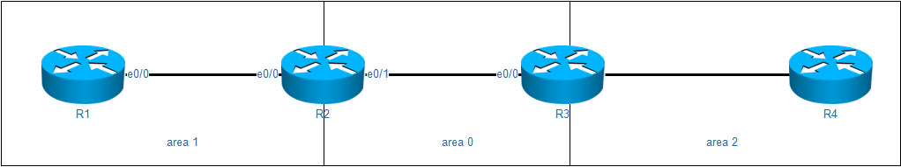

### 11.1 汇总OSPF区域间路由

在R4上配置3个loopback，地址是172.16.1~3.1/24，并且加入ospf area 2，然后我们观察汇总的特性

检查R3的路由表，可以看到明细路由

```
R3#sh ip route ospf
      172.16.0.0/32 is subnetted, 3 subnets
O        172.16.1.1 [110/11] via 192.168.34.4, 00:01:24, Ethernet0/1
O        172.16.2.1 [110/11] via 192.168.34.4, 00:01:24, Ethernet0/1
O        172.16.3.1 [110/11] via 192.168.34.4, 00:01:24, Ethernet0/1

```

我们可以尝试在R4上配置汇总

```
R4
router ospf 1
 area 2 range 172.16.0.0 255.255.0.0

```

```
R3#sh ip route ospf
      172.16.0.0/32 is subnetted, 3 subnets
O        172.16.1.1 [110/11] via 192.168.34.4, 00:02:41, Ethernet0/1
O        172.16.2.1 [110/11] via 192.168.34.4, 00:02:41, Ethernet0/1
O        172.16.3.1 [110/11] via 192.168.34.4, 00:02:41, Ethernet0/1
# 在同一个区域中，OSPF是不支持汇总的

```

OSPF可以在ABR上对OSPF中的路由进行汇总，影响下游的区域。上图中，我们可以在R3上配置汇总命令

```
R3
router ospf 1
 area 2 range 172.16.0.0 255.255.0.0
# 汇总哪个的区域路由，就写区域几，比如这条就是要汇总area 2

```

关闭R3上的汇总命令，换到R2上去配置，会发现无法汇总这个条目，原因是因为R2无法修改R3产生的LSA。

### 11.2 汇总OSPF外部路由

OSPF外部的路由由ASBR产生，所以只能由ASBR去修改或者汇总

在R1上配置3个环回接口10.1~3.0.1/24,然后导入到OSPF中

```
R1
interface Loopback1
 ip address 10.1.0.1 255.255.255.0
interface Loopback2
 ip address 10.2.0.1 255.255.255.0
interface Loopback3
 ip address 10.3.0.1 255.255.255.0
router ospf 1
 redistribute connected subnets

```

这些条目是由R1引入的，所以只能在R1上配置汇总命令

```
R1
router ospf 1
 summary-address 10.0.0.0 255.0.0.0

```

### 11.3 抑制路由条目

抑制路由条目的做法在汇总操作中非常常见，汇总就是将明细路由进行抑制，然后本地产生一条汇总的路由发出去。

抑制区域间的条目，只能在ABR上进行。

抑制外部路由条目，只能在ASBR上进行。

#### 11.3.1 区域间路由抑制更新

```
R3
router ospf 1
 area 2 range 172.16.2.1 255.255.255.255 not-advertise

```

在R2上查看效果

```
R2#sh ip route ospf
      172.16.0.0/32 is subnetted, 2 subnets
O IA     172.16.1.1 [110/21] via 192.168.23.3, 00:09:04, Ethernet0/1
O IA     172.16.3.1 [110/21] via 192.168.23.3, 00:09:04, Ethernet0/1
# 172.16.2.1消失

```

#### 11.3.2 外部路由抑制更新

```
R1
router ospf 1
 summary-address 10.2.0.0 255.255.255.0 not-advertise

```

在其他路由器上看效果

```
R3#sh ip route ospf
      10.0.0.0/24 is subnetted, 2 subnets
O E2     10.1.0.0 [110/20] via 192.168.23.2, 00:02:43, Ethernet0/0
O E2     10.3.0.0 [110/20] via 192.168.23.2, 00:02:43, Ethernet0/0

```

### 11.4 抑制7类转发地址

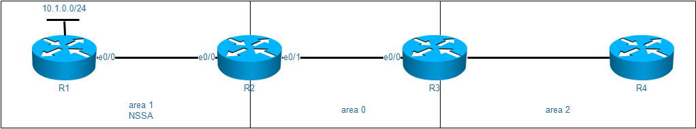

在配置好了之后，我们在R2上抑制R1的条目

```
router ospf 1
 area 1 range 1.1.1.1 255.255.255.255 not-advertise

```

我们发现R3不仅仅是1.1.1.1无法学习，连10.x.0.0/24也学习不到了

```
R3#sh ip route ospf
      2.0.0.0/32 is subnetted, 1 subnets
O        2.2.2.2 [110/11] via 192.168.23.2, 00:11:48, Ethernet0/0
      4.0.0.0/32 is subnetted, 1 subnets
O        4.4.4.4 [110/11] via 192.168.34.4, 00:11:48, Ethernet0/1
      172.16.0.0/32 is subnetted, 3 subnets
O        172.16.1.1 [110/11] via 192.168.34.4, 00:11:48, Ethernet0/1
O        172.16.2.1 [110/11] via 192.168.34.4, 00:11:48, Ethernet0/1
O        172.16.3.1 [110/11] via 192.168.34.4, 00:11:48, Ethernet0/1
O IA  192.168.12.0/24 [110/20] via 192.168.23.2, 00:11:48, Ethernet0/0

```

虽然R3路由表中没有10开头的地址，但是数据库中竟然还有

```
R3#sh ip ospf database 
------------省略------------
		Type-5 AS External Link States

Link ID         ADV Router      Age         Seq#       Checksum Tag
10.1.0.0        2.2.2.2         124         0x80000001 0x004F3A 0
10.2.0.0        2.2.2.2         124         0x80000001 0x004345 0
10.3.0.0        2.2.2.2         124         0x80000001 0x003750 0

```

查看详细内容

```
R3#sh ip ospf database external 10.1.0.0

            OSPF Router with ID (3.3.3.3) (Process ID 1)

		Type-5 AS External Link States

  LS age: 171
  Options: (No TOS-capability, DC, Upward)
  LS Type: AS External Link
  Link State ID: 10.1.0.0 (External Network Number )
  Advertising Router: 2.2.2.2
  LS Seq Number: 80000001
  Checksum: 0x4F3A
  Length: 36
  Network Mask: /24
	Metric Type: 2 (Larger than any link state path)
	MTID: 0 
	Metric: 20 
	Forward Address: 1.1.1.1		# 这个地址不可达，导致即使有LSA，也是无法使用的
	External Route Tag: 0

```

通过上述的实验现象，说明了OSPF学到LSA之后，还是会进行可用性的判断。

```
R2
router ospf 1
 area 1 nssa translate type7 suppress-fa
# 这条命令的意思是在翻译type7LSA的时候，将forward address改为0.0.0.0

```

下面查看R3的数据库，发现10开头的LSA已经有效了

```
R3#sh ip ospf database external 10.1.0.0

            OSPF Router with ID (3.3.3.3) (Process ID 1)

		Type-5 AS External Link States

  LS age: 32
  Options: (No TOS-capability, DC, Upward)
  LS Type: AS External Link
  Link State ID: 10.1.0.0 (External Network Number )
  Advertising Router: 2.2.2.2
  LS Seq Number: 80000002
  Checksum: 0x1B71
  Length: 36
  Network Mask: /24
	Metric Type: 2 (Larger than any link state path)
	MTID: 0 
	Metric: 20 
	Forward Address: 0.0.0.0
	External Route Tag: 0
R3#show ip route ospf
      10.0.0.0/24 is subnetted, 3 subnets
O E2     10.1.0.0 [110/20] via 192.168.23.2, 00:03:15, Ethernet0/0
O E2     10.2.0.0 [110/20] via 192.168.23.2, 00:03:15, Ethernet0/0
O E2     10.3.0.0 [110/20] via 192.168.23.2, 00:03:15, Ethernet0/0
# 发现1.1.1.1没学到，但是外部的条目都可以使用了

```

## 12. 被动接口

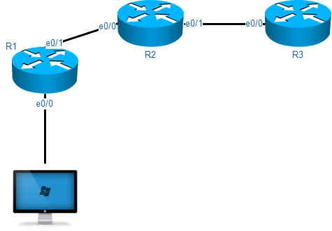

这种情况下，想要将R1的e0/0口地址加入OSPF，但是PC或者服务器是不安全的，一旦被入侵，可能和R1建立邻居，从而破坏整个网络。

我们可以将R1的e0/0加入ospf之后，设置为被动接口，那么R1的e0/0接口就无法启动任何邻居。

```
R1
router ospf 1
 passive-interface Ethernet0/0

```

## 13. 身份验证

OSPF支持以下几种认证形式

> Null
>
> 简单密码身份验证
>
> MD5身份验证
>
> 接口认证
>
> 区域认证

```
interface Ethernet0/0
 ip ospf authentication message-digest
 ip ospf message-digest-key 1 md5 [密码]
# 接口密文认证

```

```
router ospf 1
 area 1 authentication message-digest
# 配置了上述命令后，所有area1的接口都必须加同样的密码

```

如果加了区域认证，虚链路的两端属于area 0 所以在给area 0加认证的时候，别忘了虚链路对端也是area 0。

### 13.1 HMAC

 HMAC是密钥相关的哈希运算消息认证码（Hash-based Message Authentication Code）的缩写 

HMAC在OSPF中的过程大致如下

1. OSPF将更新消息和密码放在一起，算一下MD5的值，比如值是A
2. 然后OSPF将更新消息和A一起发给邻居，注意这个数据里面不带密码
3. 邻居收到了之后，将更新消息和密码放在一起，算一下MD5的值，比如值是B
4. 邻居发现A=B，就通过了对方的身份认证，如果A≠B，说明对方的认证密码和自己不一样，不能建立邻居。

## 14. OSPF综合实验


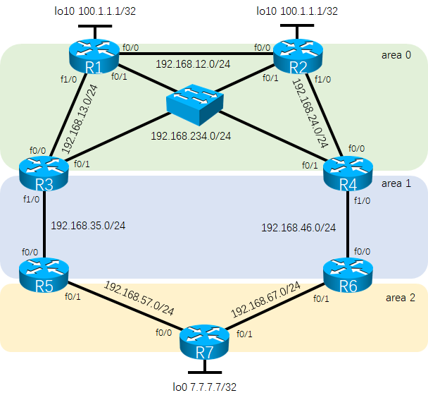

需求：

1，按照如图所示配置好路由器的接口地址。在每台路由器上必须建立loopback0接口。

2，配置好OSPF，区域划分如图所示，并且ospf的router-id必须为loopback0的地址。最终实现全网互联。

3，在R1、R2、R3、R4之间的多路访问网络里面，必须是的R1成为DR，R2成为BDR。在其余的链路里面必须保障OSPF邻居的快速建立，而不需要经过wait timer。

4，在R1和R2上建立loopback10，接口的地址为同样的100.1.1.1/32来模拟外网的接入。要求R1和R2都向内网通告一条缺省路由，正常的时候所有的路由器通过R1的缺省路由来访问外网，当R1无法正常工作的时候，通过R2来访问外网。（需要在R7上使用traceroute来测试路线。）

5，area 2为特殊区域，该区域无法学习到ospf其他区域的路由。R7的loopback0的地址通过redistribute connected subnets命令进入ospf。(观察R5和R6上的7.7.7.0路由的来源，思考原因。)

6，在R3上创建loopback1-3，地址为172.16.x.1/24(x为1-3)。并且宣告进OSPF区域1，要求在area 0只能看到一条汇总的路由172.16.0.0

7，area 0需要启用明文区域认证，R3和R5之间明文链路认证，R4和R6之间密文链路认证。

8，禁止area 2内的192.168.57.0/24和192.168.67.0/24被其他区域学习到。此刻思考区域0里面关于7.7.7.0的路由消失的原因，并且需要解决7.7.7.0消失的问题。

