# 10.交换原理

## 1. 交换机的工作原理

- 交换机的主要作用是将多个节点连接至同一个广播域中
- 广播域中的设备可以直接通信，同一个广播域建议IP地址网络号一样

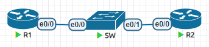

如图，R1和R2属于同一个广播域，只需要有二层的数据封装就可以通信，不看三层的数据封装

<!--more-->

R1和R2故意配置不是同一个网段的地址，看下是否可以通信

```
R1(config)#int e0/0
R1(config-if)#ip add 172.16.1.1 255.255.255.0
R1(config-if)#no sh
R1(config-if)#ip route 0.0.0.0 0.0.0.0 e0/0
```

```
R2(config)#int e0/0
R2(config-if)#ip add 192.168.1.1 255.255.255.0
R2(config-if)#no sh
R2(config-if)#ip route 0.0.0.0 0.0.0.0 e0/0
```

测试是否可以互相访问

```
R1#ping 192.168.1.1
Type escape sequence to abort.
Sending 5, 100-byte ICMP Echos to 192.168.1.1, timeout is 2 seconds:
.!!!!
Success rate is 80 percent (4/5), round-trip min/avg/max = 1/1/1 ms
```

这就说明二层的通信和三层的通信在一定程度上是隔离的，因为中间转发数据的设备不一样。

如果某个数据只有二层数据封装，那么只能在本广播域传递，交换机在处理的时候是不看IP地址相关信息，也就是不去查看三层数据。

路由器只处理IP报头中的内容，不去转发只有二层的数据，甚至如果这个数据包中二层的目的MAC地址不是路由器，路由器会直接丢弃。

1. 交换机收到一个数据之后，首先会将数据的源MAC地址和收到的这个接口对应关系记录到MAC地址表中

```
Switch#sh mac address-table 
          Mac Address Table
-------------------------------------------

Vlan    Mac Address       Type        Ports
----    -----------       --------    -----
   1    aabb.cc00.5000    DYNAMIC     Et0/2
Total Mac Addresses for this criterion: 1
```

2. 查看目的MAC地址是否存在MAC地址表中，如果不存在，就会将这个数据复制多份，每个接口都发一份(泛洪)。比如下图，就收到了交换机泛洪过来的，不应该发送的数据包，不过只收到了一个。

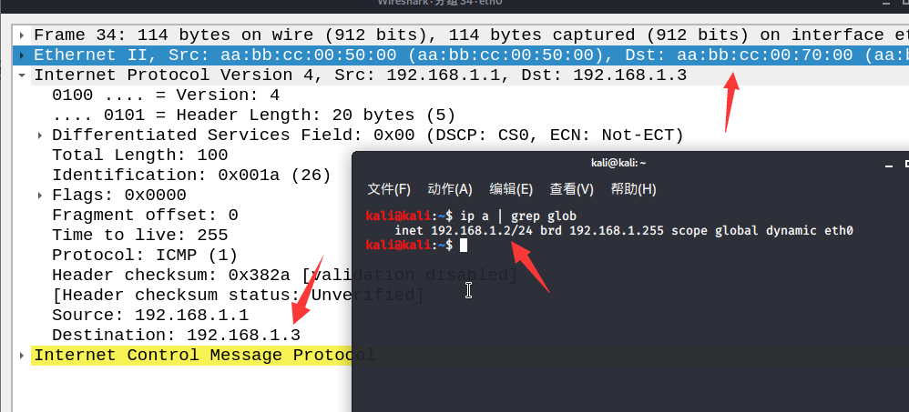

3. 交换机收到了正确的设备回应，并且学习到了MAC地址和接口对应关系，所以后续的数据都不会再泛洪。

```
Switch#sh mac address-table 
          Mac Address Table
-------------------------------------------

Vlan    Mac Address       Type        Ports
----    -----------       --------    -----
   1    aabb.cc00.5000    DYNAMIC     Et0/2
   1    aabb.cc00.7000    DYNAMIC     Et0/1
Total Mac Addresses for this criterion: 2
```

### 1.1 MAC泛洪攻击

现有市面上的交换机学习到的MAC地址都是保存在内存中的，MAC地址学习数量有限，正常一个企业级入门交换机，能学习到的MAC地址数量只有几千个。

比如cisco C3560交换机可以学习到的地址只有6056个，正常情况下动态学习的MAC地址，需要等待300s都没有再次通信，就会删除。

```
Eagle#show mac address-table count 
Mac Entries for Vlan 0:
---------------------------
Dynamic Address Count  : 21
Static  Address Count  : 0
Total Mac Addresses    : 21
Total Mac Address Space Available: 6056
```

如果有用户恶意的让交换机疯狂的学习MAC地址，直到塞满MAC地址表，那么所有的数据都会泛洪，从而导致内网信息泄漏。

macof是dsniff套装工具集的成员，macof会发送随机mac地址的数据，让交换机瞬间塞满mac地址表，这样交换机就不得不泛洪每个数据，然后再通过dsniff分析敏感信息，比如密码。

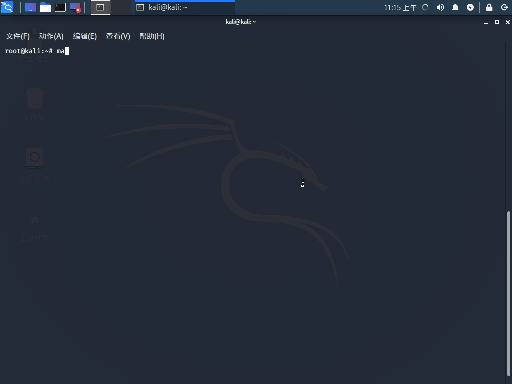

没运行几秒钟，交换机的MAC地址表就学习到了一万多条

```
Switch#show mac address-table count 

Mac Entries for Vlan 1:
---------------------------
Dynamic Address Count  : 11292
Static  Address Count  : 0
Total Mac Addresses    : 11292

Total Mac Address Space Available: 209388488
```

### 1.2 路由器的工作原理

1. 收到一个数据包之后，首先查看目的MAC地址是否是接收端口，如果不是，就丢弃，如果是广播那就处理，但是不转发。
2. 目的MAC地址如果通过检查，就回判断目的IP地址时候可路由(也就是路由表中是否存在匹配条目)，存在就转发。
3. 要注意，不管是接收还是发送，都会进行ACL检查。

## 2. VLAN

### 2.1 LAN(Local Area Network )

- 本地区域网络，一般指的是一个广播域，里面的节点可以直接使用数据链路层封装信息通信
- 不同的LAN往往是隔离的，如果有通信的需要，必须要经过一台三层设备，比如防火墙、路由器、上网行为管理等等
- 在企业中，不同的LAN之间通信需要进行安全策略，比如研发部门的内网和销售部门的内网，就应该中间隔离

一台交换机默认情况下，所有接口都属于一个LAN，但是有时候因为成本和部署的需要，我们想让一台交换机可以有多个LAN，这些LAN之间是逻辑上隔离的，我们称为VLAN。

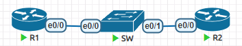

如果SW的e0/0和e0/1没有配置不同的VLAN，那么R1和R2即使网段不一样，依旧可以通信。

将R1分配到vlan10，将R2分配到vlan20，这样就彻底隔离了。

```
SW(config)#vlan 10,20
SW(config-vlan)#int e0/0	# 要注意，真实的交换机接口是从1开始的，这边是模拟器的Bug
SW(config-if)#switchport access vlan 10
SW(config-if)#int e0/1
SW(config-if)#switchport access vlan 20
SW#show vlan
VLAN Name                             Status    Ports
---- -------------------------------- --------- -------------------------------
1    default                          active    Et0/2, Et0/3
10   VLAN0010                         active    Et0/0
20   VLAN0020                         active    Et0/1
```

- 默认情况下，交换机所有的接口都属于vlan1，所以交换机插电开机就可使用，并且所有接口默认都是一个LAN
- VLAN号范围是0-4095，其中有部分是保留的，0是不可以使用的
- 在cisco设备上，vlan信息是保存在vlan数据库中的，在NVRAM的vlan.dat文件中，并不在startup-config和running-config中，所以show run是看不到对vlan操作的命令的

## 3. Trunk

如果在交换机级联的情况下(下面有介绍)，各自VLAN的数据在交换机之间也需要传递。

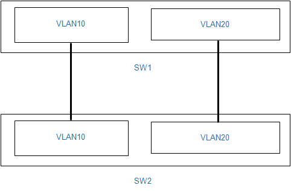

可以多台交换机之间将不同的VLAN拿线连起来，这样就可以实现不同交换机相同VLAN可以通信，但是不同VLAN又是隔离的。

不过这么做，在VLAN多了之后，比如一些大型公司，VLAN就有几十个上百个之多，这样的话接口都不够，就需要有新的解决方案。

Trunk接口是被定义了用来区分不同VLAN流量的。

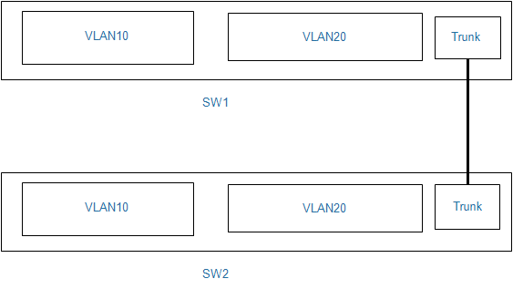

- Trunk接口不能属于任何VLAN
- Trunk接口会将流量按照802.1Q标准重新封装数据链路层，在类型字段后插入VLAN标签相关信息，标识这个流量

- Trunk发出去的时候会加上VLAN信息，接收的时候会去除信息，并且把流量放到对应的VLAN中
- 如果多台交换机trunk级联，要注意，所有的交换机都必须要创建相同的VLAN号，即使某台交换机没有任何接口属于这个VLAN，也必须创建，不然这个VLAN的流量经过这台交换机的时候，就无法识别。

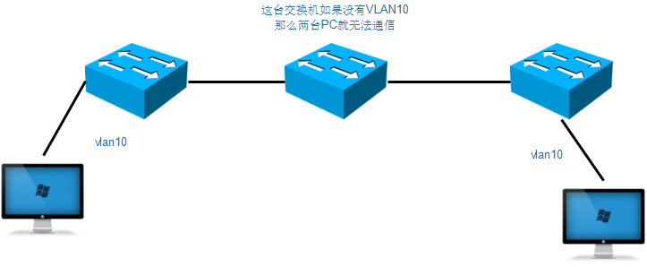

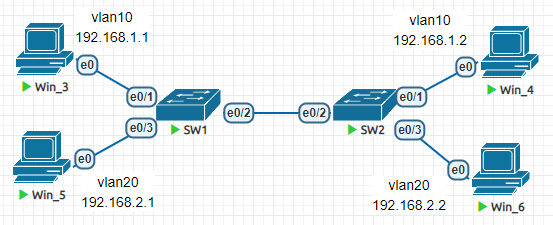

首先不去配置交换机，只是配置PC的IP地址，发现其实是会有跨网段访问的风险的。

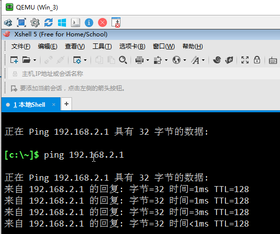

我们开始配置VLAN

```
Sw1(config)#vlan 10
Sw1(config-vlan)#name oppo
Sw1(config-vlan)#vlan 20 
Sw1(config-vlan)#name vivo
Sw1(config-vlan)#int e0/1
Sw1(config-if)#sw ac vl 10
Sw1(config-if)#int e0/3
Sw1(config-if)#sw ac vl 20
```

```
Sw2(config)#vlan 10
Sw2(config-vlan)#name oppo
Sw2(config-vlan)#vlan 20
Sw2(config-vlan)#name vivo
Sw2(config-vlan)#int e0/1
Sw2(config-if)#sw ac vl 10
Sw2(config-if)#int e0/3
Sw2(config-if)#sw ac vl 20
```

配置接口支持trunk

```
interface Ethernet0/2
 switchport trunk encapsulation dot1q
 switchport mode trunk
```

查看trunk是否启动

```
Sw2#show interfaces trunk 

Port        Mode             Encapsulation  Status        Native vlan
Et0/2       on               802.1q         trunking      1

Port        Vlans allowed on trunk
Et0/2       1-4094

Port        Vlans allowed and active in management domain
Et0/2       1,10,20

Port        Vlans in spanning tree forwarding state and not pruned
Et0/2       1,10,20
```

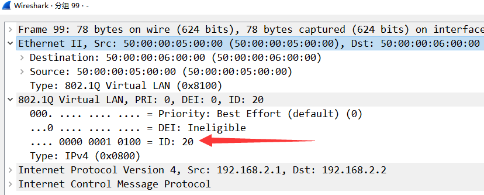

### 3.1 本帧VLAN

- 修改数据链路层封装，需要破坏原始数据报头，加入新的报头，并且还需要重新计算帧尾校验序列(FCS)，比较消耗性能
- 可以交换机约定好，特定的VLAN大家都不打标签，这个就是本帧，默认本帧VLAN是vlan1
- Trunk接口如果收到一个没打802.1Q标记的流量，就认为这个是本帧VLAN的流量
- PC接口如果收到一个打上802.1Q标记的流量，会认为数据出错，然后丢包
- 本帧VLAN如果配置错误，可能导致流量在错误VLAN出现，最新的Cisco交换机固件会发现这个问题，然后将接口切断，防止发生串错VLAN情况，会将接口设置为`Inconsistent`状态

```
interface Ethernet0/2
 switchport trunk native vlan 10
```

抓包发现没有802.1Q的信息了

## 4. 交换机级联

当交换机接口不够，或者是部署位置的需要，比如两栋楼不可能都接在同一台交换机上，这个时候就需要将多台交换机连接起来，一台接一台的做法称之为级联。

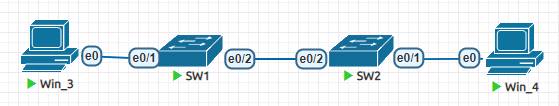

默认情况下

1. win_3发出了一个数据，Sw1记录下Win_3的MAC地址和e0/1接口的关系，然后泛洪，从e0/2发出。
2. Sw2收到了之后，记录下Win_3的MAC地址和e0/2接口的对应关系，然后泛洪，从e0/1发出。
3. Win_4收到了Win_3发来的数据，开始回复，发送给Sw2
4. Sw2收到了之后，记录下来Win_4和e0/1的对应关系，然后查找MAC表，准确的从e0/2转发给Win_3。
5. Sw1收到了之后，记录下Win_4和e0/1的对应关系，然后查找MAC表，准确的从e0/1转发给Win_3。

下面是MAC地址表

```
SW1#show mac address-table 
          Mac Address Table
-------------------------------------------

Vlan    Mac Address       Type        Ports
----    -----------       --------    -----
   1    5000.0003.0000    DYNAMIC     Et0/1
   1    5000.0004.0000    DYNAMIC     Et0/2
   1    aabb.cc00.2020    DYNAMIC     Et0/2
Total Mac Addresses for this criterion: 3
SW2#show mac address-table 
          Mac Address Table
-------------------------------------------

Vlan    Mac Address       Type        Ports
----    -----------       --------    -----
   1    5000.0003.0000    DYNAMIC     Et0/2
   1    5000.0004.0000    DYNAMIC     Et0/1
   1    aabb.cc00.1020    DYNAMIC     Et0/2
Total Mac Addresses for this criterion: 3
```

级联可能会带来带宽瓶颈的问题
