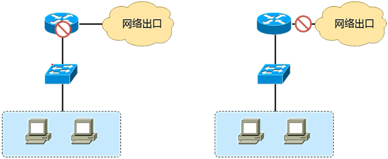
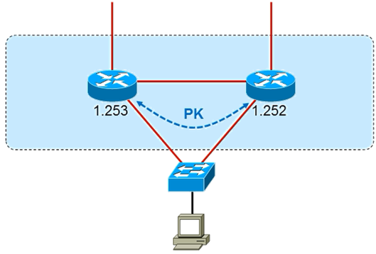
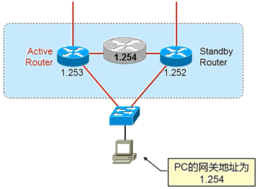
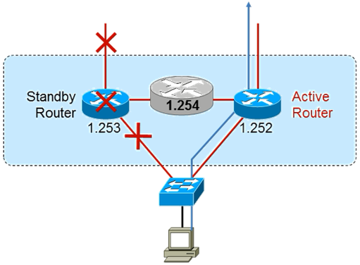
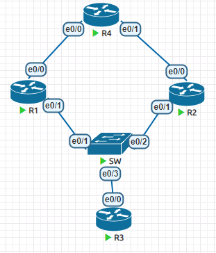

# 11.首跳冗余协议

一旦网络网关或关键节点出现故障，将对业务造成灾难性故障

而网关在大多数情况下只有一个，无法做到冗余，而本章节讨论的就是怎么对网络节点进行冗余。



## 1. HSRP

cisco私有的



比如内网中两个节点先比较各自的IP地址，地址大的最终胜出。



胜出的路由器可以响应虚拟IP地址的请求，而对用户而言，虚拟IP地址就是业务地址。



当负责响应这个虚拟IP地址的设备发生了故障，那么另外一台设备就会及时发现，并且抢过虚拟IP地址的响应。



R1,R2,R3是内网设备，R3模拟PC，R1和R2模拟网关

```
R1(config)#int lo0
R1(config-if)#ip add 1.1.1.1 255.255.255.0
R1(config-if)#ip ospf 1 area 0
R1(config-if)#int e0/0
R1(config-if)#ip add 192.168.14.1 255.255.255.0
R1(config-if)#no sh
R1(config-if)#ip ospf 1 area 0
R1(config-if)#int e0/1
R1(config-if)#ip add 192.168.123.251 255.255.255.0
R1(config-if)#no sh
=================================
R2(config)#int lo0
R2(config-if)#ip add 2.2.2.2 255.255.255.0
R2(config-if)#ip ospf 1 area 0
R2(config-if)#int e0/0
R2(config-if)#ip add 192.168.24.2 255.255.255.0
R2(config-if)#no sh
R2(config-if)#ip ospf 1 area 0
R2(config-if)#int e0/1
R2(config-if)#ip add 192.168.123.252 255.255.255.0
R2(config-if)#no sh
=====================================
R3(config)#int e0/0
R3(config-if)#ip add 192.168.123.3 255.255.255.0
R3(config-if)#no sh
R3(config-if)#ip route 0.0.0.0 0.0.0.0 192.168.123.254
=========================================
R4(config)#int lo0
R4(config-if)#ip add 4.4.4.4 255.255.255.0
R4(config-if)#ip ospf 1 area 0
R4(config-if)#int e0/0
R4(config-if)#ip add 192.168.14.4 255.255.255.0
R4(config-if)#no sh
R4(config-if)#ip ospf 1 area 0
R4(config-if)#int e0/1
R4(config-if)#ip add 192.168.24.4 255.255.255.0
R4(config-if)#no sh
R4(config-if)#ip ospf 1 area 0
```

配置HSRP

```
R1和R2
interface Ethernet0/1
 standby 1 ip 192.168.123.254
```

查看HSRP运行状态

```
R1#sh standby 
Ethernet0/1 - Group 1
  State is Active
    2 state changes, last state change 00:00:38
  Virtual IP address is 192.168.123.254		# 虚拟IP地址
  Active virtual MAC address is 0000.0c07.ac01	# 虚拟MAC地址，0000.0c07.ac<standby组号>
    Local virtual MAC address is 0000.0c07.ac01 (v1 default)
  Hello time 3 sec, hold time 10 sec
    Next hello sent in 2.560 secs
  Preemption disabled		# 默认角色不会被抢占
  Active router is local
  Standby router is 192.168.123.252, priority 100 (expires in 10.800 sec)
  Priority 100 (default 100)	# 优先级大的成为active
  Group name is "hsrp-Et0/1-1" (default)
R1#show standby brief 
                     P indicates configured to preempt.
                     |
Interface   Grp  Pri P State   Active          Standby         Virtual IP
Et0/1       1    100   Active  local           192.168.123.252 192.168.123.254
```

如果优先级一样的，就比较接口IP地址，大的成为active

```
R1(config)#track 1 interface e0/0 line-protocol		# 追踪e0/0链路协议状态
R1(config)#int e0/1
R1(config-if)#standby 1 preempt		# 开启抢占，哪个设备优先级高，就会立即变成active
R1(config-if)#standby 1 priority 110	# 修改优先级
R1(config-if)#standby 1 track 1 decrement 20	# 如果track1变成down，那么优先级降低20
```

## 2. VRRP

和HSRP功能一样，只是计时器和名词有些变化

还是上面的拓扑

```
int e0/1
vrrp 1 ip 192.168.123.254
```

查看vrrp的运行状态

```
R1#show vrrp
Ethernet0/1 - Group 1  
  State is Backup  
  Virtual IP address is 192.168.123.254
  Virtual MAC address is 0000.5e00.0101
  Advertisement interval is 1.000 sec		# hello间隔变为了1s
  Preemption enabled		# 抢占默认开启
  Priority is 100 
  Master Router is 192.168.123.252, priority is 100 
  Master Advertisement interval is 1.000 sec
  Master Down interval is 3.609 sec (expires in 3.016 sec)	# 死亡时间变为了3s
```

```
R1(config-if)#vrrp 1 priority 110
R1(config-if)#vrrp 1 preempt
R1(config-if)#vrrp 1 track 1 decrement 20
```

## 3. GLBP

协议概述

- 使得同一时间可使用多个网关，并且自动检测活跃网关。
- 每组GLBP最多可以有4台作为ip默认网关的成员路由器，这些网关被称为AVF（active virtual forwarder）
- GLBP自动管理虚拟MAC地址的分配，决定谁来负责处理转发的工作，这些功能由AVG（active virtual gateway实现）
- 因此AVG负责分发虚拟MAC，AVF负责转发数据