# 14.LNMP

## 14.LNMP

### 1. LNMP架构概述

#### 1.1 什么是LNMP

LNMP是一套技术的组合，L=Linux、N=Nginx、M=MySQL、P=PHP

#### 1.2 LNMP架构是如何工作的

- 首先nginx服务是不能处理动态请求，那么当用户发起动态请求时，nginx无法处理
- 当用户发起http请求，请求会被nginx处理，如果是静态资源请求nginx则直接返回，如果是动态请求nginx则通过fastcgi协议转交给后端的PHP程序处理


#### 1.3 Nginx与fastcgi详细工作流程

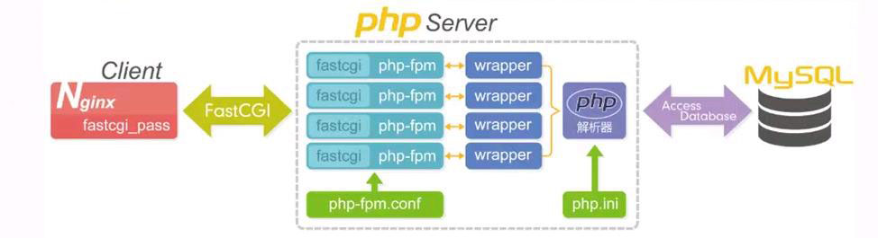

1. 用户通过http协议发起请求，请求会先抵达LNMP架构中的nginx；
2. nginx会根据用户的请求进行location规则匹配；
3. location如果匹配到请求是静态，则由nginx读取本地直接返回；
4. location如果匹配到请求是动态，则由nginx将请求转发给fastcgi协议；
5. fastcgi收到请求交给php-fpm管理进程，php-fpm管理进程接收到后会调用具体的工作进程wrapper；
6. wrapper进程会调用PHP程序进行解析，如果只是解析代码，php直接返回；
7. 如果有查询数据库操作，则由php连接数据库（用户 密码 ip）发起查询的操作；
8. 最终数据由mysql-->php-->php-fpm-->fastcgi-->nginx-->http-->user

### 2. LNMP架构环境部署

#### 2.1 安装nginx

参考课件开始部分中的编译安装，当然也可以通过yum安装，但是yum安装的时候需要注意配置文件的路径

自行完成nginx的编译安装...

#### 2.2 安装php

1. 安装php8.0全家桶

```bash
[root@localhost ~]# yum install -y epel-release

# 安装php仓库
[root@localhost ~]# yum install -y dnf-utils http://rpms.remirepo.net/enterprise/remi-release-8.rpm --skip-broken
[root@localhost ~]# yum install -y php php-cli php-curl php-mysqlnd php-gd php-opcache php-zip php-intl
```

2. 更改php配置文件，启动监控9000端口

```bash
[root@localhost ~]# vim /etc/php-fpm.d/www.conf
......
;listen = /run/php-fpm/www.sock
listen = 9000
......
```

3. 更改php-fpm用户，与nginx保持一致

```bash
[root@localhost ~]# sed -i '/^user/c user = nginx' /etc/php-fpm.d/www.conf
[root@localhost ~]# sed -i '/^group/c group = nginx' /etc/php-fpm.d/www.conf
```

4. 启动php-fpm管理器

```bash
[root@localhost ~]# systemctl enable --now php-fpm
[root@localhost ~]# systemctl status php-fpm
● php-fpm.service - The PHP FastCGI Process Manager
     Loaded: loaded (/usr/lib/systemd/system/php-fpm.service; enabled; pr>
     Active: active (running) since Fri 2025-02-07 19:26:10 CST; 10s ago
   Main PID: 34396 (php-fpm)
     Status: "Processes active: 0, idle: 5, Requests: 0, slow: 0, Traffic>
      Tasks: 6 (limit: 10888)
     Memory: 29.1M
        CPU: 60ms
     CGroup: /system.slice/php-fpm.service
             ├─34396 "php-fpm: master process (/etc/php-fpm.conf)"
             ├─34397 "php-fpm: pool www"
             ├─34398 "php-fpm: pool www"
             ├─34399 "php-fpm: pool www"
             ├─34400 "php-fpm: pool www"
             └─34401 "php-fpm: pool www"

# 检查9000端口号是否监听
[root@localhost ~]# ss -nlt
State   Recv-Q  Send-Q   Local Address:Port   Peer Address:Port  Process
LISTEN  0       128            0.0.0.0:22          0.0.0.0:*
LISTEN  0       511            0.0.0.0:80          0.0.0.0:*
LISTEN  0       511                  *:9000              *:*
LISTEN  0       128               [::]:22             [::]:*
```

#### 2.3 安装Mariadb数据库

```bash
# 安装mariadb数据库软件
[root@localhost ~]# yum install -y mariadb-server mariadb

# 启动数据库并且设置开机自启动
[root@localhost ~]# systemctl enable --now mariadb

# 设置mariadb的密码
[root@localhost ~]# mysqladmin password '123456'

# 验证数据库是否工作正常
[root@localhost ~]# mysql -uroot -p123456 -e "show databases;"
+--------------------+
| Database           |
+--------------------+
| information_schema |
| mysql              |
| performance_schema |
+--------------------+
```

### 3. LNMP架构环境配置

- 在将nginx与PHP集成的过程中，需要先了解fastcgi代理配置语法

#### 3.1 设置fastcgi服务器的地址

- 该地址可以指定为域名或IP地址，以及端口

```bash
Syntax: fastcgi_pass address;
Default:-
Context:location,if in location
#语法示例
fastcgi_pass location:9000;
fastcgi_pass unix:/tmp/fastcgi.socket;
```

#### 3.2 设置fastcgi默认的首页文件

- 需要结合fastcgi_param一起设置

```bash
Syntax: fastcgi_index name;
Default:-
Context:http,server,location
```

#### 3.3 通过fastcgi_param设置变量

- 将设置的变量传递到后端的fastcgi服务器

```bash
Syntax: fastcgi_param parameter value [if_not_empty];
Default:-
Context:http,server,location
#语法示例
fastcgi_index index.php;
fastcgi_param SCRIPT_FILENAME /code$fastcgi_script_name;
```

#### 3.4 php探针测试

为了测试php环境是否正常，我们可以编写一个php文件，然后查看是否运行正常来进行判断

```bash
# 首先为php探针创建一个虚拟主机
[root@localhost ~]# vim /apps/nginx/conf.d/php.conf
server {
        listen 80;
        server_name php.iproot.cn;
        root /code;

        location / {
                index index.php index.html;
         }

        location ~ \.php$ {
                fastcgi_pass 127.0.0.1:9000;
                fastcgi_param SCRIPT_FILENAME $document_root$fastcgi_script_name;
                include fastcgi_params;
         }
}

# 测试nginx配置是否正确
[root@localhost ~]# nginx -t

# 重启nginx服务
[root@localhost ~]# systemctl restart nginx
```

编写php文件，在php文件中编写如下代码

```php
[root@localhost ~]# mkdir /code
[root@localhost ~]# vim /code/info.php
<?php
    phpinfo();
?>
```

在浏览器中访问`php.iproot.cn`记得更改windows的hosts文件，可以得到如下的结果：


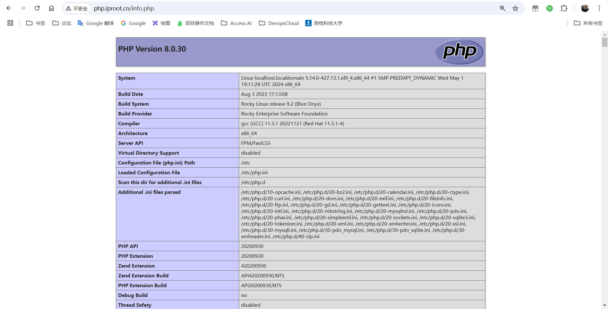

#### 3.5 测试数据库连接

为了确保php能正确访问数据库，我们可以编写如下php代码用于验证数据库是否正确连接

```php
[root@localhost ~]# vim /code/mysql.php
<?php
    $servername = "localhost";
    $username = "root";
    $password = "123456";

    // 创建连接
    $conn = mysqli_connect($servername, $username, $password);

    // 检测连接
    if (!$conn) {
         die("Connection failed: " . mysqli_connect_error());
    }
    echo "连接MySQL...成功！";
?>
```

使用浏览器访问，可以得到数据库连接的结果:


#### 3.6 安装phpmyadmin

为了方便的使用数据库，我们可以安装数据库图形化管理工具phpmyadmin

```bash
# 为数据库管理工具创建虚拟主机
[root@localhost ~]# vim /apps/nginx/conf.d/mysql.conf
server {
        listen 80;
        server_name mysql.iproot.cn;
        root /code/phpmyadmin;

        location / {
                index index.php index.html;
         }

        location ~ \.php$ {
                fastcgi_pass 127.0.0.1:9000;
                fastcgi_param SCRIPT_FILENAME $document_root$fastcgi_script_name;
                include fastcgi_params;
         }
}

# 检查nginx配置文件，并且重启
[root@localhost ~]# nginx -t
[root@localhost ~]# systemctl restart nginx


# 下载phpmyadmin源码
[root@localhost ~]# cd /code/
[root@localhost code]# wget https://files.phpmyadmin.net/phpMyAdmin/5.1.1/phpMyAdmin-5.1.1-all-languages.zip

# 解压软件包，并且重命名
[root@localhost phpmyadmin]# unzip phpMyAdmin-5.1.1-all-languages.zip
[root@localhost phpmyadmin]# mv phpMyAdmin-5.1.1-all-languages phpmyadmin

# 添加session文件夹权限
[root@localhost phpmyadmin]# chown nginx.nginx /var/lib/php/session
```

下面浏览器访问phpmyadmin页面，同样记得更改windows下的hosts文件


输入数据库用户名`root`和密码`123456`就可以进入图形化数据库管理页面了

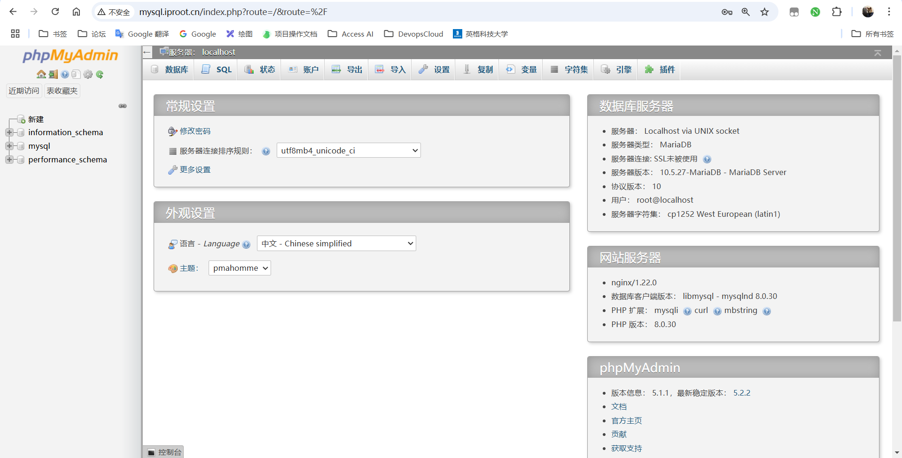

### 4. 安装博客系统

#### 4.1 部署虚拟主机

```bash
# 为博客创建虚拟主机
[root@localhost ~]# vim /apps/nginx/conf.d/typecho.conf
server {
        listen 80;
        server_name blog.iproot.cn;
        root /code/typecho;
        index index.php index.html;

        location ~ .*\.php(\/.*)*$ {
                root /code/typecho;
                fastcgi_pass   127.0.0.1:9000;
                fastcgi_index  index.php;
                fastcgi_param  SCRIPT_FILENAME $document_root$fastcgi_script_name;
                include fastcgi_params;
        }
}

# 检查nginx配置文件，并且重启
[root@localhost ~]# nginx -t
[root@localhost ~]# systemctl restart nginx

# 创建typecho目录
[root@localhost ~]# mkdir /code/typecho
[root@localhost ~]# cd /code/typecho

[root@localhost ~]# wget https://github.com/typecho/typecho/releases/latest/download/typecho.zip

# 解压源码
[root@localhost ~]# unzip typecho.zip
```

#### 4.2 创建数据库

点击数据库，输入数据库名之后，就可以点击创建

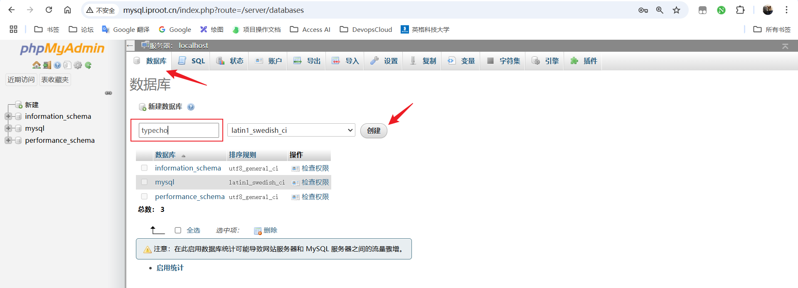

#### 4.3 安装博客系统

下面就可以开始进入网站安装的部分了，访问博客系统页面

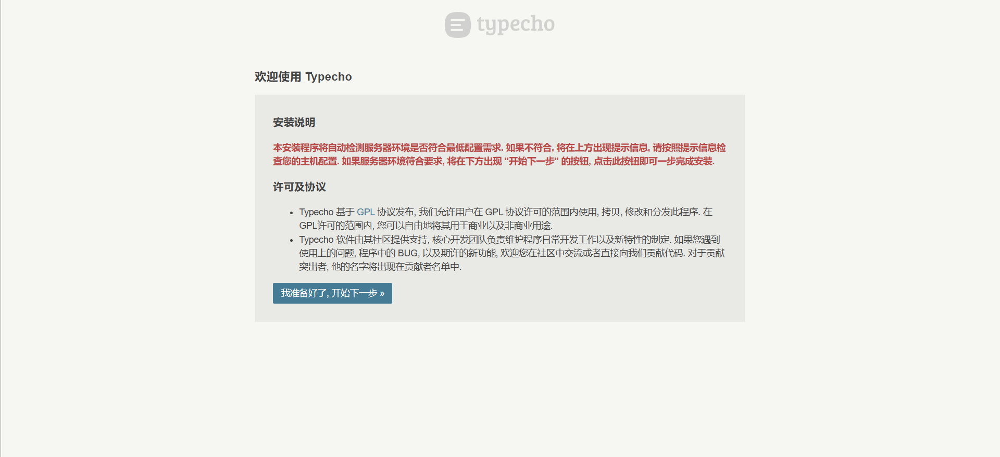

赋予网站根目录下usr/uploads目录权限

```bash
[root@localhost typecho]# chmod a+w usr/uploads/
```

继续下一步，填写数据库密码和网站后台管理员密码

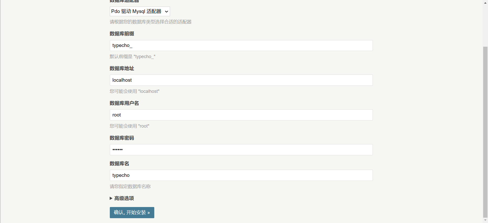

点击开始安装之后，会出现了如下页面，这个是因为php的用户是nginx用户，而/code/typecho文件夹是root用户的，所以这个网站根本没有权限保存数据相关的配置到文件夹中

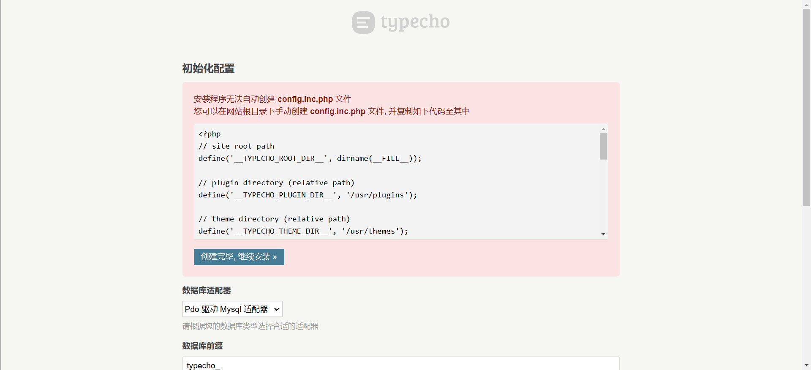

方法一：直接将typecho文件夹赋予nginx权限

方法二：手动去帮助网站创建网站没有权限的配置文件，下面将会演示方法二

直接在/code/typecho下创建`config.inc.php`文件，然后将网页提示内容写入这个文件中

```bash
[root@localhost typecho]# vim /code/typecho/config.inc.php
复制网页上的内容进去
```

配置文件创建完成之后，可以点击`创建完毕，继续安装>>`

下面是安装成功的页面

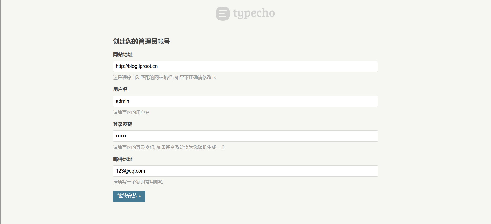

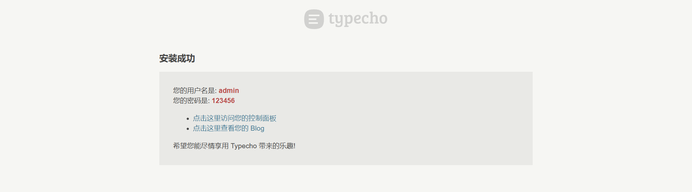

#### 4.4 切换主题

默认的主题如下，界面比较的简洁，我们可以给这个网站替换主题，也可以借此加深熟悉我们对Linux命令行的熟练程度


第三方主题商店：https://www.typechx.com/

我们尝试更换这个主题


选择模板下载

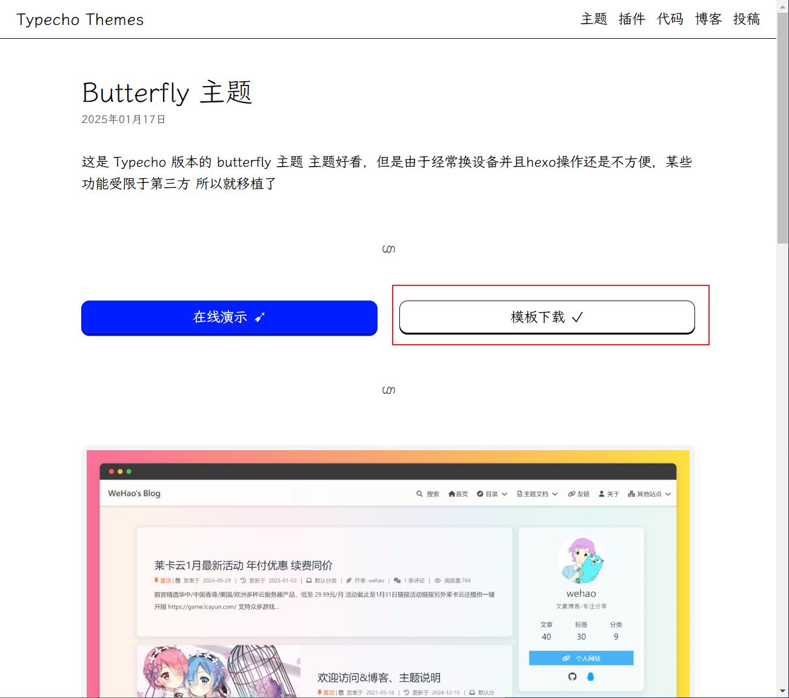

然后在打开的github仓库中下载ZIP压缩包

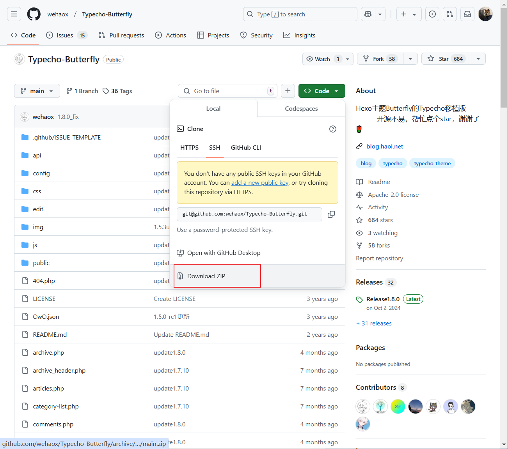

将下载好的主题压缩包上传到博客主题的目录`/code/typecho/usr/themes`

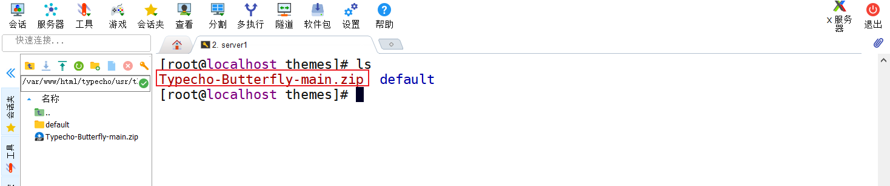

然后解压主题包，并且将名称改为简单一点的

```bash
[root@localhost themes]# unzip Typecho-Butterfly-main.zip
[root@localhost themes]# ls
Typecho-Butterfly-main  Typecho-Butterfly-main.zip  default
[root@localhost themes]# mv Typecho-Butterfly-main butterfly
[root@localhost themes]# rm -rf Typecho-Butterfly-main.zip
```

然后登录到博客后台，在设置里更换主题

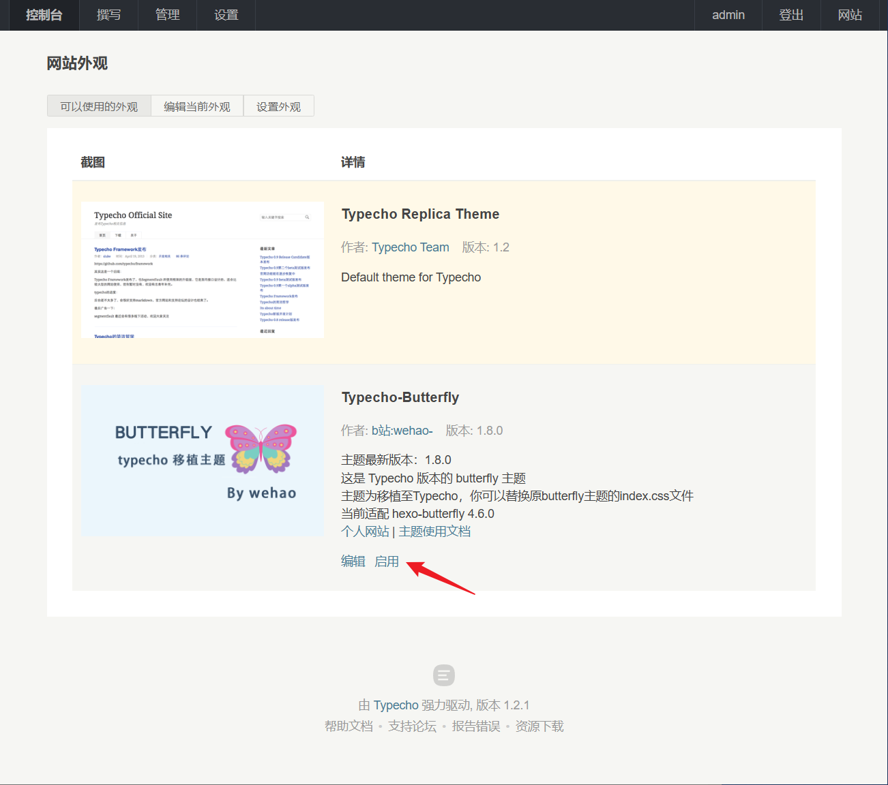

然后回到博客首页刷新一下，就可以看到新的主题已经应用了~


会有一些图片资源的丢失，稍微了解一点前端知识，就可以将其完善好了。不懂前端的同学，可以去找一些简单一点的主题。

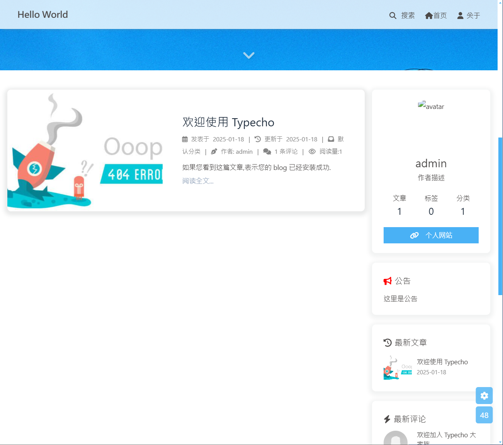

### 5. 安装网盘

#### 5.1 部署虚拟主机

```bash
# 为网盘创建虚拟主机
[root@localhost themes]# vim /apps/nginx/conf.d/kod.conf
server {
        listen 80;
        server_name kod.iproot.cn;
        root /code/kod;
        index index.php index.html;

        location ~ .*\.php(\/.*)*$ {
                root /code/kod;
                fastcgi_pass   127.0.0.1:9000;
                fastcgi_index  index.php;
                fastcgi_param  SCRIPT_FILENAME $document_root$fastcgi_script_name;
                include fastcgi_params;
        }
}

# 检查nginx配置文件，并且重启
[root@localhost ~]# nginx -t
[root@localhost ~]# systemctl restart nginx

# 下载源代码然后解压重命名
[root@localhost ~]# mkdir /code/kod
[root@localhost ~]# cd /code/kod
[root@localhost kod]# wget https://static.kodcloud.com/update/download/kodbox.1.23.zip

# 解压源码
[root@localhost kod]# unzip kodbox.1.23.zip
```

#### 5.2 创建数据库

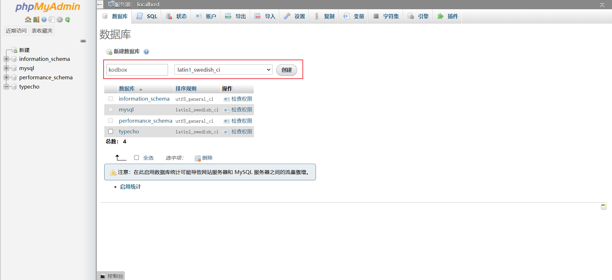

#### 5.3 安装网盘系统

浏览器访问此站点，我们发现目录权限，这个比较重要

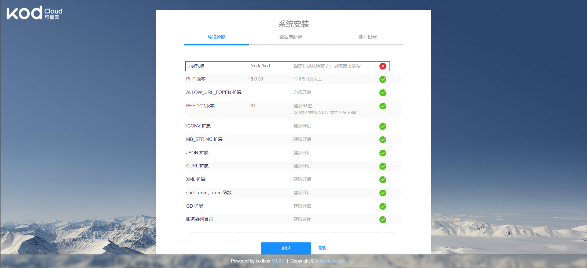

```bash
# 设置权限
[root@localhost kod]# chown -R nginx.nginx /code/kod
```

添加完成之后，刷新页面，可以看到所有条件都已经符合，就可以直接点击下一步了

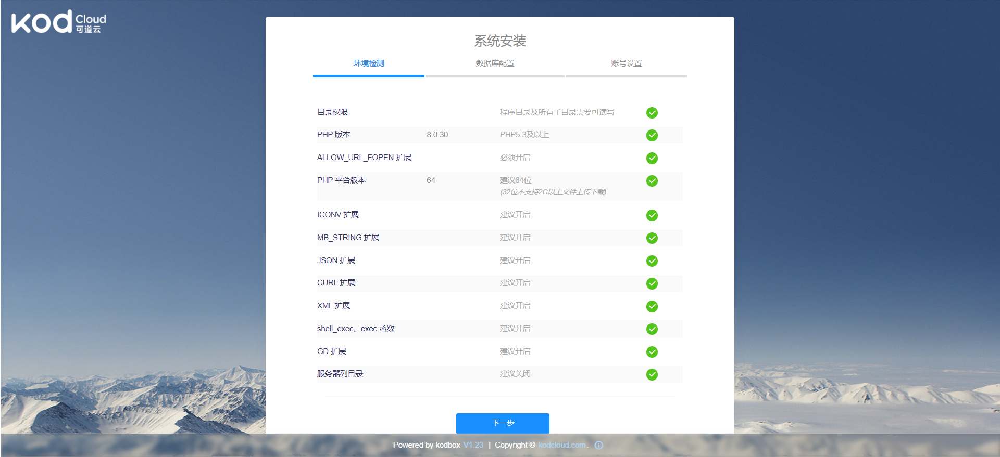

填写数据库密码和数据库名

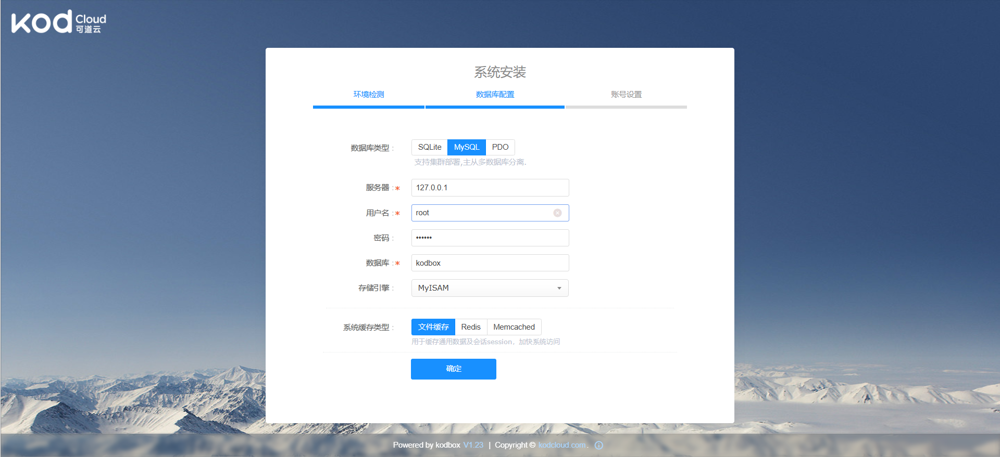

设置系统密码

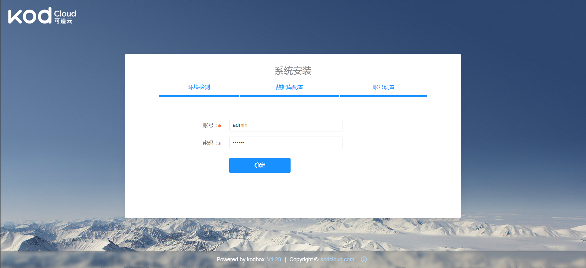

完成网站安装

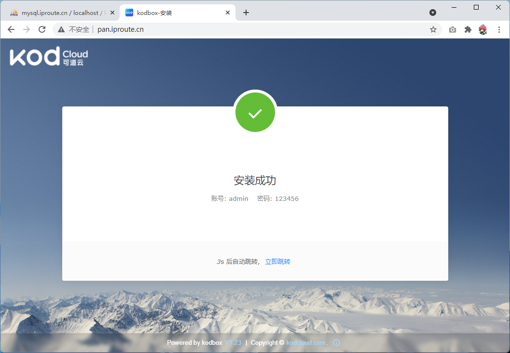


下面根据自己的喜好，进行简单的设置就可以正常使用啦！


我们也可以直接在这个上面编辑Linux上的文件，比如我们之前创建的php文件

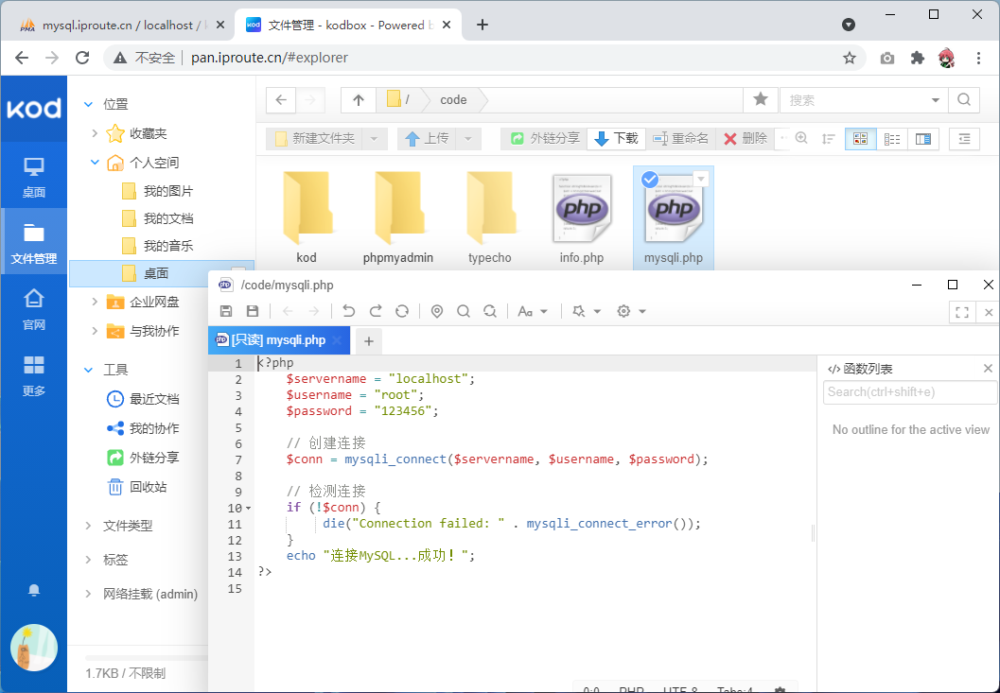

### 6. 总结

如何各位同学不是搭建在自己虚拟机上的，是去租用阿里云或者腾讯云，直接搭建，并且购买域名，就可以让自己的网站在互联网上永远在线了