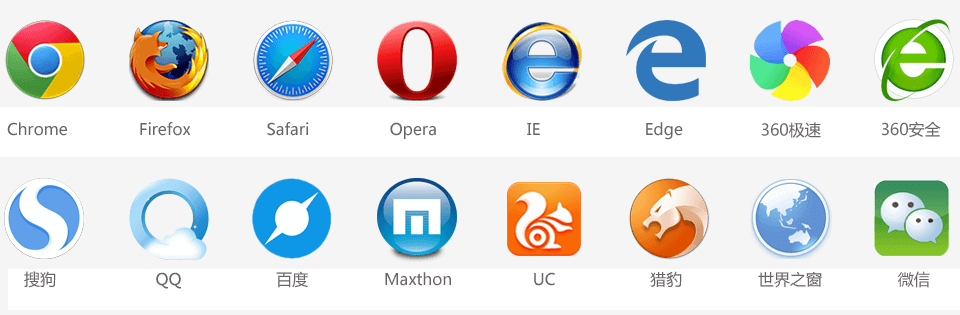
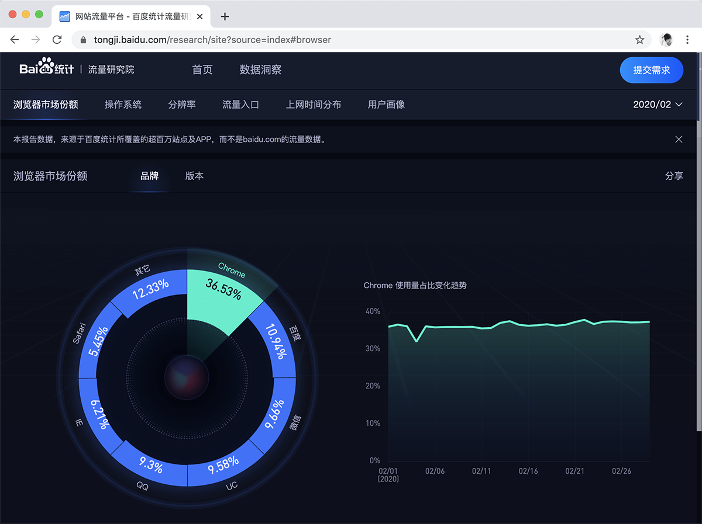
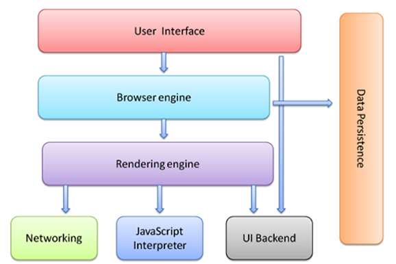

# 初识前端

## Web、网页、浏览器
### Web
Web（World Wide Web）即全球广域网，也称为万维网。
我们常说的Web端就是网页端。
### 网页
**网页是构成网站的基本元素**。网页主要由文字、图像和超链接等元素构成。当然，除了这些元素，网页中还可以包含音频、视频以及Flash等。
我们在浏览器上输入网址后，打开的任何一个页面，都是属于网页。
### 浏览器
浏览器是网页运行的平台，常见的浏览器有谷歌（Chrome）、Safari、火狐（Firefox）、IE、Edge、Opera等。
关于浏览器的详细介绍，可以看下一篇文章：《[浏览器的介绍](https://github.com/qianguyihao/Web/blob/master/01-html/02-%E6%B5%8F%E8%A7%88%E5%99%A8%E7%9A%84%E4%BB%8B%E7%BB%8D.md)》
## Web标准
### W3C组织
**W3C**：万维网联盟组织，用来制定web标准的机构（组织）。
W3C 万维网联盟是国际最著名的标准化组织。1994年成立后，至今已发布近百项相关万维网的标准，对万维网发展做出了杰出的贡献。
W3C 组织就类似于现实世界中的联合国。
为什么要遵循WEB标准呢？因为很多浏览器的浏览器内核不同，导致页面解析出来的效果可能会有差异，给开发者增加无谓的工作量。因此需要指定统一的标准。
### Web 标准
**Web标准**：制作网页要遵循的规范。
Web标准不是某一个标准，而是由W3C组织和其他标准化组织制定的一系列标准的集合。
**1、Web标准包括三个方面**：

- 结构标准（HTML）：用于对网页元素进行整理和分类。
- 表现标准（CSS）：用于设置网页元素的版式、颜色、大小等外观样式。
- 行为标准（JS）：用于定义网页的交互和行为。

根据上面的Web标准，可以将 Web前端分为三层，如下。
**2、Web前端分三层**：

- HTML（HyperText Markup Language）：超文本标记语言。从**语义**的角度描述页面的**结构**。相当于人的身体组织结构。
- CSS（Cascading Style Sheets）：层叠样式表。从**审美**的角度美化页面的**样式**。相当于人的衣服和打扮。
- JS：JavaScript。从**交互**的角度描述页面的**行为**。相当于人的动作，让人有生命力。

**3、打个比方**：（拿黄渤举例）
HTML 相当于人的身体组织结构：

CSS 相当于人的衣服和打扮：

JS 相当于人的行为：

## 
常见的浏览器
浏览器是网页运行的平台，常见的浏览器有谷歌（Chrome）、Safari、火狐（Firefox）、IE、Edge、Opera等。如下图所示：

我们重点需要学习的是 Chrome 浏览器。

## 浏览器的市场占有份额
浏览器的市场占有份额：[https://tongji.baidu.com/research/site?source=index#browser](https://tongji.baidu.com/research/site?source=index#browser)

上面这张图的统计时间是2020年2月。

## 浏览器的组成
浏览器分成两部分：

- 1、渲染引擎（即：浏览器内核）
- 2、JS 引擎
### 1、渲染引擎（浏览器内核）
浏览器所采用的「渲染引擎」也称之为「浏览器内核」，用来解析 HTML与CSS。渲染引擎决定了浏览器如何显示网页的内容以及页面的格式信息。
**渲染引擎是浏览器兼容性问题出现的根本原因。**
渲染引擎的英文叫做 Rendering Engine。通俗来说，它的作用就是：读取网页内容，计算网页的显示方式并显示在页面上。
常见浏览器的内核如下：

| **浏览器** | **内核** |
| --- | --- |
| chrome | Blink |
| 欧鹏 | Blink |
| 360安全浏览器 | Blink |
| 360极速浏览器 | Blink |
| Safari | Webkit |
| Firefox 火狐 | Gecko |
| IE | Trident |

备注：360的浏览器，以前使用的IE浏览器的Trident内核，但是现在已经改为使用 chrome 浏览器的 Blink内核。
另外，移动端的浏览器内核是什么？大家可以自行查阅资料。
### 2、JS 引擎
也称为 JS 解释器。 用来解析网页中的JavaScript代码，对其处理后再运行。
浏览器本身并不会执行JS代码，而是通过内置 JavaScript 引擎(解释器) 来执行 JS 代码 。JS 引擎执行时会逐行解释源码（转换为机器语言），然后由计算机去执行。
浏览器本身并不会执行JS代码，而是通过内置 JavaScript 引擎(解释器) 来执行 JS 代码 。JS 引擎执行代码时逐行解释每一句源码（转换为机器语言），然后由计算机去执行。所以 JavaScript 语言归为脚本语言，会逐行解释执行。
常见浏览器的 JS 引擎如下：

| **浏览器** | **JS 引擎** |
| --- | --- |
| chrome / 欧鹏 | V8 |
| Safari | Nitro |
| Firefox 火狐 | SpiderMonkey（1.0-3.0）/ TraceMonkey（3.5-3.6）/ JaegerMonkey（4.0-） |
| Opera | Linear A（4.0-6.1）/ Linear B（7.0-9.2）/ Futhark（9.5-10.2）/ Carakan（10.5-） |
| IE | Trident |

参考链接：

- [主流浏览器内核及JS引擎](https://juejin.im/post/5ada727c518825670b33a584)
## 浏览器工作原理
这一小段有些深入，小白可以暂时跳过，以后再来看。

1、User Interface 用户界面，我们所看到的浏览器
2、Browser engine 浏览器引擎，用来查询和操作渲染引擎
3、Rendering engine 用来显示请求的内容，负责解析HTML、CSS
4、Networking 网络，负责发送网络请求
5、JavaScript Interpreter(解析者) JavaScript解析器，负责执行JavaScript的代码
6、UI Backend UI后端，用来绘制类似组合框和弹出窗口
7、Data Persistence(持久化) 数据持久化，数据存储 cookie、HTML5中的sessionStorage
参考链接：

- [https://www.2cto.com/kf/201202/118111.html](https://www.2cto.com/kf/201202/118111.html)

