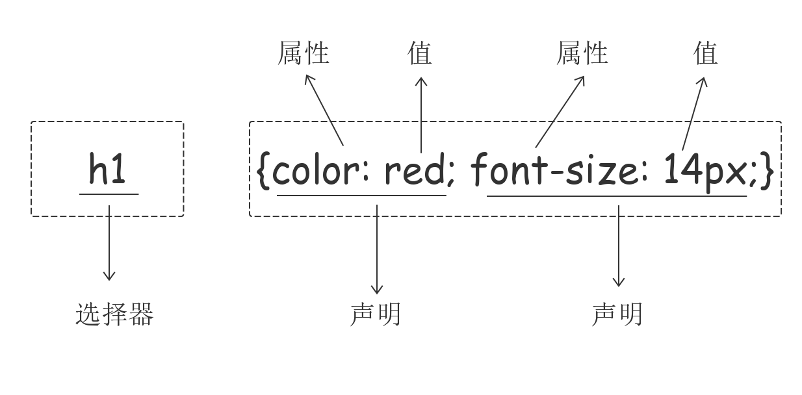
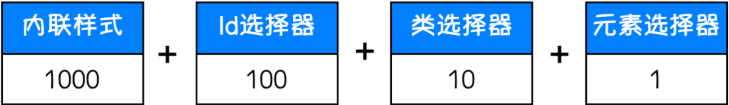
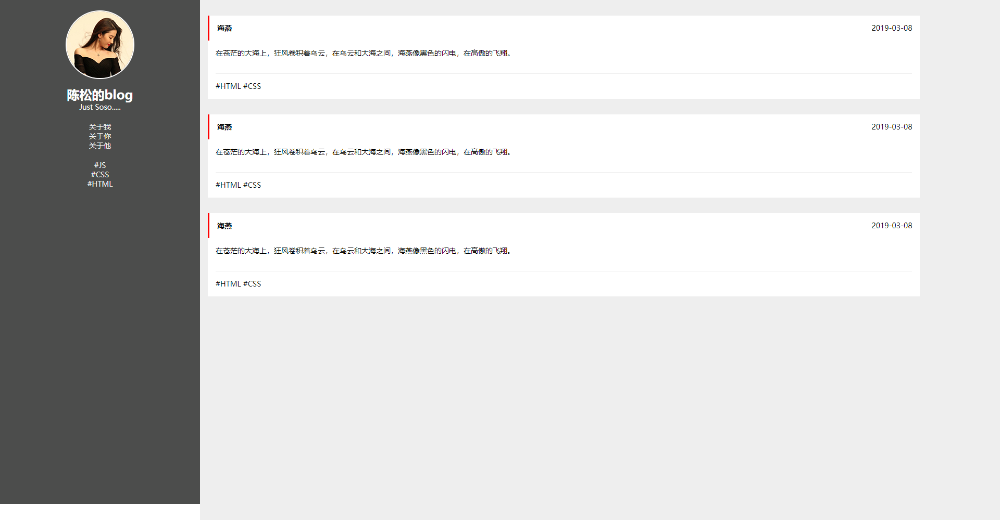

# div与css

## CSS介绍
CSS（Cascading Style Sheet，层叠样式表)定义如何显示HTML元素。
当浏览器读到一个样式表，它就会按照这个样式表来对文档进行格式化（渲染）。
## CSS语法
### CSS实例
每个CSS样式由两个组成部分：选择器和声明。声明又包括属性和属性值。每个声明之后用分号结束。




### CSS注释
/*这是注释*/
## CSS的几种引入方式
### 行内样式
行内式是在标记的style属性中设定CSS样式。不推荐大规模使用。
```css
<p style="color: red">Hello world.</p>
```
### 内部样式
嵌入式是将CSS样式集中写在网页的`<head></head>` 标签对的`<style></style>` 标签对中。格式如下：
```css
<head>
    <meta charset="UTF-8">
    <title>Title</title>
    <style>
        p{
            background-color: #2b99ff;
        }
    </style>
</head>
```
### 外部样式
外部样式就是将css写在一个单独的文件中，然后在页面进行引入即可。推荐使用此方式。
```css
<link href="mystyle.css" rel="stylesheet" type="text/css"/>
```
## CSS选择器
### 基本选择器
#### 元素选择器
```css
p {color: red;}
```
#### ID选择器
```css
##i1 {
  background-color: red;
}
```
#### 类选择器
```css
.c1 {
  font-size: 14px;
}
p.c1 {
  color: red;
}
```
注意：
样式类名不要用数字开头（有的浏览器不认）。
标签中的class属性如果有多个，要用空格分隔。
#### 通用选择器
```css
* {
  color: white;
}
```
## 组合选择器
#### 后代选择器
```css
/*li内部的a标签设置字体颜色*/
li a {
  color: green;
}
```
#### 儿子选择器
```css
/*选择所有父级是 <div> 元素的 <p> 元素*/
div>p {
  font-family: "Arial Black", arial-black, cursive;
}
```
#### 毗邻选择器
```css
/*选择所有紧接着<div>元素之后的<p>元素*/
div+p {
  margin: 5px;
}
```
#### 弟弟选择器
```css
/*i1后面所有的兄弟p标签*/
##i1~p {
  border: 2px solid royalblue;
}
```
### 属性选择器
```css
/*用于选取带有指定属性的元素。*/
p[title] {
  color: red;
}
/*用于选取带有指定属性和值的元素。*/
p[title="213"] {
  color: green;
}
```
**不常用**
```css
/*找到所有title属性以hello开头的元素*/
[title^="hello"] {
  color: red;
}

/*找到所有title属性以hello结尾的元素*/
[title$="hello"] {
  color: yellow;
}

/*找到所有title属性中包含（字符串包含）hello的元素*/
[title*="hello"] {
  color: red;
}

/*找到所有title属性(有多个值或值以空格分割)中有一个值为hello的元素：*/
[title~="hello"] {
  color: green;
}
```
### 分组和嵌套
#### 分组
当多个元素的样式相同的时候，我们没有必要重复地为每个元素都设置样式，我们可以通过在多个选择器之间使用逗号分隔的分组选择器来统一设置元素样式。 
```css
div,
p {
  color: red;
}
```
#### 嵌套
多种选择器可以混合起来使用，比如：.c1类内部所有p标签设置字体颜色为红色。
```css
.c1 p {
  color: red;
}
```
### 伪类选择器
```css
/* 未访问的链接 */
a:link {
  color: #FF0000
}

/* 已访问的链接 */
a:visited {
  color: #00FF00
} 

/* 鼠标移动到链接上 */
a:hover {
  color: #FF00FF
} 

/* 选定的链接 */ 
a:active {
  color: #0000FF
}

/*input输入框获取焦点时样式*/
input:focus {
  outline: none;
  background-color: #eee;
}
```
### 伪元素选择器
#### first-letter
常用的给首字母设置特殊样式：
```css
p:first-letter {
  font-size: 48px;
  color: red;
}
```
#### before
```css
/*在每个<p>元素之前插入内容*/
p:before {
  content:"*";
  color:red;
}
```
#### after
```css
/*在每个<p>元素之后插入内容*/
p:after {
  content:"[?]";
  color:blue;
} 
```
before和after多用于清除浮动。
### 选择器的优先级
#### CSS继承
继承是CSS的一个主要特征，它是依赖于祖先-后代的关系的。继承是一种机制，它允许样式不仅可以应用于某个特定的元素，还可以应用于它的后代。例如一个body定义了的字体颜色值也会应用到段落的文本中。
```css
body {
  color: red;
}
```
此时页面上所有标签都会继承body的字体颜色。然而CSS继承性的权重是非常低的，是比普通元素的权重还要低的0。
我们只要给对应的标签设置字体颜色就可覆盖掉它继承的样式。
```css
p {
  color: green;
}
```
此外，继承是CSS重要的一部分，我们甚至不用去考虑它为什么能够这样，但CSS继承也是有限制的。有一些属性不能被继承，如：border, margin, padding, background等。
#### 选择器的优先级
我们上面学了很多的选择器，也就是说在一个HTML页面中有很多种方式找到一个元素并且为其设置样式，那浏览器根据什么来决定应该应用哪个样式呢？
其实是按照不同选择器的权重来决定的，具体的选择器权重计算方式如下图：




- 内联样式的权重为1000
- id选择器的权重为100
- 内选择器的权重为10
- 元素选择器的权重为1
- 权重计算永不退位

除此之外还可以通过添加 !important方式来强制让样式生效，但并不推荐使用。因为如果过多的使用!important会使样式文件混乱不易维护。
万不得已可以使用!important
## CSS属性相关
### 宽和高
width属性可以为元素设置宽度。
height属性可以为元素设置高度。
块级标签才能设置宽度，内联标签的宽度由内容来决定。
### 字体属性
#### 文字字体
font-family可以把多个字体名称作为一个“回退”系统来保存。如果浏览器不支持第一个字体，则会尝试下一个。浏览器会使用它可识别的第一个值。
简单实例：
```css
body {
  font-family: "Microsoft Yahei", "微软雅黑", "Arial", sans-serif;
}
```
#### 字体大小
```css
p {
  font-size: 14px;
}
```
如果设置成inherit表示继承父元素的字体大小值。
#### 字重（粗细） 
font-weight用来设置字体的字重（粗细）。

| 值 | 描述 |
| --- | --- |
| normal | 默认值，标准粗细 |
| bold | 粗体 |
| bolder | 更粗 |
| lighter | 更细 |
| 100~900 | 设置具体粗细，400等同于normal，而700等同于bold |
| inherit | 继承父元素字体的粗细值 |

#### 文本颜色
颜色属性被用来设置文字的颜色。
颜色是通过CSS最经常的指定：

- 十六进制值 - 如: ＃FF0000
- 一个RGB值 - 如: RGB(255,0,0)
- 颜色的名称 - 如:  red

还有rgba(255,0,0,0.3)，第四个值为alpha, 指定了色彩的透明度/不透明度，它的范围为0.0到1.0之间。
### 文字属性
#### 文字对齐
text-align 属性规定元素中的文本的水平对齐方式。

| 值 | 描述 |
| --- | --- |
| left | 左边对齐 默认值 |
| right | 右对齐 |
| center | 居中对齐 |
| justify | 两端对齐 |

#### 文字装饰
text-decoration 属性用来给文字添加特殊效果。

| 值 | 描述 |
| --- | --- |
| none | 默认。定义标准的文本。 |
| underline | 定义文本下的一条线。 |
| overline | 定义文本上的一条线。 |
| line-through | 定义穿过文本下的一条线。 |
| inherit | 继承父元素的text-decoration属性的值。 |

常用的为去掉a标签默认的自划线：
```css
a {
  text-decoration: none;
}
```
#### 首行缩进
将段落的第一行缩进 32像素：
```css
p {
  text-indent: 32px;
}
```
### 背景属性
```css
/*背景颜色*/
background-color: red;
/*背景图片*/
background-image: url('1.jpg');
/*
 背景重复
 repeat(默认):背景图片平铺排满整个网页
 repeat-x：背景图片只在水平方向上平铺
 repeat-y：背景图片只在垂直方向上平铺
 no-repeat：背景图片不平铺
*/
background-repeat: no-repeat; 
/*背景位置*/
background-position: right top;
/*background-position: 200px 200px;*/
```
支持简写：
```css
background:#ffffff url('1.png') no-repeat right top;
```
使用背景图片的一个常见案例就是很多网站会把很多小图标放在一张图片上，然后根据位置去显示图片。减少频繁的图片请求。
鼠标滚动背景不动
```css
<!DOCTYPE html>
<html lang="en">
<head>
    <meta charset="UTF-8">
    <meta name="viewport" content="width=device-width, initial-scale=1.0">
    <meta http-equiv="X-UA-Compatible" content="ie=edge">
    <title>滚动背景图示例</title>
    <style>
        * {
            margin: 0;
        }
        .box {
            width: 100%;
            height: 500px;
            background: url("http://tu.eagleslab.com/images/2019/01/21/timg.jpg") no-repeat center center;
            background-attachment: fixed;
        }
        .d1 {
            height: 500px;
            background-color: tomato;
        }
        .d2 {
            height: 500px;
            background-color: steelblue;
        }
        .d3 {
            height: 500px;
            background-color: mediumorchid;
        }
    </style>
</head>
<body>
    <div class="d1"></div>
    <div class="box"></div>
    <div class="d2"></div>
    <div class="d3"></div>
</body>
</html>
```
### 边框
边框属性  

- border-width
- border-style
- border-color
```css
##i1 {
  border-width: 2px;
  border-style: solid;
  border-color: red;
}
```
通常使用简写方式：
```css
##i1 {
  border: 2px solid red;
}
```
边框样式

| 值 | 描述 |
| --- | --- |
| none | 无边框。 |
| dotted | 点状虚线边框。 |
| dashed | 矩形虚线边框。 |
| solid | 实线边框。 |

除了可以统一设置边框外还可以单独为某一个边框设置样式，如下所示：
```css
##i1 {
  border-top-style:dotted;
  border-top-color: red;
  border-right-style:solid;
  border-bottom-style:dotted;
  border-left-style:none;
}
```
### border-radius
用这个属性能实现圆角边框的效果。
将border-radius设置为长或高的一半即可得到一个圆形。
### display属性
用于控制HTML元素的显示效果。

| 值 | 意义 |
| --- | --- |
| display:"none" | HTML文档中元素存在，但是在浏览器中不显示。一般用于配合JavaScript代码使用。 |
| display:"block" | 默认占满整个页面宽度，如果设置了指定宽度，则会用margin填充剩下的部分。 |
| display:"inline" | 按行内元素显示，此时再设置元素的width、height、margin-top、margin-bottom和float属性都不会有什么影响。 |
| display:"inline-block" | 使元素同时具有行内元素和块级元素的特点。 |

**display:"none"与visibility:hidden的区别：**
visibility:hidden: 可以隐藏某个元素，但隐藏的元素仍需占用与未隐藏之前一样的空间。也就是说，该元素虽然被隐藏了，但仍然会影响布局。
display:none: 可以隐藏某个元素，且隐藏的元素不会占用任何空间。也就是说，该元素不但被隐藏了，而且该元素原本占用的空间也会从页面布局中消失。
### CSS盒子模型

- margin:            用于控制元素与元素之间的距离；margin的最基本用途就是控制元素周围空间的间隔，从视觉角度上达到相互隔开的目的。
- padding:           用于控制内容与边框之间的距离；    
- Border(边框):     围绕在内边距和内容外的边框。
- Content(内容):   盒子的内容，显示文本和图像。


### margin外边距
```css
.margin-test {
  margin-top:5px;
  margin-right:10px;
  margin-bottom:15px;
  margin-left:20px;
}
```
推荐使用简写：
```css
.margin-test {
  margin: 5px 10px 15px 20px;
}
```
顺序：上右下左
常见居中：
```css
.mycenter {
  margin: 0 auto;
}
```
### padding内填充
```css
.padding-test {
  padding-top: 5px;
  padding-right: 10px;
  padding-bottom: 15px;
  padding-left: 20px;
}
```
推荐使用简写：
```css
.padding-test {
  padding: 5px 10px 15px 20px;
}
```
顺序：上右下左
补充padding的常用简写方式：

- 提供一个，用于四边；
- 提供两个，第一个用于上－下，第二个用于左－右；
- 如果提供三个，第一个用于上，第二个用于左－右，第三个用于下；
- 提供四个参数值，将按上－右－下－左的顺序作用于四边；
### float
在 CSS 中，任何元素都可以浮动。
浮动元素会生成一个块级框，而不论它本身是何种元素。
关于浮动的两个特点：

- 浮动的框可以向左或向右移动，直到它的外边缘碰到包含框或另一个浮动框的边框为止。
- 由于浮动框不在文档的普通流中，所以文档的普通流中的块框表现得就像浮动框不存在一样
#### 三种取值
left：向左浮动
right：向右浮动
none：默认值，不浮动
### clear
clear属性规定元素的哪一侧不允许其他浮动元素。

| 值 | 描述 |
| --- | --- |
| left | 在左侧不允许浮动元素。 |
| right | 在右侧不允许浮动元素。 |
| both | 在左右两侧均不允许浮动元素。 |
| none | 默认值。允许浮动元素出现在两侧。 |
| inherit | 规定应该从父元素继承 clear 属性的值。 |

注意：clear属性只会对自身起作用，而不会影响其他元素。
#### 清除浮动
清除浮动的副作用（父标签塌陷问题）
主要有三种方式：

- 固定高度
- 伪元素清除法
- overflow:hidden

伪元素清除法（使用较多）：
```css
.clearfix:after {
  content: "";
  display: block;
  clear: both;
}
```
### overflow溢出属性 
| 值 | 描述 |
| --- | --- |
| visible | 默认值。内容不会被修剪，会呈现在元素框之外。 |
| hidden | 内容会被修剪，并且其余内容是不可见的。 |
| scroll | 内容会被修剪，但是浏览器会显示滚动条以便查看其余的内容。 |
| auto | 如果内容被修剪，则浏览器会显示滚动条以便查看其余的内容。 |
| inherit | 规定应该从父元素继承 overflow 属性的值。 |

- overflow（水平和垂直均设置）
- overflow-x（设置水平方向）
- overflow-y（设置垂直方向）
#### 圆形头像示例
```html
<!DOCTYPE html>
<html lang="en">
<head>
    <meta charset="UTF-8">
    <title>csstest</title>
    <style>
        * {
            margin: 0;
            padding: 0;
            background-color: #eee;
        }
        .header-img {
            width: 550px;
            height: 550px;
            border: 3px solid black;
            border-radius: 50%;
            overflow: hidden;
        }
        .header-img>img {
            max-width: 100%;
        }
    </style>
</head>
<body>
<div class="header-img">
    
</div>
</body>
</html>
```
### 定位（position）
#### static
static 默认值，无定位，不能当作绝对定位的参照物，并且设置标签对象的left、top等值是不起作用的的。
#### relative（相对定位）
相对定位是相对于该元素在文档流中的原始位置，即以自己原始位置为参照物。有趣的是，即使设定了元素的相对定位以及偏移值，元素还占有着原来的位置，即占据文档流空间。对象遵循正常文档流，但将依据top，right，bottom，left等属性在正常文档流中偏移位置。而其层叠通过z-index属性定义。
注意：position：relative的一个主要用法：方便绝对定位元素找到参照物。
#### absolute（绝对定位）
定义：设置为绝对定位的元素框从文档流完全删除，并相对于最近的已定位祖先元素定位，如果元素没有已定位的祖先元素，那么它的位置相对于最初的包含块（即body元素）。元素原先在正常文档流中所占的空间会关闭，就好像该元素原来不存在一样。元素定位后生成一个块级框，而不论原来它在正常流中生成何种类型的框。
重点：如果父级设置了position属性，例如position:relative;，那么子元素就会以父级的左上角为原始点进行定位。这样能很好的解决自适应网站的标签偏离问题，即父级为自适应的，那我子元素就设置position:absolute;父元素设置position:relative;，然后Top、Right、Bottom、Left用百分比宽度表示。
另外，对象脱离正常文档流，使用top，right，bottom，left等属性进行绝对定位。而其层叠通过z-index属性定义。
#### fixed（固定）
fixed：对象脱离正常文档流，使用top，right，bottom，left等属性以窗口为参考点进行定位，当出现滚动条时，对象不会随着滚动。而其层叠通过z-index属性 定义。 注意点： 一个元素若设置了 position:absolute | fixed; 则该元素就不能设置float。这 是一个常识性的知识点，因为这是两个不同的流，一个是浮动流，另一个是“定位流”。但是 relative 却可以。因为它原本所占的空间仍然占据文档流。
在理论上，被设置为fixed的元素会被定位于浏览器窗口的一个指定坐标，不论窗口是否滚动，它都会固定在这个位置。
**返回顶部按钮样式**
```html
<!DOCTYPE html>
<html lang="en">
<head>
    <meta charset="UTF-8">
    <title>csstest</title>
    <style>
        * {
            margin: 0;
            padding: 0;
            background-color: #eee;
        }
        .d1 {
            height: 1000px;
            background-color: #eee;
        }
        .scrolltop {
            background-color: pink;
            padding: 10px;
            text-align: center;
            position: fixed;
            right: 10px;
            bottom: 20px;
        }
    </style>
</head>
<body>
<div class="d1">111</div>
<div class="scrolltop">返回顶部</div>
</body>
</html>
```
### z-index
```css
##i2 {
  z-index: 999;
}
```
设置对象的层叠顺序。

1. z-index 值表示谁压着谁，数值大的压盖住数值小的，
2. 只有定位了的元素，才能有z-index,也就是说，不管相对定位，绝对定位，固定定位，都可以使用z-index，而浮动元素不能使用z-index
3. z-index值没有单位，就是一个正整数，默认的z-index值为0如果大家都没有z-index值，或者z-index值一样，那么谁写在HTML后面，谁在上面压着别人，定位了元素，永远压住没有定位的元素。
4. 从父现象：父亲怂了，儿子再牛逼也没用
### opacity
用来定义透明效果。取值范围是0~1，0是完全透明，1是完全不透明。
## 博客小练习



```html
<!DOCTYPE html>
<html lang="en">
<head>
    <meta charset="UTF-8">
    <title>blog</title>
    <link rel="stylesheet" href="blog.css" type="text/css">
</head>
<body>

<!--左边栏开始-->
<div class="left">
    <div class="header-img">
        
    </div>

    <div class="blog-name">陈松的blog</div>
    <div class="blog-info">Just Soso.....</div>

    <div class="blog-links">
        <ul>
            <li><a href="">关于我</a></li>
            <li><a href="">关于你</a></li>
            <li><a href="">关于他</a></li>
        </ul>
    </div>

    <div class="blog-tags">
        <ul>
            <li><a href="">JS</a></li>
            <li><a href="">CSS</a></li>
            <li><a href="">HTML</a></li>
        </ul>
    </div>


</div>
<!--左边栏结束-->

<!--右边栏开始-->
<div class="right">
    <div class="article-list">
        <div class="article">
            <div class="article-title">
                <h1 class="article-name">海燕</h1>
                <span class="article-date">2019-03-08</span>
            </div>
            <div class="article-info">在苍茫的大海上，狂风卷积着乌云，在乌云和大海之间，海燕像黑色的闪电，在高傲的飞翔。</div>
            <div class="article-tag">#HTML #CSS</div>
        </div>
    </div>

    <div class="article-list">
        <div class="article">
            <div class="article-title">
                <h1 class="article-name">海燕</h1>
                <span class="article-date">2019-03-08</span>
            </div>
            <div class="article-info">在苍茫的大海上，狂风卷积着乌云，在乌云和大海之间，海燕像黑色的闪电，在高傲的飞翔。</div>
            <div class="article-tag">#HTML #CSS</div>
        </div>
    </div>

    <div class="article-list">
        <div class="article">
            <div class="article-title">
                <h1 class="article-name">海燕</h1>
                <span class="article-date">2019-03-08</span>
            </div>
            <div class="article-info">在苍茫的大海上，狂风卷积着乌云，在乌云和大海之间，海燕像黑色的闪电，在高傲的飞翔。</div>
            <div class="article-tag">#HTML #CSS</div>
        </div>
    </div>

</div>
<!--右边栏结束-->
</body>
</html>
```

```css
* {
    font-family: "Microsoft YaHei UI";
    font-size: 14px;
    margin: 0;
    padding: 0;
    list-style: none;
}

a {
    text-decoration: none;
}

.left {
    width: 20%;
    background-color: rgb(76,77,76);
    height: 100%;
    position: fixed;
    left: 0;
    top: 0;
}

.header-img {
    height: 128px;
    width: 128px;
    border: 2px solid white;
    border-radius: 50%;
    overflow: hidden;
    margin: 0 auto;
    margin-top: 20px;
}

.header-img>img {
    max-width: 100%;
}

.blog-name {
    color: white;
    font-size: 24px;
    font-weight: bold;
    text-align: center;
    margin-top: 15px;
}

.blog-info {
    color: white;
    text-align: center;
}

.blog-links,
.blog-tags {
    text-align: center;
    margin-top: 20px;
}

.blog-links a,
.blog-tags a {
    color: #eeeeee;
}

.blog-tags a:before {
    content: "#";
}

.right {
    width: 80%;
    background-color: #eeeeee;
    height: 1000px;
    float: right;
}

.article-list {
    background-color: white;
    margin-right: 10%;
    margin-left: 15px;
    margin-top: 30px;
}

.article-name {
    display: inline-block;
}

.article-title {
    padding: 15px;
    border-left: 3px solid red;
}

.article-info {
    padding: 15px;
}

.article-tag {
    padding: 15px 0;
    margin: 15px;
    border-top: 1px #eee solid;
}

.article-date {
    float: right;
}
```

