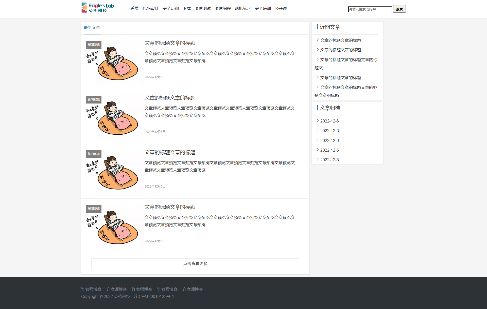
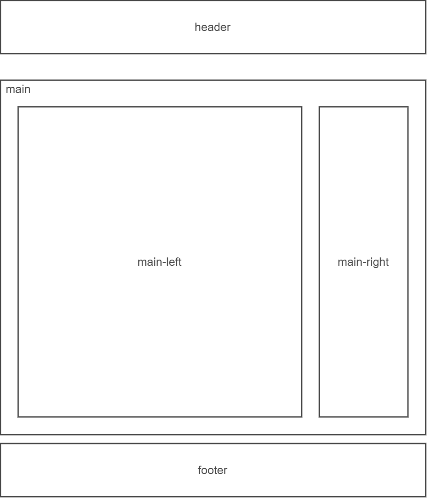

# 实战页面前端开发

## 前端部分
最终的效果



网页布局




```html
<!DOCTYPE html>
<html lang="en">

<head>
    <meta charset="UTF-8">
    <meta http-equiv="X-UA-Compatible" content="IE=edge">
    <meta name="viewport" content="width=device-width, initial-scale=1.0">
    <title>Document</title>
    <link rel="stylesheet" href="asset/style.css">
</head>

<body>
    <div id="header">
        <div class="head">
            <div class="logo">
                
            </div>
            <ul class="nav">
                <li><a href="#">首页</a></li>
                <li><a href="#">代码审计</a></li>
                <li><a href="#">安全防御</a></li>
                <li><a href="#">下载</a></li>
                <li><a href="#">渗透测试</a></li>
                <li><a href="#">渗透编程</a></li>
                <li><a href="#">靶机练习</a></li>
                <li><a href="#">安全培训</a></li>
                <li><a href="#">公开课</a></li>
            </ul>
            <form class="f1" action="#" method="GET">
                <input type="text" placeholder="请输入搜索的内容">
                <input type="submit" value="搜索">
            </form>
        </div>
    </div>
    <div id="main">
        <div id="main-left">
            <div id="a1">
                <a href="#">最新文章</a>
            </div>
            <div class="articles">
                <div class="items-img">
                    <a href="#">
                        
                    </a>
                    <a href="#" class="img-tag">新闻资讯</a>
                </div>
                <div class="items-list">

                    <div class="item-title">
                        <a href="#">文章的标题文章的标题</a>
                    </div>
                    <div class="item-content">
                        <p>文章预览文章预览文章预览文章预览文章预览文章预览文章预览文章预览文章预览文章预览文章预览文章预览文章预览</p>
                    </div>
                    <div class="item-date">
                        2022年12月5日
                    </div>
                </div>

            </div>
            <div class="articles">
                <div class="items-img">
                    <a href="#">
                        
                    </a>
                    <a href="#" class="img-tag">新闻资讯</a>
                </div>
                <div class="items-list">

                    <div class="item-title">
                        <a href="#">文章的标题文章的标题</a>
                    </div>
                    <div class="item-content">
                        <p>文章预览文章预览文章预览文章预览文章预览文章预览文章预览文章预览文章预览文章预览文章预览文章预览文章预览</p>
                    </div>
                    <div class="item-date">
                        2022年12月5日
                    </div>
                </div>

            </div>
            <div class="articles">
                <div class="items-img">
                    <a href="#">
                        
                    </a>
                    <a href="#" class="img-tag">新闻资讯</a>
                </div>
                <div class="items-list">

                    <div class="item-title">
                        <a href="#">文章的标题文章的标题</a>
                    </div>
                    <div class="item-content">
                        <p>文章预览文章预览文章预览文章预览文章预览文章预览文章预览文章预览文章预览文章预览文章预览文章预览文章预览</p>
                    </div>
                    <div class="item-date">
                        2022年12月5日
                    </div>
                </div>

            </div>
            <div class="articles">
                <div class="items-img">
                    <a href="#">
                        
                    </a>
                    <a href="#" class="img-tag">新闻资讯</a>
                </div>
                <div class="items-list">

                    <div class="item-title">
                        <a href="#">文章的标题文章的标题</a>
                    </div>
                    <div class="item-content">
                        <p>文章预览文章预览文章预览文章预览文章预览文章预览文章预览文章预览文章预览文章预览文章预览文章预览文章预览</p>
                    </div>
                    <div class="item-date">
                        2022年12月5日
                    </div>
                </div>

            </div>
            <div class="more">
                <a href="#">点击查看更多</a>
            </div>
        </div>
        <div id="main-right">
            <div class="news">
                <div class="newlist">近期文章</div>
                <ul>
                    <li><a href="#">文章的标题文章的标题</a></li>
                    <li><a href="#">文章的标题文章的标题</a></li>
                    <li><a href="#">文章的标题文章的标题文章的标题文</a></li>
                    <li><a href="#">文章的标题文章的标题</a></li>
                    <li><a href="#">文章的标题文章的标题文章的标题文章的标题</a></li>
                </ul>
            </div>

            <div class="news">
                <div class="newlist">文章归档</div>
                <ul>
                    <li><a href="#">2022-12-6</a></li>
                    <li><a href="#">2022-12-6</a></li>
                    <li><a href="#">2022-12-6</a></li>
                    <li><a href="#">2022-12-6</a></li>
                    <li><a href="#">2022-12-6</a></li>
                </ul>
            </div>
        </div>
    </div>
    <div class="clearfix"></div>
    <div id="footer">
        <div class="footer-info">
            <div class="link">
                <li><a href="#">许老师博客</a></li>
                <li><a href="#">许老师博客</a></li>
                <li><a href="#">许老师博客</a></li>
                <li><a href="#">许老师博客</a></li>
                <li><a href="#">许老师博客</a></li>
            </div>
            <div class="copyright">
                <p>Copyright &copy; 2022 英格科技 | <a href="#">苏ICP备20010123号-1</a></p>
            </div>
        </div>
    </div>
</body>

</html>
```
```css
* {
    margin: 0;
    padding: 0;
}

body {
    font-family: Arial, Helvetica, sans-serif;
    background: #f5f5f5;
    line-height: 1.8;
    font-size: 14px;
    color: #333;
}

##header {
    background: #ffffff;
    height: 70px;
    box-shadow: 0 0 3px 1px rgb(0 0 0 /10%);
}

.nav {
    list-style: none;
}

.nav li {
    float: left;
    margin-left: 15px;
    padding-top: 20px;
}

a {
    text-decoration: none;
    color: #333333;
    font-size: 16px;
}

a:hover {
    color: #337ab7;
}

.logo {
    padding-top: 10px;
    float: left;
    margin-right: 50px;
}

.head {
    width: 1280px;
    margin: 0px auto;
}

.f1 {
    float: right;
    padding-top: 20px;
}

.f1 input[type="text"] {
    height: 20px;
    border-radius: 3px;
}

.f1 input[type="submit"] {
    width: 50px;
    height: 30px;
}

##main {
    width: 1280px;
    margin: 0px auto;
    margin-top: 15px;
}

##main-left {
    background: #ffffff;
    width: 900px;
    box-shadow: 0 0 3px 1px rgb(0 0 0 /10%);
    float: left;
}

##a1 {
    font-size: 16px;
    padding: 10px 0px 10px 0px;
    margin-left: 10px;
    border-bottom: 2px solid #337ab7;
    width: 70px;
}

##a1 a {
    color: #337ab7;
}

.articles {
    border-top: 1px solid #efefef;
    padding-top: 15px;
    height: 200px;
    background: #ffffff;
}

.articles:hover {
    filter: brightness(95%);
}

.items-img img {
    width: 250px;
}

.items-img,
.items-list {
    float: left;
    position: relative;
}

.items-list {
    width: 600px;
}

.item-title a {
    font-size: 20px;
}

.item-title a:hover {
    color: #337ab7;
}

.item-content p {
    font-size: 16px;
    margin-top: 10px;
}

.item-date {
    font-size: 8px;
    color: #999;
    margin-top: 40px;
}

.img-tag {
    position: absolute;
    left: 20px;
    top: 10px;
    background: rgba(0, 0, 0, .5);
    color: #fff;
    padding: 5px 6px;
    font-size: 5px;
}

.img-tag:hover {
    background: rgb(0, 0, 0);
    color: #fff;
}

##main-right {
    float: left;
    margin-left: 10px;
    width: 280px;
}

.newlist {
    border-left: 5px solid #337ab7;
    padding-left: 6px;
    margin-left: 20px;
    padding-top: 5px;
    font-size: 20px;
    line-height: 15px;
    margin-bottom: 20px;
}

.news {
    margin-bottom: 10px;
    background: #ffffff;
    box-shadow: 0 0 3px 1px rgb(0 0 0 /10%);
    padding-top: 10px;
}

.news ul {
    width: 250px;
    margin-left: 10px;
    border-top: 2px solid #eee;
}

.news ul li {
    list-style: square inside url(/asset/img/square.svg);
    color: #666;
    font-size: 18px;
    margin-top: 6px;
}

.news ul li:hover {
    color: #337ab7;
}

.more a {
    display: block;
    border: 2px solid #eee;
    text-align: center;
    margin: 20px 40px;
    line-height: 40px;
}

.more a:hover {
    color: #337ab7;
    border: 2px solid #9ac5eb;
}

##footer {
    background: #2d3237;
    color: #5f676f;
    padding: 35px 0px;
    margin-top: 10px;
}

.clearfix {
    clear: both;
}

.footer-info {
    width: 1280px;
    margin: 0px auto;
}

.link {
    list-style: none;
}

.link li {
    float: left;
    margin-right: 20px;
}

.link li a,
.copyright a, .copyright {
    text-decoration: none;
    color: #76818c;
}

.link li a:hover, .copyright a:hover {
    color: #337ab7;
}

.copyright {
    clear: left;
    font-size: 16px;
}
```
