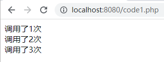
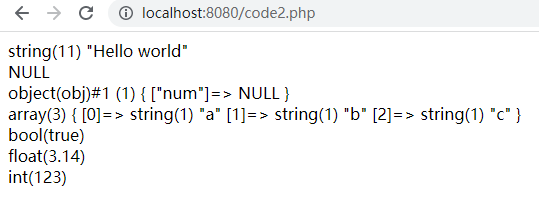
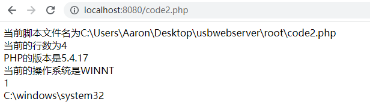
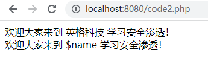
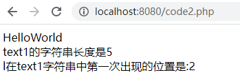
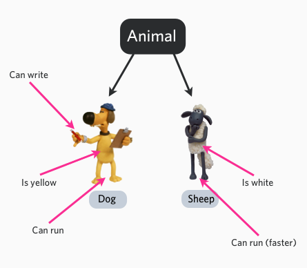
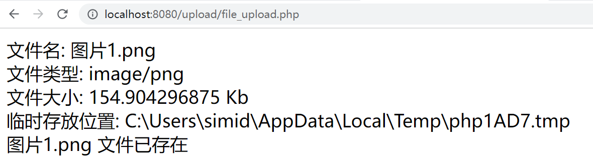
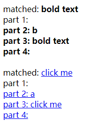
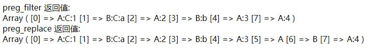

# PHP基础

## PHP简述
通用开源脚本语言。
在一个php文件中可以包括以下内容：

- PHP 文件可包含文本、HTML、JavaScript代码和 PHP 代码
- PHP 代码在服务器上执行，结果以纯 HTML 形式返回给浏览器
- PHP 文件的默认文件扩展名是 ".php"

php的使用：

1. PHP 可以生成动态页面内容
2. PHP 可以创建、打开、读取、写入、关闭服务器上的文件
3. PHP 可以收集表单数据
4. PHP 可以发送和接收 cookies
5. PHP 可以添加、删除、修改您的数据库中的数据
6. PHP 可以限制用户访问您的网站上的一些页面
7. PHP 可以加密数据
## 基本语法格式
### 注释
PHP脚本以`<?php`开始，以`?>`结束
```php
<?php
  //脚本的基本格式
  /*
  * 多行注释
  **/
?>
```
### 变量的命名
变量以 $ 符号开始，后面跟着变量的名称
变量名必须以字母或者下划线字符开始
变量名只能包含字母数字字符以及下划线（A-z、0-9 和 _ ）
变量名不能包含空格
```php
<?php
$num = 3.14;
$str = "hello world";

/*static的关键字的使用
 * 当一个函数完成时，它的所有变量通常都会被删除。
 * 然而，有时候您希望某个局部变量不要被删除。
 * 要做到这一点，请在您第一次声明变量时使用 static 关键字：
 * */
function test(){
  static $n = 0;
  $n++;
  echo "调用了". $n . "次<br \>";
}
test();
test();
test();
?>
```





## 数据类型
PHP有以下几种数据类型

- String：字符串
- Integer：整数型
- Float：浮点型
- Boolean：布尔型
- Array：数组
- Object：对象
- NULL：空值
- Resource：资源类型
```php
<meta http-equiv="Content-Type" content="text/html;charset=UTF-8">
<?php
$s = "Hello world";
$i = 123;
$f = 3.14;
$b = true;
$a = array("a", "b", "c");
class obj{
    var $num;
    function name(){}
}

$o = new obj();
$n = NULL;

var_dump($s);echo "<br>";
var_dump($n);echo "<br>";
var_dump($o);echo "<br>";
var_dump($a);echo "<br>";
var_dump($b);echo "<br>";
var_dump($f);echo "<br>";
var_dump($i);echo "<br>";
?>
```





### 常量
常量是一个简单值的标识符。该值在脚本中不能改变。（在整个脚本中都能使用）
一个常量由英文字母、下划线、和数字组成,但数字不能作为首字母出现。 (常量名不需要加 $ 修饰符)。
设置常量，使用 define() 函数，函数语法如下：
`bool define ( string $name , mixed $value [, bool $case_insensitive = false ] )`
该函数有三个参数:

- name：必选参数，常量名称，即标志符。
- value：必选参数，常量的值。
- case_insensitive ：可选参数，如果设置为 TRUE，该常量则大小写不敏感。默认是大小写敏感的。
```php
<?php
define("PI",3.14,false);
echo PI;
?>
```
#### 预定义常量
PHP预定义了许多常量，这些常量无需使用define()函数定义，可直接在程序中使用。下面列举了一些常用的PHP预定义常量。

1. `__FILE__`：当前正在处理的脚本文件名，若使用一个被引用的文件中(include 或 require)，那么他的值就是被引用的文件，而不是引用它的那个文件。
2. `__LINE__`：正在处理的脚本文件的当前行数
3. `PHP_VERSION`：当前PHP预处理器的版本，如5.4.16
4. `PHP_OS`：PHP所在的操作系统的类型，如Linux
5. `TRUE`：表示逻辑真。`FALSE`：表示逻辑假。`NULL`：表示没有值或值不确定。
6. `DIRECTORY_SEPARATOR`：表示目录分隔符，不同的操作系统目录分隔符不一样
```php
<?php
echo "当前脚本文件名为" . __FILE__ . "<br>";
echo "当前的行数为" . __LINE__ . "<br>";
echo "PHP的版本是" . PHP_VERSION . "<br>";
echo "当前的操作系统是" . PHP_OS . "<br>";
echo TRUE . FALSE . NULL . "<br>";
echo "C:" . DIRECTORY_SEPARATOR . "windows" . DIRECTORY_SEPARATOR . "system32" . "<br>";
?>
```





### 整型
整数类型：保存整数数值（范围限制），4个字节存储数据。PHP中默认为有符号。
在PHP中提供四种整形的定义方式，十进制定义，二进制定义，八进制定义和十六进制定义
```php
<?php
$a = 120; //十进制
$b = 0b110; //二进制
$o = 0321; //八进制
$x = 0x1fac3; //十六进制
//使用echo输出时，默认输出为十进制
echo $a;
?>
```
进制之间的转换
```php
decbin() // 十进制转二进制
decoct() // 十进制转八进制
dechex() // 十进制转十六进制
bindec() // 二进制转十进制
bin2hex() //二进制转十六进制   
```
### 字符串
字符串变量用于存储并处理文本。
```php
<?php
// 双引号会将变量的字符串进行引用
$name = "英格科技";
$str1 = "欢迎大家来到 $name 学习安全渗透！";
$str2 = '欢迎大家来到 $name 学习安全渗透！';
echo $str1 . "<br>";
echo $str2
?>
```




字符串可以使用`.`符号进行连接

```php
<?php
$text1 = "Hello";
$text2 = "World";
echo $text1 . $text2 . "<br>";
echo "text1的字符串长度是". strlen($text1) . "<br>";
echo "l在text1字符串中第一次出现的位置是:" . strpos($text1, "l");
?>
```





#### 字符串操作函数
字符串操作的函数有如下这么多，但是我们常用需要记住的并不多。
```php
addcslashes — 以 C 语言风格使用反斜线转义字符串中的字符
addslashes — 使用反斜线引用字符串
bin2hex — 函数把包含数据的二进制字符串转换为十六进制值
chop — rtrim 的别名
chr — 返回指定的字符
chunk_split — 将字符串分割成小块
convert_cyr_string — 将字符由一种 Cyrillic 字符转换成另一种
convert_uudecode — 解码一个 uuencode 编码的字符串
convert_uuencode — 使用 uuencode 编码一个字符串
count_chars — 返回字符串所用字符的信息
crc32 — 计算一个字符串的 crc32 多项式
crypt — 单向字符串散列
echo — 输出一个或多个字符串
explode — 使用一个字符串分割另一个字符串
fprintf — 将格式化后的字符串写入到流
get_html_translation_table — 返回使用 htmlspecialchars 和 htmlentities 后的转换表
hebrev — 将逻辑顺序希伯来文（logical-Hebrew）转换为视觉顺序希伯来文（visual-Hebrew）
hebrevc — 将逻辑顺序希伯来文（logical-Hebrew）转换为视觉顺序希伯来文（visual-Hebrew），并且转换换行符
hex2bin — 转换十六进制字符串为二进制字符串
html_entity_decode — Convert HTML entities to their corresponding characters
htmlentities — 将字符转换为 HTML 转义字符
htmlspecialchars_decode — 将特殊的 HTML 实体转换回普通字符
htmlspecialchars — 将特殊字符转换为 HTML 实体
implode — 将一个一维数组的值转化为字符串
join — 别名 implode
lcfirst — 使一个字符串的第一个字符小写
levenshtein — 计算两个字符串之间的编辑距离
localeconv — Get numeric formatting information
ltrim — 删除字符串开头的空白字符（或其他字符）
md5_file — 计算指定文件的 MD5 散列值
md5 — 计算字符串的 MD5 散列值
metaphone — Calculate the metaphone key of a string
money_format — 将数字格式化成货币字符串
nl_langinfo — Query language and locale information
nl2br — 在字符串所有新行之前插入 HTML 换行标记
number_format — 以千位分隔符方式格式化一个数字
ord — 转换字符串第一个字节为 0-255 之间的值
parse_str — 将字符串解析成多个变量
print — 输出字符串
printf — 输出格式化字符串
quoted_printable_decode — 将 quoted-printable 字符串转换为 8-bit 字符串
quoted_printable_encode — 将 8-bit 字符串转换成 quoted-printable 字符串
quotemeta — 转义元字符集
rtrim — 删除字符串末端的空白字符（或者其他字符）
setlocale — 设置地区信息
sha1_file — 计算文件的 sha1 散列值
sha1 — 计算字符串的 sha1 散列值
similar_text — 计算两个字符串的相似度
soundex — Calculate the soundex key of a string
sprintf — Return a formatted string
sscanf — 根据指定格式解析输入的字符
str_contains — Determine if a string contains a given substring
str_ends_with — Checks if a string ends with a given substring
str_getcsv — 解析 CSV 字符串为一个数组
str_ireplace — str_replace 的忽略大小写版本
str_pad — 使用另一个字符串填充字符串为指定长度
str_repeat — 重复一个字符串
str_replace — 子字符串替换
str_rot13 — 对字符串执行 ROT13 转换
str_shuffle — 随机打乱一个字符串
str_split — 将字符串转换为数组
str_starts_with — Checks if a string starts with a given substring
str_word_count — 返回字符串中单词的使用情况
strcasecmp — 二进制安全比较字符串（不区分大小写）
strchr — 别名 strstr
strcmp — 二进制安全字符串比较
strcoll — 基于区域设置的字符串比较
strcspn — 获取不匹配遮罩的起始子字符串的长度
strip_tags — 从字符串中去除 HTML 和 PHP 标记
stripcslashes — 反引用一个使用 addcslashes 转义的字符串
stripos — 查找字符串首次出现的位置（不区分大小写）
stripslashes — 反引用一个引用字符串
stristr — strstr 函数的忽略大小写版本
strlen — 获取字符串长度
strnatcasecmp — 使用“自然顺序”算法比较字符串（不区分大小写）
strnatcmp — 使用自然排序算法比较字符串
strncasecmp — 二进制安全比较字符串开头的若干个字符（不区分大小写）
strncmp — 二进制安全比较字符串开头的若干个字符
strpbrk — 在字符串中查找一组字符的任何一个字符
strpos — 查找字符串首次出现的位置
strrchr — 查找指定字符在字符串中的最后一次出现
strrev — 反转字符串
strripos — 计算指定字符串在目标字符串中最后一次出现的位置（不区分大小写）
strrpos — 计算指定字符串在目标字符串中最后一次出现的位置
strspn — 计算字符串中全部字符都存在于指定字符集合中的第一段子串的长度。
strstr — 查找字符串的首次出现
strtok — 标记分割字符串
strtolower — 将字符串转化为小写
strtoupper — 将字符串转化为大写
strtr — 转换指定字符
substr_compare — 二进制安全比较字符串（从偏移位置比较指定长度）
substr_count — 计算字串出现的次数
substr_replace — 替换字符串的子串
substr — 返回字符串的子串
trim — 去除字符串首尾处的空白字符（或者其他字符）
ucfirst — 将字符串的首字母转换为大写
ucwords — 将字符串中每个单词的首字母转换为大写
vfprintf — 将格式化字符串写入流
vprintf — 输出格式化字符串
vsprintf — 返回格式化字符串
wordwrap — 打断字符串为指定数量的字串
```
部分字符串函数示例
```php
<?php
$text1 = "在苍茫的大海上，狂风卷积着乌云。";
echo $text1 . "<br>一共有" . strlen($text1) . "字符。<br>";
echo "去掉空格后“" . trim($text1) . "”<br>";
echo "风在字符串中第一次出现的位置：" . strpos($text1, "风") . "<br>";
echo "截取字符串：" . substr($text1, strpos($text1,"风"),12) . "<br>"; //表示往后截取12个字节
echo "MD5散列值是：" . md5($text1) . "<br>";
echo "获取指定字符：" . $text1[0].$text1[1].$text1[2] . "<br>"; //在utf8编码下中文占3个字符
echo "替换指定字符：" . str_replace("乌云","白云",$text1) . "<br>";
//遍历字符串
for($i=0;$i<strlen($text1);$i++){
    echo $text1[$i];
}
echo "<br>";

//中文处理，出现乱码
for ($i=0; $i < strlen($text1); $i++) { 
    echo $i;
    echo $text1[$i];
}

//将字符串作为utf-8编码处理
function mb_str_split($string){
    //  /u表示把字符串当作utf-8处理，并把字符串开始和结束之前所有的字符串分割成数组
    return preg_split('/(?<!^)(?!$)/u',$string);
}
foreach (mb_str_split($text1) as $i) {
    echo "~";
    echo $i;
}
?>
```
## 运算符
基本运算符

| 运算符 | 名称 | 描述 | 实例 | 结果 |
| --- | --- | --- | --- | --- |
| x + y | 加 | x和y的和 | 2+2 | 4 |
| x - y | 减 | x和y的差 | 5-2 | 3 |
| x * y | 乘 | x和y的积 | 5*2 | 10 |
| x / y | 除 | x和y的商 | 15/5 | 3 |
| x % y | 模 | x除以y的余数 | 5%2 | 1 |
| -x | 取反 | x取反 | -2 | -2 |
| a . b | 并置 | 连接两个字符串 | "Hello"." world" | Hello world |

赋值运算符

| 运算符 | 等同于 | 描述 |
| --- | --- | --- |
| x = y | x = y | 左操作数被设置为右侧表达式的值 |
| x += y | x = x + y | 加 |
| x -= y | x = x - y | 减 |
| x *= y | x = x * y | 乘 |
| x /= y | x = x / y | 除 |
| x %= y | x = x % y | 模 |
| a .= b | a = a . b | 连接两个字符串 |

递增/递减运算符

| 运算符 | 名称 | 描述 |
| --- | --- | --- |
| ++x | 预递增 | x加1，然后返回x |
| x++ | 后递增 | 返回x，然后x加1 |
| --x | 预递减 | x减1，然后返回x |
| x-- | 后递减 | 返回x，然后x减1 |

比较运算符

| 运算符 | 名称 | 描述 | 实例 |
| --- | --- | --- | --- |
| x == y | 等于 | 如果x等于y，则返回true | 5==8 返回 false |
| x === y | 绝对等于 | 如果x等于y，类型也相同，则返回true | 5==='5' 返回false |
| x != y | 不等于 | 如果x不等于y，则返回true | 5!=8 返回true |
| x <> y | 不等于 | 如果x不等于y，则返回true | 5!=8 返回true |
| x !== y | 绝对不等于 | 如果x不等于y，类型不相同，则返回true | 5!=='5' 返回true |
| x > y | 大于 | 如果x大于y，则返回true | 5>8 返回false |
| x < y | 小于 | 如果x小于y，则返回true | 5<8 返回true |
| x >= y | 大于等于 | 如果x大于或等于y，则返回true | 5>=8 返回false |
| x <= y | 小于等于 | 如果x小于或等于y，则返回true | 5<=8 返回true |

逻辑运算符

| 运算符 | 名称 | 描述 |
| --- | --- | --- |
| x and y | 与 | 如果x和y都为true，则返回true |
| x or y | 或 | 如果x和y至少有一个为true，则返回true |
| x xor y | 异或 | 如果x和y有且仅有一个为true，则返回true |
| x && y | 与 | 如果x和y都为true，则返回true |
| x &#124;&#124; y | 或 | 如果x和y至少有一个为true，则返回true |
| !x | 非 | 如果x不为true，则返回true |

三元运算符
如果条件“expr1”成立，则执行语句“expr2”，否则执行“expr3”。
`(expr1)?(expr2):(expr3)`
## 控制语句
### 条件控制语句
条件控制语句主要有

- 单分支
- 多分支
- 分支嵌套
```php
<?php
$score = 30;
if ($score >= 0 and $score <= 100) {
    if ($score >= 80) {
        echo "优";
    } elseif ($score >= 60) {
        echo "良";
    } else {
        echo "不及格";
    }
} else {
    echo "成绩输入有误";
}
?>
```

- switch：在若干条件之一成立时执行一个代码块
```php
<?php
$eat = "中餐";
switch ($eat){
    case "西餐":
        echo "吃肯德基";
        break;
    case "中餐":
        echo "吃大娘水饺";
        break;
    case "小吃":
        echo "沙县大饭店";
        break;
    default:
        echo "吃个屁";
}
?>
```
### 循环控制语句
#### while循环
先做条件的判断，再执行代码
```php
<?php
$sum = 0;
$i = 0;
while ($i <= 100) {
    $sum += $i;
    $i++;
}
echo "1+2+3+...+100=" . $sum;
?>
```
#### do...while循环
先执行一遍，再做条件的判断
```php
<?php
$hunger = true;
$i = 3;
do {
    echo "吃了一碗面<br>";
    $i--;
} while ($i >= 0);
echo "吃撑了";
?>
```
#### for循环
循环代码指定的次数
```php
<?php
$sum = 0;
for ($i=0; $i <= 100; $i++) { 
        $sum += $i;
}
echo "1+2+3+...+100=" . $sum;
?>
```
break语句：用于终止本次循环
continue语句：跳出本次循环，接着执行下一次循环
```php
<?php
// 计算100以内所有偶数的和
$sum = 0;
for ($i=0; $i <= 100; $i++) { 
    if ($i % 2 != 0) {
        continue;
    }
    $sum += $i;
}
echo "2+4+6+...+100=" . $sum;
?>
```
#### foreach循环
根据数组中每个元素来循环代码块
```php
<?php
$arr = ["Hello", "world"];
foreach ($arr as $key => $value) {
    echo $key . "-->" . $value . "<br>";
}
?>
```
## PHP数组
数组是一个能在单个变量中存储多个值的特殊变量。
在 PHP 中，有三种类型的数组：

- **数值数组**：带有数字ID 键的数组
- **关联数组**：带有指定的键的数组，每个键关联一个值
- **多维数组**：包含一个或多个数组的数组
```php
<?php
//简单数组
$cars = array("Volvo", "BMW", "Volkswagen");
echo count($cars) . "<br>"; //数组长度

//关联数组
$age = array("Aaron" => "18", "zhangsan" => "20");
echo "Aaron is " . $age["Aaron"] . " years old.<br>";

//遍历关联数组
foreach($age as $x => $x_value){
    echo "Key=" . $x . ",Value=" . $x_value . "<br>";
}
?>
```
在PHP中定义了多个数组排序的内置函数:

- sort() - 对数组进行升序排列
- rsort() - 对数组进行降序排列
- asort() - 根据关联数组的值，对数组进行升序排列
- ksort() - 根据关联数组的键，对数组进行升序排列
- arsort() - 根据关联数组的值，对数组进行降序排列
- krsort() - 根据关联数组的键，对数组进行降序排列

数组的操作
```php
$array1 = array("a", "b", "c");
$array2 = array("a1" => "PHP", "a2" => "Python", "a3" => "Java");
$array3 = array_merge($array1, $array2);
```
```php
$array1 = array("a", "b", "c");
//向第一个参数的数组尾部添加一个或多个元素，然后返回新的数组长度
array_push($array1, "d", "e");
print_r($array1);
echo "<br>";

//下标为空，自动添加元素
$array1[] = "f";

//根据键值添加元素
$array1["test"] = "PHP";
print_r($array1);
echo "<br>";

//添加到指定位置
$array2 = array('a', 'b', 'c', 'd', 'e');
$array3 = array('x');
//插入到位置3，并且删除0个
array_splice($array2, 3, 0, $array3);
print_r($array2);
```
```php
//删除某一个元素
$array1 = array('a','b','c','d','e');
array_splice($array1,3,1);
print_r($array1);
echo "<br>";

//销毁指定元素
unset($array1[0]);
print_r($array1);
```
常用数组函数

- **is_array** 判断是否为数组
- **count** 数组的元素数目
- **array_search** — 在数组中搜索给定的值，如果成功则返回相应的键名
- **array_key_exists()**在给定的 key 存在于数组中时返回 TRUE
- **array_unshift() ** 将传入的单元插入到 array 数组的开头。注意单元是作为整体被插入的，因此传入单元将保持同样的顺序。所有的数值键名将修改为从零开始重新计数，所有的文字键名保持不变
- **array_shift()**  将array 的第一个单元移出并作为结果返回，将 array 的长度减一并将所有其它单元向前移动一位。所有的数字键名将改为从零开始计数，文字键名将不变。
- **array_unique()**  接受 array 作为输入并返回没有重复值的新数组。注意键名保留不变。 array_unique()  先将值作为字符串排序，然后对每个值只保留第一个遇到的键名，接着忽略所有后面的键名。这并不意味着在未排序的 array 中同一个值的第一个出现的键名会被保留。 
- **in_array** — 检查数组中是否存在某个值  如果找到指定的值则返回 TRUE，否则返回 FALSE 。in_array()是区分大小写的。
## PHP函数
PHP 的真正力量来自它的函数：它拥有超过 1000 个内建的函数。
### PHP 用户定义函数
除了内建的 PHP 函数，我们可以创建我们自己的函数。
函数是可以在程序中重复使用的语句块。
页面加载时函数不会立即执行。
函数只有在被调用时才会执行。
在 PHP 创建用户定义函数
用户定义的函数声明以单词 "function" 开头：
```php
function functionName() {
  被执行的代码;
}
```
注意：函数名能够以字母或下划线开头（而非数字）。
注意：函数名对大小写不敏感。
提示：函数名应该能够反映函数所执行的任务。
```php
function sayHi(){
    echo "Hello World!";
}

sayHi();
```
### PHP 函数参数
可以通过参数向函数传递信息。参数类似变量。
参数被定义在函数名之后，括号内部。您可以添加任意多参数，只要用逗号隔开即可。
下面的例子中的函数有一个参数（$name）。当调用 yyds() 函数时，我们同时要传递一个名字（例如 Bill），这样会输出不同的名字：
```php
function yyds($name) {
    echo "$name yyds.<br>";
}

yyds("许老师");
yyds("张老师");
yyds("英格科技");
```
### PHP默认参数
```php
function yyds($name="PHP") {
    echo "$name yyds.<br>";
}

//此处将使用默认的值
yyds();

//赋予值之后，就会使用指定的值
yyds("许老师");
```
### 函数返回值
```php
//计算1+2+3+...+num的和
function mysum($num){
    $sum = 0;
    for ($i=0; $i <= $num; $i++) { 
        $sum += $i;
    }
    return $sum;
}

echo mysum(100);
```
### 匿名函数
匿名函数就是没有名字的函数。
将一个匿名函数"赋值"给一个变量——此时该变量就代表该匿名函数了！
```php
$mysum = function($num){
    $sum = 0;
    for ($i=0; $i <= $num; $i++) { 
        $sum += $i;
    }
    return $sum;
};

echo $mysum(100);
```
### 回调函数
回调函数是指调用函数的时候将另一个函数作为参数传递到调用的函数中，而不是传递一个普通的变量作为参数
使用回调函数是为了可以将一段自己定义的功能传到函数内部使用
```php
function mysum($num){
    $sum = 0;
    for ($i=0; $i <= $num; $i++) { 
        $sum += $i;
    }
    return $sum;
};

function callback($n){
    //mysum作为全局变量可以直接被调用，并不需要传参
    return call_user_func_array('mysum',array('100'));
};

echo callback(100);
```
## PHP变量作用域
在 PHP 中，可以在脚本的任意位置对变量进行声明。
变量的作用域指的是变量能够被引用/使用的那部分脚本。
PHP 有三种不同的变量作用域：

- local（局部）
- global（全局）
- static（静态）
### Local 和 Global 作用域

- 函数之外声明的变量拥有 Global 作用域，只能在函数以外进行访问。
- 函数内部声明的变量拥有 LOCAL 作用域，只能在函数内部进行访问。

下面的例子测试了带有局部和全局作用域的变量：
```php
$x = "全局作用域";
function myTest(){
    $y = "局部作用域";
    echo "函数内部测试变量x,$x<br>";
    echo "函数内部测试变量y,$y<br>";
}

myTest();

echo "函数外部测试变量x,$x<br>";
// echo "函数外部测试变量y,$y"
```
注释：您可以在不同的函数中创建名称相同的局部变量，因为局部变量只能被在其中创建它的函数识别。
###  global 关键词
global关键词用于定义全局变量，或者声明全局变量
```php
$x = 5;
$y = 10;
function myTest(){
    $x = 6;
    global $y;
    $y = 16;
    echo "函数内的x=$x,y=$y<br>";
};

myTest();
echo "函数外的x=$x,y=$y";

//全局下的变量可以在$GLOBALS数组中查看
print_r($GLOBALS);
```
### static关键词
通常，当函数完成/执行后，会删除所有变量。不过，有时我需要不删除某个局部变量。实现这一点需要更进一步的工作。
要完成这一点，请在您首次声明变量时使用 static 关键词：
```php
//打印1~100
function plus(){
    static $x = 1;
    echo $x;
    $x++;
};

for ($i=0; $i < 100; $i++) { 
    plus();
    echo "<br>";
};
```
## 类与对象
PHP 面向对象
在面向对象的程序设计（英语：Object-oriented programming，缩写：OOP）中，对象是一个由信息及对信息进行处理的描述所组成的整体，是对现实世界的抽象。
在现实世界里我们所面对的事情都是对象，如计算机、电视机、自行车等。
对象的主要三个特性：

- 对象的行为：可以对对象施加那些操作，开灯，关灯就是行为。
- 对象的形态：当施加那些方法是对象如何响应，颜色，尺寸，外型。
- 对象的表示：对象的表示就相当于身份证，具体区分在相同的行为与状态下有什么不同。

比如 Animal(动物) 是一个抽象类，我们可以具体到一只狗跟一只羊，而狗跟羊就是具体的对象，他们有颜色属性，可以写，可以跑等行为状态。




### 面向对象名词解释
**类**−定义了一件事物的抽象特点。类的定义包含了数据的形式以及对数据的操作。
**对象**−是类的实例。
**成员变量**−定义在类内部的变量。该变量的值对外是不可见的，但是可以通过**成员函数访问**，在类被实例化为对象后，该变量即可称为对象的属性。
**成员函数**−定义在类的内部，可用于访问对象的数据。
**继承**−继承性是子类自动共享父类数据结构和方法的机制，这是类之间的一种关系。在定义和实现一个类的时候，可以在一个已经存在的类的基础之上来进行，把这个已经存在的类所定义的内容作为自己的内容，并加入若干新的内容。
**父类**−一个类被其他类继承，可将该类称为父类，或基类，或超类。
**子类**−一个类继承其他类称为子类，也可称为派生类。
**多态**−多态性是指相同的操作或函数、过程可作用于多种类型的对象上并获得不同的结果。不同的对象，收到同一消息可以产生不同的结果，这种现象称为多态性。
**重载**−简单说，就是函数或者方法有同样的名称，但是参数列表不相同的情形，这样的同名不同参数的函数或者方法之间，互相称之为重载函数或者方法。
**抽象性**−抽象性是指将具有一致的数据结构（属性）和行为（操作）的对象抽象成类。一个类就是这样一种抽象，它反映了与应用有关的重要性质，而忽略其他一些无关内容。任何类的划分都是主观的，但必须与具体的应用有关。
**封装**−封装是指将现实世界中存在的某个客体的属性与行为绑定在一起，并放置在一个逻辑单元内。
**构造函数**−主要用来在创建对象时初始化对象，即为对象成员变量赋初始值，总与new运算符一起使用在创建对象的语句中。
**析构函数**−析构函数(destructor) 与构造函数相反，当对象结束其生命周期时（例如对象所在的函数已调用完毕），系统自动执行析构函数。析构函数往往用来做"清理善后" 的工作（例如在建立对象时用new开辟了一片内存空间，应在退出前在析构函数中用delete释放）。

### 类的定义
定义类通常语法格式如下：
```php
<?php
class phpClass {
  var $var1;
  var $var2 = "constant string";
  
  function myfunc ($arg1, $arg2) {
     [..]
  }
  [..]
}
?>

```
创建一个学生对象
```php
class Student{
    var $name;
    var $age;

    function eat(){
        echo $this->name . "会吃饭<br>";
    }

    function study(){
        echo $this->name . "会学习<br>";
    }

};

$student1 = new Student();
$student1->name = "张三";
$student1->age = 18;
$student1->eat();
$student1->study();
```
### 构造函数
构造函数是一种特殊的方法。主要用来在创建对象时初始化对象， 即为对象成员变量赋初始值，在创建对象的语句中与`new`运算符一起使用。
```php
class Student{
    var $name;
    var $age;
    function __construct($name, $age){
        $this->name = $name;
        $this->age = $age;
    }

    function eat(){
        echo $this->name . "会吃饭<br>";
    }

    function study(){
        echo $this->name . "会学习<br>";
    }

};

$student1 = new Student("张三", 18);
$student1->eat();
$student1->study();
```
### 析构函数
析构函数(destructor) 与构造函数相反，当对象结束其生命周期时（例如对象所在的函数已调用完毕），系统自动执行析构函数。
```php
class Student{
    var $name;
    var $age;
    function __construct($name, $age){
        $this->name = $name;
        $this->age = $age;
        echo "===实例化一个学生:$this->name <br>";
    }

    function eat(){
        echo $this->name . "会吃饭<br>";
    }

    function study(){
        echo $this->name . "会学习<br>";
    }
    
    function __destruct(){
        echo "===实例使用完毕，被销毁：$this->name";
    }

};

$student1 = new Student("张三", 18);
$student1->eat();
$student1->study();
```
### 继承
PHP 使用关键字 **extends **来继承一个类，PHP 不支持多继承，格式如下：
```php
class Animal{
    var $name;

    function __construct($name){
        $this->name = $name;
    }

    function eat(){
        echo $this->name . "会吃东西<br>";
    }
};

class Dog extends Animal {
    function watch(){
        echo $this->name . "会看家<br>";
    }
};

$erha = new Dog("二哈");
$erha->eat();
$erha->watch();
```
### 方法重写
如果从父类继承的方法不能满足子类的需求，可以对其进行改写，这个过程叫方法的覆盖（override），也称为方法的重写。
```php
class Animal{
    var $name;

    function __construct($name){
        $this->name = $name;
    }

    function eat(){
        echo $this->name . "会吃东西<br>";
    }
};

class Dog extends Animal {
    function watch(){
        echo $this->name . "会看家<br>";
    }

    function eat(){
        echo $this->name . "喜欢吃肉骨头<br>";
    }
};

$erha = new Dog("二哈");
$erha->eat();
$erha->watch();
```
### 访问控制
PHP 对属性或方法的访问控制，是通过在前面添加关键字 public（公有），protected（受保护）或 private（私有）来实现的。

- public（公有）：公有的类成员可以在任何地方被访问。
- protected（受保护）：受保护的类成员则可以被其自身以及其子类和父类访问。
- private（私有）：私有的类成员则只能被其定义所在的类访问。
#### 属性的访问控制
类属性必须定义为公有，受保护，私有之一。如果用 var 定义，则被视为公有。
```php
class MyClass{
    public $public = "public";
    protected $protected = "protected";
    private $private = "private";

    function test(){
        echo $this->public;
        echo $this->protected;
        echo $this->private;
    }
};
$obj = new MyClass();
$obj->test();
echo $obj->public;
// echo $obj->protected;    //无法访问
// echo $obj->private;      //无法访问
```
另外定义一个子类
```php
class MyClass{
    public $public = "public";
    protected $protected = "protected";
    private $private = "private";
};

class MyClass1 extends MyClass{
    function test(){
        echo $this->public;
        echo $this->protected;
        // echo $this->private; //无法访问
    }
};

$obj2 = new MyClass1();
$obj2->test();
echo $obj2->public;
// echo $obj2->protected;  //无法访问
// echo $obj2->private;    //无法访问
```
#### 方法的访问控制
类中的方法可以被定义为公有，私有或受保护。如果没有设置这些关键字，则该方法默认为公有。
```php

class MyClass{
    public function fun1(){
        echo "这是一个public方法";
    }

    protected function fun2(){
        echo "这是一个protected方法";
    }

    private function fun3(){
        echo "这是一个private方法";
    }

    function test(){
        $this->fun1();
        $this->fun2();
        $this->fun3();
    }
};
$obj = new MyClass();
$obj->test();
$obj->fun1();
// $obj->fun2();        //无法调用
// $obj->fun3();        //无法调用
```
### 接口类
使用接口（interface），可以指定某个类必须实现哪些方法，但不需要定义这些方法的具体内容。
接口是通过 interface 关键字来定义的，就像定义一个标准的类一样，但其中定义所有的方法都是空的。
接口中定义的所有方法都必须是公有，这是接口的特性。
要实现一个接口，使用 implements 操作符。类中必须实现接口中定义的所有方法，否则会报一个致命错误。类可以实现多个接口，用逗号来分隔多个接口的名称。
```php
interface Pay{
    public function pay($num);
}

class Alipay implements Pay{
    //不实现payMethod会报错
    public function pay($price){
        echo "支付宝到账$price 元~<br>";
    }
}

class WechatPay implements Pay{
    public function pay($price){
        echo "微信到账$price 元~<br>";
    }
}

$ali = new Alipay();
$ali->pay(100);
$wechat = new WechatPay();
$wechat->pay(200);
```
### 常量
可以把在类中始终保持不变的值定义为常量。在定义和使用常量的时候不需要使用 $ 符号。
常量的值必须是一个定值，不能是变量，类属性，数学运算的结果或函数调用。
自 PHP 5.3.0 起，可以用一个变量来动态调用类。但该变量的值不能为关键字（如 self，parent 或 static）。
```php
class MyClass{
    const constant="常量";
    function showConstant(){
        echo self::constant . "<br>";
    }
}

echo MyClass::constant . "<br>";

$classname = "MyClass";
echo $classname::constant;

$classname = new MyClass();
$classname->showConstant();
echo $classname::constant . "<br>";
```
### 抽象类
任何一个类，如果它里面至少有一个方法是被声明为抽象的，那么这个类就必须被声明为抽象的。
定义为抽象的类不能被实例化。
被定义为抽象的方法只是声明了其调用方式（参数），不能定义其具体的功能实现。
继承一个抽象类的时候，子类必须定义父类中的所有抽象方法；另外，这些方法的访问控制必须和父类中一样（或者更为宽松）。例如某个抽象方法被声明为受保护的，那么子类中实现的方法就应该声明为受保护的或者公有的，而不能定义为私有的。
```php
abstract class Animal{
    var $name = "动物";

    abstract function eat();
}

class Dog extends Animal{
    //必须要实现eat方法
    function eat($food="饭"){
        echo "吃$food";
    }
}

$erha = new Dog();
//子类方法可以包含父类抽象方法中不存在的可选参数
$erha->eat("肉骨头");
```
### Final 关键字
PHP 5 新增了一个 final 关键字。如果父类中的方法被声明为 final，则子类无法覆盖该方法。如果一个类被声明为 final，则不能被继承。
```php
abstract class Animal{
    var $name = "动物";

    final function eat(); //这里会报错，因为final不能被覆盖
}

final class Dog extends Animal{
    //必须要实现eat方法
    function eat($food="饭"){
        echo "吃$food";
    }
}

$erha = new Dog();
//子类方法可以包含父类抽象方法中不存在的可选参数
$erha->eat("肉骨头");
```
### parent调用父类构造
PHP 不会在子类的构造方法中自动的调用父类的构造方法。要执行父类的构造方法，需要在子类的构造方法中调用 parent::__construct() 。
```php
abstract class Animal
{
    var $name = "动物";

    function __construct($name)
    {
        $this->name = $name;
    }

    abstract function eat();
}

class Dog extends Animal
{
    function __construct($name)
    {
        parent::__construct($name);
        echo "调用了父类的构造方法<br>";
    }
    //必须要实现eat方法
    function eat($food = "饭")
    {
        echo $this->name . "吃$food";
    }
}

$erha = new Dog("二哈");
//子类方法可以包含父类抽象方法中不存在的可选参数
$erha->eat("肉骨头");
```
## 超级全局变量
PHP中预定义了几个超级全局变量（superglobals） ，这意味着它们在一个脚本的全部作用域中都可用。 你不需要特别说明，就可以在函数及类中使用。
### $GLOBALS
$GLOBALS 是PHP的一个超级全局变量组，在一个PHP脚本的全部作用域中都可以访问。
$GLOBALS 是一个包含了全部变量的全局组合数组。变量的名字就是数组的键。
```php
$x = 20;
$y = 30;
function add(){
    $GLOBALS['z'] = $GLOBALS['x'] + $GLOBALS['y'];
}

add();
echo $z;
```
### $_SERVER
$_SERVER 是一个包含了诸如头信息(header)、路径(path)、以及脚本位置(script locations)等等信息的数组。这个数组中的项目由 Web 服务器创建。不能保证每个服务器都提供全部项目；服务器可能会忽略一些，或者提供一些没有在这里列举出来的项目。
```php
echo $_SERVER['PHP_SELF'];
echo "<br>";
echo $_SERVER['SERVER_NAME'];
echo "<br>";
echo $_SERVER['HTTP_HOST'];
echo "<br>";
echo $_SERVER['HTTP_USER_AGENT'];
echo "<br>";
echo $_SERVER['SCRIPT_NAME'];
echo "<br>";
// echo $_SERVER['HTTP_REFERER'];
```
| 元素/代码 | 描述 |
| --- | --- |
| $_SERVER['PHP_SELF'] | 当前执行脚本的文件名，与 document root 有关。例如，在地址为 http://example.com/test.php/foo.bar 的脚本中使用 $_SERVER['PHP_SELF'] 将得到 /test.php/foo.bar。__FILE__ 常量包含当前(例如包含)文件的完整路径和文件名。 从 PHP 4.3.0 版本开始，如果 PHP 以命令行模式运行，这个变量将包含脚本名。之前的版本该变量不可用。 |
| $_SERVER['GATEWAY_INTERFACE'] | 服务器使用的 CGI 规范的版本；例如，"CGI/1.1"。 |
| $_SERVER['SERVER_ADDR'] | 当前运行脚本所在的服务器的 IP 地址。 |
| $_SERVER['SERVER_NAME'] | 当前运行脚本所在的服务器的主机名。如果脚本运行于虚拟主机中，该名称是由那个虚拟主机所设置的值决定。(如: www.runoob.com) |
| $_SERVER['SERVER_SOFTWARE'] | 服务器标识字符串，在响应请求时的头信息中给出。 (如：Apache/2.2.24) |
| $_SERVER['SERVER_PROTOCOL'] | 请求页面时通信协议的名称和版本。例如，"HTTP/1.0"。 |
| $_SERVER['REQUEST_METHOD'] | 访问页面使用的请求方法；例如，"GET", "HEAD"，"POST"，"PUT"。 |
| $_SERVER['REQUEST_TIME'] | 请求开始时的时间戳。从 PHP 5.1.0 起可用。 (如：1377687496) |
| $_SERVER['QUERY_STRING'] | query string（查询字符串），如果有的话，通过它进行页面访问。 |
| $_SERVER['HTTP_ACCEPT'] | 当前请求头中 Accept: 项的内容，如果存在的话。 |
| $_SERVER['HTTP_ACCEPT_CHARSET'] | 当前请求头中 Accept-Charset: 项的内容，如果存在的话。例如："iso-8859-1,*,utf-8"。 |
| $_SERVER['HTTP_HOST'] | 当前请求头中 Host: 项的内容，如果存在的话。 |
| $_SERVER['HTTP_REFERER'] | 引导用户代理到当前页的前一页的地址（如果存在）。由 user agent 设置决定。并不是所有的用户代理都会设置该项，有的还提供了修改 HTTP_REFERER 的功能。简言之，该值并不可信。) |
| $_SERVER['HTTPS'] | 如果脚本是通过 HTTPS 协议被访问，则被设为一个非空的值。 |
| $_SERVER['REMOTE_ADDR'] | 浏览当前页面的用户的 IP 地址。 |
| $_SERVER['REMOTE_HOST'] | 浏览当前页面的用户的主机名。DNS 反向解析不依赖于用户的 REMOTE_ADDR。 |
| $_SERVER['REMOTE_PORT'] | 用户机器上连接到 Web 服务器所使用的端口号。 |
| $_SERVER['SCRIPT_FILENAME'] | 当前执行脚本的绝对路径。 |
| $_SERVER['SERVER_ADMIN'] | 该值指明了 Apache 服务器配置文件中的 SERVER_ADMIN 参数。如果脚本运行在一个虚拟主机上，则该值是那个虚拟主机的值。(如：someone@runoob.com) |
| $_SERVER['SERVER_PORT'] | Web 服务器使用的端口。默认值为 "80"。如果使用 SSL 安全连接，则这个值为用户设置的 HTTP 端口。 |
| $_SERVER['SERVER_SIGNATURE'] | 包含了服务器版本和虚拟主机名的字符串。 |
| $_SERVER['PATH_TRANSLATED'] | 当前脚本所在文件系统（非文档根目录）的基本路径。这是在服务器进行虚拟到真实路径的映像后的结果。 |
| $_SERVER['SCRIPT_NAME'] | 包含当前脚本的路径。这在页面需要指向自己时非常有用。__FILE__ 常量包含当前脚本(例如包含文件)的完整路径和文件名。 |
| $_SERVER['SCRIPT_URI'] | URI 用来指定要访问的页面。例如 "/index.html"。 |

### $_REQUEST
PHP $_REQUEST 用于收集HTML表单提交的数据。
```php
<meta http-equiv="Content-Type" content="text/html;charset=UTF-8">
  <form method="post" action="<?php echo $_SERVER['PHP_SELF'];?>">
  Name: <input type="text" name="fname">
  <input type="submit">
  <?php
  if (isset($_POST['fname'])){
  $name = $_REQUEST['fname']; 
echo "<h1>" . $name . "</h1>"; 
}
?>
```
### $_POST
 $_POST 被广泛应用于收集表单数据，在HTML form标签的指定该属性："method="post"。
### $_GET
$_GET 同样被广泛应用于收集表单数据，在HTML form标签的指定该属性："method="get"。
## include
服务器端包含 (SSI) 用于创建可在多个页面重复使用的函数、页眉、页脚或元素。
include （或 require）语句会获取指定文件中存在的所有文本/代码/标记，并复制到使用 include 语句的文件中。
包含文件很有用，如果您需要在网站的多张页面上引用相同的 PHP、HTML 或文本的话。
PHP include 和 require 语句
通过 include 或 require 语句，可以将 PHP 文件的内容插入另一个 PHP 文件（在服务器执行它之前）。
include 和 require 语句是相同的，除了错误处理方面：
require 会生成致命错误（E_COMPILE_ERROR）并停止脚本
include 只生成警告（E_WARNING），并且脚本会继续
因此，如果您希望继续执行，并向用户输出结果，即使包含文件已丢失，那么请使用 include。否则，在框架、CMS 或者复杂的 PHP 应用程序编程中，请始终使用 require 向执行流引用关键文件。这有助于提高应用程序的安全性和完整性，在某个关键文件意外丢失的情况下。
包含文件省去了大量的工作。这意味着您可以为所有页面创建标准页头、页脚或者菜单文件。然后，在页头需要更新时，您只需更新这个页头包含文件即可。
语法
`include 'filename';`
或
`require 'filename';`
## 文件处理
PHP 拥有的多种函数可供创建、读取、上传以及编辑文件。
### 打开文件
fopen() 函数用于在 PHP 中打开文件。
文件可以通过下列模式来打开：

| 模式 | 描述 |
| --- | --- |
| r | 只读。在文件的开头开始。 |
| r+ | 读/写。在文件的开头开始。 |
| w | 只写。打开并清空文件的内容；如果文件不存在，则创建新文件。 |
| w+ | 读/写。打开并清空文件的内容；如果文件不存在，则创建新文件。 |
| a | 追加。打开并向文件末尾进行写操作，如果文件不存在，则创建新文件。 |
| a+ | 读/追加。通过向文件末尾写内容，来保持文件内容。 |
| x | 只写。创建新文件。如果文件已存在，则返回 FALSE 和一个错误。 |
| x+ | 读/写。创建新文件。如果文件已存在，则返回 FALSE 和一个错误。 |

**注释**：如果 fopen() 函数无法打开指定文件，则返回 0 (false)。
```php
$file = fopen("test.txt","r") or exit("此文件不存在！");
//关闭文件
fclose($file);
```
### 逐行读取文件
fgets() 函数用于从文件中逐行读取文件。
注释：在调用该函数之后，文件指针会移动到下一行。
```php
<?php
$file = fopen("test.txt","r") or exit("此文件不存在！");
while(!feof($file)){
    echo fgets($file) . "<br>";
}
//关闭文件
fclose($file);
?>
```
### 逐字符读取文件
fgetc() 函数用于从文件中逐字符地读取文件。
注释：在调用该函数之后，文件指针会移动到下一个字符。
```php
$file = fopen("test.txt","r") or exit("此文件不存在！");
while(!feof($file)){
    echo fgetc($file) . "<br>";
}
//关闭文件
fclose($file);
```
### 复制 重命名 删除
```php
copy("test.txt","new_test.txt");
rename("new_test.txt", "old_test.txt");
unlink("old_test.txt")
```
### 文件的判断
```php
if(file_exists("test.txt")){
    echo "test.txt文件存在<br>";
};

if(is_file("test.txt")){
    echo "test.txt是个文件<br>";
}
```
### 文件属性读取
| 函数 | 描述 |
| --- | --- |
| basename() | 返回路径中的文件名部分。 |
| chgrp() | 改变文件组。 |
| chmod() | 改变文件模式。 |
| chown() | 改变文件所有者。 |
| clearstatcache() | 清除文件状态缓存。 |
| copy() | 复制文件。 |
| delete() | 参见 unlink() 或 unset() |
| dirname() | 返回路径中的目录名称部分。 |
| disk_free_space() | 返回目录的可用空间。 |
| disk_total_space() | 返回一个目录的磁盘总容量。 |
| diskfreespace() | disk_free_space() 的别名。 |
| fclose() | 关闭打开的文件。 |
| feof() | 测试文件指针是否到了文件末尾。 |
| fflush() | 向打开的文件刷新缓冲输出。 |
| fgetc() | 从打开的文件中返回字符。 |
| fgetcsv() | 从打开的文件中解析一行，校验 CSV 字段。 |
| fgets() | 从打开的文件中返回一行。 |
| fgetss() | 从打开的文件中返回一行，并过滤掉 HTML 和 PHP 标签。 |
| file() | 把文件读入一个数组中。 |
| file_exists() | 检查文件或目录是否存在。 |
| file_get_contents() | 把文件读入字符串。 |
| file_put_contents() | 把字符串写入文件。 |
| fileatime() | 返回文件的上次访问时间。 |
| filectime() | 返回文件的上次修改时间。 |
| filegroup() | 返回文件的组 ID。 |
| fileinode() | 返回文件的 inode 编号。 |
| filemtime() | 返回文件内容的上次修改时间。 |
| fileowner() | 返回文件的用户 ID （所有者）。 |
| fileperms() | 返回文件的权限。 |
| filesize() | 返回文件大小。 |
| filetype() | 返回文件类型。 |
| flock() | 锁定或释放文件。 |
| fnmatch() | 根据指定的模式来匹配文件名或字符串。 |
| fopen() | 打开一个文件或 URL。 |
| fpassthru() | 从打开的文件中读数据，直到文件末尾（EOF），并向输出缓冲写结果。 |
| fputcsv() | 把行格式化为 CSV 并写入一个打开的文件中。 |
| fputs() | fwrite() 的别名。 |
| fread() | 读取打开的文件。 |
| fscanf() | 根据指定的格式对输入进行解析。 |
| fseek() | 在打开的文件中定位。 |
| fstat() | 返回关于一个打开的文件的信息。 |
| ftell() | 返回在打开文件中的当前位置。 |
| ftruncate() | 把打开文件截断到指定的长度。 |
| fwrite() | 写入打开的文件。 |
| glob() | 返回一个包含匹配指定模式的文件名/目录的数组。 |
| is_dir() | 判断文件是否是一个目录。 |
| is_executable() | 判断文件是否可执行。 |
| is_file() | 判断文件是否是常规的文件。 |
| is_link() | 判断文件是否是连接。 |
| is_readable() | 判断文件是否可读。 |
| is_uploaded_file() | 判断文件是否是通过 HTTP POST 上传的。 |
| is_writable() | 判断文件是否可写。 |
| is_writeable() | is_writable() 的别名。 |
| lchgrp() | 改变符号连接的组所有权。 |
| lchown() | 改变符号连接的用户所有权。 |
| link() | 创建一个硬连接。 |
| linkinfo() | 返回有关一个硬连接的信息。 |
| lstat() | 返回关于文件或符号连接的信息。 |
| mkdir() | 创建目录。 |
| move_uploaded_file() | 把上传的文件移动到新位置。 |
| parse_ini_file() | 解析一个配置文件。 |
| parse_ini_string() | 解析一个配置字符串。 |
| pathinfo() | 返回关于文件路径的信息。 |
| pclose() | 关闭由 popen() 打开的进程。 |
| popen() | 打开一个进程。 |
| readfile() | 读取一个文件，并写入到输出缓冲。 |
| readlink() | 返回符号连接的目标。 |
| realpath() | 返回绝对路径名。 |
| realpath_cache_get() | 返回高速缓存条目。 |
| realpath_cache_size() | 返回高速缓存大小。 |
| rename() | 重命名文件或目录。 |
| rewind() | 倒回文件指针的位置。 |
| rmdir() | 删除空的目录。 |
| set_file_buffer() | 设置已打开文件的缓冲大小。 |
| stat() | 返回关于文件的信息。 |
| symlink() | 创建符号连接。 |
| tempnam() | 创建唯一的临时文件。 |
| tmpfile() | 创建唯一的临时文件。 |
| touch() | 设置文件的访问和修改时间。 |
| umask() | 改变文件的文件权限。 |
| unlink() | 删除文件。 |

php读取文件属性案例
```php
$file = "test.txt";
file_exists($file) or die("文件不存在");
echo $file . "文件的大小是" . filesize($file) . "个字节<br>";
if(is_readable($file)){
    echo "文件可读<br>";
}else{
    echo "文件不可读<br>";
}

if(is_writable($file)){
    echo "文件可写<br>";
}else{
    echo "文件不可写<br>";
}

if(is_executable($file)){
    echo "文件可执行<br>";
}else{
    echo "文件不可执行<br>";
}

echo "文件创建的时间是：" . date("Y-m-d H:i:s", filectime($file)) . "<br>";
echo "文件创建的时间是：" . date("Y-m-d H:i:s", filemtime($file)) . "<br>";;
echo "文件创建的时间是：" . date("Y-m-d H:i:s", fileatime($file)) . "<br>";;
```
### 目录操作
新建目录： mkdir(路径, 权限, 递归创建)
删除目录：rmdir()
移动(改名)：rename()
打开目录：目录句柄 = opendir()
读取目录：文件名 = readdir(目录句柄)
依次读取文件名，同时向下移动文件句柄指针，读取不到则返回false
关闭目录：closedir()

递归读取目录内容
```php
function myscandir($path, $flag="") {
    $dir_handle = opendir($path);
    while (($file = readdir($dir_handle)) !== false) {
      $p = "$path/$file";
      
      if (is_dir($p) && $file != "." && $file != "..") {
        $flag = $flag . "&#160;&#160;&#160;&#160;";
        echo $flag . "目录 $file <br>";
        myscandir($p,$flag);
      }else{
        if ($file != "." && $file != "..") {
            echo $flag . "|&#160;&#160;&#160;&#160;" . $file . "<br>";
        }
      }
    }
  }

myscandir("./")
```
### 文件上传
```html
<!DOCTYPE html>
<html lang="en">
<head>
    <meta charset="UTF-8">
    <meta http-equiv="X-UA-Compatible" content="IE=edge">
    <meta name="viewport" content="width=device-width, initial-scale=1.0">
    <title>Document</title>
</head>
<body>
    <form action="file_upload.php" method="post" enctype="multipart/form-data">
        <input type="file" name="file">
        <input type="submit" value="提交">
    </form>
</body>
</html>
```
```php
<meta charset="utf-8">
<?php
if ($_FILES["file"]["error"] > 0) {
    echo "Error: " . $_FILES["file"]["error"] . "
";
} else {
    echo "文件名: " . $_FILES["file"]["name"] . "
";
    echo "文件类型: " . $_FILES["file"]["type"] . "
";
    echo "文件大小: " . ($_FILES["file"]["size"] / 1024) . " Kb
";
    echo "临时存放位置: " . $_FILES["file"]["tmp_name"] . "
";

    $file_name = iconv('utf-8', 'gbk', $_FILES["file"]["name"]);
    if (file_exists("file_upload/" . $file_name)) {
        echo $_FILES["file"]["name"] . " 文件已存在";
    } else {
        move_uploaded_file(
            $_FILES["file"]["tmp_name"],
            "file_upload/" . $file_name
        );
        echo "已保存: " . "upload/" . $_FILES["file"]["name"];
    }
}
?>
```





## 命名空间
### 创建命名空间
**命名空间**
定义：命名空间namespace，是指人为的将内存进行分隔，让不同内存区域的同名结构共存，从而解决在大型项目中可能出现的重名结构的问题
```php
namespace MyProject {
    const CONNECT_OK = 1;
    class Connection { /* ... */ }
    function connect() { /* ... */  }
}

namespace AnotherProject {
    const CONNECT_OK = 1;
    class Connection { /* ... */ }
    function connect() { /* ... */  }
}

//全局代码必须用一个不带名称的 namespace 语句加上大括号括起来
namespace { // 全局代码
session_start();
$a = MyProject\connect();
echo MyProject\Connection::start();
}
```
**子空间（子文件夹）**
定义：命名空间内部再划分一个命名空间，让每个小空间独立起来
```php
<?php
namespace MyProject\Sub\Level;  //声明分层次的单个命名空间

const CONNECT_OK = 1;
class Connection { /* ... */ }
function Connect() { /* ... */  }

?>
```
### 命名空间使用
PHP 命名空间中的类名可以通过三种方式引用：

1. 非限定名称，或不包含前缀的类名称，例如 $a=new foo(); 或 foo::staticmethod();。如果当前命名空间是 currentnamespace，foo 将被解析为 currentnamespace\foo。如果使用 foo 的代码是全局的，不包含在任何命名空间中的代码，则 foo 会被解析为foo。 警告：如果命名空间中的函数或常量未定义，则该非限定的函数名称或常量名称会被解析为全局函数名称或常量名称。
2. 限定名称,或包含前缀的名称，例如 $a = new subnamespace\foo(); 或 subnamespace\foo::staticmethod();。如果当前的命名空间是 currentnamespace，则 foo 会被解析为 currentnamespace\subnamespace\foo。如果使用 foo 的代码是全局的，不包含在任何命名空间中的代码，foo 会被解析为subnamespace\foo。
3. 完全限定名称，或包含了全局前缀操作符的名称，例如， $a = new \currentnamespace\foo(); 或 \currentnamespace\foo::staticmethod();。在这种情况下，foo 总是被解析为代码中的文字名(literal name)currentnamespace\foo。
```php
<?php
namespace Foo\Bar\subnamespace; 

const FOO = 1;
function foo() {}
class foo
{
    static function staticmethod() {}
}
?>
```
```php
<?php
namespace Foo\Bar;
include 'file1.php';

const FOO = 2;
function foo() {}
class foo
{
    static function staticmethod() {}
}

/* 非限定名称 */
foo(); // 解析为函数 Foo\Bar\foo
foo::staticmethod(); // 解析为类 Foo\Bar\foo ，方法为 staticmethod
echo FOO; // 解析为常量 Foo\Bar\FOO

/* 限定名称 */
subnamespace\foo(); // 解析为函数 Foo\Bar\subnamespace\foo
subnamespace\foo::staticmethod(); // 解析为类 Foo\Bar\subnamespace\foo,
                                  // 以及类的方法 staticmethod
echo subnamespace\FOO; // 解析为常量 Foo\Bar\subnamespace\FOO
                                  
/* 完全限定名称 */
\Foo\Bar\foo(); // 解析为函数 Foo\Bar\foo
\Foo\Bar\foo::staticmethod(); // 解析为类 Foo\Bar\foo, 以及类的方法 staticmethod
echo \Foo\Bar\FOO; // 解析为常量 Foo\Bar\FOO
?>
```
注意访问任意全局类、函数或常量，都可以使用完全限定名称，例如 \strlen() 或 \Exception 或 \INI_ALL。
在命名空间内部访问全局类、函数和常量：
```php
<?php
namespace Foo;

function strlen() {}
const INI_ALL = 3;
class Exception {}

$a = \strlen('hi'); // 调用全局函数strlen
$b = \INI_ALL; // 访问全局常量 INI_ALL
$c = new \Exception('error'); // 实例化全局类 Exception
?>
```
### 导入与别名
PHP 命名空间支持 有两种使用别名或导入方式：为类名称使用别名，或为命名空间名称使用别名。
在PHP中，别名是通过操作符 use 来实现的
#### 使用use操作符导入/使用别名
```php
<?php
namespace foo;
use My\Full\Classname as Another;

// 下面的例子与 use My\Full\NSname as NSname 相同
use My\Full\NSname;

// 导入一个全局类
use \ArrayObject;

$obj = new namespace\Another; // 实例化 foo\Another 对象
$obj = new Another; // 实例化 My\Full\Classname　对象
NSname\subns\func(); // 调用函数 My\Full\NSname\subns\func
$a = new ArrayObject(array(1)); // 实例化 ArrayObject 对象
// 如果不使用 "use \ArrayObject" ，则实例化一个 foo\ArrayObject 对象
?>
```
#### 一行中包含多个use语句
```php
<?php
use My\Full\Classname as Another, My\Full\NSname;

$obj = new Another; // 实例化 My\Full\Classname 对象
NSname\subns\func(); // 调用函数 My\Full\NSname\subns\func
?>
```
#### 导入和动态名称
```php
<?php
use My\Full\Classname as Another, My\Full\NSname;

$obj = new Another; // 实例化一个 My\Full\Classname 对象
$a = 'Another';
$obj = new $a;      // 实际化一个 Another 对象
?>
```
#### 导入和完全限定名称
```php
<?php
use My\Full\Classname as Another, My\Full\NSname;

$obj = new Another; // 实例化 My\Full\Classname 类
$obj = new \Another; // 实例化 Another 类
$obj = new Another\thing; // 实例化 My\Full\Classname\thing 类
$obj = new \Another\thing; // 实例化 Another\thing 类
?>
```
## 正则表达式
正则表达式(Regular Expression)是一种文本模式，包括普通字符（例如，a 到 z 之间的字母）和特殊字符（称为"元字符"）。
正则表达式使用单个字符串来描述、匹配一系列匹配某个句法规则的字符串。
参考教程：[https://www.runoob.com/regexp/regexp-tutorial.html](https://www.runoob.com/regexp/regexp-tutorial.html)
### preg_match_all()
函数用于执行一个全局正则表达式匹配。
```php
$userinfo = "Name: <b>PHP</b> <br> Title: <b>Programming Language</b>";
preg_match_all ("/<b>(.*)<\/b>/U", $userinfo, $pat_array);
print_r($pat_array[0]);
```


正则匹配贪婪模式

```php
//\\2是一个后向引用的示例. 这会告诉pcre它必须匹配正则表达式中第二个圆括号(这里是([\w]+))
//匹配到的结果. 这里使用两个反斜线是因为这里使用了双引号.
$html = "<b>bold text</b><a href=howdy.html>click me</a>";
 
preg_match_all("/(<([\w]+)[^>]*>)(.*?)(<\/\\2>)/", $html, $matches, PREG_SET_ORDER);
 
foreach ($matches as $val) {
    echo "matched: " . $val[0] . "<br>";
    echo "part 1: " . $val[1] . "<br>";
    echo "part 2: " . $val[2] . "<br>";
    echo "part 3: " . $val[3] . "<br>";
    echo "part 4: " . $val[4] . "<br><br>";
}
```





### PRGE常量
| 常量 | 描述 |
| --- | --- |
| **PREG_PATTERN_ORDER** | 结果按照"规则"排序，仅用于preg_match_all()， 即$matches[0]是完整规则的匹配结果， $matches[1]是第一个子组匹配的结果，等等。 |
| **PREG_SET_ORDER** | 结果按照"集合"排序，仅用于preg_match_all()， 即$matches[0]保存第一次匹配结果的所有结果(包含子组)信息, $matches[1]保存第二次的结果信息，等等。 |
| **PREG_OFFSET_CAPTURE** | 查看**PREG_SPLIT_OFFSET_CAPTURE**的描述。 |
| **PREG_SPLIT_NO_EMPTY** | 这个标记告诉 preg_split() 进返回非空部分。 |
| **PREG_SPLIT_DELIM_CAPTURE** | 这个标记告诉 preg_split() 同时捕获括号表达式匹配到的内容。 |
| **PREG_SPLIT_OFFSET_CAPTURE** | 如果设置了这个标记，每次出现的匹配子串的偏移量也会被返回。注意，这会改变返回数组中的值， 每个元素都是由匹配子串作为第0个元素，它相对目标字符串的偏移量作为第1个元素的数组。这个 标记只能用于 preg_split()。 |
| **PREG_NO_ERROR** | 没有匹配错误时调用 preg_last_error() 返回。 |
| **PREG_INTERNAL_ERROR** | 如果有PCRE内部错误时调用 preg_last_error() 返回。 |
| **PREG_BACKTRACK_LIMIT_ERROR** | 如果调用回溯限制超出，调用preg_last_error()时返回。 |
| **PREG_RECURSION_LIMIT_ERROR** | 如果递归限制超出，调用preg_last_error()时返回。 |
| **PREG_BAD_UTF8_ERROR** | 如果最后一个错误时由于异常的utf-8数据(仅在运行在 UTF-8 模式正则表达式下可用)。 导致的，调用preg_last_error()返回。 |
| **PREG_BAD_UTF8_OFFSET_ERROR** | 如果偏移量与合法的urf-8代码不匹配(仅在运行在 UTF-8 模式正则表达式下可用)。 调用preg_last_error()返回。 |
| **PCRE_VERSION** | PCRE版本号和发布日期(比如： "_7.0 18-Dec-2006_")。 |

### preg_match()
 函数用于执行一个正则表达式匹配。
返回 pattern 的匹配次数。 它的值将是 0 次（不匹配）或 1 次，因为 preg_match() 在第一次匹配后 将会停止搜索。preg_match_all() 不同于此，它会一直搜索subject 直到到达结尾。 如果发生错误preg_match()返回 FALSE。
```php
//模式分隔符后的"i"标记这是一个大小写不敏感的搜索
if (preg_match("/php/i", "PHP is the web scripting language of choice.")) {
  echo "查找到匹配的字符串 php。";
} else {
  echo "未发现匹配的字符串 php。";
}
```
```php
/* 模式中的 \b 标记一个单词边界，所以只有独立的单词"web"会被匹配，而不会匹配
 * 单词的部分内容比如"webbing" 或 "cobweb" */
if (preg_match("/\bweb\b/i", "PHP is the web scripting language of choice.")) {
    echo "查找到匹配的字符串。\n";
} else {
    echo "未发现匹配的字符串。\n";
}
 
if (preg_match("/\bweb\b/i", "PHP is the website scripting language of choice.")) {
    echo "查找到匹配的字符串。\n";
} else {
    echo "未发现匹配的字符串。\n";
}
```
```php
// 从URL中获取主机名称
preg_match('@^(?:http://)?([^/]+)@i',
    "http://www.eagleslab.com/index.html", $matches);
$host = $matches[1];
 
// 获取主机名称的后面两部分
preg_match('/[^.]+\.[^.]+$/', $host, $matches);
echo "domain name is: {$matches[0]}\n";
```
```php
$str = 'foobar: 2008';
 
preg_match('/(?P<name>\w+): (?P<digit>\d+)/', $str, $matches);
 
/* 下面例子在php 5.2.2(pcre 7.0)或更新版本下工作, 然而, 为了后向兼容, 上面的方式是推荐写法. */
// preg_match('/(?<name>\w+): (?<digit>\d+)/', $str, $matches);
 
print_r($matches);
```
### preg_filter()
preg_filter 函数用于执行一个正则表达式搜索和替换。
```php
<?php
$subject = array('1', 'a', '2', 'b', '3', 'A', 'B', '4'); 
$pattern = array('/\d/', '/[a-z]/', '/[1a]/'); 
$replace = array('A:$0', 'B:$0', 'C:$0'); 
 
echo "preg_filter 返回值:<br>";
print_r(preg_filter($pattern, $replace, $subject)); 
 
echo "<br>preg_replace 返回值:<br>";
print_r(preg_replace($pattern, $replace, $subject)); 
?>
```




可以看出 preg_filter 只返回匹配结果，不匹配的直接忽略，而 preg_replace 将不匹配的结果 'A' 'B' 元素也一起返回。

### preg_split()
函数通过一个正则表达式分隔字符串。
```php
//使用逗号或空格(包含" ", \r, \t, \n, \f)分隔短语
$keywords = preg_split("/[\s,]+/", "hypertext language, programming");
print_r($keywords);
```
```php
$str = 'eagleslab';
$chars = preg_split('//', $str, -1, PREG_SPLIT_NO_EMPTY);
print_r($chars);
```
## PHP调用MySQL
PHP 5 及以上版本建议使用以下方式连接 MySQL :

- MySQLi extension ("i" 意为 improved)
- PDO (PHP Data Objects)

PDO 应用在 12 种不同数据库中， MySQLi 只针对 MySQL 数据库。
所以，如果你的项目需要在多种数据库中切换，建议使用 PDO ，这样你只需要修改连接字符串和部分查询语句即可。 使用 MySQLi, 如果不同数据库，你需要重新编写所有代码，包括查询。
两者都是面向对象, 但 MySQLi 还提供了 API 接口。
两者都支持预处理语句。 预处理语句可以防止 SQL 注入，对于 web 项目的安全性是非常重要的。
### 连接MySQL
#### MySQLi-面向对象
```php
<?php
$servername = "localhost";
$username = "username";
$password = "password";
 
// 创建连接
$conn = new mysqli($servername, $username, $password);
 
// 检测连接
if ($conn->connect_error) {
    die("连接失败: " . $conn->connect_error);
} 
echo "连接成功";

$conn->close();
?>
```
#### MySQLi-面向过程
```php
<?php
$servername = "localhost";
$username = "username";
$password = "password";
 
// 创建连接
$conn = mysqli_connect($servername, $username, $password);
 
// 检测连接
if (!$conn) {
    die("Connection failed: " . mysqli_connect_error());
}
echo "连接成功";

mysqli_close($conn);
?>
```
#### PDO
```php
<?php
$servername = "localhost";
$username = "username";
$password = "password";
 
try {
    $conn = new PDO("mysql:host=$servername;", $username, $password);
    echo "连接成功"; 
}
catch(PDOException $e)
{
    echo $e->getMessage();
}

$conn = null;
?>
```
注意在以上 PDO 实例中我们已经指定了数据库 (myDB)。PDO 在连接过程需要设置数据库名。如果没有指定，则会抛出异常。
### 创建数据库
#### MySQLi-面向对象
```php
<?php
$servername = "localhost";
$username = "username";
$password = "password";
 
// 创建连接
$conn = new mysqli($servername, $username, $password);
// 检测连接
if ($conn->connect_error) {
    die("连接失败: " . $conn->connect_error);
} 
 
// 创建数据库
$sql = "CREATE DATABASE myDB";
if ($conn->query($sql) === TRUE) {
    echo "数据库创建成功";
} else {
    echo "Error creating database: " . $conn->error;
}
 
$conn->close();
?>
```
#### MySQLi Procedural
```php
<?php
$servername = "localhost";
$username = "username";
$password = "password";
 
// 创建连接
$conn = mysqli_connect($servername, $username, $password);
// 检测连接
if (!$conn) {
    die("连接失败: " . mysqli_connect_error());
}
 
// 创建数据库
$sql = "CREATE DATABASE myDB";
if (mysqli_query($conn, $sql)) {
    echo "数据库创建成功";
} else {
    echo "Error creating database: " . mysqli_error($conn);
}
 
mysqli_close($conn);
?>
```
#### PDO
```php
<?php
$servername = "localhost";
$username = "username";
$password = "password";

try {
    $conn = new PDO("mysql:host=$servername", $username, $password);

    // 设置 PDO 错误模式为异常
    $conn->setAttribute(PDO::ATTR_ERRMODE, PDO::ERRMODE_EXCEPTION);
    $sql = "CREATE DATABASE myDBPDO";

    // 使用 exec() ，因为没有结果返回
    $conn->exec($sql);

    echo "数据库创建成功<br>";
}
catch(PDOException $e)
{
    echo $sql . "<br>" . $e->getMessage();
}

$conn = null;
?>
```
### 创建数据表
#### MySQLi-面向对象
```php
<?php
$servername = "localhost";
$username = "username";
$password = "password";
$dbname = "myDB";
 
// 创建连接
$conn = new mysqli($servername, $username, $password, $dbname);
// 检测连接
if ($conn->connect_error) {
    die("连接失败: " . $conn->connect_error);
} 
 
// 使用 sql 创建数据表
$sql = "CREATE TABLE MyGuests (
id INT(6) UNSIGNED AUTO_INCREMENT PRIMARY KEY, 
firstname VARCHAR(30) NOT NULL,
lastname VARCHAR(30) NOT NULL,
email VARCHAR(50),
reg_date TIMESTAMP
)";
 
if ($conn->query($sql) === TRUE) {
    echo "Table MyGuests created successfully";
} else {
    echo "创建数据表错误: " . $conn->error;
}
 
$conn->close();
?>
```
#### MySQLi-面向过程
```php
<?php
$servername = "localhost";
$username = "username";
$password = "password";
$dbname = "myDB";
 
// 创建连接
$conn = mysqli_connect($servername, $username, $password, $dbname);
// 检测连接
if (!$conn) {
    die("连接失败: " . mysqli_connect_error());
}
 
// 使用 sql 创建数据表
$sql = "CREATE TABLE MyGuests (
id INT(6) UNSIGNED AUTO_INCREMENT PRIMARY KEY, 
firstname VARCHAR(30) NOT NULL,
lastname VARCHAR(30) NOT NULL,
email VARCHAR(50),
reg_date TIMESTAMP
)";
 
if (mysqli_query($conn, $sql)) {
    echo "数据表 MyGuests 创建成功";
} else {
    echo "创建数据表错误: " . mysqli_error($conn);
}
 
mysqli_close($conn);
?>
```
#### PDO
```php
<?php
$servername = "localhost";
$username = "username";
$password = "password";
$dbname = "myDBPDO";
 
try {
    $conn = new PDO("mysql:host=$servername;dbname=$dbname", $username, $password);
    // 设置 PDO 错误模式，用于抛出异常
    $conn->setAttribute(PDO::ATTR_ERRMODE, PDO::ERRMODE_EXCEPTION);
 
    // 使用 sql 创建数据表
    $sql = "CREATE TABLE MyGuests (
    id INT(6) UNSIGNED AUTO_INCREMENT PRIMARY KEY, 
    firstname VARCHAR(30) NOT NULL,
    lastname VARCHAR(30) NOT NULL,
    email VARCHAR(50),
    reg_date TIMESTAMP
    )";
 
    // 使用 exec() ，没有结果返回 
    $conn->exec($sql);
    echo "数据表 MyGuests 创建成功";
}
catch(PDOException $e)
{
    echo $sql . "<br>" . $e->getMessage();
}
 
$conn = null;
?>
```
### 插入数据
#### MySQLi-面向对象
```php
<?php
$servername = "localhost";
$username = "username";
$password = "password";
$dbname = "myDB";
 
// 创建连接
$conn = new mysqli($servername, $username, $password, $dbname);
// 检测连接
if ($conn->connect_error) {
    die("连接失败: " . $conn->connect_error);
} 
 
$sql = "INSERT INTO MyGuests (firstname, lastname, email)
VALUES ('John', 'Doe', 'john@example.com')";
 
if ($conn->query($sql) === TRUE) {
    echo "新记录插入成功";
} else {
    echo "Error: " . $sql . "<br>" . $conn->error;
}
 
$conn->close();
?>
```
#### MySQLi-面向过程
```php
<?php
$servername = "localhost";
$username = "username";
$password = "password";
$dbname = "myDB";
 
// 创建连接
$conn = mysqli_connect($servername, $username, $password, $dbname);
// 检测连接
if (!$conn) {
    die("Connection failed: " . mysqli_connect_error());
}
 
$sql = "INSERT INTO MyGuests (firstname, lastname, email)
VALUES ('John', 'Doe', 'john@example.com')";
 
if (mysqli_query($conn, $sql)) {
    echo "新记录插入成功";
} else {
    echo "Error: " . $sql . "<br>" . mysqli_error($conn);
}
 
mysqli_close($conn);
?>
```
#### PDO
```php
<?php
$servername = "localhost";
$username = "username";
$password = "password";
$dbname = "myDBPDO";
 
try {
    $conn = new PDO("mysql:host=$servername;dbname=$dbname", $username, $password);
    // 设置 PDO 错误模式，用于抛出异常
    $conn->setAttribute(PDO::ATTR_ERRMODE, PDO::ERRMODE_EXCEPTION);
    $sql = "INSERT INTO MyGuests (firstname, lastname, email)
    VALUES ('John', 'Doe', 'john@example.com')";
    // 使用 exec() ，没有结果返回 
    $conn->exec($sql);
    echo "新记录插入成功";
}
catch(PDOException $e)
{
    echo $sql . "<br>" . $e->getMessage();
}
 
$conn = null;
?>
```
### 插入多条数据
#### MySQLi-面向对象
```php
<?php
$servername = "localhost";
$username = "username";
$password = "password";
$dbname = "myDB";
 
// 创建链接
$conn = new mysqli($servername, $username, $password, $dbname);
// 检查链接
if ($conn->connect_error) {
    die("连接失败: " . $conn->connect_error);
} 
 
$sql = "INSERT INTO MyGuests (firstname, lastname, email)
VALUES ('John', 'Doe', 'john@example.com');";
$sql .= "INSERT INTO MyGuests (firstname, lastname, email)
VALUES ('Mary', 'Moe', 'mary@example.com');";
$sql .= "INSERT INTO MyGuests (firstname, lastname, email)
VALUES ('Julie', 'Dooley', 'julie@example.com')";
 
if ($conn->multi_query($sql) === TRUE) {
    echo "新记录插入成功";
} else {
    echo "Error: " . $sql . "<br>" . $conn->error;
}
 
$conn->close();
?>
```
#### MySQLi-面向过程
```php
<?php
$servername = "localhost";
$username = "username";
$password = "password";
$dbname = "myDB";
 
// 创建链接
$conn = mysqli_connect($servername, $username, $password, $dbname);
// 检查链接
if (!$conn) {
    die("连接失败: " . mysqli_connect_error());
}
 
$sql = "INSERT INTO MyGuests (firstname, lastname, email)
VALUES ('John', 'Doe', 'john@example.com');";
$sql .= "INSERT INTO MyGuests (firstname, lastname, email)
VALUES ('Mary', 'Moe', 'mary@example.com');";
$sql .= "INSERT INTO MyGuests (firstname, lastname, email)
VALUES ('Julie', 'Dooley', 'julie@example.com')";
 
if (mysqli_multi_query($conn, $sql)) {
    echo "新记录插入成功";
} else {
    echo "Error: " . $sql . "<br>" . mysqli_error($conn);
}
 
mysqli_close($conn);
?>
```
#### PDO
```php
<?php
$servername = "localhost";
$username = "username";
$password = "password";
$dbname = "myDBPDO";
 
try {
    $conn = new PDO("mysql:host=$servername;dbname=$dbname", $username, $password);
    // set the PDO error mode to exception
    $conn->setAttribute(PDO::ATTR_ERRMODE, PDO::ERRMODE_EXCEPTION);
 
    // 开始事务
    $conn->beginTransaction();
    // SQL 语句
    $conn->exec("INSERT INTO MyGuests (firstname, lastname, email) 
    VALUES ('John', 'Doe', 'john@example.com')");
    $conn->exec("INSERT INTO MyGuests (firstname, lastname, email) 
    VALUES ('Mary', 'Moe', 'mary@example.com')");
    $conn->exec("INSERT INTO MyGuests (firstname, lastname, email) 
    VALUES ('Julie', 'Dooley', 'julie@example.com')");
 
    // 提交事务
    $conn->commit();
    echo "新记录插入成功";
}
catch(PDOException $e)
{
    // 如果执行失败回滚
    $conn->rollback();
    echo $sql . "<br>" . $e->getMessage();
}
 
$conn = null;
?>
```
### 预处理语句
预处理语句对于防止 MySQL 注入是非常有用的。
预处理语句用于执行多个相同的 SQL 语句，并且执行效率更高。
预处理语句的工作原理如下：

1. 预处理：创建 SQL 语句模板并发送到数据库。预留的值使用参数 "?" 标记 。例如：

`INSERT INTO MyGuests (firstname, lastname, email) VALUES(?, ?, ?)`

2. 数据库解析，编译，对SQL语句模板执行查询优化，并存储结果不输出。
3. 执行：最后，将应用绑定的值传递给参数（"?" 标记），数据库执行语句。应用可以多次执行语句，如果参数的值不一样。

相比于直接执行SQL语句，预处理语句有三个主要优点：

1. 预处理语句大大减少了分析时间，只做了一次查询（虽然语句多次执行）。
2. 绑定参数减少了服务器带宽，你只需要发送查询的参数，而不是整个语句。
3. 预处理语句针对SQL注入是非常有用的，因为参数值发送后使用不同的协议，保证了数据的合法性。
#### MySQLi 使用预处理语句
```php
<?php
$servername = "localhost";
$username = "username";
$password = "password";
$dbname = "myDB";
 
// 创建连接
$conn = new mysqli($servername, $username, $password, $dbname);
 
// 检测连接
if ($conn->connect_error) {
    die("连接失败: " . $conn->connect_error);
}
 
// 预处理及绑定
$stmt = $conn->prepare("INSERT INTO MyGuests (firstname, lastname, email) VALUES (?, ?, ?)");
$stmt->bind_param("sss", $firstname, $lastname, $email);
 
// 设置参数并执行
$firstname = "John";
$lastname = "Doe";
$email = "john@example.com";
$stmt->execute();
 
$firstname = "Mary";
$lastname = "Moe";
$email = "mary@example.com";
$stmt->execute();
 
$firstname = "Julie";
$lastname = "Dooley";
$email = "julie@example.com";
$stmt->execute();
 
echo "新记录插入成功";
 
$stmt->close();
$conn->close();
?>
```
解析以下实例的每行代码:
`"INSERT INTO MyGuests (firstname, lastname, email) VALUES(?, ?, ?)"`
在 SQL 语句中，我们使用了问号 (?)，在此我们可以将问号替换为整型，字符串，双精度浮点型和布尔值。
接下来，让我们来看下 bind_param() 函数：
`$stmt->bind_param("sss", $firstname, $lastname, $email);`
该函数绑定了 SQL 的参数，且告诉数据库参数的值。 "sss" 参数列处理其余参数的数据类型。s 字符告诉数据库该参数为字符串。
参数有以下四种类型:

- i - integer（整型）
- d - double（双精度浮点型）
- s - string（字符串）
- b - BLOB（binary large object:二进制大对象）

每个参数都需要指定类型。
通过告诉数据库参数的数据类型，可以降低 SQL 注入的风险。
#### PDO 使用预处理语句
```php
<?php
$servername = "localhost";
$username = "username";
$password = "password";
$dbname = "myDBPDO";
 
try {
    $conn = new PDO("mysql:host=$servername;dbname=$dbname", $username, $password);
    // 设置 PDO 错误模式为异常
    $conn->setAttribute(PDO::ATTR_ERRMODE, PDO::ERRMODE_EXCEPTION);
 
    // 预处理 SQL 并绑定参数
    $stmt = $conn->prepare("INSERT INTO MyGuests (firstname, lastname, email) 
    VALUES (:firstname, :lastname, :email)");
    $stmt->bindParam(':firstname', $firstname);
    $stmt->bindParam(':lastname', $lastname);
    $stmt->bindParam(':email', $email);
 
    // 插入行
    $firstname = "John";
    $lastname = "Doe";
    $email = "john@example.com";
    $stmt->execute();
 
    // 插入其他行
    $firstname = "Mary";
    $lastname = "Moe";
    $email = "mary@example.com";
    $stmt->execute();
 
    // 插入其他行
    $firstname = "Julie";
    $lastname = "Dooley";
    $email = "julie@example.com";
    $stmt->execute();
 
    echo "新记录插入成功";
}
catch(PDOException $e)
{
    echo "Error: " . $e->getMessage();
}
$conn = null;
?>
```
### 读取数据
#### MySQLi-面向对象
```php
<?php
$servername = "localhost";
$username = "username";
$password = "password";
$dbname = "myDB";
 
// 创建连接
$conn = new mysqli($servername, $username, $password, $dbname);
// Check connection
if ($conn->connect_error) {
    die("连接失败: " . $conn->connect_error);
} 
 
$sql = "SELECT id, firstname, lastname FROM MyGuests";
$result = $conn->query($sql);
 
if ($result->num_rows > 0) {
    // 输出数据
    while($row = $result->fetch_assoc()) {
        echo "id: " . $row["id"]. " - Name: " . $row["firstname"]. " " . $row["lastname"]. "<br>";
    }
} else {
    echo "0 结果";
}
$conn->close();
?>
```
以上代码解析如下:
首先，我们设置了 SQL 语句从 MyGuests数据表中读取 id, firstname 和 lastname 三个字段。之后我们使用该 SQL 语句从数据库中取出结果集并赋给复制给变量 $result。
函数 num_rows() 判断返回的数据。
如果返回的是多条数据，函数 fetch_assoc() 将结合集放入到关联数组并循环输出。 while() 循环出结果集，并输出 id, firstname 和 lastname 三个字段值。
#### MySQLi-面向过程
```php
<?php
$servername = "localhost";
$username = "username";
$password = "password";
$dbname = "myDB";
 
// 创建连接
$conn = mysqli_connect($servername, $username, $password, $dbname);
// Check connection
if (!$conn) {
    die("连接失败: " . mysqli_connect_error());
}
 
$sql = "SELECT id, firstname, lastname FROM MyGuests";
$result = mysqli_query($conn, $sql);
 
if (mysqli_num_rows($result) > 0) {
    // 输出数据
    while($row = mysqli_fetch_assoc($result)) {
        echo "id: " . $row["id"]. " - Name: " . $row["firstname"]. " " . $row["lastname"]. "<br>";
    }
} else {
    echo "0 结果";
}
 
mysqli_close($conn);
?>
```
#### PDO+预处理
```php
<?php
echo "<table style='border: solid 1px black;'>";
echo "<tr><th>Id</th><th>Firstname</th><th>Lastname</th></tr>";
 
class TableRows extends RecursiveIteratorIterator {
    function __construct($it) { 
        parent::__construct($it, self::LEAVES_ONLY); 
    }
 
    function current() {
        return "<td style='width:150px;border:1px solid black;'>" . parent::current(). "</td>";
    }
 
    function beginChildren() { 
        echo "<tr>"; 
    } 
 
    function endChildren() { 
        echo "</tr>" . "\n";
    } 
} 
 
$servername = "localhost";
$username = "username";
$password = "password";
$dbname = "myDBPDO";
 
try {
    $conn = new PDO("mysql:host=$servername;dbname=$dbname", $username, $password);
    $conn->setAttribute(PDO::ATTR_ERRMODE, PDO::ERRMODE_EXCEPTION);
    $stmt = $conn->prepare("SELECT id, firstname, lastname FROM MyGuests"); 
    $stmt->execute();
 
    // 设置结果集为关联数组
    $result = $stmt->setFetchMode(PDO::FETCH_ASSOC); 
    foreach(new TableRows(new RecursiveArrayIterator($stmt->fetchAll())) as $k=>$v) { 
        echo $v;
    }
}
catch(PDOException $e) {
    echo "Error: " . $e->getMessage();
}
$conn = null;
echo "</table>";
?>
```
