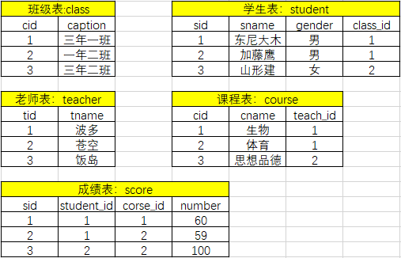

# MySQL

## 数据库概念
数据(data)是事实或观察的结果，是对客观事物的逻辑归纳，是用于表示客观事物的未经加工的的原始素材。
数据可以是连续的值，比如声音、图像，称为模拟数据。也可以是离散的，如符号、文字，称为数字数据。
在计算机系统中，数据以二进制信息单元0,1的形式表示。
**数据的定义:**数据是指对客观事件进行记录并可以鉴别的符号，是对客观事物的性质、状态以及相互关系等进行记载的物理符号或这些物理符号的组合。它是可识别的、抽象的符号。
DBMS（database management system）


### DBMS类别
#### RDBMS
以多张二维表的方式来存储，又给多张表建立了一定的关系（关系型数据库）
#### NoSQL
nosql 很多以json格式进行存储数据的（mogodb）
#### DBMS对比
##### 功能对比
|  | 关系型数据库 | 非关系型数据库 |
| --- | --- | --- |
| 强大的查询功能 | √ | × |
| 强一致性 | √ | × |
| 二级索引 | √ | × |
| 灵活模式 | × | √ |
| 扩展性 | × | √ |
| 性能 | × | √ |

##### 特点对比

- 关系型数据库（RDBMS）的特点： 
   - 二维表
   - 典型产品Oracle传统企业，MySQL互联网企业
   - 数据存取是通过SQL（Structured Query Language结构化查询语言）
   - 最大特点数据安全性方面强（ACID）
- 非关系型数据库（NoSQL：Not only SQL）的特点： 
   - 不是否定关系型数据库，而是做关系型数据库的补充
## MySQL基础操作
在mysql官方网站可以下载到mysql的各种版本：[https://downloads.mysql.com/archives/installer/](https://downloads.mysql.com/archives/installer/)
### 用户管理
用户的定义

- username@'主机域'
- 主机域:可以理解为是Mysql登录的白名单
- 主机域格式： 
   - 10.1.1.12
   - 10.1.0.1%
   - 10.1.0.%
   - 10.1.%.%
   - %
   - localhost
   - 192.168.1.1/255.255.255.
- 创建用户
```sql
mysql> create user user01@'192.168.175.%' identified by '123456';
```

- 查看用户
```sql
mysql> select user,host from mysql.user;
```

- 删除用户
```sql
mysql> drop user user01@'192.168.175.%';
```

- 修改密码
```sql
mysql> set password=PASSOWRD('123456')
mysql> update user set password=PASSWORD('user01') where user='root' and host='localhost';
mysql> grant all privileges on *.* to user01@'192.168.175.%' identified by '123456';
mysql> flush privileges;
```
### 用户权限介绍

- 权限
```sql
INSERT,SELECT, UPDATE, DELETE, CREATE, DROP, RELOAD, SHUTDOWN,  PROCESS, FILE, REFERENCES, INDEX, ALTER, SHOW DATABASES, SUPER, CREATE TEMPORARY TABLES, LOCK TABLES, EXECUTE, REPLICATION SLAVE, REPLICATION CLIENT, CREATE VIEW, SHOW VIEW, CREATE ROUTINE, ALTER ROUTINE, CREATE USER, EVENT, TRIGGER, CREATE TABLESPACE
```

- 每次设定只能有一个属主，没有属组或其他用户的概念
```sql
grant     all privileges    on     *.*    to   user01@''192.168.175.%''  identified by    ''123'';
                权限               作用对象          归属               密码
```
作用对象分解

- `_*.*_`[当前MySQL实例中所有库下的所有表]
- wordpress.* [当前MySQL实例中wordpress库中所有表（单库级别）]
- wordpress.user [当前MySQL实例中wordpress库中的user表（单表级别）]

企业中权限的设定

- 开发人员说：给我开一个用户
- 沟通 
   - 你需要对哪些库、表进行操作
   - 你从哪里连接过来
   - 用户名有没有要求
   - 密码要求
   - 发邮件
- 一般给开发创建用户权限
```sql
grant select,update,delete,insert on *.* to 'user01@192.168.175.%' identified by '123456';
```
实验思考问题
```sql
##创建wordpress数据库
create database wordpress;

##使用wordpress库
use wordpress;

##创建t1、t2表
create table t1 (id int);
create table t2 (id int);

##创建blog库
create database blog;

##使用blog库
use blog;

##创建t1表
create table tb1 (id int);
```
授权
```sql
1、grant select on *.* to wordpress@’10.0.0.5%’ identified by ‘123’;
2、grant insert,delete,update on wordpress.* to wordpress@’10.0.0.5%’ identified by ‘123’;
3、grant all on wordpress.t1 to wordpress@’10.0.0.5%’ identified by ‘123’;
```

- 一个客户端程序使用wordpress用户登陆到10.0.0.51的MySQL后， 
   - 对t1表的管理能力？
   - 对t2表的管理能力？
   - 对tb1表的管理能力？
- 解 
   - 同时满足1，2，3，最终权限是1+2+3
   - 同时满足了1和2两个授权，最终权限是1+2
   - 只满足1授权，所以只能select
- 结论 
   - 如果在不同级别都包含某个表的管理能力时，权限是相加关系。
   - 但是我们不推荐在多级别定义重复权限。
   - 最常用的权限设定方式是单库级别授权，即：wordpress.*
## SQL语句

- SQL是结构化的查询语句
- SQL的种类 
   - DDL:数据定义语句
   - DCL:数据控制语言
   - DML:数据操作语言
   - DQL:数据查询语言
### DDL数据定义语句

- 对库或者表进行操作的语句
- 创建数据库
```sql
create database db01;
## 创建数据库

create database DB01;
## 数据库名区分大小写(注意windows里面不区分)

show databases;
## 查看数据库(DQL)

show create database db01;
## 查看创建数据库语句

help create database;
## 查看创建数据库语句帮助

create database db02 charset utf8;
## 创建数据库的时候添加属性
```

- 删除数据库
```sql
drop database db02;
## 删除数据库db02
```

- 修改定义库
```sql
alter database db01 charset utf8;
show create database db01;
```

- 创建表
```sql
help create table;

## 查看创表语句的帮助
create table student(
sid int,
sname varchar(20),
sage tinyint,
sgender enum('m','f'),
comtime datetime
);
## 创建表，并且定义每一列
```

-  数据类型(下面有完整的)  
| int | 整数 -231~230 |
| --- | --- |
| tinyint | 整数 -128~127 |
| varchar | 字符类型(可变长) |
| char | 字符类型(定长) |
| enum | 枚举类型 |
| datetime | 时间类型 年月日时分秒 |

```sql
create table student(
sid int not null primary key auto_increment comment '学号',
sname varchar(20) not null comment '学生姓名',
sgender enum('m','f') not null default 'm' comment '学生性别',
cometime datetime not null comment '入学时间'
)charset utf8 engine innodb;
## 带数据属性创建学生表

show create table student;
## 查看建表语句

show tables;
## 查看表

desc student;
## 查看表中列的定义信息
```

-  数据属性  
| not null | 不允许是空 |
| --- | --- |
| primary key | 主键(唯一且非空) |
| auto_increment | 自增，此列必须是primary key或者unique key |
| unique key | 单独的唯一的 |
| default | 默认值 |
| unsigned | 非负数 |
| comment | 注释 |

-  删除表 
```sql
drop table student;
```

- 修改表的定义
```sql
alter table student rename stu;
## 修改表名

alter table stu add age int;
## 添加列和列数据类型的定义

alter table stu add test varchar(20),add qq int;
## 添加多个列

alter table stu add classid varchar(20) first;
## 指定位置进行添加列(表首)

alter table stu add phone int after age;
## 指定位置进行添加列（指定列）

alter table stu drop qq;
## 删除指定的列及定义

alter table stu modify sid varchar(20);
## 修改列及定义（列属性）

alter table stu change phone telphone char(20);
## 修改列及定义（列名及属性）
```
#### 多表结构的创建与分析
**如何找出两张表之间的关系**
分析步骤： 1. 先站在左表的角度去找 是否左表的多条记录可以对应右表的一条记录，如果是，则证明左表的一个字段foreign key 右表一个字段（通常是id） **2. **再站在右表的角度去找 是否右表的多条记录可以对应左表的一条记录，如果是，则证明右表的一个字段foreign key 左表一个字段（通常是id） **3. **总结： **多对一** 如果只有步骤1成立，则是左表多对一右表 如果只有步骤2成立，则是右表多对一左表 **多对多 **
 如果步骤1和2同时成立，则证明这两张表时一个双向的多对一，即多对多,需要定义一个这两张表的关系表来专门存放二者的关系 

**一对一**
如果1和2都不成立，而是左表的一条记录唯一对应右表的一条记录，反之亦然。这种情况很简单，就是在左表foreign key右表的基础上，将左表的外键字段设置成unique即可
#### 建立表之间的关系
**一对多或称为多对一**
创建三张表：出版社，作者信息，书籍列表
一对多（或多对一）：一个出版社可以出版多本书
```sql
create table press(
id int primary key auto_increment,
name varchar(20)
);

create table book(
id int primary key auto_increment,
name varchar(20),
press_id int not null,
foreign key(press_id) references press(id)
on delete cascade
on update cascade
);


insert into press(name) values
('英格科技出版社'),
('许老师YYDS出版社'),
('安全渗透出版社')
;

insert into book(name,press_id) values
('九阳神功',1),
('九阴真经',2),
('九阴白骨爪',2),
('独孤九剑',3),
('降龙十巴掌',2),
('葵花宝典',3)
;
```
**多对多**
三张表：出版社，作者信息，书
多对多：一个作者可以写多本书，一本书也可以有多个作者，双向的一对多，即多对多
```sql
create table author(
id int primary key auto_increment,
name varchar(20)
);

##这张表就存放作者表与书表的关系，即查询二者的关系查这表就可以了
create table author2book(
id int not null unique auto_increment,
author_id int not null,
book_id int not null,
constraint fk_author foreign key(author_id) references author(id)
on delete cascade
on update cascade,
constraint fk_book foreign key(book_id) references book(id)
on delete cascade
on update cascade,
primary key(author_id,book_id)
);

##插入四个作者，id依次排开
insert into author(name) values('zhangsan'),('lisi'),('wangwu'),('xuliu');

##每个作者与自己的代表作如下
zhangsan: 
九阳神功
九阴真经
九阴白骨爪
独孤九剑
降龙十巴掌
葵花宝典
lisi: 
九阳神功
葵花宝典
wangwu:
独孤九剑
降龙十巴掌
葵花宝典
xuliu:
九阳神功

insert into author2book(author_id,book_id) values
(1,1),
(1,2),
(1,3),
(1,4),
(1,5),
(1,6),
(2,1),
(2,6),
(3,4),
(3,5),
(3,6),
(4,1)
;
```
**一对一**
两张表：博客表和客户表
一对一：一个用户只有一个博客
```sql
create table customer(
id int primary key auto_increment,
name varchar(20)
)engine=innodb default charset=utf8;

create table blog(
id int primary key auto_increment,
url varchar(50),
name_id int unique,
constraint fk_id foreign key(name_id) references customer(id)
on delete cascade
on update cascade
)engine=innodb default charset=utf8;

insert into customer(name) values
('chensong'),('songge'),('songsong');

insert into blog(url,name_id) values
('xxxx',1),('yyyy',2),('zzzz',3);
```
#### 练习
根据表结构合理设计表与表之间的主外键关系和约束，并完成表结构的创建。



参考答案

```sql
create table class(
cid int primary key auto_increment,
caption varchar(20)
)engine=innodb default charset=utf8;

create table student(
sid int primary key auto_increment,
sname varchar(20),
gender enum('男','女'),
class_id int,
foreign key(class_id) references class(cid)
)engine=innodb default charset=utf8;

create table teacher(
tid int primary key auto_increment,
tname varchar(20)
)engine=innodb default charset=utf8;

create table course(
cid int primary key auto_increment,
cname varchar(20),
teach_id int,
foreign key(teach_id) references teacher(tid)
)engine=innodb default charset=utf8;

create table score(
sid int primary key auto_increment,
student_id int,
foreign key(student_id) references student(sid),
corse_id int,
foreign key(corse_id) references course(cid),
number int
)engine=innodb default charset=utf8;

insert into class(caption) value
('三年一班'),
('一年二班'),
('三年二班');

insert into student(sname, gender, class_id) value
('东尼大木','男',1),
('加藤鹰','男',1),
('山形健','女',2);

insert into teacher(tname) value
('波多'),
('苍空'),
('饭岛');

insert into course(cname, teach_id) value
('生物',1),
('体育',1),
('思想品德',2);

insert into score(student_id, corse_id, number) value
(1,1,60),
(1,2,59),
(2,2,100);

select * from class;
select * from student;
select * from teacher;
select * from course;
select * from score;
```
### MySQL支持的数据类型
#### 数值类型
MySQL支持所有标准SQL数值数据类型
这些类型包括严格数值数据类型(INTEGER、SMALLINT、DECIMAL和NUMERIC)，以及近似数值数据类型(FLOAT、REAL和DOUBLE PRECISION)。
关键字INT是INTEGER的同义词，关键字DEC是DECIMAL的同义词。
MySQL支持的整数类型有TINYINT、MEDIUMINT和BIGINT。下面的表显示了需要的每个整数类型的存储和范围。
对于小数的表示，MYSQL分为两种方式：浮点数和定点数。浮点数包括float(单精度)和double(双精度),而定点数只有decimal一种，在mysql中以字符串的形式存放，比浮点数更精确，适合用来表示货币等精度高的数据。
BIT数据类型保存位字段值，并且支持MyISAM、MEMORY、InnoDB和BDB表。

|  | 类型 | 大小 | 范围（有符号） | 范围（无符号）unsigned约束 | 用途 |
| --- | --- | --- | --- | --- | --- |
| TINYINT | 1 字节 | (-128，127) | (0，255) | 小整数值 |  |
| SMALLINT | 2 字节 | (-32 768，32 767) | (0，65 535) | 大整数值 |  |
| MEDIUMINT | 3 字节 | (-8 388 608，8 388 607) | (0，16 777 215) | 大整数值 |  |
| INT或INTEGER | 4 字节 | (-2 147 483 648，2 147 483 647) | (0，4 294 967 295) | 大整数值 |  |
| BIGINT | 8 字节 | (-9 233 372 036 854 775 808，9 223 372 036 854 775 807) | (0，18 446 744 073 709 551 615) | 极大整数值 |  |
| FLOAT | 4 字节
float(255,30) | (-3.402 823 466 E+38，-1.175 494 351 E-38)，0，(1.175 494 351 E-38，3.402 823 466 351 E+38) | 0，(1.175 494 351 E-38，3.402 823 466 E+38) | 单精度 | 浮点数值 |
| DOUBLE | 8 字节
double(255,30) | (-1.797 693 134 862 315 7 E+308，-2.225 073 858 507 201 4 E-308)，0，(2.225 073 858 507 201 4 E-308，1.797 693 134 862 315 7 E+308) | 0，(2.225 073 858 507 201 4 E-308，1.797 693 134 862 315 7 E+308) | 双精度 | 浮点数值 |
| DECIMAL | 对DECIMAL(M,D) ，如果M>D，为M+2否则为D+2
double(65,30) | 依赖于M和D的值 | 依赖于M和D的值 | 小数值 |  |

```sql
## 创建表一个是默认宽度的int，一个是指定宽度的int(5)
mysql> create table t1 (id1 int,id2 int(5));
Query OK, 0 rows affected (0.02 sec)

## 像t1中插入数据1，1
mysql> insert into t1 values (1,1);
Query OK, 1 row affected (0.01 sec)

## 可以看出结果上并没有异常
mysql> select * from t1;
+------+------+
| id1  | id2  |
+------+------+
|    1 |    1 |
+------+------+
1 row in set (0.00 sec)

## 那么当我们插入了比宽度更大的值，会不会发生报错呢？
mysql> insert into t1 values (111111,111111);
Query OK, 1 row affected (0.00 sec)

## 答案是否定的，id2仍然显示了正确的数值，没有受到宽度限制的影响
mysql> select * from t1;
+------------+--------+
| id1        | id2    |
+------------+--------+
| 0000000001 |  00001 |
| 0000111111 | 111111 |
+------------+--------+
2 rows in set (0.00 sec)

## 修改id1字段 给字段添加一个unsigned表示无符号
mysql> alter table t1 modify id1 int unsigned;
Query OK, 0 rows affected (0.01 sec)
Records: 0  Duplicates: 0  Warnings: 0

mysql> desc t1;
+-------+------------------+------+-----+---------+-------+
| Field | Type             | Null | Key | Default | Extra |
+-------+------------------+------+-----+---------+-------+
| id1   | int(10) unsigned | YES  |     | NULL    |       |
| id2   | int(5)           | YES  |     | NULL    |       |
+-------+------------------+------+-----+---------+-------+
2 rows in set (0.01 sec)

## 当给id1添加的数据大于214748364时，可以顺利插入
mysql> insert into t1 values (2147483648,2147483647);
Query OK, 1 row affected (0.00 sec)

## 当给id2添加的数据大于214748364时，会报错
mysql> insert into t1 values (2147483647,2147483648);
ERROR 1264 (22003): Out of range value for column 'id2' at row 1
```
```sql
## 创建表的三个字段分别为float，double和decimal参数表示一共显示5位，小数部分占2位
mysql> create table t2 (id1 float(5,2),id2 double(5,2),id3 decimal(5,2));
Query OK, 0 rows affected (0.02 sec)

## 向表中插入1.23，结果正常
mysql> insert into t2 values (1.23,1.23,1.23);
Query OK, 1 row affected (0.00 sec)

mysql> select * from t2;
+------+------+------+
| id1  | id2  | id3  |
+------+------+------+
| 1.23 | 1.23 | 1.23 |
+------+------+------+
1 row in set (0.00 sec)

## 向表中插入1.234，会发现4都被截断了
mysql> insert into t2 values (1.234,1.234,1.234);
Query OK, 1 row affected, 1 warning (0.00 sec)

mysql> select * from t2;
+------+------+------+
| id1  | id2  | id3  |
+------+------+------+
| 1.23 | 1.23 | 1.23 |
| 1.23 | 1.23 | 1.23 |
+------+------+------+
2 rows in set (0.00 sec)

## 向表中插入1.235发现数据虽然被截断，但是遵循了四舍五入的规则
mysql> insert into t2 values (1.235,1.235,1.235);
Query OK, 1 row affected, 1 warning (0.00 sec)

mysql> select * from t2;
+------+------+------+
| id1  | id2  | id3  |
+------+------+------+
| 1.23 | 1.23 | 1.23 |
| 1.23 | 1.23 | 1.23 |
| 1.24 | 1.24 | 1.24 |
+------+------+------+
3 rows in set (0.00 sec)

## 建新表去掉参数约束
mysql> create table t3 (id1 float,id2 double,id3 decimal);
Query OK, 0 rows affected (0.02 sec)

## 分别插入1.234
mysql> insert into t3 values (1.234,1.234,1.234);
Query OK, 1 row affected, 1 warning (0.00 sec)

## 发现decimal默认值是(10,0)的整数
mysql> select * from t3;
+-------+-------+------+
| id1   | id2   | id3  |
+-------+-------+------+
| 1.234 | 1.234 |    1 |
+-------+-------+------+
1 row in set (0.00 sec)

## 当对小数位没有约束的时候，输入超长的小数，会发现float和double的区别
mysql> insert into t3 values (1.2355555555555555555,1.2355555555555555555,1.2355555555555555555555);
Query OK, 1 row affected, 1 warning (0.00 sec)

mysql> select * from t3;
+---------+--------------------+------+
| id1     | id2                | id3  |
+---------+--------------------+------+
|   1.234 |              1.234 |    1 |
| 1.23556 | 1.2355555555555555 |    1 |
+---------+--------------------+------+
2 rows in set (0.00 sec)
```
#### 日期和时间类型
表示时间值的日期和时间类型为DATETIME、DATE、TIMESTAMP、TIME和YEAR。
每个时间类型有一个有效值范围和一个"零"值，当指定不合法的MySQL不能表示的值时使用"零"值。
TIMESTAMP类型有专有的自动更新特性，将在后面描述。

| 类型 | 大小 | (字节) | 范围 | 格式 | 用途 |
| --- | --- | --- | --- | --- | --- |
| DATE | 3 | 1000-01-01/9999-12-31 | YYYY-MM-DD | 年月日 |  |
| TIME | 3 | '-838:59:59'/'838:59:59' | HH:MM:SS | 时分秒 |  |
| YEAR | 1 | 1901/2155 | YYYY | 年份值 |  |
| DATETIME | 8 | 1000-01-01 00:00:00/9999-12-31 23:59:59 | YYYY-MM-DD HH:MM:SS | 年月日时分秒 |  |
| TIMESTAMP | 4 | 1970-01-01 00:00:00/2038
结束时间是第 **2147483647** 秒，北京时间 **2038-1-19 11:14:07**，格林尼治时间 2038年1月19日 凌晨 03:14:07 | YYYYMMDD HHMMSS | 混合日期和时间值，时间戳 |  |

```sql
MariaDB [db2]> create table time(d date,t time,dt datetime);
Query OK, 0 rows affected (0.00 sec)

MariaDB [db2]> desc time;
+-------+----------+------+-----+---------+-------+
| Field | Type     | Null | Key | Default | Extra |
+-------+----------+------+-----+---------+-------+
| d     | date     | YES  |     | NULL    |       |
| t     | time     | YES  |     | NULL    |       |
| dt    | datetime | YES  |     | NULL    |       |
+-------+----------+------+-----+---------+-------+
3 rows in set (0.00 sec)

MariaDB [db2]> insert into time values(now(),now(),now());
Query OK, 1 row affected, 2 warnings (0.00 sec)

MariaDB [db2]> select * from time;
+------------+----------+---------------------+
| d          | t        | dt                  |
+------------+----------+---------------------+
| 2019-02-27 | 11:29:32 | 2019-02-27 11:29:32 |
+------------+----------+---------------------+
1 row in set (0.00 sec)

MariaDB [db2]> insert into time values (null,null,null);
Query OK, 1 row affected (0.00 sec)

MariaDB [db2]> select * from time;
+------------+----------+---------------------+
| d          | t        | dt                  |
+------------+----------+---------------------+
| 2019-02-27 | 11:29:32 | 2019-02-27 11:29:32 |
| NULL       | NULL     | NULL                |
+------------+----------+---------------------+
2 rows in set (0.00 sec)
```
```sql
mysql> create table t5 (id1 timestamp);
Query OK, 0 rows affected (0.02 sec)

mysql> desc t5;
+-------+-----------+------+-----+-------------------+-----------------------------+
| Field | Type      | Null | Key | Default           | Extra                       |
+-------+-----------+------+-----+-------------------+-----------------------------+
| id1   | timestamp | NO   |     | CURRENT_TIMESTAMP | on update CURRENT_TIMESTAMP |
+-------+-----------+------+-----+-------------------+-----------------------------+
1 row in set (0.00 sec)

## 插入数据null，会自动插入当前时间的时间
mysql> insert into t5 values (null);
Query OK, 1 row affected (0.00 sec)

mysql> select * from t5;
+---------------------+
| id1                 |
+---------------------+
| 2019-02-21 14:56:50 |
+---------------------+
1 row in set (0.00 sec)

##添加一列 默认值是'0000-00-00 00:00:00'
mysql> alter table t5 add id2 timestamp;
Query OK, 0 rows affected (0.02 sec)
Records: 0  Duplicates: 0  Warnings: 0

mysql> show create table t5 \G;
*************************** 1. row ***************************
       Table: t5
Create Table: CREATE TABLE `t5` (
  `id1` timestamp NOT NULL DEFAULT CURRENT_TIMESTAMP ON UPDATE CURRENT_TIMESTAMP,
  `id2` timestamp NOT NULL DEFAULT '0000-00-00 00:00:00'
) ENGINE=InnoDB DEFAULT CHARSET=utf8
1 row in set (0.00 sec)

ERROR: 
No query specified

## 手动修改新的列默认值为当前时间
mysql> alter table t5 modify id2 timestamp default current_timestamp;
Query OK, 0 rows affected (0.02 sec)
Records: 0  Duplicates: 0  Warnings: 0

mysql> show create table t5 \G;
*************************** 1. row ***************************
       Table: t5
Create Table: CREATE TABLE `t5` (
  `id1` timestamp NOT NULL DEFAULT CURRENT_TIMESTAMP ON UPDATE CURRENT_TIMESTAMP,
  `id2` timestamp NOT NULL DEFAULT CURRENT_TIMESTAMP
) ENGINE=InnoDB DEFAULT CHARSET=utf8
1 row in set (0.00 sec)

ERROR: 
No query specified

mysql> insert into t5 values (null,null);
Query OK, 1 row affected (0.01 sec)

mysql> select * from t5;
+---------------------+---------------------+
| id1                 | id2                 |
+---------------------+---------------------+
| 2019-02-21 14:56:50 | 0000-00-00 00:00:00 |
| 2019-02-21 14:59:31 | 2019-02-21 14:59:31 |
+---------------------+---------------------+
2 rows in set (0.00 sec)
```
```sql
mysql> create table t6 (t1 timestamp);
Query OK, 0 rows affected (0.02 sec)

mysql> desc t6;
+-------+-----------+------+-----+-------------------+-----------------------------+
| Field | Type      | Null | Key | Default           | Extra                       |
+-------+-----------+------+-----+-------------------+-----------------------------+
| t1    | timestamp | NO   |     | CURRENT_TIMESTAMP | on update CURRENT_TIMESTAMP |
+-------+-----------+------+-----+-------------------+-----------------------------+
1 row in set (0.01 sec)

mysql> insert into t6 values (19700101080001);
Query OK, 1 row affected (0.00 sec)

mysql> select * from t6;
+---------------------+
| t1                  |
+---------------------+
| 1970-01-01 08:00:01 |
+---------------------+
1 row in set (0.00 sec)
## timestamp时间的下限是19700101080001
mysql> insert into t6 values (19700101080000);
ERROR 1292 (22007): Incorrect datetime value: '19700101080000' for column 't1' at row 1

mysql> insert into t6 values ('2038-01-19 11:14:07');
Query OK, 1 row affected (0.00 sec)
## timestamp时间的上限是2038-01-19 11:14:07
mysql> insert into t6 values ('2038-01-19 11:14:08');
ERROR 1292 (22007): Incorrect datetime value: '2038-01-19 11:14:08' for column 't1' at row 1
mysql> 
```
```java
mysql> create table t7 (y year);
Query OK, 0 rows affected (0.02 sec)

mysql> insert into t7 values (2019);
Query OK, 1 row affected (0.00 sec)

mysql> select * from t7;
+------+
| y    |
+------+
| 2019 |
+------+
1 row in set (0.00 sec)
```
```sql
mysql> create table t8 (dt datetime);
Query OK, 0 rows affected (0.01 sec)

mysql> insert into t8 values ('2019-2-26 12:20:10');
Query OK, 1 row affected (0.01 sec)

mysql> insert into t8 values ('2019/2/26 12+20+10');
Query OK, 1 row affected (0.00 sec)

mysql> insert into t8 values ('20190226122010');
Query OK, 1 row affected (0.00 sec)

mysql> insert into t8 values (20190926122010);
Query OK, 1 row affected (0.00 sec)

mysql> select * from t8;
+---------------------+
| dt                  |
+---------------------+
| 2019-02-26 12:20:10 |
| 2019-02-26 12:20:10 |
| 2019-02-26 12:20:10 |
| 2019-02-26 12:20:10 |
+---------------------+
4 rows in set (0.00 sec)
```
#### 字符串类型
字符串类型指CHAR、VARCHAR、BINARY、VARBINARY、BLOB、TEXT、ENUM和SET。该节描述了这些类型如何工作以及如何在查询中使用这些类型。

| 类型 | 大小 | 用途 |
| --- | --- | --- |
| CHAR | 0-255字节 | 定长字符串 |
| VARCHAR | 0-65535 字节 | 变长字符串 |
| TINYBLOB | 0-255字节 | 不超过 255 个字符的二进制字符串 |
| TINYTEXT | 0-255字节 | 短文本字符串 |
| BLOB | 0-65 535字节 | 二进制形式的长文本数据 |
| TEXT | 0-65 535字节 | 长文本数据 |
| MEDIUMBLOB | 0-16 777 215字节 | 二进制形式的中等长度文本数据 |
| MEDIUMTEXT | 0-16 777 215字节 | 中等长度文本数据 |
| LONGBLOB | 0-4 294 967 295字节 | 二进制形式的极大文本数据 |
| LONGTEXT | 0-4 294 967 295字节 | 极大文本数据 |

CHAR 和 VARCHAR 类型类似，但它们保存和检索的方式不同。它们的最大长度和是否尾部空格被保留等方面也不同。在存储或检索过程中不进行大小写转换。
CHAR列的长度固定为创建表是声明的长度,范围(0-255);而VARCHAR的值是可变长字符串范围(0-65535)。
```sql
mysql> create table t9 (v varchar(4),c char(4));
Query OK, 0 rows affected (0.01 sec)

mysql> insert into t9 values ('ab  ','ab  ');
Query OK, 1 row affected (0.00 sec)

## 在检索的时候char数据类型会去掉空格
mysql> select * from t9;
+------+------+
| v    | c    |
+------+------+
| ab   | ab   |
+------+------+
1 row in set (0.00 sec)

## 来看看对查询结果计算的长度
mysql> select length(v),length(c) from t9;
+-----------+-----------+
| length(v) | length(c) |
+-----------+-----------+
|         4 |         2 |
+-----------+-----------+
1 row in set (0.00 sec)

## 给结果拼上一个加号会更清楚
mysql> select concat(v,'+'),concat(c,'+') from t9;
+---------------+---------------+
| concat(v,'+') | concat(c,'+') |
+---------------+---------------+
| ab  +         | ab+           |
+---------------+---------------+
1 row in set (0.00 sec)

## 当存储的长度超出定义的长度，会截断
mysql> insert into t9 values ('abcd  ','abcd  ');
Query OK, 1 row affected, 1 warning (0.01 sec)

mysql> select * from t9;
+------+------+
| v    | c    |
+------+------+
| ab   | ab   |
| abcd | abcd |
+------+------+
2 rows in set (0.00 sec)
```
BINARY 和 VARBINARY 类似于 CHAR 和 VARCHAR，不同的是它们包含二进制字符串而不要非二进制字符串。也就是说，它们包含字节字符串而不是字符字符串。这说明它们没有字符集，并且排序和比较基于列值字节的数值值。
BLOB 是一个二进制大对象，可以容纳可变数量的数据。有 4 种 BLOB 类型：TINYBLOB、BLOB、MEDIUMBLOB 和 LONGBLOB。它们区别在于可容纳存储范围不同。
有 4 种 TEXT 类型：TINYTEXT、TEXT、MEDIUMTEXT 和 LONGTEXT。对应的这 4 种 BLOB 类型，可存储的最大长度不同，可根据实际情况选择。
#### ENUM和SET类型
ENUM中文名称叫枚举类型，它的值范围需要在创建表时通过枚举方式显示。ENUM**只允许从值集合中选取单个值，而不能一次取多个值**。
SET和ENUM非常相似，也是一个字符串对象，里面可以包含0-64个成员。根据成员的不同，存储上也有所不同。set类型可以**允许值集合中任意选择1或多个元素进行组合**。对超出范围的内容将不允许注入，而对重复的值将进行自动去重。

| 类型 | 大小 | 用途 |
| --- | --- | --- |
| ENUM | 对1-255个成员的枚举需要1个字节存储;
对于255-65535个成员，需要2个字节存储;
最多允许65535个成员。 | 单选：选择性别 |
| SET | 1-8个成员的集合，占1个字节
9-16个成员的集合，占2个字节
17-24个成员的集合，占3个字节
25-32个成员的集合，占4个字节
33-64个成员的集合，占8个字节 | 多选：兴趣爱好 |

```sql
mysql> create table t10 (name char(20),gender enum('female','male'));
Query OK, 0 rows affected (0.01 sec)

## 选择enum('female','male')中的一项作为gender的值，可以正常插入
mysql> insert into t10 values ('zhangsan','male');
Query OK, 1 row affected (0.00 sec)

## 不能同时插入'male,female'两个值，也不能插入不属于'male,female'的值
mysql> insert into t10 values ('zhangsan','male,female');
ERROR 1265 (01000): Data truncated for column 'gender' at row 1

mysql> create table t11 (name char(20),hobby set('抽烟','喝酒','烫头','翻车'));
Query OK, 0 rows affected (0.01 sec)

## 可以任意选择set('抽烟','喝酒','烫头','翻车')中的项，并自带去重功能
mysql> insert into t11 values ('zhangsan','烫头,喝酒,烫头');
Query OK, 1 row affected (0.01 sec)

mysql> select * from t11;
+----------+---------------+
|    name  |  hobby        |
+----------+---------------+
| zhangsan |  喝酒,烫头     |
+----------+---------------+
1 row in set (0.00 sec)

## 不能选择不属于set('抽烟','喝酒','烫头','翻车')中的项，
mysql> insert into t11 values ('zhangsan','烫头,翻车,看妹子');
ERROR 1265 (01000): Data truncated for column 'hobby' at row 1
```
### 表的完整性约束
#### 概述
为了防止不符合规范的数据进入数据库，在用户对数据进行插入、修改、删除等操作时，DBMS自动按照一定的约束条件对数据进行监测，使不符合规范的数据不能进入数据库，以确保数据库中存储的数据正确、有效、相容。 
约束条件与数据类型的宽度一样，都是可选参数，主要分为以下几种：
1. NOT NULL ：非空约束，指定某列不能为空；  
2. UNIQUE : 唯一约束，指定某列或者几列组合不能重复 
3. PRIMARY KEY ：主键，指定该列的值可以唯一地标识该列记录 
4. FOREIGN KEY ：外键，指定该行记录从属于主表中的一条记录，主要用于参照完整性
#### NOT NULL
是否可空，null表示空，非字符串
not null - 不可空
null - 可空(默认)
```sql
mysql> create table t12 (id int not null);
Query OK, 0 rows affected (0.02 sec)

mysql> select * from t12;
Empty set (0.00 sec)

mysql> desc t12;
+-------+---------+------+-----+---------+-------+
| Field | Type    | Null | Key | Default | Extra |
+-------+---------+------+-----+---------+-------+
| id    | int(11) | NO   |     | NULL    |       |
+-------+---------+------+-----+---------+-------+
1 row in set (0.00 sec)

##不能向id列插入空元素。 
mysql> insert into t12 values (null);
ERROR 1048 (23000): Column 'id' cannot be null

mysql> insert into t12 values (1);
Query OK, 1 row affected (0.01 sec)
```
#### DEFAULT
约束某一列不为空，如果这一列中经常有重复的内容，就需要我们频繁的插入，这样会给我们的操作带来新的负担，于是就出现了默认值的概念。
默认值，创建列时可以指定默认值，当插入数据时如果未主动设置，则自动添加默认值
```sql
mysql> create table t13 (id1 int not null,id2 int not null default 222);
Query OK, 0 rows affected (0.01 sec)

mysql> desc t13;
+-------+---------+------+-----+---------+-------+
| Field | Type    | Null | Key | Default | Extra |
+-------+---------+------+-----+---------+-------+
| id1   | int(11) | NO   |     | NULL    |       |
| id2   | int(11) | NO   |     | 222     |       |
+-------+---------+------+-----+---------+-------+
2 rows in set (0.01 sec)

## 只向id1字段添加值，会发现id2字段会使用默认值填充
mysql> insert into t13 (id1) values (111);
Query OK, 1 row affected (0.00 sec)

mysql> select * from t13;
+-----+-----+
| id1 | id2 |
+-----+-----+
| 111 | 222 |
+-----+-----+
1 row in set (0.00 sec)

## id1字段不能为空，所以不能单独向id2字段填充值；
mysql> insert into t13 (id2) values (223);
ERROR 1364 (HY000): Field 'id1' doesn't have a default value

## 向id1，id2中分别填充数据，id2的填充数据会覆盖默认值
mysql> insert into t13 (id1,id2) values (112,223);
Query OK, 1 row affected (0.00 sec)

mysql> select * from t13;
+-----+-----+
| id1 | id2 |
+-----+-----+
| 111 | 222 |
| 112 | 223 |
+-----+-----+
2 rows in set (0.00 sec)
```
设置严格模式:

- 不支持对not null字段插入null值 
- 不支持对自增长字段插入null值
- 不支持text字段有默认值
```sql
直接在mysql中生效(重启失效):
mysql>set sql_mode="STRICT_TRANS_TABLES,NO_AUTO_CREATE_USER,NO_ENGINE_SUBSTITUTION";

配置文件添加(永久失效)：
sql-mode="STRICT_TRANS_TABLES,NO_AUTO_CREATE_USER,NO_ENGINE_SUBSTITUTION"
```
#### UNIQUE
唯一约束，指定某列或者几列组合不能重复
```sql
方法一：
create table department1(
id int,
name varchar(20) unique,
comment varchar(100)
);


方法二：
create table department2(
id int,
name varchar(20),
comment varchar(100),
unique(name)
);


mysql> insert into department1 values(1,'IT','技术');
Query OK, 1 row affected (0.00 sec)
mysql> insert into department1 values(1,'IT','技术');
ERROR 1062 (23000): Duplicate entry 'IT' for key 'name'
```
```sql
mysql> create table t1(id int not null unique);
Query OK, 0 rows affected (0.02 sec)

mysql> desc t1;
+-------+---------+------+-----+---------+-------+
| Field | Type    | Null | Key | Default | Extra |
+-------+---------+------+-----+---------+-------+
| id    | int(11) | NO   | PRI | NULL    |       |
+-------+---------+------+-----+---------+-------+
1 row in set (0.00 sec)
```
```sql
create table service(
id int primary key auto_increment,
name varchar(20),
host varchar(15) not null,
port int not null,
unique(host,port) #联合唯一
);

mysql> insert into service values
    -> (1,'nginx','192.168.0.10',80),
    -> (2,'haproxy','192.168.0.20',80),
    -> (3,'mysql','192.168.0.30',3306)
    -> ;
Query OK, 3 rows affected (0.01 sec)
Records: 3  Duplicates: 0  Warnings: 0

mysql> insert into service(name,host,port) values('nginx','192.168.0.10',80);
ERROR 1062 (23000): Duplicate entry '192.168.0.10-80' for key 'host'
```
#### PRIMARY KEY
主键为了保证表中的每一条数据的该字段都是表格中的唯一值。换言之，它是用来独一无二地确认一个表格中的每一行数据。 
主键可以包含一个字段或多个字段。当主键包含多个栏位时，称为组合键 (Composite Key),也可以叫联合主键。
主键可以在建置新表格时设定 (运用 CREATE TABLE 语句)，或是以改变现有的表格架构方式设定 (运用 ALTER TABLE)。
主键必须唯一，主键值非空；可以是单一字段，也可以是多字段组合。

1. 单字段主键
```sql
============单列做主键===============
##方法一：not null+unique
create table department1(
id int not null unique, #主键
name varchar(20) not null unique,
comment varchar(100)
);

mysql> desc department1;
+---------+--------------+------+-----+---------+-------+
| Field   | Type         | Null | Key | Default | Extra |
+---------+--------------+------+-----+---------+-------+
| id      | int(11)      | NO   | PRI | NULL    |       |
| name    | varchar(20)  | NO   | UNI | NULL    |       |
| comment | varchar(100) | YES  |     | NULL    |       |
+---------+--------------+------+-----+---------+-------+
rows in set (0.01 sec)

##方法二：在某一个字段后用primary key
create table department2(
id int primary key, #主键
name varchar(20),
comment varchar(100)
);

mysql> desc department2;
+---------+--------------+------+-----+---------+-------+
| Field   | Type         | Null | Key | Default | Extra |
+---------+--------------+------+-----+---------+-------+
| id      | int(11)      | NO   | PRI | NULL    |       |
| name    | varchar(20)  | YES  |     | NULL    |       |
| comment | varchar(100) | YES  |     | NULL    |       |
+---------+--------------+------+-----+---------+-------+
rows in set (0.00 sec)

##方法三：在所有字段后单独定义primary key
create table department3(
id int,
name varchar(20),
comment varchar(100),
primary key(id); #创建主键并为其命名pk_name

mysql> desc department3;
+---------+--------------+------+-----+---------+-------+
| Field   | Type         | Null | Key | Default | Extra |
+---------+--------------+------+-----+---------+-------+
| id      | int(11)      | NO   | PRI | NULL    |       |
| name    | varchar(20)  | YES  |     | NULL    |       |
| comment | varchar(100) | YES  |     | NULL    |       |
+---------+--------------+------+-----+---------+-------+
rows in set (0.01 sec)

## 方法四：给已经建成的表添加主键约束
mysql> create table department4(
    -> id int,
    -> name varchar(20),
    -> comment varchar(100));
Query OK, 0 rows affected (0.01 sec)

mysql> desc department4;
+---------+--------------+------+-----+---------+-------+
| Field   | Type         | Null | Key | Default | Extra |
+---------+--------------+------+-----+---------+-------+
| id      | int(11)      | YES  |     | NULL    |       |
| name    | varchar(20)  | YES  |     | NULL    |       |
| comment | varchar(100) | YES  |     | NULL    |       |
+---------+--------------+------+-----+---------+-------+
3 rows in set (0.01 sec)

mysql> alter table department4 modify id int primary key;
Query OK, 0 rows affected (0.02 sec)
Records: 0  Duplicates: 0  Warnings: 0

mysql> desc department4;
+---------+--------------+------+-----+---------+-------+
| Field   | Type         | Null | Key | Default | Extra |
+---------+--------------+------+-----+---------+-------+
| id      | int(11)      | NO   | PRI | NULL    |       |
| name    | varchar(20)  | YES  |     | NULL    |       |
| comment | varchar(100) | YES  |     | NULL    |       |
+---------+--------------+------+-----+---------+-------+
3 rows in set (0.01 sec)
```

2. 多字段主键
```sql
==================多列做主键================
create table service(
ip varchar(15),
port char(5),
service_name varchar(10) not null,
primary key(ip,port)
);


mysql> desc service;
+--------------+-------------+------+-----+---------+-------+
| Field        | Type        | Null | Key | Default | Extra |
+--------------+-------------+------+-----+---------+-------+
| ip           | varchar(15) | NO   | PRI | NULL    |       |
| port         | char(5)     | NO   | PRI | NULL    |       |
| service_name | varchar(10) | NO   |     | NULL    |       |
+--------------+-------------+------+-----+---------+-------+
3 rows in set (0.00 sec)

mysql> insert into service values
    -> ('172.16.45.10','3306','mysqld'),
    -> ('172.16.45.11','3306','mariadb')
    -> ;
Query OK, 2 rows affected (0.00 sec)
Records: 2  Duplicates: 0  Warnings: 0

mysql> insert into service values ('172.16.45.10','3306','nginx');
ERROR 1062 (23000): Duplicate entry '172.16.45.10-3306' for key 'PRIMARY'
```
#### AUTO_INCREMENT
约束字段为自动增长，被约束的字段必须同时被key约束
```sql
##不指定id，则自动增长
create table student(
id int primary key auto_increment,
name varchar(20),
sex enum('male','female') default 'male'
);

mysql> desc student;
+-------+-----------------------+------+-----+---------+----------------+
| Field | Type                  | Null | Key | Default | Extra          |
+-------+-----------------------+------+-----+---------+----------------+
| id    | int(11)               | NO   | PRI | NULL    | auto_increment |
| name  | varchar(20)           | YES  |     | NULL    |                |
| sex   | enum('male','female') | YES  |     | male    |                |
+-------+-----------------------+------+-----+---------+----------------+
mysql> insert into student(name) values
    -> ('egon'),
    -> ('alex')
    -> ;

mysql> select * from student;
+----+------+------+
| id | name | sex  |
+----+------+------+
|  1 | egon | male |
|  2 | alex | male |
+----+------+------+


##也可以指定id
mysql> insert into student values(4,'asb','female');
Query OK, 1 row affected (0.00 sec)

mysql> insert into student values(7,'wsb','female');
Query OK, 1 row affected (0.00 sec)

mysql> select * from student;
+----+------+--------+
| id | name | sex    |
+----+------+--------+
|  1 | egon | male   |
|  2 | alex | male   |
|  4 | asb  | female |
|  7 | wsb  | female |
+----+------+--------+


##对于自增的字段，在用delete删除后，再插入值，该字段仍按照删除前的位置继续增长
mysql> delete from student;
Query OK, 4 rows affected (0.00 sec)

mysql> select * from student;
Empty set (0.00 sec)

mysql> insert into student(name) values('ysb');
mysql> select * from student;
+----+------+------+
| id | name | sex  |
+----+------+------+
|  8 | ysb  | male |
+----+------+------+

##应该用truncate清空表，比起delete一条一条地删除记录，truncate是直接清空表，在删除大表时用它
mysql> truncate student;
Query OK, 0 rows affected (0.01 sec)

mysql> insert into student(name) values('egon');
Query OK, 1 row affected (0.01 sec)

mysql> select * from student;
+----+------+------+
| id | name | sex  |
+----+------+------+
|  1 | egon | male |
+----+------+------+
row in set (0.00 sec)
```
知识扩展
```sql
##在创建完表后，修改自增字段的起始值
mysql> create table student(
    -> id int primary key auto_increment,
    -> name varchar(20),
    -> sex enum('male','female') default 'male'
    -> );

mysql> alter table student auto_increment=3;

mysql> show create table student;
.......
ENGINE=InnoDB AUTO_INCREMENT=3 DEFAULT CHARSET=utf8

mysql> insert into student(name) values('egon');
Query OK, 1 row affected (0.01 sec)

mysql> select * from student;
+----+------+------+
| id | name | sex  |
+----+------+------+
|  3 | egon | male |
+----+------+------+
row in set (0.00 sec)

mysql> show create table student;
.......
ENGINE=InnoDB AUTO_INCREMENT=4 DEFAULT CHARSET=utf8


##也可以创建表时指定auto_increment的初始值，注意初始值的设置为表选项，应该放到括号外
create table student(
id int primary key auto_increment,
name varchar(20),
sex enum('male','female') default 'male'
)auto_increment=3;


##设置步长
sqlserver：自增步长
    基于表级别
    create table t1（
        id int。。。
    ）engine=innodb,auto_increment=2 步长=2 default charset=utf8

mysql自增的步长：
    show session variables like 'auto_inc%';
    
    #基于会话级别
    set session auto_increment_increment=2 #修改会话级别的步长

    #基于全局级别的
    set global auto_increment_increment=2 #修改全局级别的步长（所有会话都生效）


##！！！注意了注意了注意了！！！
If the value of auto_increment_offset is greater than that of auto_increment_increment, the value of auto_increment_offset is ignored. 
翻译：如果auto_increment_offset的值大于auto_increment_increment的值，则auto_increment_offset的值会被忽略 ，这相当于第一步步子就迈大了，扯着了蛋
比如：设置auto_increment_offset=3，auto_increment_increment=2


mysql> set global auto_increment_increment=5;
Query OK, 0 rows affected (0.00 sec)

mysql> set global auto_increment_offset=3;
Query OK, 0 rows affected (0.00 sec)

mysql> show variables like 'auto_incre%'; #需要退出重新登录
+--------------------------+-------+
| Variable_name            | Value |
+--------------------------+-------+
| auto_increment_increment | 1     |
| auto_increment_offset    | 1     |
+--------------------------+-------+


create table student(
id int primary key auto_increment,
name varchar(20),
sex enum('male','female') default 'male'
);

mysql> insert into student(name) values('egon1'),('egon2'),('egon3');
mysql> select * from student;
+----+-------+------+
| id | name  | sex  |
+----+-------+------+
|  3 | egon1 | male |
|  8 | egon2 | male |
| 13 | egon3 | male |
+----+-------+------+

步长:auto_increment_increment,起始偏移量:auto_increment_offset
```
#### FOREIKEY
表 ：
假设我们要描述所有公司的员工，需要描述的属性有这些 ： 工号 姓名 部门
公司有3个部门，但是有1个亿的员工，那意味着部门这个字段需要重复存储，部门名字越长，越浪费
解决方法： 我们完全可以定义一个部门表 然后让员工信息表关联该表，如何关联，即foreign key
```sql
mysql> create table departments (dep_id int(4),dep_name varchar(11));
Query OK, 0 rows affected (0.02 sec)

mysql> desc departments;
+----------+-------------+------+-----+---------+-------+
| Field    | Type        | Null | Key | Default | Extra |
+----------+-------------+------+-----+---------+-------+
| dep_id   | int(4)      | YES  |     | NULL    |       |
| dep_name | varchar(11) | YES  |     | NULL    |       |
+----------+-------------+------+-----+---------+-------+
2 rows in set (0.00 sec)

## 创建外键不成功
mysql> create table staff_info (s_id int,name varchar(20),dep_id int,foreign key(dep_id) references departments(dep_id));
ERROR 1215 (HY000): Cannot add foreign key 

## 设置dep_id非空，仍然不能成功创建外键
mysql> alter table departments modify dep_id int(4) not null;
Query OK, 0 rows affected (0.02 sec)
Records: 0  Duplicates: 0  Warnings: 0

mysql> desc departments;
+----------+-------------+------+-----+---------+-------+
| Field    | Type        | Null | Key | Default | Extra |
+----------+-------------+------+-----+---------+-------+
| dep_id   | int(4)      | NO   |     | NULL    |       |
| dep_name | varchar(11) | YES  |     | NULL    |       |
+----------+-------------+------+-----+---------+-------+
2 rows in set (0.00 sec)

mysql> create table staff_info (s_id int,name varchar(20),dep_id int,foreign key(dep_id) references departments(dep_id));
ERROR 1215 (HY000): Cannot add foreign key constraint

## 当设置字段为unique唯一字段时，设置该字段为外键成功
mysql> alter table departments modify dep_id int(4) unique;
Query OK, 0 rows affected (0.01 sec)
Records: 0  Duplicates: 0  Warnings: 0

mysql> desc departments;                                                                                                       +----------+-------------+------+-----+---------+-------+
| Field    | Type        | Null | Key | Default | Extra |
+----------+-------------+------+-----+---------+-------+
| dep_id   | int(4)      | YES  | UNI | NULL    |       |
| dep_name | varchar(11) | YES  |     | NULL    |       |
+----------+-------------+------+-----+---------+-------+
2 rows in set (0.01 sec)

mysql> create table staff_info (s_id int,name varchar(20),dep_id int,foreign key(dep_id) references departments(dep_id));
Query OK, 0 rows affected (0.02 sec)
```
```sql
##表类型必须是innodb存储引擎，且被关联的字段，即references指定的另外一个表的字段，必须保证唯一
create table department(
id int primary key,
name varchar(20) not null
)engine=innodb;

##dpt_id外键，关联父表（department主键id），同步更新，同步删除
create table employee(
id int primary key,
name varchar(20) not null,
dpt_id int,
foreign key(dpt_id)
references department(id)
on delete cascade  # 连级删除
on update cascade # 连级更新
)engine=innodb;


##先往父表department中插入记录
insert into department values
(1,'教质部'),
(2,'技术部'),
(3,'人力资源部');


##再往子表employee中插入记录
insert into employee values
(1,'yuan',1),
(2,'nezha',2),
(3,'egon',2),
(4,'alex',2),
(5,'wusir',3),
(6,'张三三',3),
(7,'皮卡丘',3),
(8,'程咬金',3),
(9,'程咬银',3)
;


##删父表department，子表employee中对应的记录跟着删
mysql> delete from department where id=2;
Query OK, 1 row affected (0.00 sec)

mysql> select * from employee;
+----+-----------+--------+
| id | name      | dpt_id |
+----+-----------+--------+
|  1 | yuan      |      1 |
|  5 | wusir     |      3 |
|  6 | 张三三    |      3 |
|  7 | 皮卡丘    |      3 |
|  8 | 程咬金    |      3 |
|  9 | 程咬银    |      3 |
+----+-----------+--------+
6 rows in set (0.00 sec)


##更新父表department，子表employee中对应的记录跟着改
mysql> update department set id=2 where id=3;
Query OK, 1 row affected (0.01 sec)
Rows matched: 1  Changed: 1  Warnings: 0

mysql> select * from employee;
+----+-----------+--------+
| id | name      | dpt_id |
+----+-----------+--------+
|  1 | yuan      |      1 |
|  5 | wusir     |      2 |
|  6 | 张三三    |      2 |
|  7 | 皮卡丘    |      2 |
|  8 | 程咬金    |      2 |
|  9 | 程咬银    |      2 |
+----+-----------+--------+
6 rows in set (0.00 sec)
```
### DCL数据操控语言

- DCL是针对权限进行控制
- 授权
```sql
grant all on *.* to root@'192.168.175.%' identified by '123456'
## 授予root@'192.168.175.%'用户所有权限(非超级管理员)
grant all on *.* to root@'192.168.175.%' identified by '123456' with grant option;
## 授权一个超级管路员
max_queries_per_hour：一个用户每小时可发出的查询数量
max_updates_per_hour：一个用户每小时可发出的更新数量
max_connections_per_hour：一个用户每小时可连接到服务器的次数
max_user_connections：允许同时连接数量
```

- 收回权限
```sql
revoke select on *.* from root@'192.168.175.%';
## 收回select权限
show grants for root@'192.168.175.%';
## 查看权限
```
### DML数据操作语言

- 操作表中的数据
- 插入数据
```sql
insert into stu valus('linux01',1,NOW(),'zhangsan',20,'m',NOW(),110,123456);
## 基础用法，插入数据
insert into stu(classid,birth.sname,sage,sgender,comtime,telnum,qq) values('linux01',1,NOW(),'zhangsan',20,'m',NOW(),110,123456);
## 规范用法，插入数据
insert into stu(classid,birth.sname,sage,sgender,comtime,telnum,qq) values('linux01',1,NOW(),'zhangsan',20,'m',NOW(),110,123456),
('linux02',2,NOW(),'zhangsi',21,'f',NOW(),111,1234567);
## 插入多条数据
```

- 更新数据
```sql
update student set sgender='f';
## 不规范
update student set sgender='f' where sid=1;
## 规范update修改
update student set sgender='f' where 1=1;
## 如果非要全表修改
update mysql.user set password=PASSWORD('123456') where user='root' and host='localhost';
## 修改密码，需要刷新权限flush privileges
```

- 删除数据
```sql
delete from student;
## 不规范
delete from student where sid=3;
## 规范删除（危险）
truncate table student;
## DDL清空表中的内容
```

- 使用伪删除 
   - 有时候一些重要数据不能直接删除，只能伪删除，因为以后还得使用呢
   - 使用update代替delete，将状态改成删除状态，在查询的时候就可以不显示被标记删除的数据
```sql
alter table student add status enum(1,0) default 1;
## 额外添加一个状态列
update student set status='0' where sid=1;
## 使用update
select * from student where status=1;
## 应用查询存在的数据
```
### DQL数据查询语言
#### 单表查询
单表查询语法
```sql
SELECT 字段1,字段2... FROM 表名
                     WHERE 条件
                     GROUP BY field
                     HAVING 筛选
                     ORDER BY field
                     LIMIT 限制条数
```
关键字执行优先级
```sql
from
where
group by
having
select
distinct
order by
limit
```

1. 找到表:from
2. 拿着where指定的约束条件，去文件/表中取出一条条记录
3. 将取出的一条条记录进行分组group by，如果没有group by，则整体作为一组
4. 将分组的结果进行having过滤
5. 执行select
6. 去重
7. 将结果按条件排序：order by
8. 限制结果的显示条数
#### 简单查询
```sql
create table employee(
id int not null unique auto_increment,
emp_name varchar(20) not null,
sex enum('male','female') not null default 'male',
age int(3) unsigned not null default 28,
hire_date date not null,
post varchar(50),
post_comment varchar(100),
salary double(15,2),
office int, 
depart_id int
)engine=innodb default charset=utf8;

insert into employee(emp_name,sex,age,hire_date,post,salary,office,depart_id) values
('草莓','male',18,'20170301','teacher',7300.33,401,1), #以下是教学部
('蓝莓','male',78,'20150302','teacher',1000000.31,401,1),
('黑莓','male',81,'20130305','teacher',8300,401,1),
('桑葚','male',73,'20140701','teacher',3500,401,1),
('覆盆子','male',28,'20121101','teacher',2100,401,1),
('葡萄','female',18,'20110211','teacher',9000,401,1),
('青提','male',18,'19000301','teacher',30000,401,1),
('红提','male',48,'20101111','teacher',10000,401,1),

('蘑菇','female',48,'20150311','sale',3000.13,402,2),#以下是销售部门
('洋葱','female',38,'20101101','sale',2000.35,402,2),
('大葱','female',18,'20110312','sale',1000.37,402,2),
('大蒜','female',18,'20160513','sale',3000.29,402,2),
('甜椒','female',28,'20170127','sale',4000.33,402,2),

('慕斯','male',28,'20160311','operation',10000.13,403,3), #以下是运营部门
('西米露','male',18,'19970312','operation',20000,403,3),
('鲜奶吐司','female',18,'20130311','operation',19000,403,3),
('绿茶布丁','male',18,'20150411','operation',18000,403,3),
('葡式蛋塔','female',18,'20140512','operation',17000,403,3);
```
```sql
##简单查询
    SELECT id,emp_name,sex,age,hire_date,post,post_comment,salary,office,depart_id 
    FROM employee;

    SELECT * FROM employee;

    SELECT emp_name,salary FROM employee;

##避免重复DISTINCT
    SELECT DISTINCT post FROM employee;    

##通过四则运算查询
    SELECT emp_name, salary*12 FROM employee;
    SELECT emp_name, salary*12 AS Annual_salary FROM employee;
    SELECT emp_name, salary*12 Annual_salary FROM employee;

##定义显示格式
   CONCAT() 函数用于连接字符串
   SELECT CONCAT('姓名: ',emp_name,'  年薪: ', salary*12)  AS Annual_salary 
   FROM employee;
   
   CONCAT_WS() 第一个参数为分隔符
   SELECT CONCAT_WS(':',emp_name,salary*12)  AS Annual_salary 
   FROM employee;

   结合CASE语句：
   SELECT
       (
           CASE
           WHEN emp_name = '草莓' THEN
               emp_name
           WHEN emp_name = '蘑菇' THEN
               CONCAT(emp_name,'_BIGSB')
           ELSE
               concat(emp_name, 'SB')
           END
       ) as new_name
   FROM
       employee;
```
#### where约束
where字句中可以使用：

1. 比较运算符：> < >= <= <> !=
2. between 80 and 100 值在80到100之间
3. in(80,90,100) 值是80或90或100
4. like '123%'
   1. pattern可以是%或_，
   2. %表示任意多字符
   3. _表示一个字符 
5. 逻辑运算符：在多个条件直接可以使用逻辑运算符 and or not
```sql
##1:单条件查询
    SELECT emp_name FROM employee
        WHERE post='sale';
        
##2:多条件查询
    SELECT emp_name,salary FROM employee
        WHERE post='teacher' AND salary>10000;

##3:关键字BETWEEN AND
    SELECT emp_name,salary FROM employee 
        WHERE salary BETWEEN 10000 AND 20000;

    SELECT emp_name,salary FROM employee 
        WHERE salary NOT BETWEEN 10000 AND 20000;
    
##4:关键字IS NULL(判断某个字段是否为NULL不能用等号，需要用IS)
    SELECT emp_name,post_comment FROM employee 
        WHERE post_comment IS NULL;

    SELECT emp_name,post_comment FROM employee 
        WHERE post_comment IS NOT NULL;
        
    SELECT emp_name,post_comment FROM employee 
        WHERE post_comment=''; 注意''是空字符串，不是null
    ps：
        执行
        update employee set post_comment='' where id=2;
        再用上条查看，就会有结果了

##5:关键字IN集合查询
    SELECT emp_name,salary FROM employee 
        WHERE salary=3000 OR salary=3500 OR salary=4000 OR salary=9000 ;
    
    SELECT emp_name,salary FROM employee 
        WHERE salary IN (3000,3500,4000,9000) ;

    SELECT emp_name,salary FROM employee 
        WHERE salary NOT IN (3000,3500,4000,9000) ;

##6:关键字LIKE模糊查询
    通配符’%’
    SELECT * FROM employee 
            WHERE emp_name LIKE 'eg%';

    通配符’_’
    SELECT * FROM employee 
            WHERE emp_name LIKE 'al__';
```
小练习
> 1. 查看岗位是teacher的员工姓名、年龄
> 2. 查看岗位是teacher且年龄大于30岁的员工姓名、年龄
> 3. 查看岗位是teacher且薪资在9000-1000范围内的员工姓名、年龄、薪资
> 4. 查看岗位描述不为NULL的员工信息
> 5. 查看岗位是teacher且薪资是10000或9000或30000的员工姓名、年龄、薪资
> 6. 查看岗位是teacher且薪资不是10000或9000或30000的员工姓名、年龄、薪资
> 7. 查看岗位是teacher且名字是'大'开头的员工姓名、年薪

#### group by
```sql
单独使用GROUP BY关键字分组
    SELECT post FROM employee GROUP BY post;
    注意：我们按照post字段分组，那么select查询的字段只能是post，想要获取组内的其他相关信息，需要借助函数

GROUP BY关键字和GROUP_CONCAT()函数一起使用
    SELECT post,GROUP_CONCAT(emp_name) FROM employee GROUP BY post;#按照岗位分组，并查看组内成员名
    SELECT post,GROUP_CONCAT(emp_name) as emp_members FROM employee GROUP BY post;

GROUP BY与聚合函数一起使用
    select post,count(id) as count from employee group by post;#按照岗位分组，并查看每个组有多少人
```
**强调：**
如果我们用unique的字段作为分组的依据，则每一条记录自成一组，这种分组没有意义
多条记录之间的某个字段值相同，该字段通常用来作为分组的依据
#### 聚合函数
```sql
##强调：聚合函数聚合的是组的内容，若是没有分组，则默认一组

示例：
    SELECT COUNT(*) FROM employee;
    SELECT COUNT(*) FROM employee WHERE depart_id=1;
    SELECT MAX(salary) FROM employee;
    SELECT MIN(salary) FROM employee;
    SELECT AVG(salary) FROM employee;
    SELECT SUM(salary) FROM employee;
    SELECT SUM(salary) FROM employee WHERE depart_id=3;
```
小练习
> 1. 查询岗位名以及岗位包含的所有员工名字
> 2. 查询岗位名以及各岗位内包含的员工个数
> 3. 查询公司内男员工和女员工的个数
> 4. 查询岗位名以及各岗位的平均薪资
> 5. 查询岗位名以及各岗位的最高薪资
> 6. 查询岗位名以及各岗位的最低薪资
> 7. 查询男员工与男员工的平均薪资，女员工与女员工的平均薪资

#### HAVING过滤
HAVING与WHERE不一样的地方在于!
执行优先级从高到低：where > group by > having  

1. Where 发生在分组group by之前，因而Where中可以有任意字段，但是绝对不能使用聚合函数。
2. Having发生在分组group by之后，因而Having中可以使用分组的字段，无法直接取到其他字段,可以使用聚合函数
```sql
MariaDB [db2]> select * from employee where salary > 100000;
+----+----------+------+-----+------------+---------+--------------+------------+--------+-----------+
| id | emp_name | sex  | age | hire_date  | post    | post_comment | salary     | office | depart_id |
+----+----------+------+-----+------------+---------+--------------+------------+--------+-----------+
|  2 | 蓝莓     | male |  78 | 2015-03-02 | teacher | NULL         | 1000000.31 |    401 |         1 |
+----+----------+------+-----+------------+---------+--------------+------------+--------+-----------+
1 row in set (0.00 sec)

MariaDB [db2]> select post,group_concat(emp_name) from employee group by post having salary > 10000;
ERROR 1054 (42S22): Unknown column 'salary' in 'having clause'
MariaDB [db2]> select post,group_concat(emp_name) from employee group by post having avg(salary) > 10000;
+-----------+------------------------------------------------------------+
| post      | group_concat(emp_name)                                     |
+-----------+------------------------------------------------------------+
| operation | 葡式蛋塔,绿茶布丁,鲜奶吐司,西米露,慕斯                     |
| teacher   | 红提,青提,葡萄,覆盆子,桑葚,黑莓,蓝莓,草莓                  |
+-----------+------------------------------------------------------------+
2 rows in set (0.00 sec)
```
小练习
> 1. 查询各岗位内包含的员工个数小于2的岗位名、岗位内包含员工名字、个数
> 2. 查询各岗位平均薪资大于10000的岗位名、平均工资
> 3. 查询各岗位平均薪资大于10000且小于20000的岗位名、平均工资

#### ORDER BY 查询排序
```sql
按单列排序
    SELECT * FROM employee ORDER BY salary;
    SELECT * FROM employee ORDER BY salary ASC;
    SELECT * FROM employee ORDER BY salary DESC;

按多列排序:先按照age排序，如果年纪相同，则按照薪资排序
    SELECT * from employee
        ORDER BY age,
        salary DESC;
```
小练习
> 1. 查询所有员工信息，先按照age升序排序，如果age相同则按照hire_date降序排序
> 2. 查询各岗位平均薪资大于10000的岗位名、平均工资,结果按平均薪资升序排列
> 3. 查询各岗位平均薪资大于10000的岗位名、平均工资,结果按平均薪资降序排列

#### LIMIT 限制查询的记录数
```sql
示例：
    SELECT * FROM employee ORDER BY salary DESC 
        LIMIT 3;                    #默认初始位置为0 
    
    SELECT * FROM employee ORDER BY salary DESC
        LIMIT 0,5; #从第0开始，即先查询出第一条，然后包含这一条在内往后查5条

    SELECT * FROM employee ORDER BY salary DESC
        LIMIT 5,5; #从第5开始，即先查询出第6条，然后包含这一条在内往后查5条
```
#### 使用正则表达式查询
```sql
SELECT * FROM employee WHERE emp_name REGEXP '^ale';

SELECT * FROM employee WHERE emp_name REGEXP 'on$';

SELECT * FROM employee WHERE emp_name REGEXP 'm{2}';


小结：对字符串匹配的方式
WHERE emp_name = 'egon';
WHERE emp_name LIKE 'yua%';
WHERE emp_name REGEXP 'on$';
```
#### 多表连接查询
创建表格
```sql
create table department(
id int,
name varchar(20) 
)engine=innodb default charset=utf8;

create table employee(
id int primary key auto_increment,
name varchar(20),
sex enum('male','female') not null default 'male',
age int,
dep_id int
)engine=innodb default charset=utf8;

##插入数据
insert into department values
(200,'技术'),
(201,'人力资源'),
(202,'销售'),
(203,'运营');

insert into employee(name,sex,age,dep_id) values
('草莓','male',18,200),
('蓝莓','female',48,201),
('黑莓','male',38,201),
('桑葚','female',28,202),
('覆盆子','male',18,200),
('葡萄','female',18,204)
;

mysql> select * from department;
+------+----------+
| id   | name     |
+------+----------+
|  200 | 技术     |
|  201 | 人力资源 |
|  202 | 销售     |
|  203 | 运营     |
+------+----------+
4 rows in set (0.00 sec)

mysql> select * from employee;
+----+--------+--------+------+--------+
| id | name   | sex    | age  | dep_id |
+----+--------+--------+------+--------+
|  1 | 草莓   | male   |   18 |    200 |
|  2 | 蓝莓   | female |   48 |    201 |
|  3 | 黑莓   | male   |   38 |    201 |
|  4 | 桑葚   | female |   28 |    202 |
|  5 | 覆盆子 | male   |   18 |    200 |
|  6 | 葡萄   | female |   18 |    204 |
+----+--------+--------+------+--------+
6 rows in set (0.00 sec)
```
重点：外链接语法
```sql
SELECT 字段列表

    FROM 表1 INNER|LEFT|RIGHT JOIN 表2

    ON 表1.字段 = 表2.字段;
```

1. **交叉连接： 不适用任何匹配条件，生成笛卡尔积**
```sql
MariaDB [db3]> select * from employee,department;
+----+-----------+--------+------+--------+------+--------------+
| id | name      | sex    | age  | dep_id | id   | name         |
+----+-----------+--------+------+--------+------+--------------+
|  1 | 草莓      | male   |   18 |    200 |  200 | 技术         |
|  1 | 草莓      | male   |   18 |    200 |  201 | 人力资源     |
|  1 | 草莓      | male   |   18 |    200 |  202 | 销售         |
|  1 | 草莓      | male   |   18 |    200 |  203 | 运营         |
|  2 | 蓝莓      | female |   48 |    201 |  200 | 技术         |
|  2 | 蓝莓      | female |   48 |    201 |  201 | 人力资源     |
|  2 | 蓝莓      | female |   48 |    201 |  202 | 销售         |
|  2 | 蓝莓      | female |   48 |    201 |  203 | 运营         |
|  3 | 黑莓      | male   |   38 |    201 |  200 | 技术         |
|  3 | 黑莓      | male   |   38 |    201 |  201 | 人力资源     |
|  3 | 黑莓      | male   |   38 |    201 |  202 | 销售         |
|  3 | 黑莓      | male   |   38 |    201 |  203 | 运营         |
|  4 | 桑葚      | female |   28 |    202 |  200 | 技术         |
|  4 | 桑葚      | female |   28 |    202 |  201 | 人力资源     |
|  4 | 桑葚      | female |   28 |    202 |  202 | 销售         |
|  4 | 桑葚      | female |   28 |    202 |  203 | 运营         |
|  5 | 覆盆子    | male   |   18 |    200 |  200 | 技术         |
|  5 | 覆盆子    | male   |   18 |    200 |  201 | 人力资源     |
|  5 | 覆盆子    | male   |   18 |    200 |  202 | 销售         |
|  5 | 覆盆子    | male   |   18 |    200 |  203 | 运营         |
|  6 | 葡萄      | female |   18 |    204 |  200 | 技术         |
|  6 | 葡萄      | female |   18 |    204 |  201 | 人力资源     |
|  6 | 葡萄      | female |   18 |    204 |  202 | 销售         |
|  6 | 葡萄      | female |   18 |    204 |  203 | 运营         |
+----+-----------+--------+------+--------+------+--------------+
24 rows in set (0.00 sec)
```

2. **内连接： 只连接匹配的行**
```sql
##找两张表共有的部分，相当于利用条件从笛卡尔积结果中筛选出了正确的结果
##department没有204这个部门，因而employee表中关于204这条员工信息没有匹配出来
mysql> select employee.id,employee.name,employee.age,employee.sex,department.name from employee inner join department on employee.dep_id=department.id; 
+----+-----------+------+--------+--------------+
| id | name      | age  | sex    | name         |
+----+-----------+------+--------+--------------+
|  1 | 草莓      |   18 | male   | 技术         |
|  2 | 蓝莓      |   48 | female | 人力资源     |
|  3 | 黑莓      |   38 | male   | 人力资源     |
|  4 | 桑葚      |   28 | female | 销售         |
|  5 | 覆盆子    |   18 | male   | 技术         |
+----+-----------+------+--------+--------------+
5 rows in set (0.01 sec)

##上述sql等同于
mysql> select employee.id,employee.name,employee.age,employee.sex,department.name from employee,department where employee.dep_id=department.id;
```

3. **外连接之左连接： 优先显示左表全部记录**

以左表为准，即找出所有员工信息，当然包括没有部门的员工
本质就是：在内连接的基础上增加左边有右边没有的结果
```sql
MariaDB [db3]> select employee.id,employee.name,department.name as depart_name from employee left join  department on employee.dep_id=department.id;
+----+-----------+--------------+
| id | name      | depart_name  |
+----+-----------+--------------+
|  1 | 草莓      | 技术         |
|  5 | 覆盆子    | 技术         |
|  2 | 蓝莓      | 人力资源     |
|  3 | 黑莓      | 人力资源     |
|  4 | 桑葚      | 销售         |
|  6 | 葡萄      | NULL         |
+----+-----------+--------------+
6 rows in set (0.00 sec)
```

4. **外连接之右连接： 优先显示右表全部记录**

以右表为准，即找出所有部门信息，包括没有员工的部门
本质就是：在内连接的基础上增加右边有左边没有的结果
```sql
MariaDB [db3]> select employee.id,employee.name,department.name as depart_name from employee right join  department on employee.dep_id=department.id;
+------+-----------+--------------+
| id   | name      | depart_name  |
+------+-----------+--------------+
|    1 | 草莓      | 技术         |
|    2 | 蓝莓      | 人力资源     |
|    3 | 黑莓      | 人力资源     |
|    4 | 桑葚      | 销售         |
|    5 | 覆盆子    | 技术         |
| NULL | NULL      | 运营         |
+------+-----------+--------------+
6 rows in set (0.00 sec)
```

5. 全外连接： 显示左右两个表全部记录

全外连接：在内连接的基础上增加左边有右边没有的和右边有左边没有的结果
注意：mysql不支持全外连接 full JOIN
强调：mysql可以使用此种方式间接实现全外连接
```sql
mysql> select * from employee left join department on employee.dep_id = department.id union select * from employee right join department on employee.dep_id = department.id;
+------+--------+--------+------+--------+------+----------+
| id   | name   | sex    | age  | dep_id | id   | name     |
+------+--------+--------+------+--------+------+----------+
|    1 | 草莓   | male   |   18 |    200 |  200 | 技术     |
|    5 | 覆盆子 | male   |   18 |    200 |  200 | 技术     |
|    2 | 蓝莓   | female |   48 |    201 |  201 | 人力资源 |
|    3 | 黑莓   | male   |   38 |    201 |  201 | 人力资源 |
|    4 | 桑葚   | female |   28 |    202 |  202 | 销售     |
|    6 | 葡萄   | female |   18 |    204 | NULL | NULL     |
| NULL | NULL   | NULL   | NULL |   NULL |  203 | 运营     |
+------+--------+--------+------+--------+------+----------+
7 rows in set (0.00 sec)
```
注意 union与union all的区别：union会去掉相同的纪录
#### 符合条件连接查询
示例1：以内连接的方式查询employee和department表，并且employee表中的age字段值必须大于25,即找出年龄大于25岁的员工以及员工所在的部门
```sql
mysql> select employee.name,department.name from employee inner join department on employee.dep_id = department.id where age > 25;
+------+----------+
| name | name     |
+------+----------+
| 蓝莓 | 人力资源 |
| 黑莓 | 人力资源 |
| 桑葚 | 销售     |
+------+----------+
3 rows in set (0.00 sec)
```
示例2：以内连接的方式查询employee和department表，并且以age字段的升序方式显示
```sql
mysql> select employee.id,employee.name,employee.age,department.name from employee,department where employee.dep_id = department.id and age > 25 order by age asc;
+----+------+------+----------+
| id | name | age  | name     |
+----+------+------+----------+
|  4 | 桑葚 |   28 | 销售     |
|  3 | 黑莓 |   38 | 人力资源 |
|  2 | 蓝莓 |   48 | 人力资源 |
+----+------+------+----------+
3 rows in set (0.00 sec)
```
#### 子查询

1. 子查询是将一个查询语句嵌套在另一个查询语句中。
2. 内层查询语句的查询结果，可以为外层查询语句提供查询条件。
3. 子查询中可以包含：IN、NOT IN、ANY、ALL、EXISTS 和 NOT EXISTS等关键字
4. 还可以包含比较运算符：= 、 !=、> 、<等

**带IN关键字的子查询**
```sql
select id,name from department
where id in
(select dep_id from employee group by dep_id having avg(age) > 25);

+------+----------+
| id   | name     |
+------+----------+
|  201 | 人力资源 |
|  202 | 销售     |
+------+----------+
2 rows in set (0.00 sec)
```
**带比较运算符的子查询**
EXISTS关字键字表示存在。在使用EXISTS关键字时，内层查询语句不返回查询的记录。
而是返回一个真假值。True或False
当返回True时，外层查询语句将进行查询；当返回值为False时，外层查询语句不进行查询
department表中存在dept_id=203，Ture
```sql
MariaDB [db3]> select * from employee
    -> where exists
    -> (select id from department where id=200);
+----+-----------+--------+------+--------+
| id | name      | sex    | age  | dep_id |
+----+-----------+--------+------+--------+
|  1 | 草莓      | male   |   18 |    200 |
|  2 | 蓝莓      | female |   48 |    201 |
|  3 | 黑莓      | male   |   38 |    201 |
|  4 | 桑葚      | female |   28 |    202 |
|  5 | 覆盆子    | male   |   18 |    200 |
|  6 | 葡萄      | female |   18 |    204 |
+----+-----------+--------+------+--------+
6 rows in set (0.00 sec)
```
department表中不存在dept_id=205，False
```sql
MariaDB [db3]> select * from employee where exists (select id from department where id=205);
Empty set (0.01 sec)
```
练习：查询每个部门最新入职的那位员工
```sql
MariaDB [db4]> SELECT * FROM employee AS t1 INNER JOIN (SELECT post, max(hire_date) max_date FROM employee GROUP BY post ) AS t2 ON t1.post = t2.post WHERE t1.hire_date = t2.max_date;
+----+--------+--------+-----+------------+-----------+--------------+----------+--------+-----------+-----------+------------+
| id | name   | sex    | age | hire_date  | post      | post_comment | salary   | office | depart_id | post      | max_date   |
+----+--------+--------+-----+------------+-----------+--------------+----------+--------+-----------+-----------+------------+
|  1 | 草莓   | male   |  18 | 2017-03-01 | teacher   | NULL         |  7300.33 |    401 |         1 | teacher   | 2017-03-01 |
| 13 | 甜椒   | female |  28 | 2017-01-27 | sale      | NULL         |  4000.33 |    402 |         2 | sale      | 2017-01-27 |
| 14 | 慕斯   | male   |  28 | 2016-03-11 | operation | NULL         | 10000.13 |    403 |         3 | operation | 2016-03-11 |
+----+--------+--------+-----+------------+-----------+--------------+----------+--------+-----------+-----------+------------+
3 rows in set (0.00 sec)
```
