# 实战博客后端开发

## 数据库表的创建
系统表：config

| id | name | value |
| --- | --- | --- |

文章表：article

| id | title | author | content | c_time | catid | keyword |
| --- | --- | --- | --- | --- | --- | --- |

分类表： cate

| id | class_name |
| --- | --- |

友链表：flink

| id | url | url_name |
| --- | --- | --- |

用户表：users

| id | username | password | email |
| --- | --- | --- | --- |

```sql
create table config(
id int auto_increment primary key,
name varchar(255),
value varchar(255)
)engine=innodb default charset=utf8;

create table article(
id int auto_increment primary key,
title varchar(255),
author varchar(255),
content text,
c_time int(11),
catid int(11),
keyword varchar(255)
)engine=innodb default charset=utf8;

create table config(
id int auto_increment primary key,
class_name varchar(255)
)engine=innodb default charset=utf8;

create table flink(
id int auto_increment primary key,
url varchar(255),
url_name varchar(255)
)engine=innodb default charset=utf8;

create table cate(
id int auto_increment primary key,
class_name varchar(255)
)engine=innodb default charset=utf8;

create table users(
id int auto_increment primary key,
username varchar(255),
password varchar(255),
email varchar(255)
)engine=innodb default charset=utf8;
```
## 创建目录结构

- admin：后台管理目录
- common：一些功能模块
- configs：配置相关文件
## config.php
编写网站配置文件，主要用于连接数据库
```php
<meta charset="utf-8">
<?php 
$username = "root";
$password = "usbw";
$host = "localhost";
$dbname = "blog";
$conn = mysqli_connect($host, $username, $password, $dbname) or die("数据库连接失败");
mysqli_query($conn, "set names utf8;");
?>
```
## function.php
配置过滤函数，在特殊字符前加上转义符号防止注入
```php
<?php
function filterstr($value)
{
    $value = addcslashes(trim($value),"'\"=#\(\)\\");
    return $value;
}
?>
```
## login.php
配置登陆界面
```php
<!DOCTYPE html>
<html lang="en">

<head>
    <meta charset="UTF-8">
    <title>管理员登陆</title>
    <style>
        input[type="text"],
        input[type="password"] {
            outline: none;
            height: 50px;
            width: 200px;
            font-size: 25px;
            border: none;
            margin: 0px 20px;
        }
    </style>
</head>

<body>
    <?php
    include_once('init.php');
    if (isset($_POST['username']) and isset($_POST['password'])) {
        $username = filterstr($_POST['username']);
        $password = md5($_POST['password']);
        $result = $conn->query("select * from users where username='$username' and password='$password'");
        if ($result->num_rows > 0) {
            echo "<center><h1 style='color:green;'>登陆成功</h1></center>";
        } else {
            echo "<center><h1 style='color:red;'>登陆失败</h1></center>";
        }
    }
    ?>
    <form action="/admin/login.php" method="POST">
        <table cellspacing="0" cellpadding="0" border="1px" align="center">
            <tr align="center" height="50px">
                <td colspan="2">管理员登陆</td>
            </tr>
            <tr align="center" height="50px">
                <td width="100px">用户名</td>
                <td width="200px"><input type="text" name="username" placeholder="用户名"></td>
            </tr>
            <tr align="center" height="50px">
                <td>密码</td>
                <td><input type="password" name="password" placeholder="密码"></td>
            </tr>
            <tr align="center" height="50px">
                <td colspan="2"><input type="submit" value="登陆"></td>
            </tr>
        </table>

    </form>
</body>

</html>
```


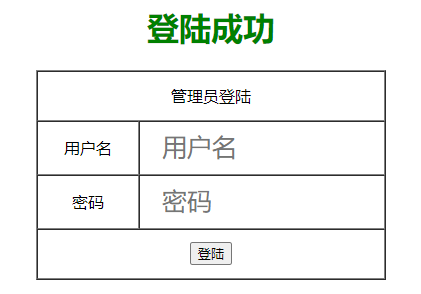


## 配置用户SESSION验证
```php
session_start(); //开始记录会话
```
修改登陆页面代码，让登陆成功之后在cookie中添加一个记录
```php
<?php
    include_once('init.php');
    if (isset($_POST['username']) and isset($_POST['password'])) {
        $username = filterstr($_POST['username']);
        $password = md5($_POST['password']);
        $result = $conn->query("select * from users where username='$username' and password='$password'");
        if ($result->num_rows > 0) {
            $row = $result->fetch_assoc();
            if ($row['password'] == $password) {
                echo "<center><h1 style='color:green;'>登陆成功</h1></center>";
                $_SESSION['username'] = $row['username'];
            }
        } else {
            echo "<center><h1 style='color:red;'>登陆失败</h1></center>";
        }
    }
?>
```
创建一个main.php用于测试
```php
<?php
include_once 'init.php';

if(isset($_SESSION['username'])){
    echo $_SESSION['username'];
}else{
    echo '验证失败';
}
?>
```
修改php.ini文件，配置session保存的路径，修改php.ini之后需要重启apache使之生效

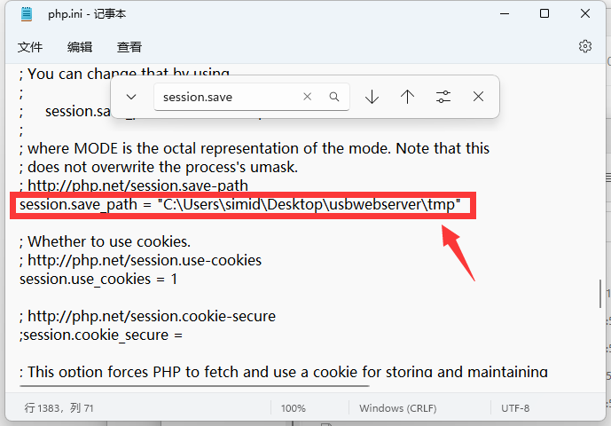

登陆之前访问main.php

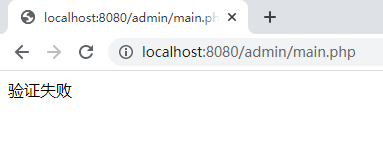

在login.php之处登陆之后访问main.php

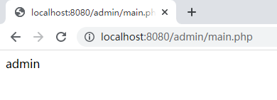

可以看到在服务器端的tmp目录中已经存在session

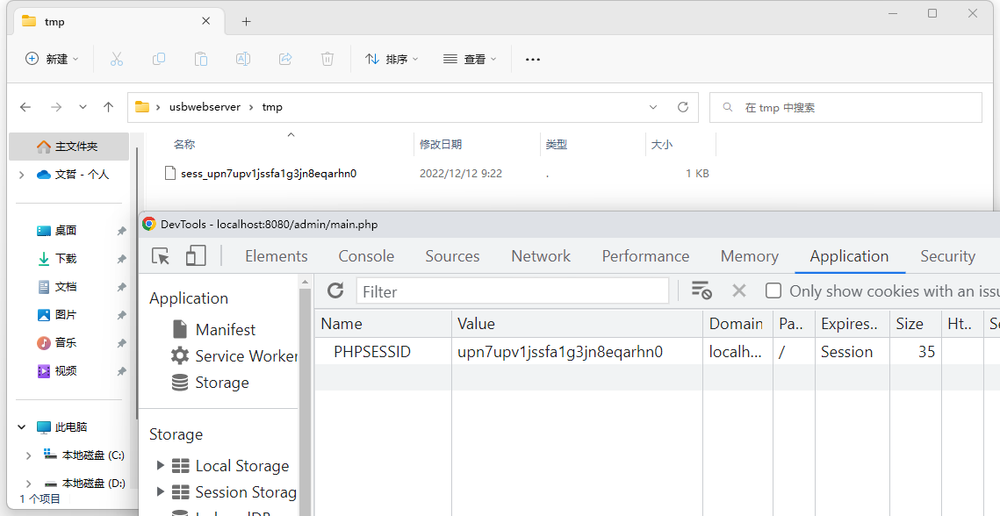

## 配置前台JS验证
```javascript
<form method="POST" onsubmit="return check(this)">
//在form标签中添加检测的函数

<script>
    function check(form){
        var username = form.username.value;
        if(username.length == 0) {
            alert('用户名不能为空');
            form.username.focus();
            return false;
        }
        var password = form.password.value;
        if(password.length == 0) {
            alert('密码不能为空');
            form.password.focus();
            return false;
        }
        return true;
    }
</script>

//在php代码中给登陆成功添加一个跳转到main.php的方法
if ($row['password'] == $password) {
  echo "<center><h1 style='color:green;'>登陆成功</h1></center>";
  $_SESSION['username'] = $row['username'];
  header('Location: main.php');
  $conn->close();
}
```
## 套用前端模版
前端模版下载：[https://pan.baidu.com/s/1WUzcDURS_iWiQXzlXKrQvA?pwd=6666](https://pan.baidu.com/s/1WUzcDURS_iWiQXzlXKrQvA?pwd=6666)
全部解压到admin目录下
首先修改login.php，把功能和界面都移植过来

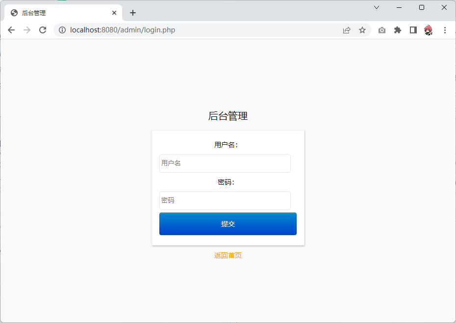
准备main.php，界面使用index.html的html代码，并且可以做适当的精简，然后界面如下

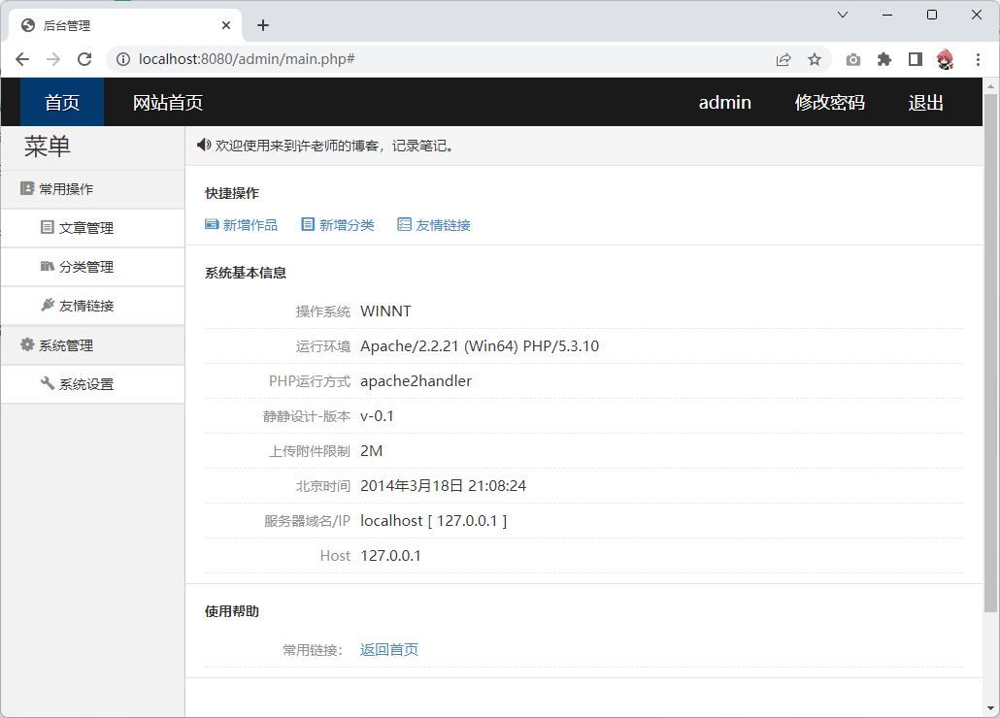

## 文章添加界面
在admin文件夹中创建article_add.php，并且添加如下代码
```php
<?php
include_once 'init.php';

if (isset($_SESSION['username'])) {
    $username = $_SESSION['username'];
} else {
    header("location: login.php");
}

if (isset($_POST['submit'])) {
    $title = filterstr($_POST['title']);
    $author = filterstr($_POST['author']);
    $keywords = filterstr($_POST['keywords']);
    $content = filterstr($_POST['content']);
    $ctime = time();

    $result = $conn->query("insert into article(title,content,author,keyword,c_time) value('$title', '$content', '$author', '$keywords', $ctime)");
    if ($result) {
        echo "<script>alert('内容添加成功!')</script>";
    } else {
        echo "<script>alert('内容添加失败!')</script>";
    }
}
?>

<!doctype html>
<html>

<head>
    <meta charset="UTF-8" />
    <title>后台管理</title>
    <link rel="stylesheet" type="text/css" href="css/common.css" />
    <link rel="stylesheet" type="text/css" href="css/main.css" />
</head>

<body>
    <div class="topbar-wrap white">
        <div class="topbar-inner clearfix">
            <div class="topbar-logo-wrap clearfix">
                <h1 class="topbar-logo none"><a href="index.html" class="navbar-brand">后台管理</a></h1>
                <ul class="navbar-list clearfix">
                    <li><a class="on" href="index.html">首页</a></li>
                    <li><a href="#" target="_blank">网站首页</a></li>
                </ul>
            </div>
            <div class="top-info-wrap">
                <ul class="top-info-list clearfix">
                    <li><a href="#">
                            <?php echo $username ?>
                        </a></li>
                    <li><a href="#">修改密码</a></li>
                    <li><a href="#">退出</a></li>
                </ul>
            </div>
        </div>
    </div>
    <div class="container clearfix">
        <div class="sidebar-wrap">
            <div class="sidebar-title">
                <h1>菜单</h1>
            </div>
            <div class="sidebar-content">
                <ul class="sidebar-list">
                    <li>
                        <a href="#"><i class="icon-font">&#xe003;</i>常用操作</a>
                        <ul class="sub-menu">
                            <li><a href="design.html"><i class="icon-font">&#xe005;</i>文章管理</a></li>
                            <li><a href="design.html"><i class="icon-font">&#xe006;</i>分类管理</a></li>
                            <li><a href="design.html"><i class="icon-font">&#xe052;</i>友情链接</a></li>
                        </ul>
                    </li>
                    <li>
                        <a href="#"><i class="icon-font">&#xe018;</i>系统管理</a>
                        <ul class="sub-menu">
                            <li><a href="system.html"><i class="icon-font">&#xe017;</i>系统设置</a></li>
                        </ul>
                    </li>
                </ul>
            </div>
        </div>
        <!--/sidebar-->
        <div class="main-wrap">

            <div class="crumb-wrap">
                <div class="crumb-list"><i class="icon-font"></i><a href="/jscss/admin/design/">首页</a><span
                        class="crumb-step">&gt;</span><a class="crumb-name" href="/jscss/admin/design/">作品管理</a><span
                        class="crumb-step">&gt;</span><span>新增作品</span></div>
            </div>
            <div class="result-wrap">
                <div class="result-content">
                    <form action="" method="post" id="myform" name="myform" enctype="multipart/form-data">
                        <table class="insert-tab" width="100%">
                            <tbody>
                                <tr>
                                    <th width="120"><i class="require-red">*</i>分类：</th>
                                    <td>
                                        <select name="colId" id="catid" class="required">
                                            <option value="">请选择</option>
                                            <option value="19">精品界面</option>
                                            <option value="20">推荐界面</option>
                                        </select>
                                    </td>
                                </tr>
                                <tr>
                                    <th><i class="require-red">*</i>标题：</th>
                                    <td>
                                        <input class="common-text required" id="title" name="title" size="50" value=""
                                            type="text">
                                    </td>
                                </tr>
                                <tr>
                                    <th>作者：</th>
                                    <td><input class="common-text" name="author" size="50" value="admin" type="text">
                                    </td>
                                </tr>
                                <tr>
                                    <th>关键字：</th>
                                    <td><input class="common-text" name="keywords" size="50" value="IT技术" type="text">
                                    </td>
                                </tr>
                                <tr>
                                    <th>内容：</th>
                                    <td><textarea name="content" class="common-textarea" id="content" cols="30"
                                            style="width: 98%;" rows="10"></textarea></td>
                                </tr>
                                <tr>
                                    <th></th>
                                    <td>
                                        <input class="btn btn-primary btn6 mr10" value="提交" name="submit" type="submit">
                                        <input class="btn btn6" onClick="history.go(-1)" value="返回" type="button">
                                    </td>
                                </tr>
                            </tbody>
                        </table>
                    </form>
                </div>
            </div>

        </div>
        <!--/main-->
    </div>
</body>

</html>
```
添加文章内容进行测试

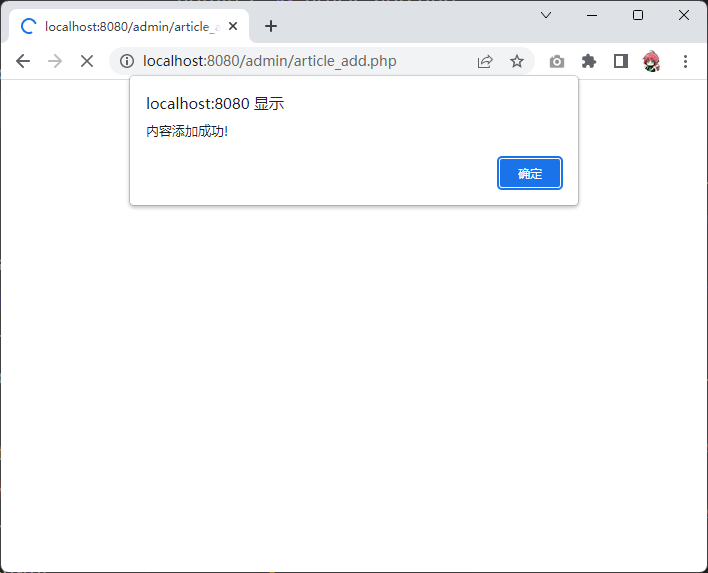

### 富文本编辑器添加
下载富文本编辑器源码：[https://pan.baidu.com/s/1fxUEFU1JgAX0EvVugXxqzg?pwd=6666](https://pan.baidu.com/s/1fxUEFU1JgAX0EvVugXxqzg?pwd=6666)
将ueditor代码文件夹解压到admin目录下，然后在article_add.php中添加如下代码
```javascript
    <script src="ueditor/ueditor.config.js"></script>
    <script src="ueditor/ueditor.all.min.js"></script>
    <script src="ueditor/lang/zh-cn/zh-cn.js"></script>
    <script type="text/javascript" charset="utf-8">
        window.UEDITOR_HOME_URL = "/ueditor/"; //配置路径设定为UEditor所放的位置
        window.onload=function(){
            // window.UEDITOR_CONFIG.initalFrameHeight=600;
            // window.UEDITOR_CONFIG.initalFrameWidth=1200;
            var editor = new UE.ui.Editor({
                imageUrl : '',
                fileUrl : '',
                imagePath : '',
                filePath : '',
                imageManagerUrl : '',
                imageManagerPath : ''
            });
            editor.render("content"); //此处的id要和textarea标签的id对应
        }
    </script>
```


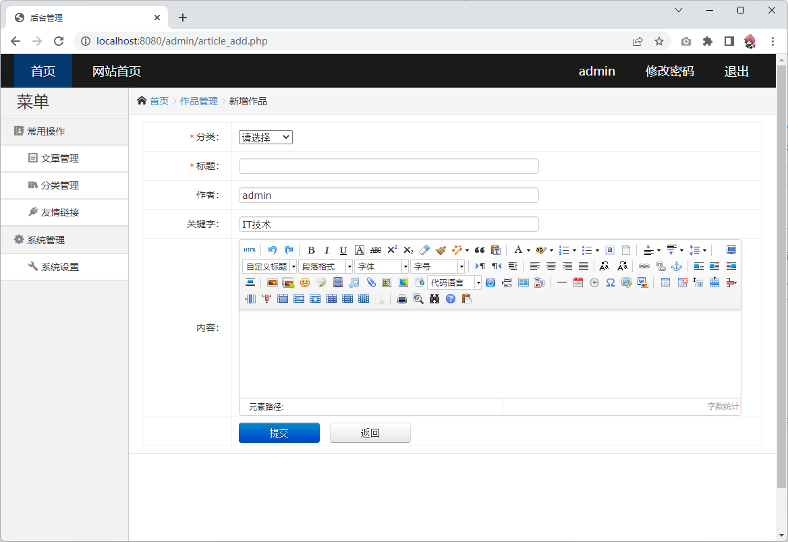

## 分类功能
在article_add.php的分类选项代码改成如下
```php
<th width="120"><i class="require-red">*</i>分类：</th>
<td>
    <select name="colId" id="catid" class="required">
        <option value="">请选择</option>
        <?php
        $cate_result = $conn->query("select * from cate");
        while($row = $cate_result->fetch_assoc()){
            $id = $row['id'];
            $class_name = $row['class_name'];
            echo "<option value='$id'>$class_name</option>";
        }
        ?>
    </select>
</td>
```
在数据库中添加部分分类做测试

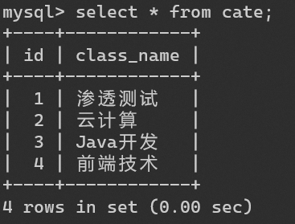

查看页面中的最终效果

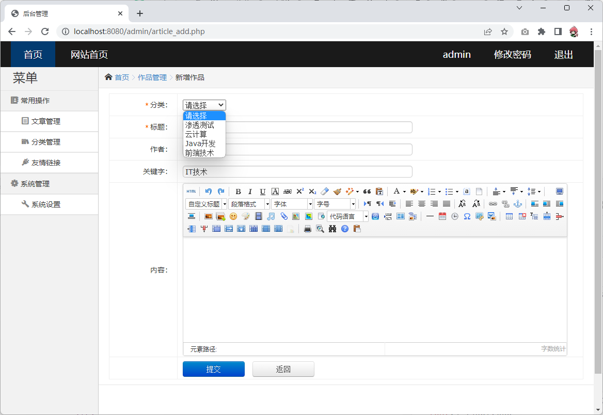

修改添加文章的代码，加入分类的id到数据库中

```php
$catid = filterstr($_POST['colId']);
$result = $conn->query("insert into article(title,catid,content,author,keyword,c_time) value('$title', $catid, '$content', '$author', '$keywords', $ctime)");
```
添加文章进行测试，在数据库中验证cateid正确添加

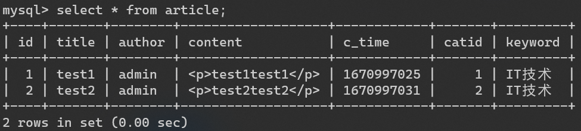

## 文章栏目
新建article_list.php，并且复制design.html中的内容过来，并且进行修改

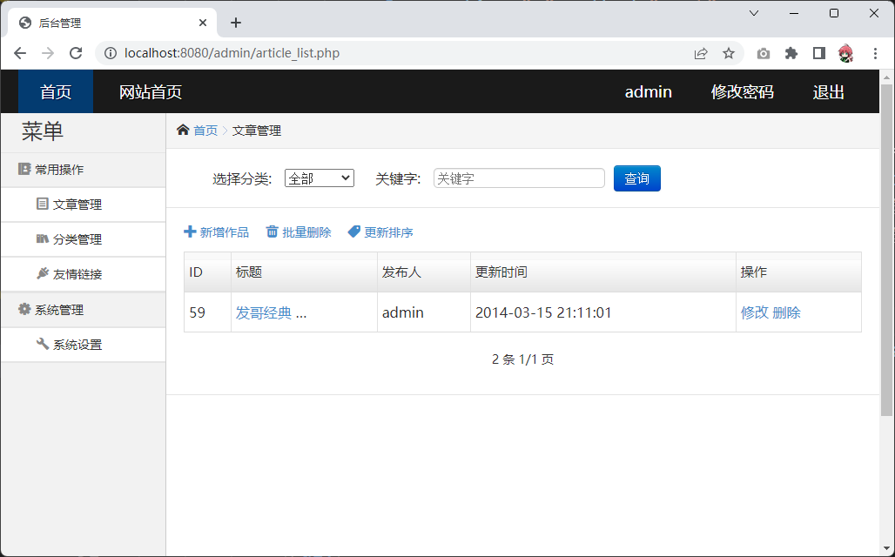

从数据库中读取对应的数据

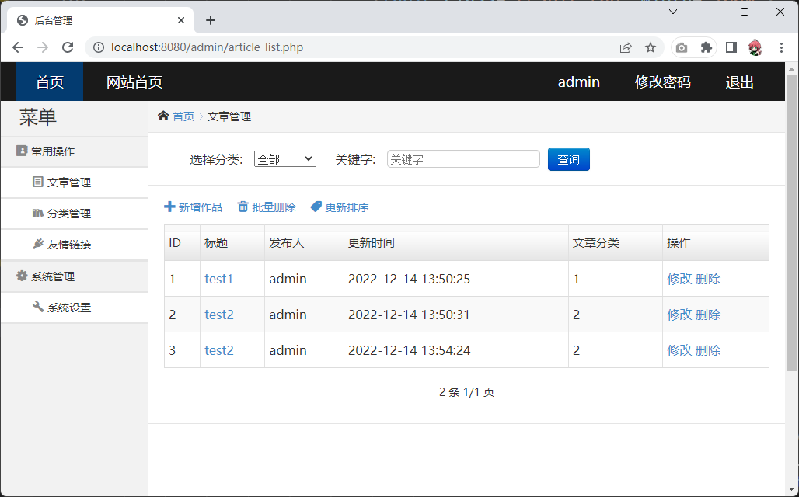

```php
<?php
$result = $conn->query("select * from article");
while($row=$result->fetch_assoc()){
?>
<tr>
    <td><?php echo $row['id'] ?></td>
    <td title="<?php echo $row['title'] ?>"><a target="_blank" href="#"><?php echo $row['title'] ?></a>
    </td>
    <td><?php echo $row['author'] ?></td>
    <td><?php echo date('Y-m-d H:i:s',$row['c_time']) ?></td>
    <td><?php echo $row['catid'] ?></td>
    <td>
        <a class="link-update" href="#">修改</a>
        <a class="link-del" href="#">删除</a>
    </td>
</tr>
<?php } ?>
```
### 文章修改功能
将修改的超链接改为
```php
article_edit.php?id=<?php echo $row['id'] ?>
```
复制article_add.php为article_edit.php文件，并且使用如下代码获取文章内容
```php
$id = filterstr($_GET['id']);
$result=$conn->query("select * from article where id='$id'");
$row = $result->fetch_assoc();
```
在对应的input标签中修改value值，其中分类改成如下代码
```php
 <tr>
  <th width="120"><i class="require-red">*</i>分类：</th>
  <td>
      <select name="colId" id="catid" class="required">
          <option value="">请选择</option>
          <?php
          $cate_result = $conn->query("select * from cate");
          while($rows = $cate_result->fetch_assoc()){
              $id = $rows['id'];
              $class_name = $rows['class_name'];
              if($id == $row['catid']){
                  echo "<option selected value='$id'>$class_name</option>";
              }else{
                  echo "<option value='$id'>$class_name</option>";
              }
          }
          ?>
      </select>
  </td>
</tr>
```
查看点击修改后效果如下

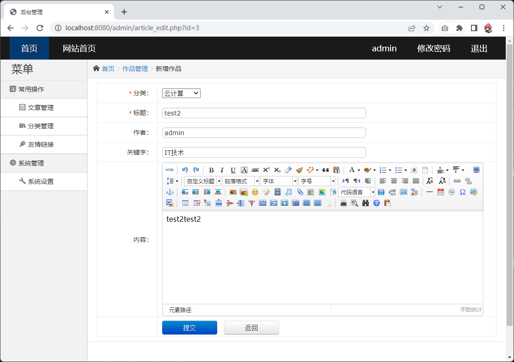

修改article_edit.php代码，能够更新文章

```php
if (isset($_POST['submit'])) {
    $title = filterstr($_POST['title']);
    $author = filterstr($_POST['author']);
    $keywords = filterstr($_POST['keywords']);
    $content = filterstr($_POST['content']);
    $ctime = time();
    $catid = filterstr($_POST['colId']);

    $result = $conn->query("update article set title='$title', catid=$catid, content='$content', author='$author', keyword='$keywords', c_time=$ctime where id=$id");
    if ($result) {
        echo "<script>alert('内容修改成功!')</script>";
    } else {
        echo "<script>alert('内容修改失败!')</script>";
    }
}
```
### 删除文章功能
在article_list.php中添加如下代码
```php
if(isset($_GET['action']) && $_GET['action'] == 'del') {
    $id = filterstr($_GET['id']);
    $result = $conn->query("delete from article where id='$id'");
    if($result){
        echo "<script>alert('删除成功')</script>";
    }else{
        echo "<script>alert('删除失败')</script>";
    }
}
```
并且添加好确认的逻辑代码
```javascript
<script>
    function del(id){
        if(false == confirm("是否确定删除当前文章？")) return;
        location.href='?action=del&id=' + id;
    }
</script>

//将删除超链接改成
javascript:del(<?php echo $row['id'] ?>)
```
### 显示文章分类
修改article_list.php中查询文章的sql语句如下
```sql
select a.id,a.title,a.author,a.c_time,b.class_name from article as a left join cate as b on a.catid=b.id order by a.id desc
```
文件分类处改成
```php
<?php echo $row['class_name'] ?>
```
查看显示情况

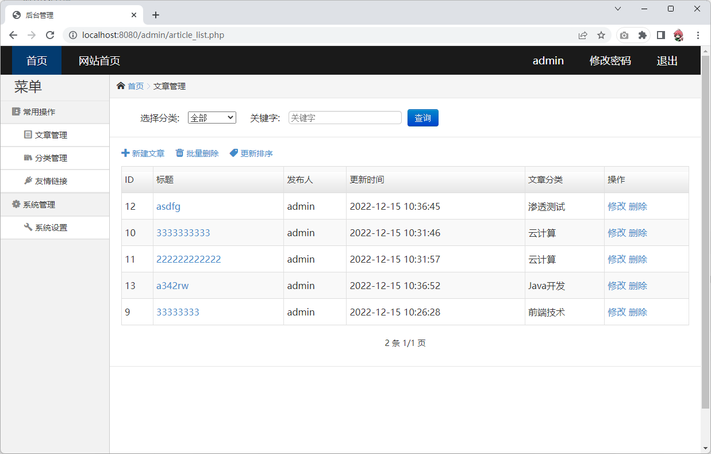


## 编写跳转页面
在function.php中添加如下代码
```php
function redirect($ms='', $url='', $text=''){
    echo <<<EOT
<meta http-quiv="refresh" content=$ms;URL=$url>
<div align="center">
    <h1>页面操作提示：$text</h1>
    <a href="$url">本页面在$ms 秒后自动跳转，如果您的浏览器没有跳转，点此链接返回。</a>
</div>
EOT;
}
```
然后在需要进行跳转的地方使用此函数进行跳转
## 编写分页功能
下载分页类文件：[https://pan.baidu.com/s/114iEhrHdoXX7KHYOqCt76w?pwd=6666](https://pan.baidu.com/s/114iEhrHdoXX7KHYOqCt76w?pwd=6666)
将Page.class.php文件放到common目录下
编辑article_list.php文件，在开始的php代码块处获取如下变量
```php
$page = isset($_GET['page']) ? $_GET['page'] : 1;
$subPages = 8;
```
编辑article_list.php文件，在显示页码处改成如下代码
```php
<div class="list-page">
    <?php
    $result = $conn->query("select * from article");
    $result_count = $result->num_rows;
    $p = new Page($result_count, 4, $page,$subPages);
    echo $p->showPages();
    ?>
</div>
```
编辑article_list.php文件，在获取文章列表的sql语句后做如下修改
```sql
"select a.id,a.title,a.author,a.c_time,b.class_name from article as a,cate as b where a.catid=b.id order by a.id limit " . ($page-1)*8 . ",$subPages"
```
## 系统设置功能
首先将config表修改成如下结构

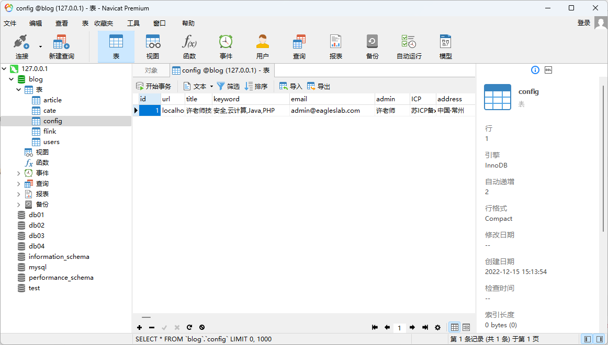

编写system.php代码

```php
<?php
include_once 'init.php';
include_once 'header.php';
$username = sess();

$result = $conn->query("select * from config");
$row = $result->fetch_assoc();

if(isset($_POST['submit'])){
    $url = filterstr($_POST['url']);
    $title = filterstr($_POST['title']);
    $keyword = filterstr($_POST['keyword']);
    $email = filterstr($_POST['email']);
    $admin = filterstr($_POST['admin']);
    $icp = filterstr($_POST['icp']);
    $address = filterstr($_POST['address']);
    $result = $conn->query("update config set url='$url', title='$title', keyword='$keyword', email='$email', admin='$admin', icp='$icp', address='$address'");
    if($result){
        redirect("1","system.php","内容修改成功");
    }else{
        redirect("1","system.php","内容修改失败");
    }
}
?>

<!doctype html>
<html>

<head>
    <meta charset="UTF-8" />
    <title>后台管理</title>
    <link rel="stylesheet" type="text/css" href="css/common.css" />
    <link rel="stylesheet" type="text/css" href="css/main.css" />
</head>

<body>
    <div class="topbar-wrap white">
        <div class="topbar-inner clearfix">
            <div class="topbar-logo-wrap clearfix">
                <h1 class="topbar-logo none"><a href="index.html" class="navbar-brand">后台管理</a></h1>
                <ul class="navbar-list clearfix">
                    <li><a class="on" href="index.html">首页</a></li>
                    <li><a href="#" target="_blank">网站首页</a></li>
                </ul>
            </div>
            <div class="top-info-wrap">
                <ul class="top-info-list clearfix">
                    <li><a href="#">管理员</a></li>
                    <li><a href="#">修改密码</a></li>
                    <li><a href="#">退出</a></li>
                </ul>
            </div>
        </div>
    </div>
    <div class="container clearfix">
        <div class="sidebar-wrap">
            <div class="sidebar-title">
                <h1>菜单</h1>
            </div>
            <div class="sidebar-content">
                <ul class="sidebar-list">
                    <li>
                        <a href="main.php"><i class="icon-font">&#xe003;</i>常用操作</a>
                        <ul class="sub-menu">
                            <li><a href="article_list.php"><i class="icon-font">&#xe005;</i>文章管理</a></li>
                            <li><a href="cate_list.php"><i class="icon-font">&#xe006;</i>分类管理</a></li>
                            <li><a href="design.html"><i class="icon-font">&#xe052;</i>友情链接</a></li>
                        </ul>
                    </li>
                    <li>
                        <a href="#"><i class="icon-font">&#xe018;</i>系统管理</a>
                        <ul class="sub-menu">
                            <li><a href="system.php"><i class="icon-font">&#xe017;</i>系统设置</a></li>
                        </ul>
                    </li>
                </ul>
            </div>
        </div>
        <!--/sidebar-->
        <div class="main-wrap">
            <div class="crumb-wrap">
                <div class="crumb-list"><i class="icon-font"></i><a href="index.html">首页</a><span
                        class="crumb-step">&gt;</span><span class="crumb-name">系统设置</span></div>
            </div>
            <div class="result-wrap">
                <form method="post" id="myform" name="myform">
                    <div class="config-items">
                        <div class="config-title">
                            <h1><i class="icon-font">&#xe00a;</i>网站信息设置</h1>
                        </div>
                        <div class="result-content">
                            <table width="100%" class="insert-tab">
                                <tbody>
                                    <tr>
                                        <th width="15%"><i class="require-red">*</i>域名：</th>
                                        <td><input type="text" id="" value="<?php echo $row['url']; ?>" size="85" name="url"
                                                class="common-text"></td>
                                    </tr>
                                    <tr>
                                        <th><i class="require-red">*</i>站点标题：</th>
                                        <td><input type="text" id="" value="<?php echo $row['title']; ?>" size="85" name="title"
                                                class="common-text"></td>
                                    </tr>
                                    <tr>
                                        <th><i class="require-red">*</i>关键字：</th>
                                        <td><input type="text" id=""
                                                value="<?php echo $row['keyword']; ?>"
                                                size="85" name="keyword" class="common-text"></td>
                                    </tr>
                                    <tr>
                                        <th></th>
                                        <td>
                                            <input type="submit" name='submit' value="提交" class="btn btn-primary btn6 mr10">
                                            <input type="button" value="返回" onClick="history.go(-1)" class="btn btn6">
                                        </td>
                                    </tr>
                                </tbody>
                            </table>
                        </div>
                    </div>
                    <div class="config-items">
                        <div class="config-title">
                            <h1><i class="icon-font">&#xe014;</i>站长信息设置</h1>
                        </div>
                        <div class="result-content">
                            <table width="100%" class="insert-tab">
                                <tr>
                                    <th width="15%"><i class="require-red">*</i>网站联系邮箱：</th>
                                    <td><input type="text" id="" value="<?php echo $row['email']; ?>" size="85" name="email"
                                            class="common-text"></td>
                                </tr>
                                <tr>
                                    <th><i class="require-red">*</i>管理员：</th>
                                    <td><input type="text" id="" value="<?php echo $row['admin']; ?>" size="85" name="admin"
                                            class="common-text"></td>
                                </tr>
                                <tr>
                                    <th><i class="require-red">*</i>备案ICP：</th>
                                    <td><input type="text" id="" value="<?php echo $row['ICP']; ?>" size="85" name="icp" class="common-text">
                                    </td>
                                </tr>
                                <tr>
                                    <th><i class="require-red">*</i>地址：</th>
                                    <td><input type="text" id="" value="<?php echo $row['address']; ?>" size="85" name="address"
                                            class="common-text"></td>
                                </tr>
                                <tr>
                                    <th></th>
                                    <td>
                                        <input type="hidden" value="siteConf.inc.php" name="file">
                                        <input type="submit" value="提交" name='submit' class="btn btn-primary btn6 mr10">
                                        <input type="button" value="返回" onClick="history.go(-1)" class="btn btn6">
                                    </td>
                                </tr>
                            </table>
                        </div>
                    </div>
                </form>
            </div>
        </div>
        <!--/main-->
    </div>
</body>

</html>
```
最终的效果

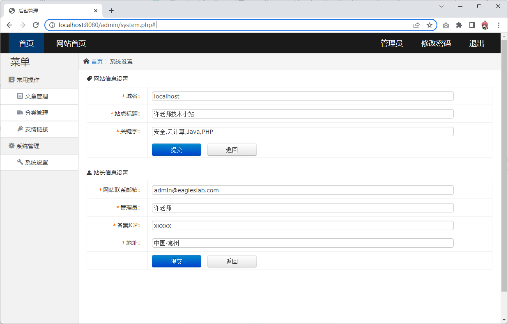


## 后台剩下的步骤

依次完成如下功能模块

- cate_list.php
- cate_add.php
- cate_edit.php
- flink_list.php
- flink_add.php
- flink_edit.php
- change_pwd.php

并且优化细节
## 退出功能
在config.php中加入如下代码
```php
if(isset($_GET['logout'])){
    session_destroy();
    redirect('2','login.php','退出登陆成功！');
}
```
然后将所有退出的超链接改为
```html
?logout
```
## 显示系统信息
首先打印系统变量，查看需要的信息
```php
print_r($_SERVER);

//显示结果如下
Array
(
    [HTTP_HOST] => localhost:8080
    [HTTP_CONNECTION] => keep-alive
    [HTTP_SEC_CH_UA] => "Google Chrome";v="107", "Chromium";v="107", "Not=A?Brand";v="24"
    [HTTP_SEC_CH_UA_MOBILE] => ?0
    [HTTP_SEC_CH_UA_PLATFORM] => "Windows"
    [HTTP_UPGRADE_INSECURE_REQUESTS] => 1
    [HTTP_USER_AGENT] => Mozilla/5.0 (Windows NT 10.0; Win64; x64) AppleWebKit/537.36 (KHTML, like Gecko) Chrome/107.0.0.0 Safari/537.36
    [HTTP_ACCEPT] => text/html,application/xhtml+xml,application/xml;q=0.9,image/avif,image/webp,image/apng,*/*;q=0.8,application/signed-exchange;v=b3;q=0.9
    [HTTP_SEC_FETCH_SITE] => none
    [HTTP_SEC_FETCH_MODE] => navigate
    [HTTP_SEC_FETCH_USER] => ?1
    [HTTP_SEC_FETCH_DEST] => document
    [HTTP_ACCEPT_ENCODING] => gzip, deflate, br
    [HTTP_ACCEPT_LANGUAGE] => zh-CN,zh;q=0.9,zh-TW;q=0.8
    [HTTP_COOKIE] => PHPSESSID=349e6574s902hllac20hh563s2
    [PATH] => C:\Program Files (x86)\VMware\VMware Workstation\bin\;C:\Windows\system32;C:\Windows;C:\Windows\System32\Wbem;C:\Windows\System32\WindowsPowerShell\v1.0\;C:\Windows\System32\OpenSSH\;C:\Program Files\Microsoft VS Code\bin;C:\Program Files (x86)\NVIDIA Corporation\PhysX\Common;C:\Program Files\NVIDIA Corporation\NVIDIA NvDLISR;C:\Users\simid\AppData\Local\Microsoft\WindowsApps;
    [SystemRoot] => C:\Windows
    [COMSPEC] => C:\Windows\system32\cmd.exe
    [PATHEXT] => .COM;.EXE;.BAT;.CMD;.VBS;.VBE;.JS;.JSE;.WSF;.WSH;.MSC
    [WINDIR] => C:\Windows
    [SERVER_SIGNATURE] => 
    [SERVER_SOFTWARE] => Apache/2.4.6 (Win32) PHP/5.4.17
    [SERVER_NAME] => localhost
    [SERVER_ADDR] => ::1
    [SERVER_PORT] => 8080
    [REMOTE_ADDR] => ::1
    [DOCUMENT_ROOT] => C:/Users/simid/Desktop/usbwebserver/root
    [REQUEST_SCHEME] => http
    [CONTEXT_PREFIX] => 
    [CONTEXT_DOCUMENT_ROOT] => C:/Users/simid/Desktop/usbwebserver/root
    [SERVER_ADMIN] => mail@localhost
    [SCRIPT_FILENAME] => C:/Users/simid/Desktop/usbwebserver/root/admin/main.php
    [REMOTE_PORT] => 6751
    [GATEWAY_INTERFACE] => CGI/1.1
    [SERVER_PROTOCOL] => HTTP/1.1
    [REQUEST_METHOD] => GET
    [QUERY_STRING] => 
    [REQUEST_URI] => /admin/main.php
    [SCRIPT_NAME] => /admin/main.php
    [PHP_SELF] => /admin/main.php
    [REQUEST_TIME_FLOAT] => 1671169877.04
    [REQUEST_TIME] => 1671169877
)
```
挑选需要的信息内容填入对应的位置，最终效果和代码

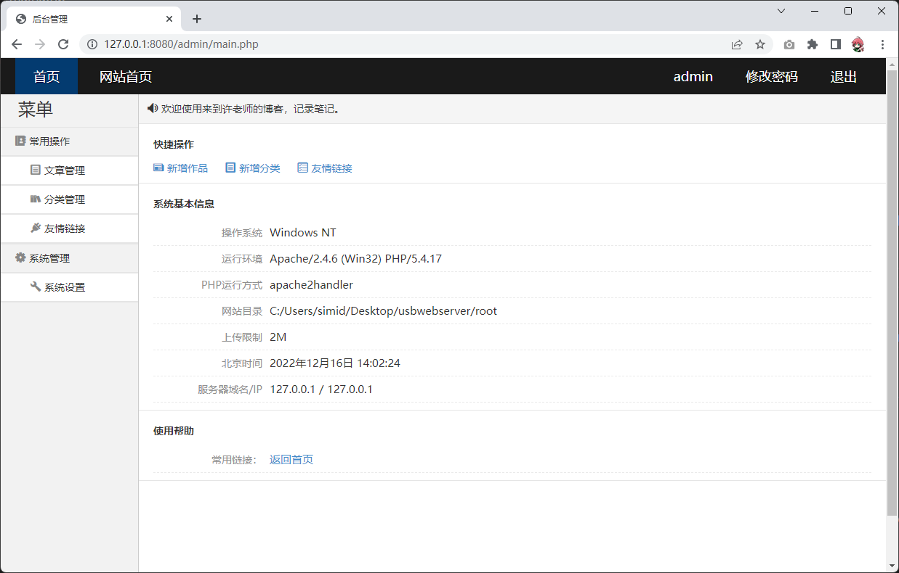


```html
<ul class="sys-info-list">
    <li>
        <label class="res-lab">操作系统</label><span class="res-info"><?php echo php_uname('s');?></span>
    </li>
    <li>
        <label class="res-lab">运行环境</label><span class="res-info"><?php echo $_SERVER['SERVER_SOFTWARE'];?></span>
    </li>
    <li>
        <label class="res-lab">PHP运行方式</label><span class="res-info"><?php echo php_sapi_name();?></span>
    </li>
    <li>
        <label class="res-lab">网站目录</label><span class="res-info"><?php echo $_SERVER['DOCUMENT_ROOT'];?></span>
    </li>
    <li>
        <label class="res-lab">上传限制</label><span class="res-info"><?php echo ini_get('upload_max_filesize');?></span>
    </li>
    <li>
        <label class="res-lab">北京时间</label><span class="res-info"><?php echo date('Y年m月d日 H:i:s', $_SERVER['REQUEST_TIME']) ?></span>
    </li>
    <li>
        <label class="res-lab">服务器域名/IP</label><span class="res-info"><?php echo $_SERVER['SERVER_NAME'] . " / " . $_SERVER['SERVER_ADDR'];?></span>
    </li>
</ul>
```
## 导入前端代码
前端代码示例下载地址：[https://pan.baidu.com/s/1dqmwUdXR77MyWiyhCIySkQ?pwd=6666](https://pan.baidu.com/s/1dqmwUdXR77MyWiyhCIySkQ?pwd=6666)


获取博客系统信息

```php
$result = $conn->query("select * from config");
$web = $result->fetch_assoc()

//下面在需要的地方进行替换，比如标题
<title>
    <?php echo $web['title'] ?>
</title>
```
修改分类
```php
<ul class="navbar-nav flex-column text-center">
    <li class="nav-item active">
        <a class="nav-link" href="index.html">首页</a>
    </li>
    <?php 
    $result = $conn->query("select * from cate");
    while($cate = $result->fetch_assoc()){

    ?>
    <li class="nav-item">
        <a class="nav-link" href="post.php?id=<?php echo $cate['id'];?>">
            <?php echo $cate['class_name'];?>
        </a>
    </li>
    <?php }?>
    <li class="nav-item">
        <a class="nav-link" href="about.html">关于我</a>
    </li>
</ul>
```
修改文章列表
```php
<?php
$result = $conn->query("select a.id,a.title,a.content,a.author,a.c_time,b.class_name from article as a left join cate as b on a.catid=b.id order by a.id desc");
while ($row = $result->fetch_assoc()) {
?>
<article class="lyear-arc">
    <div class="arc-header">
        <h2 class="arc-title"><a href="post.php?id=<?php echo $row['id']; ?>"><?php echo $row['title'];?></a></h2>
        <ul class="arc-meta">
            <li><i class="mdi mdi-calendar"></i><?php echo date('Y-m-d H:i:s', $row['c_time']) ?></li>
            <li><i class="mdi mdi-tag-text-outline"></i> <a href="#"><?php echo $row['class_name'];?></a>
            </li>
            <li><i class="mdi mdi-comment-multiple-outline"></i> <a href="#">3 评论</a></li>
        </ul>
    </div>

    <div class="arc-synopsis">
        <?php echo $row['content'] ?>
    </div>
</article>
<?php }?>
```


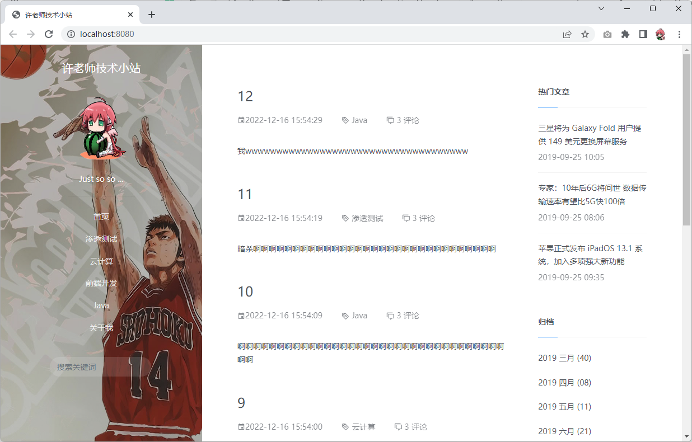

分页功能

```php
$page = isset($_GET['page']) ? $_GET['page'] : 1;
$subPages = 8;

//将文章查询的sql语句修改成如下
"select a.id,a.title,a.author,a.c_time,b.class_name from article as a left join cate as b on a.catid=b.id order by a.id desc limit " . ($page-1)*8 . ",$subPages"

//页码显示的代码
<div class="list-page">
    <?php
    $result = $conn->query("select * from article");
    $result_count = $result->num_rows;
    $p = new Page($result_count, 4, $page,$subPages);
    echo $p->showPages();
    ?>
</div>
```
## 文章显示页面
```php
<?php
include_once("init.php");
include_once("header.php");
if(isset($_GET['id'])){
    $id = filterstr($_GET['id']);
    $result = $conn->query("select a.id,a.content,a.title,a.author,a.c_time,b.class_name from article as a left join cate as b on a.catid=b.id where a.id=$id");
    $row = $result->fetch_assoc();
}else{
    redirect('2', 'index.php', '该页面不存在');
    die("404 not find");
}
?>

//之后在每个需要替换的地方使用$row['xxx']
```


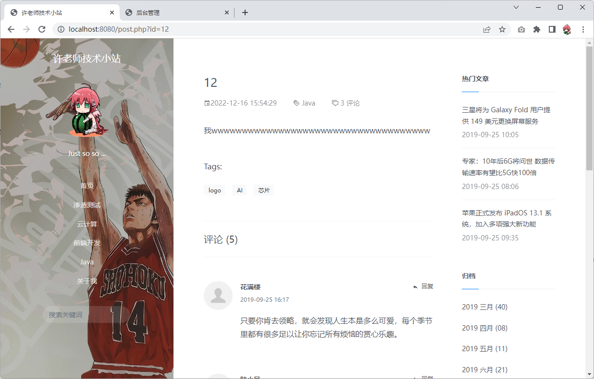

评论功能同学们自己练习完成

## 前端分类功能
写一个cate.php文件，实现分类文章显示

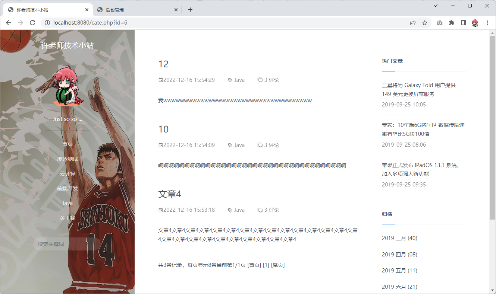


## 热门文章

可以在数据库中追加每篇文章的阅读数功能，然后排列出热度靠前的文章

